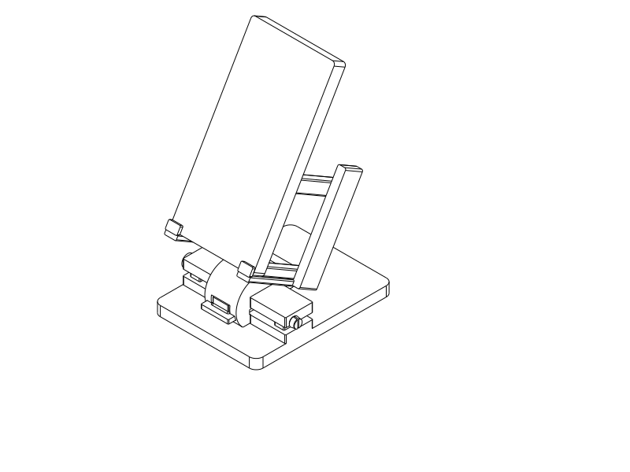
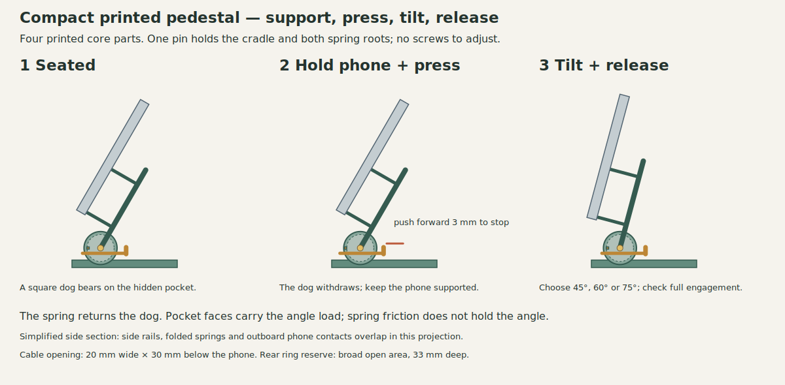

# Compact Fully Printed Phone Stand — Revision 3 (V3)

A compact `105 × 140 mm` fully 3D-printed pedestal phone stand (`4` core PETG parts assembled with a single printed split-tail pin, plus optional TPU feet) featuring an open fork cradle and a concealed three-angle (`45°`, `60°`, `75°`) spring-returned dog lock.



---

## At a Glance: Current Status & What to Do Next

- **Current Status:** **UNPRINTED PROTOTYPE (`Unknown` physical status)**
  - `V3` replaces `V1` (rejected before printing for exposed gears) and `V2` (rejected before printing for an oversized `224 × 246 mm` footprint).
  - CAD fit/motion checks, conditional solid-PETG FEA (fork deflection reduced to `0.904 mm`; deformable dog-lock contact checked), MyoArm rear-button reach screening, and reference OrcaSlicer smoke review are **complete**.
- **What to Do Next (If You Want to Test It):**
  - **Print the 4-part PETG core:** [`phone_stand_v3.step`](phone_stand_v3.step) · [`phone_stand_v3.stl`](phone_stand_v3.stl) · [Python source](phone_stand_v3.py)
  - **Optional TPU feet:** [`phone_stand_v3_feet.step`](phone_stand_v3_feet.step) · [`phone_stand_v3_feet.stl`](phone_stand_v3_feet.stl)
  - **Required Slicer Settings:** PETG, `0.4 mm` nozzle, `0.2 mm` layers, **4 wall loops and 100% infill** (`~436 g` with supports, `~11 h` on Qidi Q2C; `373 g` solid part mass is required for tipping stability and fork stiffness—do not print at `7%` infill), **supports ON** (clear support material from the internal slider/root channels and under the cradle pads before assembly).
  - **What NOT to do:** Do not print `V1` or `V2` (superseded), and do not run further FEA or MyoArm reach searches before a physical print trial.

---

## How V3 Assembles & Operates



- **Views:** [Adjustment mechanism SVG](renders/concepts/v3_adjustment.svg) · [Side view](renders/assembled/v3/inspect_v3_right.png) · [Landscape view](renders/assembled/v3/inspect_v3_landscape_isometric.png)
- **Target phone & accessory clearance (`fit, cable and ring space`):**
  - Designed around a Pixel 7 Pro in a bulky case (`13 mm` thick, `85 × 170 mm`, `0.30 kg`) in both **portrait and landscape**.
  - **Charging cable gap:** Split lower ledges leave a `20 × 30 × 18 mm` central plug/cable passage (`63–74 mm` above the desk).
  - **Rear ring / camera clearance:** Open fork reserves `33 mm` depth behind the phone (`60 × 115 mm` portrait, `170 × 50 mm` landscape) so a `30 mm` rear hanging ring or camera bar sits completely clear of the outboard support pads.
- **One-pin assembly (no screws or glue):**
  1. Remove supports carefully from the base's rear slider/root channels and beneath the cradle pads ([support locations preview](notes/v3_support_review.png)).
  2. Slide the spring-slider into the base from the rear, position the fork cradle inside the base hood, and push the printed `8 mm` pin (`8.3 mm` bore) through the base, spring roots, slider slots, and cradle until its split tail snaps into capture.
- **Adjusting the angle (`45°`, `60°`, `75°`):**
  - Support the phone/cradle with one hand to unload the lock tooth, press the rear button forward (`3 mm` stroke), tilt to the desired angle, and release so the folded PETG springs return the dog into the pocket.

---

## Summary of Engineering Improvements in V3

<a id="agreement-and-architecture-decisions"></a>
<a id="print-setup-and-remaining-physical-checks"></a>

1. **Compact `105 × 140 mm` Pedestal (`Proposal A`):** Cuts desk footprint by more than half compared to `V2` (`224 × 246 mm`) while hiding the 3-angle index pockets inside the base hood and keeping all 4 core parts printable in optimal orientations (base upright, cradle on its side for continuous fork fibers, slider flat in XY so springs bend in-plane, pin flat).
2. **Fork Stiffness & Deformable Lock Contact ([`notes/v3_engineering.md`](notes/v3_engineering.md#analysis-and-verification)):** Deepening the fork sections behind the phone reduced modeled tip deflection under full phone load to **`0.904 mm`**, and two-body deformable contact FEA guided local reinforcement of the locking nose.
3. **Articulated Hand Reach Screen ([`notes/v3_engineering.md`](notes/v3_engineering.md#articulated-release-access)):** Replaced synthetic hand proxies with the MyoSim `MyoArm` biomechanical model to screen rear-button reach behind the tilted phone. A nearer shoulder setup achieves a collision-free button press witness, while nominal straight withdrawal and farther shoulder setups remain constrained/inconclusive—confirming that comfortable one- or two-hand operation is a physical test question (`UNKNOWN`).

---

## Print Status, Verification & Detailed Notes

| Item | Print status | Artifact(s) | User result or remaining physical checks |
| --- | --- | --- | --- |
| **Test pieces** | N/A | None | Complete compact prototype tests assembly, spring return, and stability together; scaled miniatures do not qualify full-size clearances or loads. |
| **Final printable objects** | **Unknown** (Unprinted) | `phone_stand_v3.step/.stl`, `phone_stand_v3_feet.step/.stl` | No physical print report yet. Check support cleanup, pin fit, spring return, angle lock seating, cable/ring clearance, tap wobble, and desk grip. (`V1`/`V2` rejected before print.) |

### Reproduce Verification
```sh
./execute.py model/analysis_phone_stand/verification.py --variant v3
```

<a id="attribution"></a>

### Attribution
- **Design & Analysis:** Original repository CadQuery design and CalculiX/MuJoCo studies authored from user requirements; no external CAD copied. See [selected agent token/timing record](notes/agent_effort.md) and historical attribution in [`HISTORY.md`](HISTORY.md#attribution) and [`notes/v3_engineering.md`](notes/v3_engineering.md).

### Links to Deep Engineering Notes (Preserved Anchors)

<a id="analysis-and-verification"></a>
<a id="timeout-investigation-requested-by-the-user"></a>
<a id="contact-and-collision-qualification"></a>
<a id="evidence-integration-and-reproduction"></a>
<a id="imported-constraints-and-setup"></a>
<a id="results-and-sensitivity"></a>
<a id="articulated-release-access"></a>
<a id="qualification-and-interpretation"></a>
<a id="setup-and-collision-scope"></a>
<a id="evidence-integration-and-reproduction-1"></a>
<a id="historical-synthetic-release-access"></a>

- **V3 Structural, Contact & Kinematic Studies ([`notes/v3_engineering.md`](notes/v3_engineering.md)):**
  - [Analysis and verification (fork deflection & deformable lock contact)](notes/v3_engineering.md#analysis-and-verification)
  - [Articulated release access (MyoSim MyoArm reach study)](notes/v3_engineering.md#articulated-release-access) & [Historical synthetic release access](notes/v3_engineering.md#historical-synthetic-release-access)
  - [Timeout and solver progress investigation](notes/v3_engineering.md#timeout-investigation-requested-by-the-user)
- **Superseded Revisions (Rejected Before Printing):**
  - [`HISTORY_V2.md`](HISTORY_V2.md) — Revision 2 (`224 × 246 mm` base rejection and compact proposals `A`/`B`/`C`)
  - [`HISTORY.md`](HISTORY.md) — Revision 1 (exposed gear-sector stand and initial physical-analysis benchmarks)
