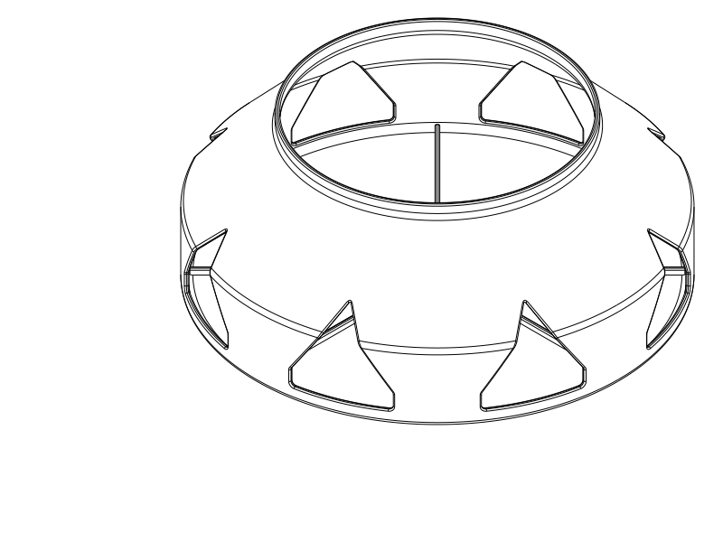

# Circular vent enclosure — V1

## At a glance

A one-piece PETG hood with a solid room-facing shield and eight broad side outlets,
for a nominal Ø130 mm inlet valve projecting 35 mm. **V1 is modelled and smoke-sliced
without generated supports; its mounting fit and noise/airflow performance remain
unverified. Measure the stationary rim before printing for installation.**

- Current prototype: [STEP](circular_vent_enclosure.step), [matching STL](circular_vent_enclosure.stl), [parametric Python](circular_vent_enclosure.py).
- **213 mm diameter × 85 mm projection**, 2.0 mm shell and 2.4 mm front. About
  **221 g** in the supplied slice; approximately **11% less geometric material**
  than the initial thicker design. No earlier variants are recommended or exported.
- Collar: provisional **130.8 mm bore**, 6 mm engagement. This is a clearance fit,
  **not a qualified friction grip**. It must attach to the stationary rim, never the disc.

| Print setup | V1 |
| --- | --- |
| Material / nozzle / layers | PETG / 0.4 mm / 0.20 mm |
| Orientation | Solid front flat on bed; collar upward; supplied files already placed |
| Walls / sparse infill | 2 walls / 7% adaptive cubic |
| Top / bottom layers | **6 / 6** so the 2.4 mm front is solid |
| Supports | Off; final automatic-support probe generated none |
| Process | [Solid-front Orca process](profiles/petg_solid_front.json), Qidi Q2C 0.4 mm printer and Generic PETG references |
| Slice estimate | 220.88 g, 5 h 4 min; estimates for the selected settings |

## Air path and fit

Your approximate interface layout is a 20 mm stationary rim followed by a 15 mm
open region to the disc, at 35 mm from the wall. The collar occupies only the
first 6 mm. The rear taper expands around the open region; the chamber remains
clear of a nominal Ø130 mm valve envelope. The front shield is 50 mm beyond the
disc face, with **44.6 mm clearance above the shallow internal ribs**.

The eight pointed-arch windows have a nominal 46 mm tangential width and 43 mm
height, with 56.3° roofs, rounded corners and softened lips. Their aggregate
**94.6 cm² projected area** is a geometric figure. They open between approximately
35 and 78 mm from the wall, sending air around the shield toward the sides.
There is no internal baffle, lining or tuned acoustic cavity.

| Position from wall | Minimum nominal radial clearance outside Ø130 mm | Local annular section |
| --- | --- | --- |
| 20 mm: rear of open band | 13.0 mm | 58.3 cm² |
| 25 mm | 17.8 mm | 82.4 cm² |
| 30 mm | 22.5 mm | 107.9 cm² |
| 35 mm: disc plane | 27.3 mm | 134.9 cm² |

The narrow 0.4 mm radial insertion clearance in the collar sits behind the open
band. It is **not an intended air passage**. The 58.3 cm² section at the rear of
the emission band is a local clearance: inflow joins along the band, rather than
all passing through that section. The nominal cylindrical opening around a
130 mm disc across a 15 mm band is approximately 61.3 cm²; actual effective area
is unknown. Forward of the disc, the checked annular section is at least 134.9 cm²,
the conservative front-turn section is 182.2 cm² and the projected exits are
94.6 cm². The smallest of those checked added full-flow sections is therefore
94.6 cm². These checks screen geometric bottlenecks; they do not calculate pressure
loss, discharge coefficients or a complete minimum hydraulic area in the 3D turn.

## Material, stiffness and mounting

Reducing the original 2.2 mm shell / 2.8 mm front to **2.0 / 2.4 mm** brings the
solid-CAD PETG estimate from 262.2 g to **233.3 g**, an 11% reduction. The slicer
estimate is lower because of path planning and infill. Eight rounded 2 mm wide ×
3 mm high radial ribs now reach the floor-to-shell blend to support the thinner
front. Keeping the face solid avoids depending on sparse infill for panel stiffness.
Panel deflection, resonance and rattle still require an operating trial.

The solid-CAD estimate implies approximately 2.3 N weight, and approximately
**0.14 N·m gravitational moment** for a wall-mounted horizontal valve axis. A
ceiling installation instead loads retention directly in withdrawal. No holding
force is credited to the loose collar and no capacity is known for the valve's
existing attachment. Do not leave the hood installed until secure retention and
the original attachment have been checked.

Measure the stationary rim's outer diameter at several angles, usable straight
length, taper/lips, and accessibility behind the disc. Verify that the complete
130.8 mm bore can pass over the real disc and adjustment hardware. Then set the
collar dimensions for that rim. Thin compliant contact strips are an option after
measurement, but their compression, friction and retention are unqualified.
If the real stationary interface cannot support a secure removable grip, it needs
a measured separate mounting-ring design; the nominal collar is not evidence
that such a grip exists.

For initial fitting, support the hood by hand, slide it over the valve and verify
that its collar touches only the fixed rim and leaves the whole open band clear.
Remove the hood to adjust the valve, inspect or clean it; preserve the valve's
original setting. The broad windows and rear opening allow rinsing and inspection;
small floor-to-wall blends avoid deep internal grooves. Check drainage and drying
in the actual wall/ceiling orientation before continued use.

## Parameters and changes

Edit the `Parameters` dataclass in [the source](circular_vent_enclosure.py).
Separate controls cover OD/depth, shell/front thickness, mounting diameter,
diametral allowance and engagement, valve projection/rim height, minimum disc
clearance, taper start/blend radius, window count/width/height/phase/roof slope,
pointed-arch or teardrop shape, lip/corner radii, and optional front ribs.
The shell is normal-offset through its taper; its thickness is not just a radial
subtraction on the sloping region.

`rib_count=0` disables ribs. Rib endpoints follow the shell diameter through
`rib_wall_inset`. Window count is restricted to 6–8; changing count or shape also
requires reviewing outlet area, roof geometry, retained posts and nearby obstacles.
Rotate `outlet_phase` to relocate the uniformly spaced windows. Six-window and
teardrop alternatives were construction-checked only, and are not qualified print
variants. Invalid configurations raise errors rather than silently selecting a
fallback. Rebuild, recheck and reslice after changing geometry.

## Verification, limits and print status

The delivered CAD is valid. Targeted checks clear the nominal valve envelope and
a 12 mm radial air band over wall heights 20–35 mm, verify shield material across
the disc footprint, and measure the flow sections above. Whole-object fit still
depends on the real rim, disc and adjustment travel.

The final FDM review uses the full front as stable bed contact. The 213 mm footprint
fits the Q2C; Orca accepted its selected placement. Thin shell regions are supported
by continuous posts and rear collar. The taper moves inward about 0.191 mm per
0.2 mm layer, and the window roofs close progressively rather than with a broad
horizontal bridge. The smaller rounded tips eliminated the earlier support signal.
No loose internal part, suspended rib start or trapped support is designed in.
PETG sag, bed adhesion, layer bonding and mounting endurance remain physical checks.

OrcaSlicer **2.4.2**, centered placement, supplied complete profile triplet: Qidi Q2C
0.4 mm / Generic PETG / the local solid-front process. Effective settings include
0.2 mm layers, 2 walls, 7% adaptive cubic, six top/bottom layers, supports off,
250°C subsequent nozzle temperature, 245°C initial and 80°C bed. Check temperatures
against the actual spool. The final slice completed with no collected notices;
the automatic-support probe completed and generated none. This checks the STL;
Orca's separate GUI STEP importer was not tested.

| Item | Print status | Artifact(s) | User result or remaining physical checks |
| --- | --- | --- | --- |
| Test piece(s) | N/A | None | No separate coupon designed |
| Final printable object(s) | Unknown | `circular_vent_enclosure.step`, `.stl` | Rim fit, secure retention, attachment loading, PETG print quality, airflow, noise, vibration and cleaning |

Before accepting performance, compare bare valve and fitted hood at the same valve
setting and ventilation operating state. Record airflow or pressure with suitable
instrumentation and matched-position noise observations/measurements. Reject a
setup that loosens, obstructs adjustment, rattles, whistles, traps moisture or
reduces ventilation unacceptably. No acoustic attenuation or negligible airflow
loss is claimed.

## Engineering record and attribution

[User brief and rim clarification](notes/brief.md) ·
[Development decisions](notes/development_record.md) ·
[Native CAD/slice receipt](notes/final_review.json) ·
[Flow/weight screen](notes/flow_screen.json) ·
[Requirement coverage](notes/verification.json).

Rebuild with `./evaluate_model.py model/circular_vent_enclosure/circular_vent_enclosure.py`.
Run declared product checks with
`./execute.py model/circular_vent_enclosure/verification.py --variant v1`.
The report preserves UNKNOWN physical obligations alongside passing nominal CAD
checks; shell validity or slice acceptance does not promote them.

Primary model: **GPT-6.1 Sol, Medium reasoning**, explicitly attributed by the user.
Harness: Codex shared-workspace coding agent; provider: OpenAI. No subagents.
