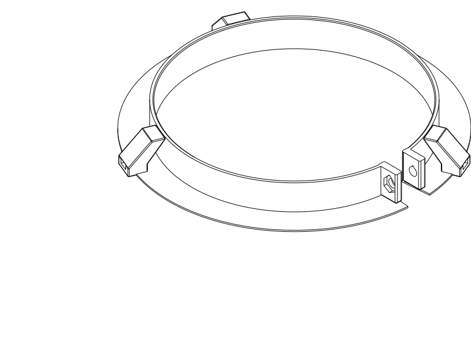

# Circular vent enclosure — V2 adjustable clamp

## At a glance

A PETG front shield and diffuser with a separate **screw-tightened, compliant rim
clamp**. Its 16.7 mm contact band replaces V1's short, loose collar. The approximate
geometric fit range is **Ø129–132 mm**; actual grip and noise/airflow performance
still need a physical trial on the stationary rim.

**Print both parts on separate plates:**

| Part | Printable files | Material estimate |
| --- | --- | --- |
| Hood | [STEP](circular_vent_enclosure.step) · [STL](circular_vent_enclosure.stl) · [Python](circular_vent_enclosure.py) | 175.40 g |
| Adjustable rim clamp | [STEP](mounting_clamp.step) · [STL](mounting_clamp.stl) · [Python](mounting_clamp.py) | 33.18 g |

Combined: **208.58 g PETG including the selected supports**, **5.6% less than
V1's 220.88 g slice**, plus four steel screws and four nuts. The assembled envelope
remains **Ø213 × 85 mm**. The solid 2.4 mm front and eight reinforcing ribs remain.
V1 at commit `19ca15f` is historical; its unqualified friction collar is superseded.
The hood alone is not a mounting system.

| Print setup | Current V2 |
| --- | --- |
| Material / nozzle / layers | PETG / 0.4 mm / 0.20 mm |
| Hood orientation | Solid front against bed; rear opening upward; supplied placement |
| Clamp orientation | Wide rear flange against bed; band upward; supplied placement |
| Walls / infill | 2 walls / 7% adaptive cubic |
| Solid layers | 6 top / 6 bottom; front remains solid |
| Process | [Supported mount process](profiles/petg_supported_mount.json), Qidi Q2C 0.4 mm / Generic PETG references |
| Supports | Small automatic tree supports; remove before fitting; see inspection below |
| Time estimate | About 4 h 21 min hood + 1 h 02 min clamp, on separate plates |

## What changed

The wider hood mouth now sits on a separate clamp. This allows a long grip behind
the original air gap without forcing a narrow, hard-to-print taper around that
gap. A thin split rear flange overlaps the hood opening, closing the large
annular rear escape path. Three supported screw lands connect the parts.

Material comes out of the **shorter curved side shell, now 1.4 mm thick**. The
front shield remains 2.4 mm solid, its eight 2 × 3 mm ribs remain, and the hood mouth
and clamp band remain 2 mm thick. This revisits the initial approximate 2 mm shell
preference in response to the further material-reduction request. Thin-wall path
coverage is checked in the actual selected slice; strength, vibration and quietness
still need a print/use trial.

The clamp's slit lets it bend around a slightly different rim diameter; the M4
screw supplies clamping preload. Its **16.7 mm nominal band length** is about
2.8 times V1's 6 mm engagement. That is an increase in available contact span,
not a measured pressure distribution or holding force. The 0.5 mm entry bevel
helps the ring go over the rim. The slit remains open through the intended range.

## Hardware and installation

| Hardware | Quantity | Purpose |
| --- | --- | --- |
| M4 × 25 mm socket-head screw + M4 nut | 1 each | Close the split ring |
| M3 × 10 mm socket-head screws + M3 nuts | 3 each | Secure hood to clamp tabs |

The lengths match the recorded stock assortment; **head type must match** the
modelled socket-cap clearance. Use a 3 mm Allen key for M4 and a **2.5 mm ball-end
Allen key rated for a 25° approach** for M3. The latter reaches the screw heads
through the outlet windows. Other head/tool styles need a clearance review.

1. Remove brims and supports and clean the nut channels, screw seats and slit. Put the M4
   nut into its partially recessed trap and the three M3 nuts into the open radial
   channels. Start the M4 screw loosely.
2. With the hood separate, slide the clamp over a **stationary** rim. Use the full
   straight band where possible, keeping all hardware behind the annular opening.
   Its available contact height must suit the actual rim profile.
3. Tighten the M4 screw gently until the ring grips without rocking. The ring can
   flex; no calibrated tightening torque or safe rim-compression load is known.
   Support it by hand for the first fit and check the original valve attachment.
4. Place the hood on the clamp's flange/tabs. The three slots accommodate the
   predicted tab movement across the diameter range. Start all three M3 screws
   through the windows, then snug them evenly. Screw preload seats the parts and
   removes play; the slots are not intended to be a loose sliding joint.
5. Check the disc and its whole annular air gap remain clear, the hood stays put
   under gentle handling, and neither the hood nor the valve attachment rocks.
   Recheck after initial use for settling or creep.

For cleaning or valve adjustment, undo the three M3 screws and remove the hood;
leave the rim clamp adjusted. To remove everything, loosen the M4 screw. No
fastener touches the disc or drills the valve. A rim outside the provisional
range, an unsuitable profile or a weak attachment needs a revised mount.

## Airflow and shielding

The user-supplied layout is approximately 20 mm of stationary rim plus a 15 mm gap
to the disc, whose face is 35 mm from the wall. The mounting flange/tabs end at
17.5 mm, behind that open band. CAD clears a continuous **12 mm radial keepout**
around the nominal Ø130 mm valve across the entire 20–35 mm band.

The eight broad, rounded pointed-arch windows retain **94.6 cm² nominal projected
outlet area**. Their 56.3° roofs close progressively. The complete front remains a
solid forward shield; there is no additional baffle or lining. Disc-to-rib front
clearance remains **44.6 mm**. The rear flange overlaps the hood mouth even at the
small end of the fit range; its intentional clamp slit is a small rear opening,
not an airtight seal.

The checked downstream disc-plane circular-core area is 127.6 cm², the
conservative front-turn area is 182.2 cm² and the projected exits are 94.6 cm².
The minimum of those checked added full-flow sections remains 94.6 cm². Local
clearance around the band is at least 12 mm; flow is distributed along the band,
so a local rear annular section is not necessarily a full-flow throat.
These are geometry screens, not effective hydraulic areas, pressure-loss estimates
or a guarantee of negligible airflow loss. Compare actual airflow and noise at
matched valve settings and ventilation conditions before accepting performance.

## Verification, supports and limitations

Both parts have valid CAD and matching, identically placed STEP/STL exports.
Targeted checks cover the valve/air-band keepout, solid front, rear flange coverage,
hood/clamp interference and bolt-slot alignment over seven diameter poses from
129 to 132 mm, axial hood removal, and driver clearance at the fit extremes.
The constant-curvature ring poses size the slots; they do not simulate the real
nonuniform deformation or prove grip on an oval/tapered rim.

The selected OrcaSlicer 2.4.2 slices use the supplied complete profile triplet,
centered placement and the orientations above. The Q2C accepts each plate. Effective
settings are 0.2 mm layers, 2 walls, 7% adaptive cubic, 6 top/bottom layers, and
small automatic tree supports. Temperatures are 245°C first layer / 250°C thereafter,
80°C bed; check them against the actual spool. Slice estimates are not weighed
parts. The STL smoke slice does not verify Orca's separate GUI STEP importer.

The support signal is reviewed rather than called support-free. Hood supports
sit under its three recessed screw seats and are reached through the large rear
opening before assembly. The clamp's nut channels open radially; any local support
can be picked out before installing nuts. Inspect these seats and channels after
removal. Actual PETG release, sag, adhesion and surface quality remain untested.
The [actual path inspection](notes/manufacturing_paths.json) checks at least three
extrusion paths and section coverage in the thinner hood wall; support locations
are shown in [hood](renders/print/hood_support_paths.svg) and
[clamp](renders/print/clamp_support_paths.svg) path views.

The combined solid-CAD estimate is 216.37 g at an assumed 1.27 g/cm³, versus
233.27 g for V1. Steel hardware is additional and was not weighed. The nominal
wall-axis gravity moment is 0.127 N·m. A positive screw preload source exists,
but friction, contact pressure, attachment strength, withdrawal resistance, handling
loads, PETG creep and panel resonance are unqualified. There is no holding-force
rating or guaranteed noise reduction. Remove the hood if it loosens, rattles,
whistles, traps moisture or causes unacceptable ventilation loss.

| Item | Print status | Artifact(s) | User result or remaining physical checks |
| --- | --- | --- | --- |
| Test piece(s) | N/A | None | No separate sample designed |
| Final printable object(s) | Unknown | `circular_vent_enclosure.step/.stl`, `mounting_clamp.step/.stl` | Print/support release, fit, grip, stability, creep, airflow, sound and cleaning |

## Parameters and engineering record

Edit [vent_parameters.py](vent_parameters.py) for hood, clamp and fastening controls.
Mount diameter/clearance on the hood describe its rear mouth; the **separate
`clamp_free_diameter`, fit-range, band height, slit and wall fields** control the
rim grip. Window/rib/shape controls remain parametric. Geometry and fit settings
are coupled; recheck and reslice a changed configuration rather than assuming the
current evidence transfers to every parameter value. The model rejects mounting
lands within 15° of the clamp split and disconnected flange/seat heights. Rotate
the assembled enclosure on the rim to clock the outlets during fitting.

[Installed CAD view](renders/assembled/assembly_isometric.png) ·
[Brief and follow-up directions](notes/brief.md) ·
[Development history and reasoning](notes/development_record.md) ·
[Geometry/weight/clamp checks](notes/geometry_checks.json) ·
[Requirement coverage](notes/verification.json) ·
[Hood receipt](notes/final_review.json) · [Clamp receipt](notes/clamp_review.json).
The earlier support-free process is historical V1 guidance; use the supported
mount process linked above for this revision.

Run `./execute.py model/circular_vent_enclosure/verification.py --variant v2-clamp`
for the declared checks. Physical obligations remain UNKNOWN alongside nominal CAD
passes. Both printable sources use the repository evaluator; `assembly.py` is an
inspection-only assembled pose.

Primary model: **GPT-6.1 Sol, Medium reasoning**, user-attributed. Harness: Codex
shared-workspace coding agent; provider: OpenAI. No subagents. Historical V1
attribution is retained in its development record and Git history.
