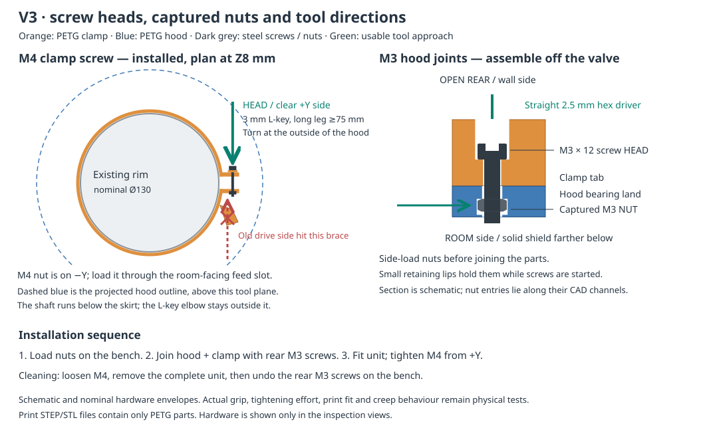
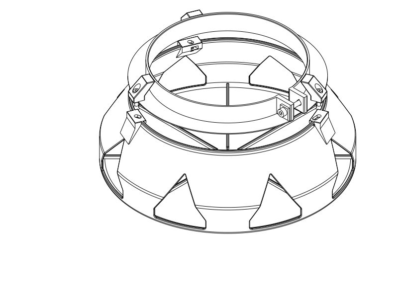
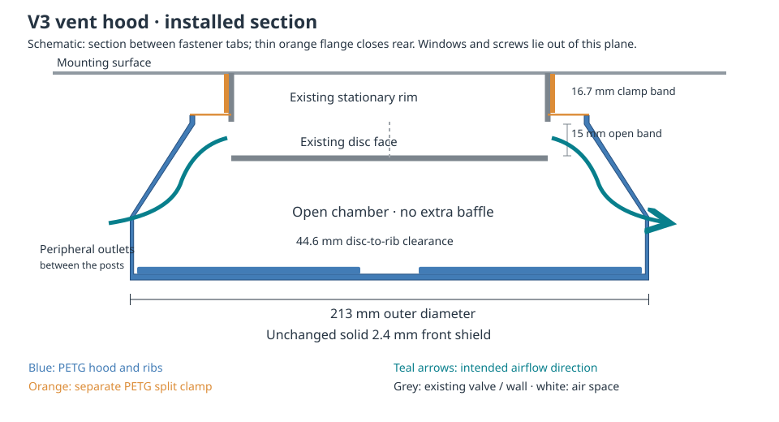

# Circular vent enclosure — V3 fastener access

## At a glance

A PETG hood and adjustable rim clamp intended to reduce perceived vent noise.
**Discontinued after physical trial (2026-10-24). Do not print or continue this
noise-damping design.** The user reports it made the sound louder even with the
clamp removed. They identified the relevant noise source elsewhere, and the
original problem is now resolved by another means; no replacement is requested.

The attempted fit also failed to cover the vent as intended. The user attributes
that mismatch to their supplied measurements, separately from the acoustic
failure. A chamber effect is their hypothesis, not a measured diagnosis.
[Final physical report and lessons](notes/development_record.md#fit-and-sound-trial--discontinued-2026-10-24).

Source, exports, illustrations and earlier print issues are retained for history.
The V3 assembly, print settings and test instructions below describe the retired
design, **not recommended next work**. Earlier skirt/nut-feed issues remain in
[the initial print report](notes/development_record.md#print-report-and-deferred-design-issues--2026-10-24);
they are no longer a planned revision backlog.

| Part | Printable files | Selected slice estimate |
| --- | --- | --- |
| Hood | [STEP](circular_vent_enclosure.step) · [STL](circular_vent_enclosure.stl) · [Python](circular_vent_enclosure.py) | 170.08 g |
| Clamp | [STEP](mounting_clamp.step) · [STL](mounting_clamp.stl) · [Python](mounting_clamp.py) | 32.90 g |

Combined: about **203 g PETG**, plus four screws and four nuts. The envelope remains
**Ø213 × 85 mm** with a solid 2.4 mm front, 1.4 mm curved shell and 16.7 mm clamp
band. The approximate geometric grip range remains Ø129–132 mm.

## Screw heads, nuts and assembly order

| Joint | Screw-head / driver side | Nut location | When tightened |
| --- | --- | --- | --- |
| Three M3 hood joints | Open rear, facing the wall when installed; straight access on the bench | Sliding captive channels in the hood | Before placing the unit on the valve |
| M4 rim clamp | Clear side shown by the green arrow (+Y) | Opposite ear (−Y), with a room-facing nut-loading slot | After placing the complete unit on the valve |

The M4 axis moved outward and its head sits on a supported 2 mm extension. This
keeps the full 25 mm screw tail clear of the nearby brace at the small end of the
grip range. The M3 screws now have clearance for their complete 12 mm length.
Their nuts slide in from the chamber side; small retaining lips stop them falling
toward the front while screws are started. The thick bearing lands carry the
assembled joint load.

[Assembled rear view](renders/assembled/assembly_isometric.png) ·
[Actual M3 joint half-section, wall side upward](renders/assembled/joint_section_isometric.png) ·
[Clamp room-facing nut-feed opening](renders/print/mounting_clamp_bottom.png).
The inspection views include nominal metal hardware. Only the two printable
STEP/STL pairs contain the PETG parts.

| Hardware | Quantity | Tool |
| --- | --- | --- |
| **M3 × 12 mm** socket-head screws + M3 nuts | 3 each | Straight 2.5 mm hex driver or Allen key, on the bench |
| M4 × 25 mm socket-head screw + M4 nut | 1 each | 3 mm L-shaped Allen key, long leg at least **75 mm** |

The lengths match the recorded stock assortment. Head type must match the
modelled socket-cap sizes; a different head or tool needs a clearance review.
V2's M3 × 10 mm recommendation is superseded.

1. Remove brims and the clamp's small exterior supports. Clear stringing from nut
   slots and check that each actual nut slides in before joining the parts.
2. With the clamp separate, load its M4 nut through the open room-facing feed
   slot. Start the M4 screw from the clear side and leave the ring loose.
3. Place the hood front-down on the bench. Slide the three M3 nuts into the hood
   channels from inside the chamber. The retaining lips support them while you
   place the clamp on the rear flange/lands.
4. Insert the three **M3 × 12 mm** screws from the open rear and snug them evenly
   with a straight driver. No reaching through the outlet windows is required.
5. Slide the complete unit over the valve onto its **stationary** rim. Clock it
   so the M4 head is easy to reach. Keep the band and hardware behind the original
   air gap and use the available straight contact height.
6. Insert the long leg of the 3 mm L-key from the clear side, below the hood skirt.
   Its elbow stays outside the hood; the model checks a sampled 90° turning arc.
   Tighten gently until the ring grips without rocking, and check the original
   valve attachment and disc clearance. No calibrated tightening torque is known.

For cleaning or valve adjustment, loosen M4 and remove the complete unit first.
Undo the three M3 screws on the bench if the hood needs separating. No screw
contacts the disc or drills the valve. The later fit attempt failed because of
incorrect supplied measurements; installed clamping strength remains unqualified,
with no further trial planned.

## Print setup

| Setting | Hood | Clamp |
| --- | --- | --- |
| Material / nozzle / layer | PETG / 0.4 mm / 0.20 mm | Same |
| Orientation | Solid front against bed, rear up | Rear flange against bed, band up |
| Walls / sparse infill | 2 / 7% adaptive cubic | Same |
| Solid layers | 6 top / 6 bottom; front remains solid | Same |
| Supports | **Off**, to keep captive-nut channels clear | Automatic; only small exterior supports in the selected slice |
| Process | [Hood nut-roof process](profiles/petg_hood_nut_bridges.json) | [Clamp process](profiles/petg_supported_mount.json) |
| Time estimate | About 4 h 04 min | About 1 hour |

The supplied files already have these print placements. Use the Qidi Q2C 0.4 mm
printer and Generic PETG filament references with the selected local process.
The process profiles are different; do not apply the clamp's automatic supports
inside the hood nut pockets. Those pockets have short roof spans/ledges and a
3.0 mm cavity for nominal 2.4 mm nuts. Actual PETG sag and nut fit remain untested.
Clean or lightly deburr loading entries rather than forcing a nut past a poor roof.

[Hood roof toolpaths](renders/print/hood_support_paths.svg) ·
[Clamp exterior support toolpaths](renders/print/clamp_support_paths.svg).

## Airflow and retained geometry

Your approximate interface remains a 20 mm stationary rim followed by a 15 mm gap
to the disc at 35 mm. The clamp/flange ends at 17.5 mm. CAD checks retain a continuous
**12 mm radial keepout** around the nominal Ø130 mm valve throughout that open band,
including the nominal metal fasteners. The front and all eight 2 × 3 mm ribs remain;
disc-to-rib front clearance is **44.6 mm**.

The windows retain **94.6 cm² nominal projected area** and 56.3° pointed roofs.
The side taper starts earlier to support the deeper captive-nut lands. The checked
downstream disc-plane circular core is **113.7 cm²**, above the exit area; the
conservative front-turn section is 182.2 cm². The minimum of these checked added
full-flow sections remains 94.6 cm². The nominal undeformed rear flange overlaps
the hood mouth. The user now reports a few-millimetre gap uncovered by the skirt
when the mount is fully tightened;
nominal overlap does not establish coverage under actual flex.

These are geometric screens, not hydraulic effective areas or pressure/noise
predictions. No additional acoustic baffle, foam or tuned cavity is introduced.
The subsequent physical trial was subjectively louder. No measured airflow or
matched-condition acoustic result was obtained; further testing is not planned.

## Verification, limits and print status

Both updated STEP/STL pairs were published from the selected builders and print
placements, and both selected OrcaSlicer 2.4.2 slices completed without collected
notices. Checks cover the valve/air keepout, rear flange, full screw/nut seating,
M3 rear bench access, M4 installed L-key approach/turning samples, actual nut-loading
paths, bolt-slot alignment over seven geometric diameters and material witnesses
in all eight retained ribs. Straight-wall and taper path coverage is inspected
in the selected G-code.

The hood's automatic-support diagnostic proposes supports under its captive-nut
roofs. That signal was reviewed; the selected hood process leaves those channels
empty and prints the short roof features without internal support. The clamp's
selected supports are exterior and below print Z0.6 mm. Actual bridge quality,
release, fit and dimensional accuracy are physical questions. The STL slice does
not verify Orca's separate GUI STEP importer. Effective reference temperatures
are 245°C first layer / 250°C thereafter, 80°C bed; check the actual spool.

The CAD solid-PETG estimate is about **216.9 g** at an assumed 1.27 g/cm³. Slice
estimates include the selected support strategy and are not weighed parts. Changes
in support settings make direct V2/V3 filament comparisons process-dependent.
The nominal wall-axis gravity moment is about 0.127 N·m; steel hardware is additional.

The diameter poses use the retained constant-neutral-arc envelope assumption.
They do not model joint friction, nonuniform ring deformation or preload after
bench tightening. First-fit clamping effort with the M3 joints seated, attachment
strength, retention, creep and panel vibration remain unqualified. The subjective
noise result is adverse; its physical mechanism is unconfirmed. Hardware
views use nominal smooth shafts/bores and omit threads. There is no holding-force
rating or guaranteed silencing result.

| Item | Print status | Artifact(s) | User result or remaining physical checks |
| --- | --- | --- | --- |
| Test piece(s) | N/A | None | No separate sample designed |
| Final printable object(s) | Yes — tried; rejected and discontinued | `circular_vent_enclosure.step/.stl`, `mounting_clamp.step/.stl` (current references; exact printed revision/part coverage unconfirmed) | Fit mismatch attributed to supplied measurements; louder with clamp removed. Earlier skirt gap and nut-feed print defect retained. No further work planned |

## Parameters and engineering record

Historical dimensions are in [vent_parameters.py](vent_parameters.py). Mount
diameter on the hood describes its Ø160 mm rear mouth; separate clamp-free/range/contact fields
control the stationary-rim grip. Captive nut height/lip/bearing, M3 length and M4
head-seat offset are explicit. Geometry/fit settings are coupled; changes need
rechecking and reslicing. The earlier direction protected retention of the ribs;
the whole project is now closed.

[Brief and fastener direction request](notes/brief.md) ·
[Development record and historical V1/V2 evidence](notes/development_record.md) ·
[Geometry checks](notes/geometry_checks.json) ·
[Requirement coverage](notes/verification.json) ·
[Actual path inspection](notes/manufacturing_paths.json) ·
[Hood receipt](notes/final_review.json) · [Clamp receipt](notes/clamp_review.json).

Run `./execute.py model/circular_vent_enclosure/verification.py --variant v3-access`
for the declared checks. Historical receipts leave physical obligations UNKNOWN
alongside nominal CAD passes; they predate the adverse sound trial and do not represent current product
acceptance. The final physical report above governs the discontinued status.
`assembly.py`, `fastener_layout.py` and `joint_section.py` are inspection-only scenes with hardware; they are not printable deliverables.

Primary model: **GPT-6.1 Sol, Medium reasoning**, user-attributed. Harness: Codex
shared-workspace coding agent; provider: OpenAI. No subagents. Earlier attribution
and evidence remain in the development record and Git history.
