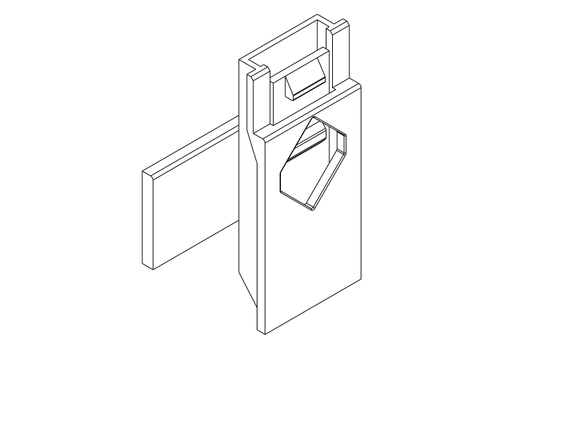
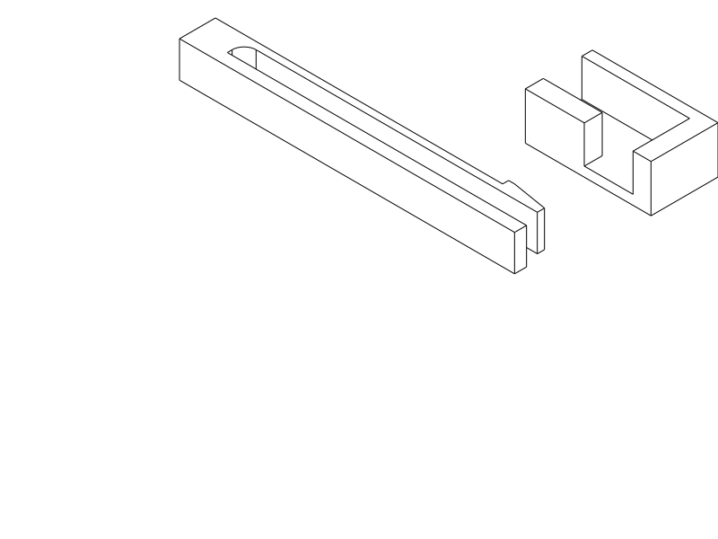

# One-sided dental latch study — A / B

Two small **cantilever snap-fit** experiments requested on 2026-10-15: compare
the latest slim M1 catch in PLA with a concept that asks less of the flexure and
prints its length in the bed plane. **The dental case is unchanged.** This is a
samples-only study, not a case revision or a material qualification.

## Print files

Print both parts in each selected file, at 100% scale, in their supplied positions
and orientations. STEP is primary; each STL matches its STEP geometry and placement
in millimetres. A and B parts are deliberately incompatible. File names identify
the pairs; no extra printed labels or hardware are needed.

| Trial | Authoritative entry / matching exports | What it tests |
| --- | --- | --- |
| A — existing geometry | [Python](a_original.py), [STEP](a_original.step), [STL](a_original.stl) | One production catch and pocket, upright as on the case |
| B — flat PLA concept | [Python](b_flat_pla.py), [STEP](b_flat_pla.step), [STL](b_flat_pla.stl) | Lower-travel leaf, longer/thinner section and bending in the bed plane |

Shared parametric source: [design.py](design.py). A imports the unchanged
[M1 builder](../dental_travel_case/m1_design.py); retain that directory when
rebuilding. B dimensions are in `FlatDimensions`. There are just **four small
printed parts total**, one leaf fixture and one keeper for each experiment.

## What differs, and what the results mean

| Feature | A | B |
| --- | --- | --- |
| Leaf length × breadth × bending thickness | 40.4 × 14 × 1.6 mm | 49 × 6 × 1.2 mm |
| Hook radial projection | 2 mm | 1 mm |
| Nominal prescribed terminal release travel | 2.7 mm | 1.2 mm |
| Root | Production attachment / R0.8 | R2 transition into grip block |
| Print direction | Length along Z, as on the case | Length and bending direction in XY; breadth along Z |
| Mating geometry | Original 0.25 mm guide allowance, 0.15 mm axial play, pocket and liner | Open inspection keeper, 0.2 mm ledge-face clearance, 0.25 mm rail/back-face clearance, 0.15 mm axial play |

A is a 24 mm-wide strip of just one end, 54 mm tall at the body and 20 mm at the
keeper. It retains the complete leaf, blended attachment, pad, local sidewalls,
liner, 12 mm sleeve and pocket. The root is not shortened to save material.
The original cap prints inverted, as does this keeper. This reproduces the local
interface and layer direction; cutting away the rest changes fixture stiffness.

B has a stationary lower rail for alignment and gripping, a compliant upper leaf,
and a square tooth shoulder. The keeper's end wall seats against the rail end;
its ledge blocks withdrawal. A sloped tooth provides the passive-closing ramp.
The broad backplate locates one face, leaving the other open to see and operate
the leaf. Keep that face against the backplate during testing: **it can be lifted
sideways out of this deliberately open fixture**. It is a local bending/closure
experiment, not a captive connector or drop-in case latch. The 56 mm-long male
fixture and 21 mm-long keeper both print flat, keeper backplate down. Their
print-layout envelope is about 59 × 31 × 7.85 mm.

Hypothesis: B should flex with less local strain demand because its travel and
bending thickness are smaller and its effective span is longer. Its print
orientation also avoids putting the beam's length across stacked layers. The
simple small-deflection estimates are **A 0.592%, B 0.098% nominal root strain**:
about sixfold lower demand, not sixfold greater life. A uses the original
point-load position at the pad, with a 1 mm fixed root allowance; B uses a tip
load and conservatively excludes R2 from its effective span. Root concentrations,
contact forces and printed anisotropy are omitted. No PLA modulus, allowable
strain, fatigue life or safe force has been assigned. B changes several factors
together: this comparison does not isolate geometry from layer orientation.

The [full M1 print](../dental_travel_case/notes/m1.md#full-box-print-feedback--2026-10-15)
pulled apart without pressing the releases. Neither sample reproduces long-wall
spreading, both catches, whole-case peeling, contents or impact leverage. The
overlap is retained locally in A, not varied; this experiment cannot determine
the appropriate full-case overlap or establish backpack retention.

## Print and try

Use **PLA, 0.4 mm nozzle, 0.2 mm layers, two walls and 7% adaptive cubic** as the
starting comparison, with your PLA filament's normal temperatures and cooling.
Use the same PLA spool and process for A and B, changing only the needed support
and brim choices. Do not rotate A flat: its original layer direction is part of
the comparison. B needs no supports by the reviewed geometry and reference slice;
start without a brim to keep its flexure slot clean. A has narrow upright contact
strips: use a small external brim, keeping the moving gap free.

The A automatic-support probe proposes supports below its inward root ramp and
inside the keeper's retaining recess. The saved
[side elevation](renders/support_side.png) shows actual support paths in red.
These are accessible from the exposed inner/cropped faces; remove them before
testing and inspect the shoulder and slot for residue or damage. A's original
local geometry is intentionally preserved. Support adhesion/removal in PLA is
unmeasured. Do not use this diagnostic PETG G-code as a PLA print job.

1. **Print B first** for the gentler flex experiment, then A to compare the existing
   arrangement. Remove any brim/support and confirm the leaf is free. Hold the
   rigid root/rail, not the moving leaf. Stop if it whitens, cracks or stays bent.
2. A: press its recessed pad inward, slide the keeper down the sleeve to the seam
   seat, then let go. B: turn the keeper backplate up, place the leaf fixture
   against it and slide the keeper from the tooth end toward the root; the rail
   end meets the keeper's end stop. Push the tooth end toward the lower rail to
   clear the ledge, then let it return. The open face makes this visible.
3. First close with the leaf held clear. Confirm recovery and try a gentle straight
   pull **without pressing**. Then press and withdraw. Keep A's cropped faces
   aligned: the strip also omits the full rim's sideways constraint. For B,
   maintain backplate contact so out-of-plane lifting does not masquerade as
   latch release.
4. If those steps work, try closing via the ramp without pre-pressing. Compare
   closing/release feel, unwanted straight-pull release and visible recovery.
   Repeat 10 cycles, inspect, then repeat to 50 only if unchanged. These are
   observation checkpoints, not a durability rating. Check again after an
   overnight closed dwell, noting any permanent set or weaker engagement.
5. Report A/B, spool, settings, cycle count and whether failure occurs at the root,
   a layer line, tooth or keeper. Record how it was held and whether the leaf
   recovered. If A fails and B survives, pursue the lower-demand concept; that
   does not alone identify the cause. If B also cracks or takes a set, reject its
   present section/travel for that process. If both survive but slip when pulled,
   revisit engagement/fixture behavior rather than calling PLA too brittle.

## Digital evidence and limits

`./execute.py model/dental_latch_study/study_checks.py` checks both complete local
male/keeper pairs: seated noninterference, positive withdrawal obstruction and
31 prescribed-release withdrawal poses at 1 mm increments over 0–30 mm. A's
production deformation envelope is reused; B uses a sampled end-loaded beam
envelope, with its fixed rail retained. These are kinematic hypotheses, not an
elastic contact solve or continuous-motion proof. Intersection tolerance is
1e-6 mm³. Obstruction at 1 mm withdrawal: A 11.7927 mm³, B 4.0800 mm³. B also
obstructs at the lower-rail play extreme; removing its tooth clears the witness.
These checks passed. Passive snap-on force, strain and return remain physical.

Both final layouts have valid CAD and successfully exported paired STEP/STL.
Print views and the [B engaged view](renders/assembled/inspection_bottom.png)
were visually inspected. Native receipts: [A](a_review.json), [B](b_review.json).
The simple named `cq.Assembly` layouts and local pair checks suffice here; no
constraint solver or additional assembly wrapper is needed for these two fixtures.

OrcaSlicer **2.4.2** accepted both STL layouts in the Q2C 270 × 270 × 256 mm
reference envelope, centered without rotation. Diagnostic profiles are the
repository Q2C 0.4 nozzle / Generic PETG / 0.20 Standard two-wall, 7% adaptive-cubic
triplet, with automatic 5 mm brim. **They are PETG diagnostics, not PLA process
qualification.** Neither had log notices; B generated no supports in the probe.
A completed with a support-review flag, inspected above. The reference A slice
estimated 6.76 g / 55 minutes without automatic support, versus the older
full-rim joint's roughly 50.55 g; PLA and supported-job estimates will differ.
STL acceptance does not test Orca's separate GUI STEP import.

Final FDM review: A retains original vertical sections, 0.8 mm leaf slots and
supported/sloped port geometry; its cropped ends are flat bed contacts and its
local ramp/ledge support requires removal. B's 1.2 mm bending section, 2.8 mm
relief to the lower rail and open tooth are planar extrusions on the bed; its
keeper grows directly from the downward-facing backplate. No trapped supports
or unsupported starts are designed into B. The B root is rounded; sliding
datums, retaining shoulders and broad flat bed faces deliberately remain square.
Deburr any sharp printed grip edges without rounding the tooth or thinning the
leaf. Actual PLA layer bonding, force, recovery, removal quality and life are unknown.

Handoff reflection: cropping preserves the intended local test but changes
support and stiffness context. These limits are already covered by the shared
experiment guidance; no shared workflow change or case redesign is justified
before the physical comparison.

## Print status

| Item | Print status | Artifact(s) | User result or remaining physical checks |
| --- | --- | --- | --- |
| Test piece(s) | No — newly modelled | `a_original.step` / `.stl`; `b_flat_pla.step` / `.stl` | PLA flex, snap effort, pull release, recovery, dwell and visible damage untested |
| Final printable object(s) | N/A — samples only | None | Case unchanged; its reported inadequate retention remains authoritative |

## Attribution

Primary language model: OpenAI GPT-6 (exact runtime model ID not exposed).
Reasoning effort: not exposed. Harness: Codex agent, API session with shared
repository tools. Provider: OpenAI. Historical M1 contributors and attribution
remain in its [provenance record](../dental_travel_case/notes/provenance.md).
