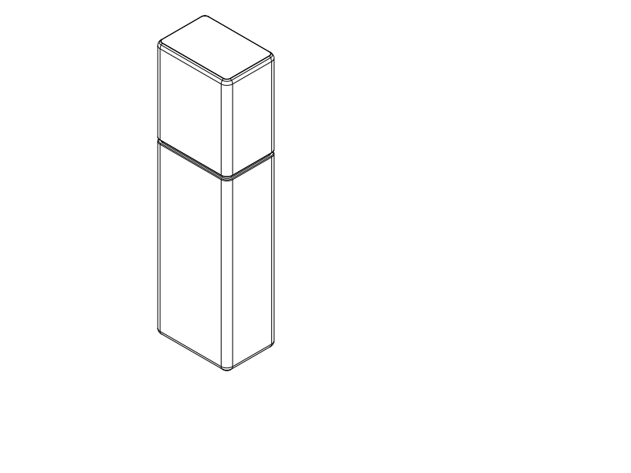
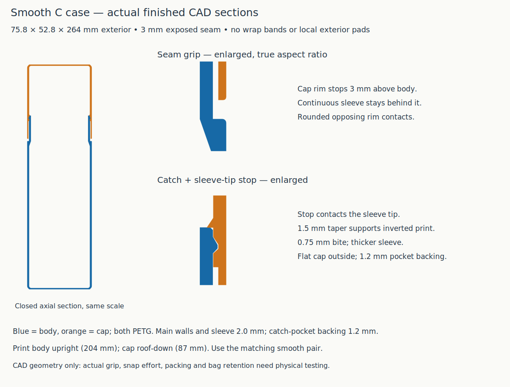
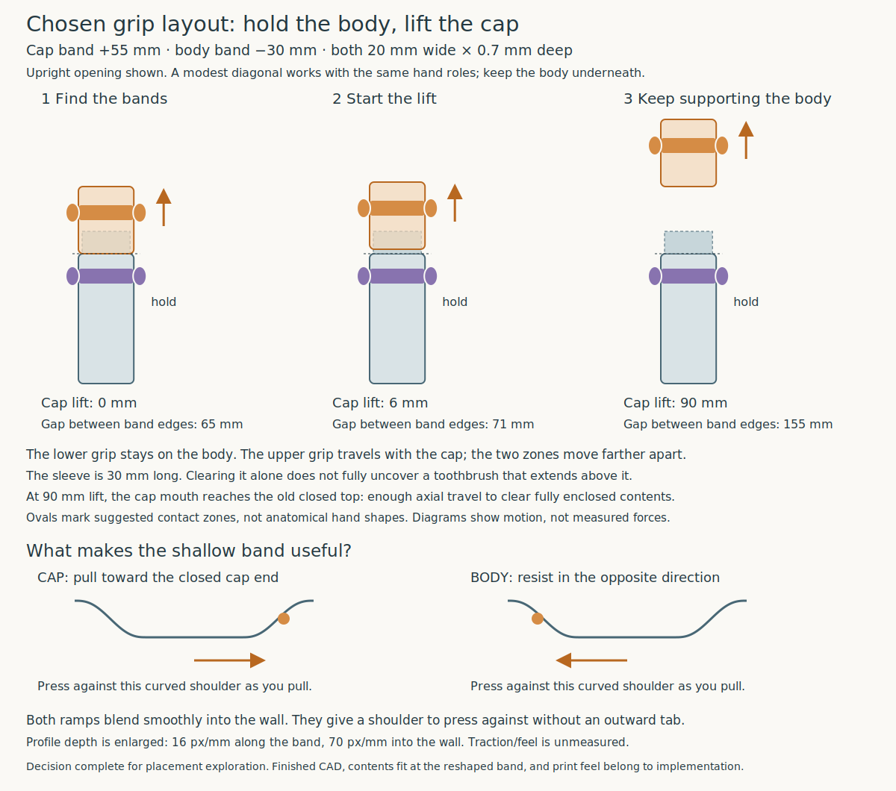
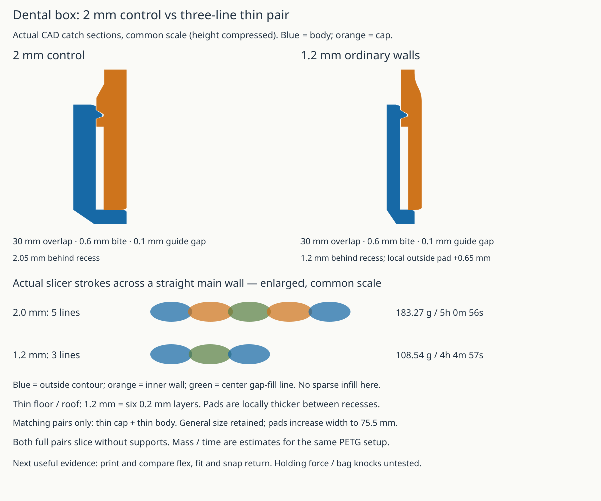

# Dental Travel Case

A slim, two-piece PETG travel box (`75.8 × 52.8 × 264 mm` current closed exterior) designed to hold a `255 mm` electric toothbrush (up to `30 mm` handle diameter) and a `160 × 55 × 40 mm` toothpaste tube without internal clips or dividers.

## At a Glance: What to Do Now

- **Current action: finish the R1a PLA action trial; review the cleaner production-orientation concepts.** [STEP](rotary_r1_test.step) · [STL](rotary_r1_test.stl) · [assembly and trial instructions](notes/rotary_r1.md) · [operation SVG](renders/tests/rotary_r1/operation.svg). Three printed parts plus one M3×12 screw and two M3 nuts. Sideways = OPEN; upright = LOCK. User reports the print underway, without a completed result. Its exposed form is not accepted for the final box. [Appearance comparison SVG](renders/concepts/rotary_refinement/comparison.svg) · [manufacturing sections](renders/concepts/rotary_refinement/manufacture.svg) · [rough CAD and evidence](notes/rotary_refinement.md). No new full-case print is recommended. B1/C2 unchanged prints stay on hold.
- **Previous B1 sample:** [STEP](slider_b_test.step) · [STL](slider_b_test.stl), retained for reference, not a current print recommendation. Print/use results were not reported; the bulky exterior is a product-design rejection. [Historical sample record](notes/slider_b.md).
- **Printed trial:** [PLA C2 sample STEP](smooth_joint_test.step) · [STL](smooth_joint_test.stl), retained for identification, not a repeat-print recommendation. Its open ends limit transfer to the full case; the user suspects PETG would also be too tight, but PETG has not been tested.
- **Existing CAD: Smooth C seam-grip case — full box unprinted; design on hold after sample rejection.** The selected C direction is implemented: straight, aligned sides, no wrap bands or local backing bumps, and a `3 mm` exposed overlap collar.
  - **Print files:** [`short_lap_case_smooth.step`](short_lap_case_smooth.step) · [`short_lap_case_smooth.stl`](short_lap_case_smooth.stl) · [Python entry point](short_lap_case_smooth.py). Historical matching pair; hold printing pending release-design review. The closed `_assembled` pose is inspection only.
  - **How to print:** PETG, `0.4 mm` nozzle, `0.2 mm` layers, **3 configured wall loops**, `7%` adaptive cubic infill, `5 mm` automatic brim, no supports ([process profile](notes/short_lap/profiles/process.json)). Body upright (`204 mm`); cap inverted on its roof (`87 mm`). Thicker end walls may use more than three strokes.
  - **Use:** Support the body underneath and lift the cap while upright or diagonal. The exposed collar replaces both separate grip bands; PLA sample effort was rejected; full-case handling remains untested.
  - **What changed:** Width and depth each grow `1.6 mm` from the original thin case, to `75.8 × 52.8 mm`; closed length stays `264 mm`. Main walls and sleeve are `2.0 mm`, with `1.2 mm` backing behind catch recesses. The bite is `0.75 mm`, strengthened after a weak force screen; main contents space and guide dimensions are retained. An internal sleeve-tip stop sets the seam gap.
  - **Review:** [Actual CAD sections](renders/assembled/smooth_case_sections.svg) · [design and evidence](notes/smooth_exterior.md) · [closed inspection STEP](short_lap_case_smooth_assembled.step).
- **What NOT to Do / Closed Branches:**
  - **Do NOT print the hinged cases (`C6`, `C7`, `C8`):** The `C8` shortened loop broke on its first push and the hinged direction is **permanently discarded**.
  - **Do NOT print `M1`–`M5` deep-sleeve cases:** `M1` was printed and works as a shell (and currently hosts the [TPU liner experiment](../dental_travel_case_liner/README.md)), but its `78 mm` sleeve and cantilever hooks had weak retention and pulled apart too easily.
  - **Use matching variants:** Smooth C adds a new internal cap stop and seam reveal. Use its matching pair; the older `2 mm` and three-line variants also have different mating offsets. The wrap-grip files are retained as a superseded comparison.
  - **Old coupled-contact branch remains closed:** The new C retention review uses fresh pull/compliance and side-bearing screens. Earlier incomplete side-knock solves remain `INCONCLUSIVE`; a static screen does not qualify actual bag impacts.

---

## Current rotary refinement

The preferred rough direction is a smooth wheel covering an external nose and a metal screw-head keeper, without the exposed cap window. The cap prints closed-top-down and the body bottom-down. [Comparison and actual sections](notes/rotary_refinement.md) explain the remaining local support, the sleeve track and unqualified indexing. R1a remains the action trial already printing.

<a id="how-the-current-design-works"></a>

## Smooth C: Grip and Closure



The cap ends `3 mm` above the body shoulder, exposing the continuous inner sleeve. Rounded opposing rim edges provide a place to grip without separate bands. Inside the cap, a tapered seat contacts the sleeve tip and prevents overclosing; the catch pockets remain at their original height. The cap covers `27 mm` of the unchanged `30 mm` sleeve.



The end-wall bites increase from `0.6` to `0.75 mm`, with a 2 mm sleeve and stiffer broad walls; the relief-track construction remains. Rigid CAD checks establish seated clearance, independent catch obstruction and a clear sampled withdrawal path after the initial snap. Fresh C2 analysis predicts about **11 N aligned pull-apart** and **6.8 N closing**, using an uncalibrated PETG elastic model and no friction credit. The first C's thin sleeve had an optimistic pull bound of only 3 N, so it was strengthened. The final ordinary main walls and sleeve are 2 mm; both pieces must be updated together.

| Retention evidence | Current conclusion |
| --- | --- |
| Centered slow-pull / closing estimate | **11 N / 6.8 N** nominal; material/fit scenarios give 6.3–25 N pull, not guaranteed print limits. |
| One-end radial fixture | About **6 N**, not a freely rocking peel-release prediction. |
| Principal side-bearing comparison | About **30% / 56% less** widthwise/broad-face flexibility than the intermediate thin C. X point-value mesh variation is 11.6%; this is a comparative result, not a bag-impact pass. |
| Actual operation / accidental opening | **PLA sample too tight** to open and close; measured force and full-case bag retention remain unknown. |

[Force plot](renders/assembled/smooth_retention_force.svg) · [method, assumptions and primary research](notes/smooth_exterior.md#retention-check-authorization). Earlier thick-case force/contact numbers are not transferred to this model.

## Previous Wrap-Grip Design (Superseded Comparison)

### 1. Wraparound Grip Bands & Upright Opening (`grip_human.md`)



Because the box holds a loose toothbrush and toothpaste tube, **open it upright or diagonally with the body underneath** so contents do not spill out:
1. **Support with the lower hand:** Wrap your lower hand around the body grip band (`-30 mm` below the seam, spanning `-40` to `-20 mm`). Its lower curved shoulder stops your hand from sliding down.
2. **Pull with the upper hand:** Wrap or pinch the cap grip band (`+55 mm` above the seam, spanning `+45` to `+65 mm`, `6 mm` clear of the snap-backing blend). Its upper curved shoulder gives your fingers a gentle slope to push upward against.
3. **Lift straight up:** The snap releases within the first `6 mm` of travel, the sleeve clears at `30 mm`, and a `90 mm` lift clears the top of the enclosed toothbrush.

- **Actual CAD cross-sections:** [SVG](notes/grip_human/finished_band_sections.svg) · [PNG](notes/grip_human/finished_band_sections.png)
- **Band placement comparison (`+40`, `+50`, `+55`, `+65 mm`):** [SVG](notes/grip_human/placement_comparison.svg) · [PNG](notes/grip_human/placement_comparison.png) · [Full placement & CAD record](notes/grip_human.md)

### 2. Three-Line (`1.2 mm`) Wall Construction vs. `2 mm` Control (`wall_comparison.md`)



With a `0.4 mm` nozzle and 3 configured wall loops in OrcaSlicer, a `2 mm` wall actually slices as **5 extrusion strokes** (`183.3 g`, `5 h 01 m`). Thinning the main walls to **`1.2 mm`** produces **3 continuous extrusion strokes** (two `0.42 mm` outer walls + one `0.43 mm` center gap-fill line) with zero sparse infill, cutting filament use by **40.8% (`108.5 g`, `4 h 05 m`)**.
- To keep `1.2 mm` of solid backing behind the `0.6 mm` snap pockets without cutting slots through the shell, the thin cap adds two smooth `0.65 mm` exterior pads (`19 mm` wide with tangent cubic blends) over the end catches.
- [Full wall & comfort comparison record](notes/wall_comparison.md) · [Comfort blend details SVG](notes/wall_comparison/comfort.svg)

### 3. Short-Lap (`30 mm`) End-Wall Snaps & Sideways-Knock Findings (`short_lap.md`)

| Diagram | What it shows |
| --- | --- |
| [Actual CAD joint sections (`short_lap/sections.svg`)](notes/short_lap/sections.svg) | `30 mm` overlap (62% shorter than `M1`'s `78 mm` sleeve), `0.6 mm` opposed end-wall bumps, `0.10 mm` per-side guide clearance, and relief tracks that stop tooth drag after the initial `6 mm` snap. |
| [What was tried for sideways hits (`sideways_test_map.svg`)](notes/short_lap/sideways_test_map.svg) | Visual map of completed static checks vs. interrupted contact runs. **No physical drop tests or dynamic impact simulations were run.** |
| [What the `12.6 N` snapshot means (`sideways_result_explained.svg`)](notes/short_lap/sideways_result_explained.svg) | Under a static sideways push on the cap roof of `12.6 N` (~`1.3 kgf`, about the weight of a full `1.25 L` bottle), one end catch loses nearly all of its overlap (`0.028 mm` left) while the far catch stays hooked (`0.347 mm`). Whether a real bag bump pops the cap off requires a physical test with the printed case. |

- [Full short-lap mechanics & sideways-hit record](notes/short_lap.md)

---

## All Deliverable Files in `model/dental_travel_case/`

| Variant / Phase | Status | Printable STEP / STL | Notes |
| --- | --- | --- | --- |
| **R1a swivel-tab trial** | **PLA print underway; exposed form rejected for final box** | [`rotary_r1_test.step`](rotary_r1_test.step) · [`.stl`](rotary_r1_test.stl) | Three printed parts + M3×12 + two M3 nuts; [instructions](notes/rotary_r1.md). |
| **B1 sliding-yoke trial (On hold)** | **Bulk rejected; print status unknown** | [`slider_b_test.step`](slider_b_test.step) · [`.stl`](slider_b_test.stl) | Three separate parts; short manual lock/unlock trial. |
| **Short PLA C2 joint trial** | **Printed in PLA; rejected for effort** | [`smooth_joint_test.step`](smooth_joint_test.step) · [`.stl`](smooth_joint_test.stl) | Open-ring 46/37 mm pair; local fit/action trial, not full-case force validation. |
| **Smooth C seam-grip case (On hold)** | **Full box unprinted; sample rejected** | [`short_lap_case_smooth.step`](short_lap_case_smooth.step) · [`.stl`](short_lap_case_smooth.stl) | Smooth sides, `3 mm` collar, internal stop; matching pair. |
| **Three-line wrap-grip case** | Superseded comparison (`Unknown` print status) | [`short_lap_case_three_line_grip.step`](short_lap_case_three_line_grip.step) · [`.stl`](short_lap_case_three_line_grip.stl) | `1.2 mm` walls, `+55/-30 mm` wrap bands, no seam notches. |
| **Three-line case (with old seam notches)** | Superseded comparison (`Unknown`) | [`short_lap_case_three_line.step`](short_lap_case_three_line.step) · [`.stl`](short_lap_case_three_line.stl) | Earlier `1.2 mm` pair before wrap-grip bands replaced seam notches. |
| **`2 mm` thick short-lap case** | Heavy control (`Unknown`) | [`short_lap_case.step`](short_lap_case.step) · [`.stl`](short_lap_case.stl) | `2.0 mm` walls (`183 g`), rounded seam notches, no wrap bands. |
| **Short-lap joint test crop (`2 mm`)** | Optional test coupon (`No`) | [`short_lap_joint_test.step`](short_lap_joint_test.step) · [`.stl`](short_lap_joint_test.stl) | `46 mm` cropped body + full `90 mm` `2 mm` cap. |
| **Printed `M1` slim box** | **Printed & usable shell**, weak retention (Superseded) | [`m1_case.step`](m1_case.step) · [`.stl`](m1_case.stl) | Printed 2026-10-15; fits brush + paste, but halves pull apart without pressing release buttons. |
| **Earlier discarded/historical files** | **Do not print** | See historical notes below | Hinged (`C6`–`C8`), `M2`–`M5`, `R1`–`R4`, cylinder, and initial two-lane clamshell. |

---

## Print Status & Verification Summary

| Item | Print status | Artifact(s) | User result or remaining physical checks |
| --- | --- | --- | --- |
| **Test pieces** | R1a Partial — underway; historical partial | Current `rotary_r1_test.step` / `.stl`; [sample record](notes/rotary_r1.md) | R1a fit/action await feedback. Earlier: initial handle clip/socket worked (2026-10-14); `M1` joint coupon partly worked (2026-10-15); two short wall-snap coupons had high effort/noise (2026-10-19); `C8` shortened hinge loop broke on first push (2026-10-19). |
| **Final printable object** | **Unknown** (Smooth C has no reported print) | `short_lap_case_smooth.step` / `.stl` | Check seam grip, snap effort/return, stop seating, combined brush+paste packing, and bag-bump retention. `M1` full box was printed and usable (2026-10-15) with inadequate retention; wrap-grip pair remains unprinted. |

### Verification & Scope Limits
- **Smooth C CAD:** Valid geometry; 20 actual wall/outline sections and six strengthened-sleeve sections, internal hard-seat contact and overclosing obstruction, six independent-catch witnesses, 13 sampled opening poses and individual brush/tube passages pass ([CAD record](notes/smooth_case/cad.json)). OrcaSlicer 2.4.2 accepts the matching layout with the stated profile, no notices and no generated support ([slice report](notes/smooth_case/print_review.json), [publication association](notes/smooth_case/publication.json)). The [verification report](notes/smooth_case/verification.json) keeps physical requirements UNKNOWN.
- **Previous wrap-grip evidence (historical):** Valid CadQuery geometry, 66 section thickness checks, individual brush (`30 mm`) and tube (`55 × 40 mm`) passage gauges, and OrcaSlicer 2.4.2 smoke slices (`0` notices, no supports, verified 3-stroke wall toolpaths) pass for `slim-short-lap-three-line-grip` ([report](notes/grip_human/finished_verification.json)).
- **Force & side evidence:** [Fresh pull model](notes/smooth_case/retention/final/pull.json) and [side-bearing comparison](notes/smooth_case/retention/final/side.json). Pull compliance is mesh-stable below 0.7% change. The X side point-value precision target remains INCONCLUSIVE; the stiffening decision is supported by consistently lower coarse/fine responses in both directions. Neither is printed-force or impact validation.
- **Physical Unknowns:** Slicer STL checks do not test Orca's GUI STEP importer. Actual PETG snap force with the thicker end walls, layer-bond durability, stop behavior, simultaneous loaded packing of the real brush and tube, seam-grip traction, and resistance to knocks inside a packed travel bag remain physical checks (`UNKNOWN` / `INCONCLUSIVE`).
- **Reproduce verification CLI:**
  ```sh
  ./execute.py --threads 1 model/dental_travel_case/verification.py --variant slim-short-lap-smooth-c
  ```

---

## Navigation: Detailed Engineering Notes & History

All historical phases, negative results, and solver investigations are preserved in [`notes/`](notes/README.md):

1. **Current Short-Lap Architecture and Exterior Exploration**
   - [`notes/rotary_refinement.md`](notes/rotary_refinement.md) — cleaner wheel/paddle/housing comparison, end-down shell manufacturing and targeted rough CAD.
   - [`notes/rotary_r1.md`](notes/rotary_r1.md) — current R1a swivel-tab sample, print files, hardware, operation and scoped evidence.
   - [`notes/smooth_exterior.md`](notes/smooth_exterior.md) — C selection and implementation, earlier SVG proposals, continuous cap exterior, exposed seam grip and internal stop.
   - [`notes/grip_human.md`](notes/grip_human.md) — Wraparound grip band placement (`+55 / -30 mm`), upright opening walkthrough, finished 3-line CAD sections, and retirement of the over-constrained MyoSim 4-finger search ([`notes/grip_human/native_search.md`](notes/grip_human/native_search.md)).
   - [`notes/wall_comparison.md`](notes/wall_comparison.md) — `2 mm` (5-stroke) vs. `1.2 mm` (3-stroke) wall comparison, local snap-backing pads, finger-slot edge rounding, and `A`/`B`/`C` & `B1`–`B4` grip concept SVGs.
   - [`notes/short_lap.md`](notes/short_lap.md) — Selection of `30 mm` overlap (`18`/`24`/`30 mm` comparison), sideways-hit deformable contact investigation (`12.6 N` snapshot), and practical stopping lessons.
2. **Earlier Wall-Snap Coupon Trials (Oct 17–19, 2026 — Superseded)**
   - [`notes/closure_short.md`](notes/closure_short.md) — Shortened wall-snap samples (two printed with high effort/noise before the `30 mm` full-case redesign).
   - [`notes/closure_pull.md`](notes/closure_pull.md) & [`notes/closure_research.md`](notes/closure_research.md) — `R1`–`R4` minimal wall-flexure specimens and `R1`/`R2` pull-force studies.
3. **Discarded Hinged Mini-Box Branch (Oct 17–19, 2026 — Discontinued)**
   - [`notes/spine.md`](notes/spine.md) (`C8` flush TPU spine — shortened loop broke on first push), [`notes/internal_hinge.md`](notes/internal_hinge.md) (`C7` internal pivot shelves — rejected before printing), [`notes/clamshell_exploration.md`](notes/clamshell_exploration.md) (`C6`).
4. **Printed `M1` Slim Box & Deep-Sleeve Revisions (Oct 14–16, 2026 — Superseded)**
   - [`notes/m1.md`](notes/m1.md) — Printed `M1` (`264 × 74.2 × 51.2 mm`, `78 mm` lap) build and physical feedback (usable shell, weak retention).
   - [`notes/m2.md`](notes/m2.md), [`notes/m3.md`](notes/m3.md), [`notes/m4.md`](notes/m4.md), [`notes/m5.md`](notes/m5.md) — Follow-up retention and space-recovery investigations on the `M1` architecture.
   - [`notes/slim_exploration.md`](notes/slim_exploration.md) & [`notes/cylinder.md`](notes/cylinder.md) — Initial slim concept selection and threaded cylinder alternative.
5. **Original Measured Two-Lane Clamshell & Provenance (Oct 13–14, 2026)**
   - [`notes/README.md`](notes/README.md) & [`notes/current_design.md`](notes/current_design.md) — User item measurements (`255 mm` brush, `160 × 55 × 40 mm` paste), initial `handle_clip` print feedback (`27.3 mm` bore / `25.4 mm` throat adjustment), and `R1`–`R3` rounded clamshell studies.
   - [`notes/provenance.md`](notes/provenance.md) & [`notes/agent_effort.md`](notes/agent_effort.md) — Model attribution and historical token/timing records.
