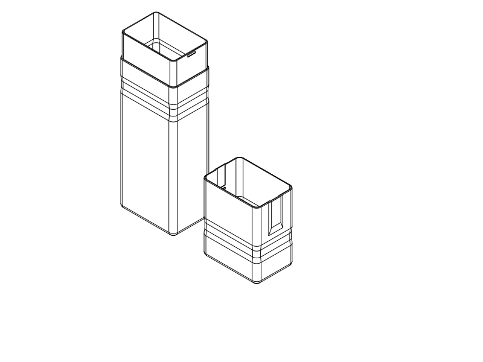

# Dental Travel Case

A slim, two-piece PETG travel box (`74.2 × 51.2 × 264 mm` closed exterior) designed to hold a `255 mm` electric toothbrush (up to `30 mm` handle diameter) and a `160 × 55 × 40 mm` toothpaste tube without internal clips or dividers.



## At a Glance: What to Do Now

- **Current action:** Review the [smoother exterior SVG options](renders/concepts/smooth_exterior_comparison.svg) and [grip / catch details](renders/concepts/smooth_exterior_details.svg) before printing. A–C are proposals only; [design discussion and tradeoffs](notes/smooth_exterior.md).
- **Existing printable model (on hold for appearance review):** **Three-line wrap-grip short-lap case**
  - **Files:** [`short_lap_case_three_line_grip.step`](short_lap_case_three_line_grip.step) · [`short_lap_case_three_line_grip.stl`](short_lap_case_three_line_grip.stl) · [Python source](short_lap_case_three_line_grip.py)
  - **What it is:** The `30 mm` short-lap wall-snap case with **`1.2 mm` (three-extrusion-line) walls** (~41% lighter than the `2 mm` version, ~`108.5 g` total), **smooth `0.7 mm` deep × `20 mm` wide full-wrap grip bands** (`+55 mm` on cap, `-30 mm` on body from the seam), blended snap-backing pads, and **no seam finger notches**.
  - **How to print:** PETG, `0.4 mm` nozzle, `0.2 mm` layers, **3 wall loops**, `7%` adaptive cubic infill, `5 mm` automatic brim, **no supports** ([Orca process profile](notes/short_lap/profiles/process.json)). Body prints upright (`204 mm` tall); cap prints inverted on its roof (`90 mm` tall). You can select just the cap in your slicer if you want to inspect the feel first, though fit testing requires the matching thin body.
- **What NOT to Do / Closed Branches:**
  - **Do NOT print the hinged cases (`C6`, `C7`, `C8`):** The `C8` shortened loop broke on its first push and the hinged direction is **permanently discarded**.
  - **Do NOT print `M1`–`M5` deep-sleeve cases:** `M1` was printed and works as a shell (and currently hosts the [TPU liner experiment](../dental_travel_case_liner/README.md)), but its `78 mm` sleeve and cantilever hooks had weak retention and pulled apart too easily.
  - **Do NOT mix `2 mm` and `1.2 mm` parts:** The `2 mm` control (`short_lap_case.step`) and `1.2 mm` three-line (`short_lap_case_three_line_grip.step`) have different internal wall offsets—always pair matching bodies and caps.
  - **Do NOT run further sideways-impact FEA:** The computational side-knock release study is closed (`INCONCLUSIVE`); verify bag-bump retention physically with the printed box.

---

## How the Current Design Works

### 1. Wraparound Grip Bands & Upright Opening (`grip_human.md`)


Because the box holds a loose toothbrush and toothpaste tube, **open it upright or diagonally with the body underneath** so contents do not spill out:
1. **Support with the lower hand:** Wrap your lower hand around the body grip band (`-30 mm` below the seam, spanning `-40` to `-20 mm`). Its lower curved shoulder stops your hand from sliding down.
2. **Pull with the upper hand:** Wrap or pinch the cap grip band (`+55 mm` above the seam, spanning `+45` to `+65 mm`, `6 mm` clear of the snap-backing blend). Its upper curved shoulder gives your fingers a gentle slope to push upward against.
3. **Lift straight up:** The snap releases within the first `6 mm` of travel, the sleeve clears at `30 mm`, and a `90 mm` lift clears the top of the enclosed toothbrush.

- **Actual CAD cross-sections:** [SVG](notes/grip_human/finished_band_sections.svg) · [PNG](notes/grip_human/finished_band_sections.png)
- **Band placement comparison (`+40`, `+50`, `+55`, `+65 mm`):** [SVG](notes/grip_human/placement_comparison.svg) · [PNG](notes/grip_human/placement_comparison.png) · [Full placement & CAD record](notes/grip_human.md)

### 2. Three-Line (`1.2 mm`) Wall Construction vs. `2 mm` Control (`wall_comparison.md`)


With a `0.4 mm` nozzle and 3 configured wall loops in OrcaSlicer, a `2 mm` wall actually slices as **5 extrusion strokes** (`183.3 g`, `5 h 01 m`). Thinning the main walls to **`1.2 mm`** produces **3 continuous extrusion strokes** (two `0.42 mm` outer walls + one `0.43 mm` center gap-fill line) with zero sparse infill, cutting filament use by **40.8% (`108.5 g`, `4 h 05 m`)**.
- To keep `1.2 mm` of solid backing behind the `0.6 mm` snap pockets without cutting slots through the shell, the thin cap adds two smooth `0.65 mm` exterior pads (`19 mm` wide with tangent cubic blends) over the end catches.
- [Full wall & comfort comparison record](notes/wall_comparison.md) · [Comfort blend details SVG](notes/wall_comparison/comfort.svg)

### 3. Short-Lap (`30 mm`) End-Wall Snaps & Sideways-Knock Findings (`short_lap.md`)

| Diagram | What it shows |
| --- | --- |
| [Actual CAD joint sections (`short_lap/sections.svg`)](notes/short_lap/sections.svg) | `30 mm` overlap (62% shorter than `M1`'s `78 mm` sleeve), `0.6 mm` opposed end-wall bumps, `0.10 mm` per-side guide clearance, and relief tracks that stop tooth drag after the initial `6 mm` snap. |
| [What was tried for sideways hits (`sideways_test_map.svg`)](notes/short_lap/sideways_test_map.svg) | Visual map of completed static checks vs. interrupted contact runs. **No physical drop tests or dynamic impact simulations were run.** |
| [What the `12.6 N` snapshot means (`sideways_result_explained.svg`)](notes/short_lap/sideways_result_explained.svg) | Under a static sideways push on the cap roof of `12.6 N` (~`1.3 kgf`, about the weight of a full `1.25 L` bottle), one end catch loses nearly all of its overlap (`0.028 mm` left) while the far catch stays hooked (`0.347 mm`). Whether a real bag bump pops the cap off requires a physical test with the printed case. |

- [Full short-lap mechanics & sideways-hit record](notes/short_lap.md)

---

## All Deliverable Files in `model/dental_travel_case/`

| Variant / Phase | Status | Printable STEP / STL | Notes |
| --- | --- | --- | --- |
| **Three-line wrap-grip case (Current)** | **On hold for appearance review** (`Unknown` print status) | [`short_lap_case_three_line_grip.step`](short_lap_case_three_line_grip.step) · [`.stl`](short_lap_case_three_line_grip.stl) | `1.2 mm` walls, `+55/-30 mm` wrap bands, no seam notches. |
| **Three-line case (with old seam notches)** | Superseded comparison (`Unknown`) | [`short_lap_case_three_line.step`](short_lap_case_three_line.step) · [`.stl`](short_lap_case_three_line.stl) | Earlier `1.2 mm` pair before wrap-grip bands replaced seam notches. |
| **`2 mm` thick short-lap case** | Heavy control (`Unknown`) | [`short_lap_case.step`](short_lap_case.step) · [`.stl`](short_lap_case.stl) | `2.0 mm` walls (`183 g`), rounded seam notches, no wrap bands. |
| **Short-lap joint test crop (`2 mm`)** | Optional test coupon (`No`) | [`short_lap_joint_test.step`](short_lap_joint_test.step) · [`.stl`](short_lap_joint_test.stl) | `46 mm` cropped body + full `90 mm` `2 mm` cap. |
| **Printed `M1` slim box** | **Printed & usable shell**, weak retention (Superseded) | [`m1_slim_dental_case.step`](m1_slim_dental_case.step) · [`.stl`](m1_slim_dental_case.stl) | Printed 2026-10-15; fits brush + paste, but halves pull apart without pressing release buttons. |
| **Earlier discarded/historical files** | **Do not print** | See historical notes below | Hinged (`C6`–`C8`), `M2`–`M5`, `R1`–`R4`, cylinder, and initial two-lane clamshell. |

---

## Print Status & Verification Summary

| Item | Print status | Artifact(s) | User result or remaining physical checks |
| --- | --- | --- | --- |
| **Test pieces** | Historical partial; current N/A | Full `short_lap_case_three_line_grip` pair has no separate coupon (`short_lap_joint_test` is for `2 mm` control) | Earlier: initial handle clip/socket worked (2026-10-14); `M1` joint coupon partly worked (2026-10-15); two short wall-snap coupons had high effort/noise (2026-10-19); `C8` shortened hinge loop broke on first push (2026-10-19). |
| **Final printable object** | **Unknown** (Current 3-line grip case unprinted) | `short_lap_case_three_line_grip.step` / `.stl` | `M1` full box printed and usable (2026-10-15) with inadequate retention. Current `30 mm` 3-line wrap-grip case needs physical check for grip feel, snap effort/return, combined brush+paste packing, and bag-bump retention. |

### Verification & Scope Limits
- **CAD & Slicer:** Valid CadQuery geometry, 66 section thickness checks, individual brush (`30 mm`) and tube (`55 × 40 mm`) passage gauges, and OrcaSlicer 2.4.2 smoke slices (`0` notices, no supports, verified 3-stroke wall toolpaths) pass for `slim-short-lap-three-line-grip` ([report](notes/grip_human/finished_verification.json)).
- **Physical Unknowns:** Slicer STL checks do not test Orca's GUI STEP importer. Actual PETG snap force, layer-bond durability, simultaneous loaded packing of the real brush and tube, grip traction, and resistance to knocks inside a packed travel bag remain physical checks (`UNKNOWN` / `INCONCLUSIVE`).
- **Reproduce verification CLI:**
  ```sh
  ./execute.py --threads 1 model/dental_travel_case/verification.py --variant slim-short-lap-three-line-grip
  ```

---

## Navigation: Detailed Engineering Notes & History

All historical phases, negative results, and solver investigations are preserved in [`notes/`](notes/README.md):

1. **Current Short-Lap Architecture and Exterior Exploration**
   - [`notes/smooth_exterior.md`](notes/smooth_exterior.md) — SVG-only exploration of one-way body shoulders, exposed overlap grip and a continuous cap exterior; no revised printable geometry yet.
   - [`notes/grip_human.md`](notes/grip_human.md) — Wraparound grip band placement (`+55 / -30 mm`), upright opening walkthrough, finished 3-line CAD sections, and retirement of the over-constrained MyoSim 4-finger search ([`notes/grip_human/native_search.md`](notes/grip_human/native_search.md)).
   - [`notes/wall_comparison.md`](notes/wall_comparison.md) — `2 mm` (5-stroke) vs. `1.2 mm` (3-stroke) wall comparison, local snap-backing pads, finger-slot edge rounding, and `A`/`B`/`C` & `B1`–`B4` grip concept SVGs.
   - [`notes/short_lap.md`](notes/short_lap.md) — Selection of `30 mm` overlap (`18`/`24`/`30 mm` comparison), sideways-hit deformable contact investigation (`12.6 N` snapshot), and practical stopping lessons.
2. **Earlier Wall-Snap Coupon Trials (Oct 17–19, 2026 — Superseded)**
   - [`notes/closure_short.md`](notes/closure_short.md) — Shortened wall-snap samples (two printed with high effort/noise before the `30 mm` full-case redesign).
   - [`notes/closure_pull.md`](notes/closure_pull.md) & [`notes/closure_research.md`](notes/closure_research.md) — `R1`–`R4` minimal wall-flexure specimens and `R1`/`R2` pull-force studies.
3. **Discarded Hinged Mini-Box Branch (Oct 17–19, 2026 — Discontinued)**
   - [`notes/spine.md`](notes/spine.md) (`C8` flush TPU spine — shortened loop broke on first push), [`notes/internal_hinge.md`](notes/internal_hinge.md) (`C7` internal pivot shelves — rejected before printing), [`notes/clamshell_exploration.md`](notes/clamshell_exploration.md) (`C6`).
4. **Printed `M1` Slim Box & Deep-Sleeve Revisions (Oct 14–16, 2026 — Superseded)**
   - [`notes/m1.md`](notes/m1.md) — Printed `M1` (`264 × 74.2 × 51.2 mm`, `78 mm` lap) build and physical feedback (usable shell, weak retention).
   - [`notes/m2.md`](notes/m2.md), [`notes/m3.md`](notes/m3.md), [`notes/m4.md`](notes/m4.md), [`notes/m5.md`](notes/m5.md) — Follow-up retention and space-recovery investigations on the `M1` architecture.
   - [`notes/slim_exploration.md`](notes/slim_exploration.md) & [`notes/cylinder.md`](notes/cylinder.md) — Initial slim concept selection and threaded cylinder alternative.
5. **Original Measured Two-Lane Clamshell & Provenance (Oct 13–14, 2026)**
   - [`notes/README.md`](notes/README.md) & [`notes/current_design.md`](notes/current_design.md) — User item measurements (`255 mm` brush, `160 × 55 × 40 mm` paste), initial `handle_clip` print feedback (`27.3 mm` bore / `25.4 mm` throat adjustment), and `R1`–`R3` rounded clamshell studies.
   - [`notes/provenance.md`](notes/provenance.md) & [`notes/agent_effort.md`](notes/agent_effort.md) — Model attribution and historical token/timing records.
