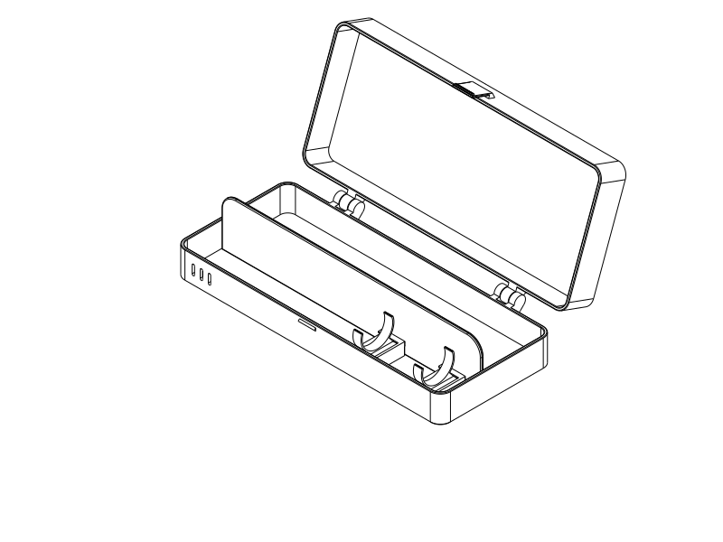

# Dental travel case — measured two-lane revision

A single-material PETG travel case for the electric toothbrush **with its head
attached**, plus a roomy toothpaste side. Floss can occupy spare space if it fits;
there is no dedicated floss slot, divider or guaranteed capacity. No TPU, glue,
separate hinge pin or purchased hardware is needed. Pack dry items; charger excluded.



## Measured items and user intent

User measurements dictated 2026-10-13 are approximate, not caliper-qualified:

| Item/feature | Reported measurement |
| --- | --- |
| Complete brush | 250–255 mm long; use 255 mm for design |
| Handle | Approximately 30 mm diameter; mostly cylindrical, narrowing near head |
| Handle bottom to shoulder | 165 mm |
| Shoulder to head tip, including neck | 90 mm |
| Head width | 10–15 mm |
| Head thickness, including bristles | Up to 25 mm |
| Button | 10–20 mm long; approximately 115 mm from butt is **tentative** |
| New toothpaste tube | Approximately 160 × 55 × 40 mm, cap approximately 30 mm diameter |

The first spoken brush length in millimetres was corrected by the user to
centimetres. The 90 mm dimension includes neck and head; it is not bristle-block
length. Actual neck transition geometry and precise head offset remain unknown. A
provisional 28 mm head block and 62 mm neck represent the measured combined
90 mm span; these separate lengths are agent assumptions.
The inspection uses simplified envelopes, not exact product replicas.

The user explicitly prefers a toothbrush side and toothpaste side, room for other
tube versions, compliant printed features preferably without a separate TPU print,
and small easy/quick fit tests delivered alongside the full model. Floss fit and
movement do not matter; user-supplied tissue packing is acceptable. The earlier
instruction to make no code changes was superseded by explicit authorization to
model both the complete case and test pieces. No physical print result was reported.

## Design and size

- Shell closed: **263.8 × 112.2 × 54.8 mm**, excluding external hinge/latch.
- Flat main print placement: **263.8 × 248.44 mm**, with maximum height 51.8 mm.
  The long brush nearly fills the Qidi Q2C's 270 mm bed axis: use **at most a
  3 mm brim and no skirt**, center the complete layout, and preserve both shells'
  relative positions. Larger brush lengths require revisiting placement/design.
- Brush lane: 41 mm wide, 259 mm internal length, nominal 2 mm end clearance.
  Long rounded separator protects the brush from the toothpaste side.
- Toothpaste design envelope: **200 × 60 × 44 mm**, deliberately larger than the
  measured tube. Storage lane is 64 mm wide and 50 mm high; no tightly shaped
  tube pocket or tube clamp. Alternative tubes remain subject to actual fit.
- Two identical removable clips sit 25 and 85 mm from the handle butt. The
  tentative 105–125 mm button band is clear of both 8 mm-wide clips.
- PETG clips have 1.2 mm curved arms, 30.3 mm bore and 28.4 mm entry throat.
  The throat geometrically captures a nominal 30 mm handle; the bore is relieved
  rather than friction-clamping it continuously. Modest seated movement is expected.
- Dovetail feet stop upward/sideways escape; a socket back wall stops forward
  sliding. Sloping ribs provide 0.15 mm nominal local interference relative to
  the channel (0.35 mm bump minus 0.20 mm side allowance). Actual holding force
  and easy sliding removal remain unmeasured.
- Removed the old shoulder stop because the neck is unmeasured; axial travel is
  limited by the case's end space instead. Inspect actual head/bristle clearance
  and button contact in the complete case before relying on it for travel.

Retained the established captive conical hinge and spring latch, translated to
the new shell dimensions. A hinge keeps the lid attached in travel; the latch
provides deliberate closure/release. A separate lid would add a loose part.
Removing the floss divider eliminates a part, cleaning obstruction and fit task.
No tube retention mechanism is necessary for this roomy closed compartment.

## Deliverables

STEP is the primary interchange format. Each printable STEP has a matching STL
in millimetres, generated from the same geometry and placement.

| STEP / matching STL | Purpose |
| --- | --- |
| [handle_clip.step](../handle_clip.step) / [STL](../handle_clip.stl) | **Smallest first test:** one exact production clip, feet down. Reusable if successful. |
| [handle_test.step](../handle_test.step) / [STL](../handle_test.stl) | One clip plus raised production socket on a small base; no shoulder gauge. |
| [dental_travel_case.step](../dental_travel_case.step) / [STL](../dental_travel_case.stl) | Full captive case, both shells open and panels down on one plate. |
| [accessories.step](../accessories.step) / [STL](../accessories.stl) | Two production clips. Omit a copy if reusing a successful test clip. |
| [hinge_test.step](../hinge_test.step) / [STL](../hinge_test.stl) | Exact local hinge with representative walls/webs. |
| [latch_test.step](../latch_test.step) / [STL](../latch_test.stl) | Exact latch/keeper and supporting wall crops. |
| [test_pieces.step](../test_pieces.step) / [STL](../test_pieces.stl) | Optional combined hinge, latch and handle tests; do not also print their individual duplicates. |

Useful views: [small socket/clip test](../renders/tests/handle_test_isometric.png),
[loaded envelope layout](../renders/fit/fit_preview_top.png), and
[main print placement](../renders/print/dental_travel_case_top.png).

[dental_travel_case_assembled.step](../dental_travel_case_assembled.step) is a
closed **inspection-only** assembly, not the print placement. Inspection Python
entry points likewise include operating poses or display-only content proxies.
Source: [parameters.py](../parameters.py), [design.py](../design.py),
[components.py](../components.py), [mechanisms.py](../mechanisms.py),
[samples.py](../samples.py), primary [entry point](../dental_travel_case.py).

## First print and test procedure

**Print the clip first**, not the full case. Use PETG, 0.4 mm nozzle and 0.2 mm
layers, in the supplied feet-down pose. The diagnostic slice uses two walls and
7% adaptive cubic infill; thin clip arms are defined by their local CAD section,
not strengthened by an infill percentage. Match the final clip settings. PLA can
check gross space but cannot qualify PETG spring, hinge or friction behavior.

1. Gently press the actual handle into the clip at 25 and 85 mm from its butt,
   button upward. It should hold without the handle falling through the throat
   and release with comfortable hand effort. Some bore play is deliberate.
   Stop if it scratches, cracks, whitens, requires excessive force or touches a
   button. Record which location is tight/loose; revise diameter/profile/throat
   before printing the case if either location fails. No useful diameter range
   beyond the nominal handle is physically qualified.
2. If the clip fits, the **handle test** adds socket behavior. Slide the foot from
   the open end to its back stop. It should resist accidental sliding, yet be
   removable back toward the entry with the brush removed. Report binding,
   rocking or a foot that slips out; adjust bump/side clearance independently
   from brush fit. Its raised support matches production locally but omits the
   case panels, second clip, lid, axial end stops and integrated handling.
3. Optional **hinge test:** keep both halves together, remove brim/strings, gently
   free and rotate through 180 degrees. Accept freedom without cracking or
   excessive play; revise mating gaps if fused or loose. Do not split the halves.
4. Optional **latch test:** turn the spring-bearing piece over, bring the two top
   rims together with spring outside the keeper, press shut, and pull the spring
   outward before opening. It should resist light unintended lifting while
   allowing deliberate release without whitening/cracking. This retains the
   entire spring/root but omits large-panel flex and cannot rate bag retention.

These tests are cheaper than discovering poor fit in the full shell. Each uses
production interface geometry/orientation; only the clip is needed for initial
brush-fit uncertainty. A successful sample qualifies its local tested behavior,
not full-case button clearance, head protection, fatigue, crush resistance or drying.
Record material, nozzle/layers, relevant slicer settings, tested file/revision and
observations; a photo of the seated handle helps identify contact locations.

## Printing, assembly and use

Print PETG, 0.4 mm nozzle, 0.2 mm layers. Starting process: two walls, 7% adaptive
cubic, 3 mm brim, no skirt/supports; use your validated PETG temperatures/speeds.
The supplied diagnostic profiles/G-code are not a validated printer job.

Exterior shell panels sit flat on the bed. Sloping hinge webs/conical roofs grow
from attached walls; supports would risk fusing the captive gaps. Clip feet sit
flat; the lower ring's tapered pedestal supports widening layers and leaves upper
arms free. Sloping socket lips/ribs avoid flat unsupported roofs. Rounded panel
corners/rims and separator edges soften handling; bed edges retain chamfers for
adhesion. Large panels depend on reliable adhesion. The clips' curved arms span
layers in the feet-down pose: layer bonding and repeated flex need physical tests.

If reusing one successful sample clip, print one additional `handle_clip` instead
of the two-clip accessories plate.

Keep shell placement fixed when importing STEP; use the matching STL if GUI
compound arrangement is uncertain. Do not scale the model or separate/auto-arrange
hinge halves. Slide two clips into sockets toward the butt end until stopped;
remove toward the head with the brush removed. Place brush head toward vents,
button upward. Place toothpaste in the other lane; optional floss only where it
fits without pressing the brush or preventing closure. Press shut and pull latch
outward to release. Open fully onto a surface for loading. Remove clips for cleaning.
Vents are not a waterproof seal or guaranteed drying in a bag; open after travel.

## Verification and remaining uncertainty

[CAD receipt](cad_review.json) records CadQuery 2.8.0 valid construction. [Product report](verification.json) is produced by the shared
`product_verification.cli`; its variant is explicitly `measured-two-lane`.
Independent CAD checks cover brush/tube clearance, nominal clip bore, unobstructed
button band, sampled loaded lid rotation at 10 degree intervals, socket capture
and backstop with bounded intentional rib overlap, and latch obstruction/released
lift. Hinge samples check rotation at 15 degree intervals and ±1 mm axial capture.
Sampled motion does not prove every intermediate pose; close-range spring deflection
is represented by the separate released-latch witness, not a rigid full-motion solve.

The clip's free arc is about 17.3 mm; each arm needs about 0.8 mm lateral spread
for a 30 mm handle. A straight-beam analogy predicts roughly **0.5% root strain**,
below an agent-selected 1% provisional design screen. Curvature, printed bonding,
root concentration, contact and large motion limit this analogy. It is not a
calibrated material allowable, measured force or durability guarantee. Socket
friction has designed positive local preload, but its useful holding force is
unknown. No physical solver or material calibration was needed for this revision.

All seven printable layouts completed **OrcaSlicer 2.4.2** smoke reviews with no
reported notices and no generated support in the automatic-support probe.
Native receipts are in [slicer_review](slicer_review/), named after each layout.
The complete supplied triplet uses the maintained Qidi Q2C 0.4 mm printer and
Generic PETG profiles with [the local diagnostic 3 mm brim process](slicer_review/process_3mm_brim.json),
based on the maintained 0.20 mm/two-wall/7% profile. Placement was `center` without
rotation; the report records effective settings and identities. This establishes
selected-profile STL layout/toolpath acceptance, not GUI STEP-import success,
physical clearance, spring effort, sag or machine-specific settings.

Product CAD/provisional screen questions pass; physical fit, alternative tubes,
comfortable effort, actual retention, fatigue and integrated use remain **UNKNOWN**.
The shared verification entry-point suite passed **75 tests**. Three focused
negative checks also rejected an unknown variant, absent brush clips and a throat
without geometric capture; these were read-only checks, not physical qualification.
Neither the receipt
nor those tests promote the case to physical readiness. Native `cq.Assembly`
provides named assembled parts; adequate existing local pair/sweep checks were
retained instead of introducing another geometry-check abstraction.

## Physical print status

| Item | Print status | Artifact(s) | User result or remaining physical checks |
| --- | --- | --- | --- |
| Test piece(s) | No — new revision | `handle_clip`, `handle_test`, `hinge_test`, `latch_test`, `test_pieces` STEP/STL | No reported print; grip/release, socket retention, hinge freedom and latch effort pending. |
| Final printable object(s) | No — new revision | `dental_travel_case`, `accessories` STEP/STL | No reported print; actual fit, button/head clearance, integrated handling and durability pending. |

## Regeneration and history

From the repository root:

```sh
./evaluate_model.py model/dental_travel_case/export_and_check.py --views none
./execute.py model/dental_travel_case/verification.py --variant measured-two-lane
```

Only `export_and_check.py` explicitly publishes all named paired artifacts; shared
STL settings are 0.003 mm absolute linear and 0.5 rad angular deflection. Geometry
imports do not export/write notes. For a new slice use `evaluate_model.py
--slice-existing` with the complete printer/process/filament triplet above.
Do not uniformly scale exports: it would scale spring sections and hinge gaps.

The earlier three-item case, divider, 238/26/169 mm provisional brush and shoulder
gauge are superseded. Its full notes and exports remain available in Git at
`d901b13`. The retained [historical PrusaSlicer report](slicer_review/report.md)
and layer images describe that earlier geometry/profile and do not qualify this
revision. [Historical effort notes](agent_effort.md) likewise remain scoped to the
old work. [Provenance](provenance.md) preserves original attribution and records
the user-identified GPT-6.1/medium modelling session separately.
