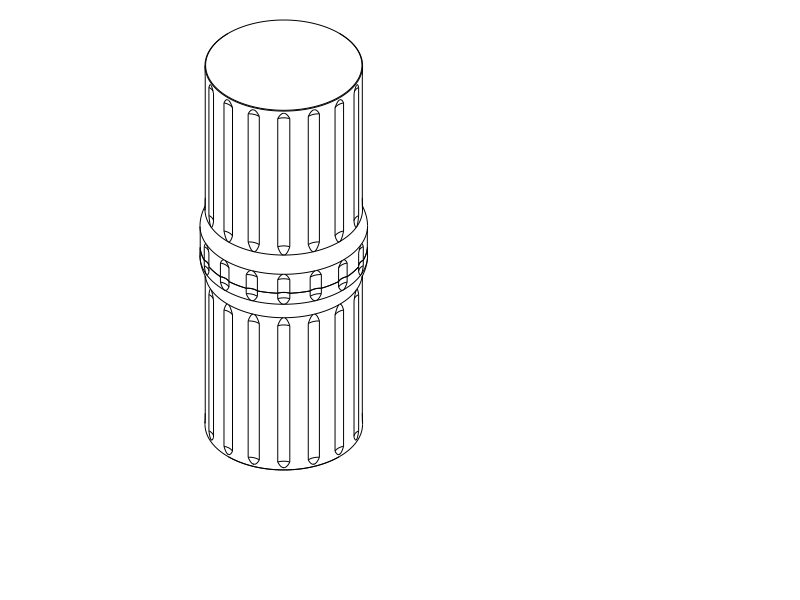

# Dental travel containers — rounded case and plain cylinder

The current alternatives, test layouts, assembly instructions and evidence are in
[Current alternatives](current_design.md). The cylinder has a plain interior:
**no separators or clips**. The R2/C hinged case has positive closed brush
retention and a smaller revised grip, preserving the reported working socket.
New objects and samples remain physically unprinted.



The sections below preserve measurements, physical feedback and historical
measured-case/SVG evidence. The old `dental_travel_case` and associated test exports
are the earlier baseline, not the current rounded or cylinder models.

## Measured items and user intent

User measurements dictated 2026-10-13 are approximate, not caliper-qualified:

| Item/feature | Reported measurement |
| --- | --- |
| Complete brush | 250–255 mm long; use 255 mm for design |
| Handle | Approximately 30 mm diameter; mostly cylindrical, narrowing near head |
| Handle bottom to shoulder | 165 mm |
| Shoulder to head tip, including neck | 90 mm |
| Head width | 10–15 mm |
| Head thickness, including bristles | Up to 25 mm |
| Button | 10–20 mm long; approximately 115 mm from butt is **tentative** |
| New toothpaste tube | Approximately 160 × 55 × 40 mm, cap approximately 30 mm diameter |

The first spoken brush length in millimetres was corrected by the user to
centimetres. The 90 mm dimension includes neck and head; it is not bristle-block
length. Actual neck transition geometry and precise head offset remain unknown. A
provisional 28 mm head block and 62 mm neck represent the measured combined
90 mm span; these separate lengths are agent assumptions.
The inspection uses simplified envelopes, not exact product replicas.

The user explicitly prefers a toothbrush side and toothpaste side, room for other
tube versions, compliant printed features preferably without a separate TPU print,
and small easy/quick fit tests delivered alongside the full model. Floss fit and
movement do not matter; user-supplied tissue packing is acceptable. The earlier
instruction to make no code changes was superseded by explicit authorization to
model both the complete case and test pieces. The user reported printing the handle clip on 2026-10-14; see the scoped feedback below.

## Historical measured-case design and size

- Shell closed: **263.8 × 112.2 × 54.8 mm**, excluding external hinge/latch.
- Flat main print placement: **263.8 × 248.44 mm**, with maximum height 51.8 mm.
  The long brush nearly fills the Qidi Q2C's 270 mm bed axis: use **at most a
  3 mm brim and no skirt**, center the complete layout, and preserve both shells'
  relative positions. Larger brush lengths require revisiting placement/design.
- Brush lane: 41 mm wide, 259 mm internal length, nominal 2 mm end clearance.
  Long rounded separator protects the brush from the toothpaste side.
- Toothpaste design envelope: **200 × 60 × 44 mm**, deliberately larger than the
  measured tube. Storage lane is 64 mm wide and 50 mm high; no tightly shaped
  tube pocket or tube clamp. Alternative tubes remain subject to actual fit.
- Two identical removable clips sit 25 and 85 mm from the handle butt. The
  tentative 105–125 mm button band is clear of both 8 mm-wide clips.
- PETG clips have 1.2 mm curved arms, 30.3 mm bore and 28.4 mm entry throat.
  The throat geometrically captures a nominal 30 mm handle; the bore is relieved
  rather than friction-clamping it continuously. Modest seated movement is expected.
- Dovetail feet stop upward/sideways escape; a socket back wall stops forward
  sliding. Sloping ribs provide 0.15 mm nominal local interference relative to
  the channel (0.35 mm bump minus 0.20 mm side allowance). Actual holding force
  and easy sliding removal remain unmeasured.
- Removed the old shoulder stop because the neck is unmeasured; axial travel is
  limited by the case's end space instead. Inspect actual head/bristle clearance
  and button contact in the complete case before relying on it for travel.

Retained the established captive conical hinge and spring latch, translated to
the new shell dimensions. A hinge keeps the lid attached in travel; the latch
provides deliberate closure/release. A separate lid would add a loose part.
Removing the floss divider eliminates a part, cleaning obstruction and fit task.
No tube retention mechanism is necessary for this roomy closed compartment.

## Historical measured-case deliverables

STEP is the primary interchange format. Each printable STEP has a matching STL
in millimetres, generated from the same geometry and placement.

| STEP / matching STL | Purpose |
| --- | --- |
| [handle_clip.step](../handle_clip.step) / [STL](../handle_clip.stl) | **Smallest first test:** one exact production clip, feet down. Reusable if successful. |
| [handle_test.step](../handle_test.step) / [STL](../handle_test.stl) | One clip plus raised production socket on a small base; no shoulder gauge. |
| [dental_travel_case.step](../dental_travel_case.step) / [STL](../dental_travel_case.stl) | Full captive case, both shells open and panels down on one plate. |
| [accessories.step](../accessories.step) / [STL](../accessories.stl) | Two production clips. Omit a copy if reusing a successful test clip. |
| [hinge_test.step](../hinge_test.step) / [STL](../hinge_test.stl) | Exact local hinge with representative walls/webs. |
| [latch_test.step](../latch_test.step) / [STL](../latch_test.stl) | Exact latch/keeper and supporting wall crops. |
| [test_pieces.step](../test_pieces.step) / [STL](../test_pieces.stl) | Optional combined hinge, latch and handle tests; do not also print their individual duplicates. |

Useful views: [small socket/clip test](../renders/tests/handle_test_isometric.png),
[loaded envelope layout](../renders/fit/fit_preview_top.png), and
[main print placement](../renders/print/dental_travel_case_top.png).

[dental_travel_case_assembled.step](../dental_travel_case_assembled.step) is a
closed **inspection-only** assembly, not the print placement. Inspection Python
entry points likewise include operating poses or display-only content proxies.
Source: [parameters.py](../parameters.py), [design.py](../design.py),
[components.py](../components.py), [mechanisms.py](../mechanisms.py),
[samples.py](../samples.py), primary [entry point](../dental_travel_case.py).

## First print and test procedure

**Print the clip first**, not the full case. Use PETG, 0.4 mm nozzle and 0.2 mm
layers, in the supplied feet-down pose. The diagnostic slice uses two walls and
7% adaptive cubic infill; thin clip arms are defined by their local CAD section,
not strengthened by an infill percentage. Match the final clip settings. PLA can
check gross space but cannot qualify PETG spring, hinge or friction behavior.

1. Gently press the actual handle into the clip at 25 and 85 mm from its butt,
   button upward. It should hold without the handle falling through the throat
   and release with comfortable hand effort. Some bore play is deliberate.
   Stop if it scratches, cracks, whitens, requires excessive force or touches a
   button. Record which location is tight/loose; revise diameter/profile/throat
   before printing the case if either location fails. No useful diameter range
   beyond the nominal handle is physically qualified.
2. If the clip fits, the **handle test** adds socket behavior. Slide the foot from
   the open end to its back stop. It should resist accidental sliding, yet be
   removable back toward the entry with the brush removed. Report binding,
   rocking or a foot that slips out; adjust bump/side clearance independently
   from brush fit. Its raised support matches production locally but omits the
   case panels, second clip, lid, axial end stops and integrated handling.
3. Optional **hinge test:** keep both halves together, remove brim/strings, gently
   free and rotate through 180 degrees. Accept freedom without cracking or
   excessive play; revise mating gaps if fused or loose. Do not split the halves.
4. Optional **latch test:** turn the spring-bearing piece over, bring the two top
   rims together with spring outside the keeper, press shut, and pull the spring
   outward before opening. It should resist light unintended lifting while
   allowing deliberate release without whitening/cracking. This retains the
   entire spring/root but omits large-panel flex and cannot rate bag retention.

These tests are cheaper than discovering poor fit in the full shell. Each uses
production interface geometry/orientation; only the clip is needed for initial
brush-fit uncertainty. A successful sample qualifies its local tested behavior,
not full-case button clearance, head protection, fatigue, crush resistance or drying.
Record material, nozzle/layers, relevant slicer settings, tested file/revision and
observations; a photo of the seated handle helps identify contact locations.

## Historical measured-case printing, assembly and use

Print PETG, 0.4 mm nozzle, 0.2 mm layers. Starting process: two walls, 7% adaptive
cubic, 3 mm brim, no skirt/supports; use your validated PETG temperatures/speeds.
The supplied diagnostic profiles/G-code are not a validated printer job.

Exterior shell panels sit flat on the bed. Sloping hinge webs/conical roofs grow
from attached walls; supports would risk fusing the captive gaps. Clip feet sit
flat; the lower ring's tapered pedestal supports widening layers and leaves upper
arms free. Sloping socket lips/ribs avoid flat unsupported roofs. Rounded panel
corners/rims and separator edges soften handling; bed edges retain chamfers for
adhesion. Large panels depend on reliable adhesion. The clips' curved arms span
layers in the feet-down pose: layer bonding and repeated flex need physical tests.

If reusing one successful sample clip, print one additional `handle_clip` instead
of the two-clip accessories plate.

Keep shell placement fixed when importing STEP; use the matching STL if GUI
compound arrangement is uncertain. Do not scale the model or separate/auto-arrange
hinge halves. Slide two clips into sockets toward the butt end until stopped;
remove toward the head with the brush removed. Place brush head toward vents,
button upward. Place toothpaste in the other lane; optional floss only where it
fits without pressing the brush or preventing closure. Press shut and pull latch
outward to release. Open fully onto a surface for loading. Remove clips for cleaning.
Vents are not a waterproof seal or guaranteed drying in a bag; open after travel.

## Historical measured-case verification and remaining uncertainty

[CAD receipt](cad_review.json) records CadQuery 2.8.0 valid construction. [Product report](verification.json) is produced by the shared
`product_verification.cli`; its variant is explicitly `measured-two-lane`.
Independent CAD checks cover brush/tube clearance, nominal clip bore, unobstructed
button band, sampled loaded lid rotation at 10 degree intervals, socket capture
and backstop with bounded intentional rib overlap, and latch obstruction/released
lift. Hinge samples check rotation at 15 degree intervals and ±1 mm axial capture.
Sampled motion does not prove every intermediate pose; close-range spring deflection
is represented by the separate released-latch witness, not a rigid full-motion solve.

The clip's free arc is about 17.3 mm; each arm needs about 0.8 mm lateral spread
for a 30 mm handle. A straight-beam analogy predicts roughly **0.5% root strain**,
below an agent-selected 1% provisional design screen. Curvature, printed bonding,
root concentration, contact and large motion limit this analogy. It is not a
calibrated material allowable, measured force or durability guarantee. Socket
friction has designed positive local preload, but its useful holding force is
unknown. No physical solver or material calibration was needed for this revision.

All seven printable layouts completed **OrcaSlicer 2.4.2** smoke reviews with no
reported notices and no generated support in the automatic-support probe.
Native receipts are in [slicer_review](slicer_review/), named after each layout.
The complete supplied triplet uses the maintained Qidi Q2C 0.4 mm printer and
Generic PETG profiles with [the local diagnostic 3 mm brim process](slicer_review/process_3mm_brim.json),
based on the maintained 0.20 mm/two-wall/7% profile. Placement was `center` without
rotation; the report records effective settings and identities. This establishes
selected-profile STL layout/toolpath acceptance, not GUI STEP-import success,
physical clearance, spring effort, sag or machine-specific settings.

Product CAD/provisional screen questions pass; physical fit, alternative tubes,
comfortable effort, actual retention, fatigue and integrated use remain **UNKNOWN**.
The shared verification entry-point suite passed **75 tests**. Three focused
negative checks also rejected an unknown variant, absent brush clips and a throat
without geometric capture; these were read-only checks, not physical qualification.
Neither the receipt
nor those tests promote the case to physical readiness. Native `cq.Assembly`
provides named assembled parts; adequate existing local pair/sweep checks were
retained instead of introducing another geometry-check abstraction.

## Historical baseline print status

| Item | Print status | Artifact(s) | User result or remaining physical checks |
| --- | --- | --- | --- |
| Test piece(s) | Partial — clip and socket reported printed 2026-10-14 | Baseline clip/socket geometry; exact exported file unconfirmed | User reports clip and socket worked in PETG, 0.4 mm nozzle / 0.2 mm layers. Both grip bore and throat should shrink 3 mm. New grip and hinge/latch remain unprinted. |
| Final printable object(s) | No — new revision | `dental_travel_case`, `accessories` STEP/STL | No reported print; actual fit, button/head clearance, integrated handling and durability pending. |

## Backpack retention and cylinder direction — 2026-10-14

The user requires the hinged case to keep the brush held when a backpack rotates
through arbitrary orientations; an open-looking holder without meaningful
retention is inadequate. The revised grip uses the clarified 27.3 mm bore and
25.4 mm throat. Development adds closed-lid lift guards and removable foot gates,
so closed retention does not depend only on friction. Printed holding force,
closed-case shake behavior and durability remain physical questions.

The user also delegates exploration/implementation of a simpler cylindrical
alternative with a threaded joint near its lengthwise midpoint and an exterior
that is easy to grip with wet hands, inspired by the existing Vaseline jar.
The user explicitly exempts this cylinder from brush clips, separators and fitted
pockets: keep the interior plain and reasonably snug; its primary role is protection
from outside pressure. This exception does not cancel the hinged-case retention
request. No numerical crush load or wet-grip acceptance threshold was supplied.

## Clip feedback — 2026-10-14

The user printed the clip **and its socket**, in PETG with a 0.4 mm nozzle and
0.2 mm layers. The clip fitted into the socket without problems, and the handle
holder worked. The user clarifies that **both** the holding bore and snap-in
opening should be 3 mm smaller. The new trial therefore targets a 27.3 mm bore
and 25.4 mm throat, while preserving the tested foot/socket mating geometry.
The original approximate 30 mm handle measurement remains historical input;
27 mm is the nominal grip target inferred from this later fit correction, not a
new caliper measurement. Whole-case clearance still reserves the 30 mm handle.

The presumed artifacts are the baseline `handle_test` clip/socket geometry
(introduced in `47b5862`, unchanged through `07ed104`); exact printed file identity
and other slicer settings are unconfirmed. This qualifies the reported local
socket insertion and useful baseline holder behavior, not the smaller grip,
full-case fit/handling, new hinge/latch, fatigue or retention in a bag.

## Concealed hinge proposals — SVG exploration

[Comparison SVG](../renders/concepts/hinge_options.svg) / [PNG preview](../renders/concepts/hinge_options.png).
These are schematic proposals requested by the user, not implemented variants.
Current model source, paired exports and print-status entries are unchanged.

| Proposal | Closed appearance and normal use | Consequential tradeoff / next CAD question |
| --- | --- | --- |
| [A — smooth covered spine](../renders/concepts/hinge_a.svg) | Conceal the existing external hinge stations under a continuous rounded rear cover, split at the lid seam. Retain 180° opening as a goal. | Retains the external axis and a thicker rear silhouette; adds material. Cover halves must clear the full sweep and print without trapped support. Existing hinge evidence does not qualify changed roots/shrouds automatically. |
| [B — internal recessed pivot](../renders/concepts/hinge_b.svg) | Two local hinge pockets behind an overlapping rear edge; no exposed barrels when closed. Target roughly 110–120° opening for loading. | Preferred first direction for a clean silhouette. Local pockets consume toothpaste space or require a wider shell. Inset axes conflict with an unchanged flat 180° shell layout: print shells separately and assemble the hinge with printed pins/captures. Actual stop angle, rim clearance, pin insertion/retention and cavity protection need CAD review. |
| [C — concealed folding link](../renders/concepts/hinge_c.svg) | Two pivots joined by a short link, folded inside when closed and extended as the lid opens. Aim for flat opening without external closed barrels. | Only worth pursuing if flat opening is important enough to justify extra links/pins, assembly, play and binding risk. Requires coordinated motion, positive stops, pocket space and relieved rear edges covered when shut. |

All proposals retain the single-material PETG intent; none assumes a TPU living
hinge or purchased hardware. A prioritizes minimal mechanism change, B prioritizes
concealment, and C prioritizes concealment plus flat opening. Diagrams show pivot
locations and opening ideas, not verified tolerances, continuous motion, support
strategy or physical function. A hidden pivot alone cannot establish a protected
cavity: rear-edge overlap and any link slots must be reviewed with contents loaded.
The current barrel projects approximately 14 mm beyond the basic rear wall,
calculated from `HY + HINGE_RADIUS - OD/2`; it is not a new CAD bounds audit.
For A, the moving cover needs a larger radius than the fixed cover: equal-radius
half covers would collide as the lid opens. The section therefore sketches nested
cover radii, increasing rear bulk; their attachments still need a sweep check.

The initial hinge-comparison recommendation was B, with A as the simpler covered
alternative. The user's subsequent form exploration instead takes an interest in
C as its shared hinge direction. Current clip/socket test files remain the
measured revision's files; this exploration changes no grip geometry or print status.
No CAD regeneration or smoke slice was needed for these drawing-only proposals.
SVG syntax, PNG rendering and local links were checked; the comparison was
visually inspected. Attribution remains the user-identified GPT-6.1/medium Codex
session recorded in [provenance](provenance.md).

## Rounded shell proposals — C hinge direction

[Comparison SVG](../renders/concepts/rounded_forms.svg) /
[PNG preview](../renders/concepts/rounded_forms.png).
The user finds the current overall form too rectangular, especially in views
other than the top, and is interested in hinge C. This round explores shell form
with C as shared intent; neither the hinge nor a final shell has been selected.
All three show closed perspective, top, long side and end views at comparable
scale. Roof-to-side and side-to-underside curvature change, rather than only
increasing the four plan-view corner radii.

| Direction | Intended difference | Main tradeoff |
| --- | --- | --- |
| [R1 — soft shell](../renders/concepts/r1_form.svg) | Broad rolled transitions around useful flat panels; approximate envelope aim 264 × 112 × 58 mm. Closest to the existing storage arrangement. | Still fairly straight in top view. Rounded underside needs print/support review. |
| [R2 — lens shell](../renders/concepts/r2_form.svg) | Continuously curved end section, curved side profile and softer roof/base; approximate aim 264 × 120 × 60 mm. Preferred first direction for overall roundness with storage room. | About 8 mm wider and 5 mm taller than the current basic shell. Smaller flat bed patch; removable supports may be needed. |
| [R3 — sculpted pebble](../renders/concepts/r3_form.svg) | Asymmetric taper beside the shorter tube while retaining the long brush side; approximate aim 264 × 124 × 60 mm. Most organic outline. | About 12 mm wider than the current shell despite taper. Less spare volume at the storage ends; large tube versions and C hinge packaging are more sensitive. |

Envelope values are **design aims in schematic drawings**, not measured CAD or
accepted dimensions. The blue guides represent the measured 255 mm brush with
30 mm handle and approximate 160 × 55 mm full tube footprint. Orange shows an
agent-proposed 180 × 60 mm footprint allowance for tube variation, not a user
threshold or proof of internal fit. Wall thickness, height variation, exact tube
shape, opening/retrieval and mechanism clearance remain to be checked in CAD.
The old 200 × 60 × 44 mm rectangular capacity was an agent decision; changing that
derived envelope must still preserve the user's actual full tube and meaningful
room for variations.

A true semicircular-ended capsule at the current length/width would crowd the
off-centre long brush: the end width shrinks where its full-diameter butt must sit.
These proposals retain a generous brush-end outline and gain roundness mainly
through the height section; R3 tapers the shorter storage side instead. This is a
cheap spatial screen, not verification of the illustrated interiors. C pockets
are deliberately not positioned in these form drawings. Their two stations need
common pivot-axis directions, space outside the contents, covered rear openings,
positive stops and an assembly/removal path. Extra shell width may be needed.
The wider base shell can partly replace space occupied by today's external hinge,
but final occupied width including the closure is unknown.

Retain single-material PETG intent and a stable local underside bed patch; broad
curved undersides may require accessible removable supports. Separate shell prints
and assembly remain the working C assumption. The long brush still keeps the
case close to the 270 mm bed axis; placement and print aids need renewed review
after shape selection. No support-free, print-in-place or 180°-motion claim is made.

Next decision is the desired shell form: R2 for broad curvature, R3 for stronger
asymmetry, or R1 for a gentler change. All drawing files and PNG rendering were
checked and the comparison visually reviewed. This is SVG-only work: no model
code, exports, geometry checks or slices were changed/run, and print status remains
unchanged. Current clip/socket samples stay available as the measured baseline;
their fit result would not automatically qualify changed shell/hinge integration.
Attribution remains the session recorded in [provenance](provenance.md).

## R2/C without supports — section feasibility study

[SVG explanation](../renders/concepts/r2_c_support_free_study.svg) /
[PNG preview](../renders/concepts/r2_c_support_free_study.png),
[reproducible study](../studies/support_free_r2_c.py) and
[numerical receipt](r2_c_feasibility.json).

**Conclusion: a modified R2 shell with C-style assembled links is geometrically
plausible; the complete product is not yet qualified for printing without supports.**
The exact earlier oval and tiny-link sketch are not established printable designs.
The user asked to explore feasibility, not to replace the production CAD yet.

The R2-S trial uses a 132 × 60 mm closed end section, with a 100 mm flat landing
and continuously curved shoulders. Compared with the R2 drawing's 120 × 60 mm
section and approximately 31 mm landing, this is wider and has broader flat faces.
That visible form compromise is intentional, not a claim to preserve the exact
oval. Target length remains approximately 264 mm, but axial geometry is not built
in this section study. For each 30 mm half, the outer half-width is
`66 - 16*(1 - z/30)**1.5` mm. Its maximum sideways growth is 0.8 mm per mm of
height, or at most 0.16 mm per 0.2 mm layer. The sketched ellipse's initial
tangent predicts approximately 1.47 mm per layer. These are geometric screens,
not universal deposition limits. An axial growth target of 0.5 mm/mm gives a
combined coordinate-growth bound of approximately 0.943 mm/mm; actual 3D corners
must obey that construction rule. Shallow end transitions must finish below the
255 mm brush rather than consume its needed length.

Print concept: two shell halves separately, flat exterior panels down and mouths
up, plus two flat link plates and four short upright printed pins, all PETG.
Use open/sloping roofs at horizontal bearing holes and floor-connected or sloped
mounts; no floating bosses or trapped-support pockets. Pin retention needs positive
capture. This trades print-in-place manufacture for assembly. Actual bearing,
cover and latch geometry and their unsupported starts are still unbuilt/unverified.

The final section trial places body/lid pivots at `(Y,Z)=(49.5,8)` and
`(49.5,52)` mm when closed: 44 mm link spacing. A 0.6 mm total rim gap is an
agent-selected witness condition, not a calibrated tolerance; protective overlap
and rear-slot covers are **excluded** and must later be designed without blocking
motion. A 14 mm link trial collides in the flat-open pose in this layout. Zero-gap
trials collide in the tested initial moves even though endpoint poses can fit.
Thus hiding pivots and checking only closed/open positions is inadequate.

The study uses piecewise polygon sections with 57 height nodes and convex-part
SAT intersections (1e-6 mm projected contact allowance). It checks both shells,
the fixed full-height separator, a conservative polygon around the measured
30 mm round handle, a 15 × 25 mm head proxy, a 60 × 44 mm tube proxy and the table.
The tube is raised 2 mm above the 2.4 mm floor. Brush centre/height and separator
position are changed engineering assumptions, not qualification of the existing
clip/socket integration. The 255 mm brush length is not independently proved by
this transverse section. A proposed 180 mm tube allowance leaves end pockets near
X=±104 mm for the hinge stations; a provisional 20 mm station width leaves 4 mm
from the nominal tube end. Those axial pockets/pins are not constructed in 3D.

Across 1,891 coarse angle pairs, a connected opening route reaches 180° with no
detected shell/contents/table collision at its selected samples. Every accepted
transition is refined to steps of at most 0.2° per joint. Refinement rejected a
coarse candidate near 2° lid / 85° link, and the final route avoids it. This is a
manually guided two-joint path, not a synchronized mechanism or a continuous-path
proof. Green links in the SVG illustrate axes only: solid link/mount interference,
rear covers, pin capture, stops, latch release, gravity and comfortable handling
remain **UNKNOWN**. SAT overlap/touch/separation guards and negative short-link /
zero-gap witnesses run with the study.

Next useful engineering is a representative rear-edge/link CAD study including
covered slots, mounts and pin insertion, followed by an Orca support probe of
those real features and a shell section. A broad flat underside alone cannot
qualify the entire hinge, and a successful hinge sample would not qualify the
full shell or integrated use. No new printable specimen or STEP/STL was produced
here. Production source, existing exports and print-status records are unchanged.
Attribution remains the user-identified GPT-6.1/medium session in [provenance](provenance.md).

To reproduce this exploration from the repository root:

```sh
./execute.py model/dental_travel_case/studies/support_free_r2_c.py model/dental_travel_case/notes/r2_c_feasibility.json
```

## Regeneration and history

From the repository root:

```sh
./evaluate_model.py model/dental_travel_case/export_and_check.py --views none
./execute.py model/dental_travel_case/verification.py --variant measured-two-lane
```

Only `export_and_check.py` explicitly publishes all named paired artifacts; shared
STL settings are 0.003 mm absolute linear and 0.5 rad angular deflection. Geometry
imports do not export/write notes. For a new slice use `evaluate_model.py
--slice-existing` with the complete printer/process/filament triplet above.
Do not uniformly scale exports: it would scale spring sections and hinge gaps.

The earlier three-item case, divider, 238/26/169 mm provisional brush and shoulder
gauge are superseded. Its full notes and exports remain available in Git at
`d901b13`. The retained [historical PrusaSlicer report](slicer_review/report.md)
and layer images describe that earlier geometry/profile and do not qualify this
revision. [Historical effort notes](agent_effort.md) likewise remain scoped to the
old work. [Provenance](provenance.md) preserves original attribution and records
the user-identified GPT-6.1/medium modelling session separately.
