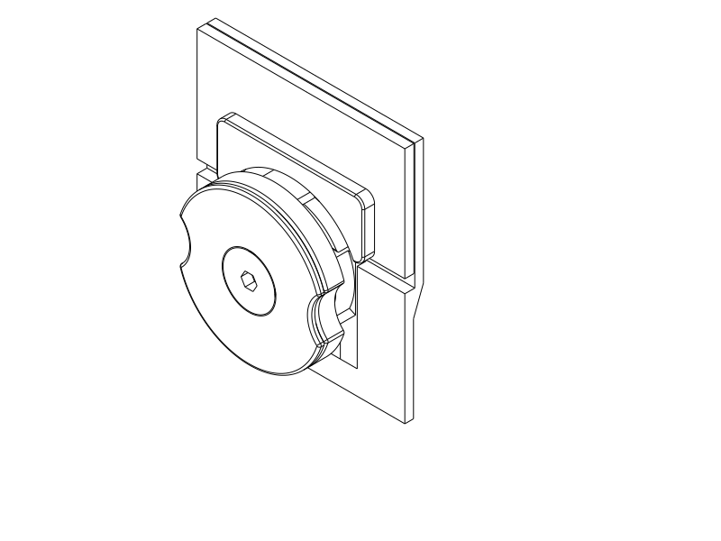
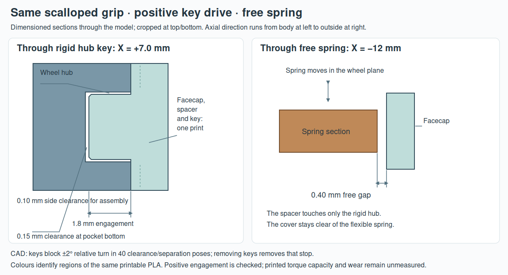
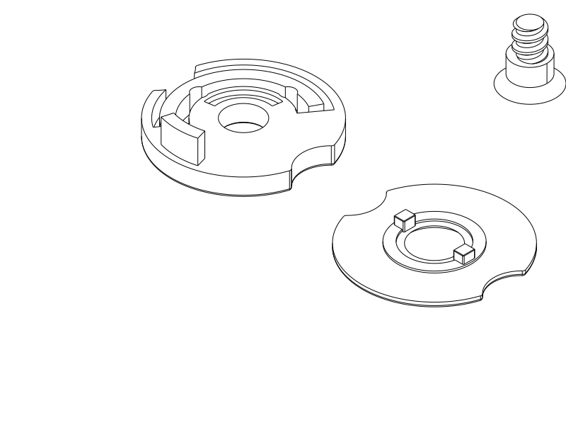

# Matching scalloped facecap and keyed rotary wheel

**Current model: a smooth facecap with the same scalloped grip shape as the wheel, joined by two positive drive keys.** Print the three-part [upgrade kit STEP](../rotary_covered_mechanism.step) / [STL](../rotary_covered_mechanism.stl) / [Python](../rotary_covered_mechanism.py): keyed wheel, matching facecap and longer screw. Reuse the body, lid and printed nut. This covered version is ready for its first PLA trial; physical fit and feel remain untested.

For a complete new box, print the [body + lid STEP](../rotary_covered_case.step) / [STL](../rotary_covered_case.stl) / [Python](../rotary_covered_case.py) and the [complete four-part control kit STEP](../rotary_covered_complete_mechanism.step) / [STL](../rotary_covered_complete_mechanism.stl) / [Python](../rotary_covered_complete_mechanism.py). Six printed parts total, no metal hardware. The assembled/detail/section files are inspection views, not print layouts.

## How the two pieces turn together

The facecap follows the wheel's existing two-sided scalloped outline, instead of the rounder puck shown in the first concept. Both use the same parametric blank, and their common-profile cross-sections match in CAD. The smooth cover hides the front spring/slot openings; a small side gap remains for independent spring movement.

Two **2.4 × 2.8 mm rectangular keys** on the back of the facecap enter matching blind pockets in the rigid hub, at **±7 mm from the axis**. They engage **1.8 mm**, with **0.10 mm side clearance** and **0.15 mm clearance at the pocket bottoms**. A small tip chamfer helps insertion. The key sidewalls carry turning force; the screw's friction is not the drive connection. Small assembly clearance permits some backlash before the keys bear; this is not a zero-play joint or a measured torque rating.

The facecap, annular hub spacer and keys are one printed part. The spacer seats on the rigid hub and leaves **0.40 mm clearance over the spring**. The facecap is **1.2 mm thick**, adding **1.6 mm** outward projection. The longer screw retains the moving parts and still seats against the fixed body journal. Its head is flush, has the same 3 mm hex-key drive and 45° clearance seat, and the threaded region stays completely solid. The successful coarse thread and printed nut are unchanged.

[Editable section SVG](../renders/assembled/covered/keyed_joint.svg). These are dimensioned local sections from the model, not a force/deformation simulation. The left cut passes through a rigid hub key; the right cut passes through the spring. The spacer intentionally touches the hub, while the cover remains clear over the spring.

The old exposed wheel and shorter screw are superseded for this covered assembly. **Change the wheel, facecap and screw as a matching set.** The existing body, lid and printed nut can be retained. A shorter screw may not engage the nut adequately through the new stack.

## Print two material settings

| Parts | Material and settings | Placement and support |
| --- | --- | --- |
| Upgrade kit, or complete control kit | **PLA, 0.4 mm nozzle, 0.2 mm layers, 4 walls, 100% rectilinear infill** | Wheel outer face down, facecap smooth face down with keys up, screw broad head down; nut flat face down if included. **Supports off**; supplied brims/settings are retained. |
| Body and lid only, if needed | PLA, 0.4/0.2 mm, **3 walls, 7% adaptive cubic**, 5 mm automatic brim | Body bottom down, lid roof down. Accessible tree supports at the outside axle-entry bore and cap keeper. |

Use the successful PLA temperature/chamber setup from your working trial. PETG has not been physically tested. The small control parts now use solid infill so the drive keys have a consistent filled section; the large shells keep their lower-material process. The reference estimate is **5.79 g / 27 m 34 s** for the three-part upgrade, or **6.46 g / 31 m 59 s** including a new nut. These are diagnostic PETG estimates, not predictions for the user’s PLA preset. The key pockets have short, doubly supported roofs rather than the old broad annular screw-recess overhang.

1. Remove the old wheel/screw. Keep the body, lid and printed nut. For new shells, clear the accessible exterior bore/keeper support before assembly.
2. Place the facecap's keys into the wheel's hub pockets, lining up the scallops. They should seat on the hub spacer without being forced. Do not sand or glue the spring to the cover. The two equivalent 180° orientations share the same grip outline.
3. Place the paired wheel and facecap over the body journal/pins at LOCK and install the longer screw into the printed nut. Seat gently with a **3 mm hex key**; tightening should not clamp the wheel.
4. Turn the facecap and confirm the wheel follows immediately after the small clearance take-up. Confirm deliberate detent resistance and free release, then try the cap at OPEN and LOCK. Release pulling pressure before unlocking.
5. If the cover turns independently, the keys have not seated or are damaged; extra screw tightening is not the remedy. Check spring clearance and smooth rotation before full loaded/bag use.

## Authorized matching facecap

After the [first concealed-face proposals](hidden_rotary.md), the user explicitly requires the facecap to match the underlying spinning piece so it is easy to hold. They also require a joining mechanism that makes the two pieces really turn together, and authorize proceeding directly to modelling. This replaces the proposed rounder-rim silhouette; the fixed shield remains a historical alternative. The facecap's outlined grip follows the accepted scalloped wheel, while the cover hides the functional openings.

The earlier complete PLA quick trial remains the functional baseline: it worked and stayed together, with slight looseness at corrected temperature. Its later underside-finish complaint led to the exposed conical-head version. These physical reports do not qualify the newly covered/keyed assembly. [Prior full case, screw and print history](rotary_case.md).

## Verification, limits and print status

[CAD report](covered_rotary/cad.json): existing full-case seating, guide/keeper capture, detent-before-release and unlocked paths are composed with the new parts. The cover clears the body, lid, screw and nut at 19 common rotation angles. Forty independent relative-turn witnesses at **±2°**, across 0–0.7 mm separation and small lateral offsets, encounter positive key obstruction. With the keys removed, the same relative rotations clear: the keys provide the rotational stop. Independent body/head axial limits keep the fitted stack below the conservative separation tested. Printed backlash, key strength and wear remain physical questions.

The body's/lid's/nut's geometry is unchanged, and wheel material outside the hub matches the previous spring/nose exactly. The hidden wheel has a small 45° bore lead-in for the extended conical head; the rest of its former large screw recess is filled. The shoulder/drive change preserves the successful thread and its complete solid core. The matching grip outlines are checked through a common section, not inferred solely from overall dimensions.

[Native/slice receipts](covered_rotary/publication.json), [local key/core/roof paths](covered_rotary/print_paths.json), and [product verification](covered_rotary/verification.json) identify the delivered files and setup. Native views were inspected. The smoke setup uses OrcaSlicer 2.4.2, Q2C 0.4 mm and the recorded process presets with **PETG diagnostic filament**; use your successful PLA preset for printing. The primary solid control slice completes with supports off and no notices. The forced support probe proposes a small plug inside one 2.6 × 3 mm pocket; its roof is reviewed as a short bridge anchored on opposing sides. That is a scoped print judgment, not a promise of PLA roof finish. The shell-pair probe keeps the usual exterior bore/keeper supports, with no storage-facing support. This is selected-profile acceptance, not PLA thermal calibration, GUI STEP-import validation, force or durability evidence.

| Item | Print status | Artifacts | Observation / remaining check |
| --- | --- | --- | --- |
| Earlier quick rotary trial | **Yes — successful complete PLA trial** | `rotary_quick_test.step` and earlier custom pair | Functional action works; slightly loose; later front-overhang finish complaint retained. Exact printed hash/settings unknown. |
| Matching keyed control kit | **Unknown — first print prepared** | `rotary_covered_mechanism.py` / `.step` / `.stl` | Confirm easy key seating, limited backlash, free spring, driver durability and co-rotation. |
| Complete covered full case | **Unknown** | `rotary_covered_case` plus `rotary_covered_complete_mechanism`, each `.py` / `.step` / `.stl` | Body/lid retain the 30 mm sleeve, 27 mm engagement, 3 mm reveal and 0.20 mm per-side guide. Loaded grip, bag bumps and wear remain untested. |
| PETG physical trial | **No** | None reported | PLA remains the current development material. |

## Engineering notes and attribution

The first 2 mm-wide key slice left a narrow central strip unfilled under Classic walls; even 100% infill could not fill that strip with the retained gap-fill-disabled preset. Keys were widened inward to 2.4 mm while preserving their outer clearance to the spring. The control kit uses solid infill; final local paths must cover both drive keys and their small pocket roofs. The source/check records preserve the final dimensions, not a strength rating inferred from a “100%” label.

The shared wheel-blank helper now owns the common grip outline. The exposed-wheel screw factory remains a fixed wrapper around an explicit head-position builder; the covered version extends the shoulder/head position without changing the thread. General checks now accept already-built component dictionaries, preserving old callers and allowing the new assembly to compose the same checks. Historical exposed-wheel records remain tied to their original source hashes; no stale receipt is promoted to current qualification.

Variant `rotary-covered-pla` is exposed through the shared product-verification CLI. User intent/provenance is inherited from the rotary case, with added matching-cover and positive-drive requirements. CAD/publication evidence leaves physical use, force and side-impact requirements UNKNOWN.

Primary language model: GPT-6 family; exact model identifier and reasoning effort not exposed. Harness: Codex coding-agent environment. Provider: OpenAI. No subagents. User selected the matching scalloped facecap, required positive co-rotation and authorized direct modelling. Prior attribution remains in the linked records.
