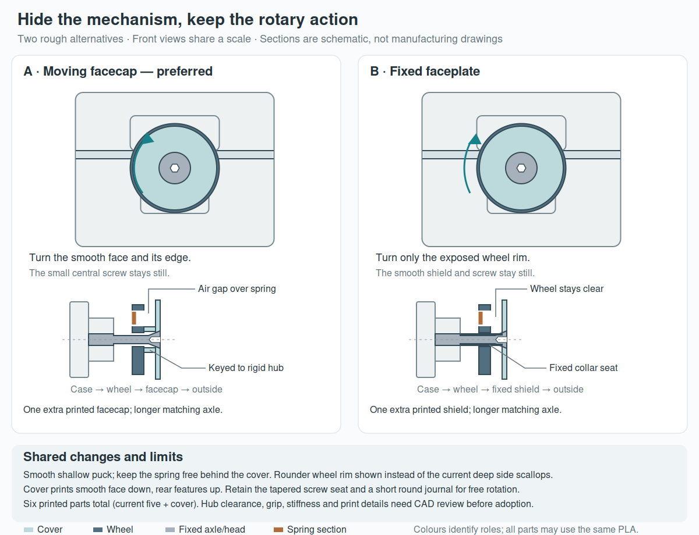

# Concealing the rotary mechanism

**Rough proposals for discussion; no replacement CAD or print files adopted.** The user likes the wheel action but finds the spring/slots, especially the left side, too exposed. They suggest an external pad held by the screw as one possibility and ask whether the pivot can also taper to improve printing. The current [conical wheel/screw files](rotary_case.md) remain the existing printable design.

[Editable SVG comparison](../renders/concepts/hidden_rotary.svg) · [PNG preview](../renders/concepts/hidden_rotary.png).

## Preferred: A, a facecap that turns with the wheel

Add a separately printed smooth facecap and connect it only to the wheel's rigid hub with shallow keys. The facecap and wheel turn together; the central screw stays stationary. Standoffs at the rigid hub hold the cap clear of the spring. When the wheel moves outward, the rigid hub presses on the cover's standoffs and the cover is captured by the screw head; the screw still seats against the fixed body journal rather than clamping the moving assembly.

This gives the user a smooth rotating control instead of making them find a narrow moving edge behind a stationary shield. It adds one printed part: body, lid, wheel, facecap, shoulder screw and nut, six total. It requires a longer matching axle/head placement and keyed cover attachment. Keep the successful coarse thread/nut interface, protected storage wall and nominal detent layout as the starting basis. Existing release effort does not automatically qualify a revised rim or cover.

The drawing uses a rounder wheel rim with shallow edge grip instead of the current deep side scallops. That lets a slightly smaller round facecap cover the mechanism while leaving the edge accessible. This silhouette is proposed, not checked CAD. A starting stack might use about a 1 mm facecap and 0.3–0.4 mm spring clearance, roughly 1–2 mm extra outward projection. Stiffness, real clearances, key location, usable grip and material choices remain to be checked; these are not settled dimensions.

## Alternative: B, a stationary shield held by the screw

The user's external-pad idea is feasible in principle. Clamp the shield to a fixed collar on the journal, keeping the wheel free behind it. The head can remain flush and the spring is concealed from the front. An integral collar keeps the extra part count to one, also six printed parts total; it needs a revised axle/collar interface.

Its main compromise is interaction: the smooth front stays still, so the user must turn only the rim behind it. A shield can obstruct the existing scalloped grip. Collar printing, clearance through the rotor bore, shield deflection and unintended rubbing need review. This may preserve more of the current wheel than A, but it does not preserve the existing axle automatically.

## Printing and the pivot

Both proposals print the cover smooth face down and its rear features upward, separately from the wheel. This preserves the wheel's established flat print placement. A cosmetic skin joined directly across the spring slots would constrain the spring. Leaving an enclosed air gap under a one-piece skin instead introduces concealed printing/bridging questions; it is not a free simplification.

Retain the matched tapered screw-head seat. Taper or chamfer exposed pivot transitions where it helps the actual print orientation, but retain a short cylindrical running journal: turning the whole bearing into mating cones can couple tightening to wedging/friction. The current wheel's vertical through-bore itself does not create the old flat recess roof. The body's horizontal axle-entry roof is a separate feature; a tapered lead-in alone does not establish that it prints without support.

## Evidence and next decision

The comparison uses the current 34 mm wheel diameter and 75.8 mm shell width for common-scale front context. Sections are schematic: colours identify parts made from the same possible PLA; white space is clearance. Named contacts and print placements are design proposals, not collision, force, comfort or slicer evidence. No new CAD, STEP/STL or slices were requested for this discussion. Current conical head/core/motion evidence remains scoped to the existing exposed wheel.

The useful next choice is whether the whole front should turn (A, preferred) or only the exposed rim should turn (B). After selection, check the complete covered assembly, spring freedom, attachment, driver access and printing before recommending a replacement. Do not fill the slots or attach the cover to the flexible spring to achieve a locally smooth surface.

Primary language model: GPT-6 family; exact model identifier/reasoning effort not exposed. Harness: Codex coding-agent environment. Provider: OpenAI. No subagents. User supplied the concealed-mechanism/pad and tapered-pivot ideas; comparison and preference are agent proposals. Existing print attribution is preserved in the current case record.
