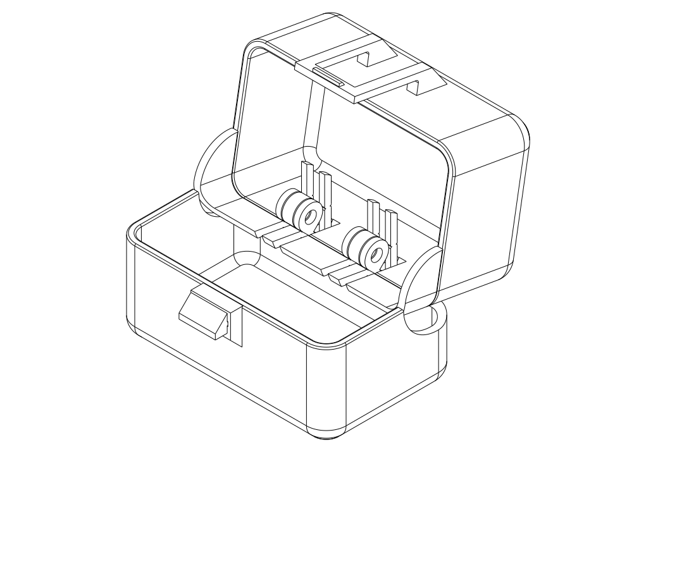

# C7 — hidden rear hinges and complete working mini boxes

**Current deliverable: two unprinted, complete mini boxes, 64 × 40 × 51.2 mm
shells.** Each has a base, lid, two internal hinges, the actual C6 shortened
front loop, receiver and matching E keeper. They replace the wall-only C6 latch
crop as the proposed operation test. The screw version is the simpler first
trial; the captive printed-pivot version explores avoiding hinge hardware.
No full-size C7 print recommendation is made yet.

The user rejected the wall-only sample **before reporting a print of it**:
without a hinge it requires manually aligning and restraining loose walls, so
it does not reproduce opening a connected box. That criticism is correct for
integrated operation. Its old CAD/source association remains valid for its
narrow geometry question, but it is no longer the recommended test piece.
The user authorizes exploring hidden hinges, a flat exterior and print-in-place,
accepting some interior mechanism space. The earlier short wall-snap print
failures remain [recorded separately](closure_short.md).

## Look at the mechanism

[Closed rear — no protruding hinges](../renders/concepts/internal_hinge/c7_mini_closed_isometric_back.png) ·
[Open mini box, hinges and latch](../renders/concepts/internal_hinge/c7_mini_open_isometric.png) ·
[Actual sections: collision and correction](../renders/concepts/internal_hinge/rear_motion.svg)



The [shared builder](../internal_hinge_design.py) also constructs rough full-size
264 × 74.2 × 51.2 mm configurations with the same local hinge geometry. The
full-size versions are used to catch shell interference omitted by a mini box;
they are not new delivered full-case print layouts. No sub-agents were used.

## What changed, and what did not work

| Direction | Evidence and decision |
| --- | --- |
| Move the C6 pivot inside without changing the ordinary seam | Rejected: the rear lid rim intersects the base immediately; mini interference is about 8.18 mm³ at 1°. |
| Raise the whole rear seam around the pivot | Rejected: the moving ear's attachment web still passes through the fixed rear wall, about .20 mm³ interference already at 5°. |
| **Segmented curved rear seam, internal screw pivots** | Retained for the first complete mini-box trial. Rear skirt sweeps in a relieved region, while fixed-ear stations keep their own rear-wall strips. |
| **Same seam with opposing captive conical pivots** | Retained as a print-in-place experiment. Its print pose must support both shells and hinge construction; captive geometry alone is insufficient. |

The pivot centre is **6.2 mm inside the rear face**. The 7.2 mm nominal barrel
and its attachment stay within the original exterior: **zero rear projection**,
versus C6's 7.9 mm. The cost is local interior occupation: the barrel reaches
**7.8 mm inward from the normal inner rear wall**, at two small modules. Screw
modules span 7 mm in X; cone modules span 12 mm. The surrounding shell stays
2 mm thick. These intrusions need a real contents/packing check before full
adoption. They are not hidden by claiming the entire original cavity is clear.

The rear split curves down around a 10/10.4 mm radial relief, changing sides at
the fixed ears. This lets each web keep its attachment without passing through
the opposite wall. The exterior is flat when closed, but the stepped seams remain
visible. This is not a gasket or a proven dust/water seal. The existing front
loop and keeper still project outside; only the rear hinge bumps are eliminated.
If adopted unchanged in the full case, the closed occupied width would be about
81.3 mm rather than C6's 89.2 mm, including the unchanged 7.1 mm front keeper.

A print-pose distance check caught a further defect after the intersection screen:
the cut and restored rear-wall strips originally had equal widths. Their edges
touched with zero intersection volume, so they could fuse when printed open.
The restored fixed strips are now .3 mm narrower on each side than the lid's
relief slots. The actual minimum body/lid surface distance in the 90° print pose
is **.30 mm**, checked for both hinge variants and both shell lengths. This is a
nominal CAD gap, not a measured printing tolerance or guarantee of free motion.
Closed rim contact is intentional and is not subjected to this print-pose rule.

Both internal variants pass the declared rigid-CAD poses from closed to **100°**
for the mini and full-length shells. The study includes 0, 1, 2, 5, 10, 20, 45,
70, 90 and 100°. At 110° interference returns (about 6.35 mm³ mini / 30.0 mm³
full); 180° is deliberately retained as a failed control. **Do not force these
boxes flat open.** This is a geometric operating range, not a strength-qualified
opening stop. Hold the base; do not assume freestanding stability at every angle.

## Printable mini boxes

| Trial | STEP — preferred | Matching STL | Printing and assembly |
| --- | --- | --- | --- |
| **Internal M3 hinges — first trial** | [C7 screw mini box](../c7_mini_screw.step) | [STL](../c7_mini_screw.stl) | Base floor down, lid roof down, keeper on its side; all three parts on one plate. Add two M3 × 12 screws and four M3 nuts. |
| **Captive printed pivots — experimental** | [C7 print-in-place mini box](../c7_mini_pip.step) | [STL](../c7_mini_pip.stl) | Base and lid already 90° open in a V; broad exterior panels at 45° to the bed. Keeper prints separately on the same plate. Keep the supplied placement. |

[Separate-parts print layout](../renders/tests/c7/c7_mini_screw_isometric.png) ·
[Captive V print layout](../renders/tests/c7/c7_mini_pip_isometric.png)

For the screw trial, position the lid in the rear recesses. Insert the left screw
from the left outer end and the right screw from the right outer end, toward the
middle. Secure each using a pair of nuts locked against each other, leaving the
moving ear free. A sampled CAD insertion path clears the actual box and both
hinges using an assumed 3 mm-radius, 3 mm-long head and 12 mm shaft. Actual screw
head and nut dimensions remain unmeasured. The 7 mm stack leaves nominally 5 mm
thread for two assumed 2.4 mm nuts; check actual hardware fits. Avoid tightening
the ears together. Use ordinary tools from above with the lid open.

The captive cones reuse the sunglasses hinge principle, with 2.2 mm pivot radius,
.6 mm radial cone offset (about .424 mm normal clearance) and .5 mm ear-end gap.
The 7.2 mm barrel is a new smaller design: the sunglasses print success does not
qualify its fusion resistance, axial/radial play or durability. No screws or
separate hinge pins are needed. Remove the brim carefully and try a small hinge
movement before installing the keeper; stop if a pivot is fused rather than
forcing it. Do not insert support into the captive clearances.

Slide the keeper into the front receiver from the side. Hold the loop outward,
close the lid onto its rims, then let the loop return under the keeper. To open,
pull the loop outward before lifting. This tests a connected opening action,
not balancing loose wall samples. The shorter loop, .35 mm seated clearance,
3.2 mm nominal release travel and flat keeper shoulder are unchanged from C6.
Actual CAD checks the prescribed outward release through the hinge path and
recovery once open; it does not predict printed actuation or pull-off force.

Compare closing effort, release effort/noise, hinge freedom, keeper seating and
repeated loop recovery with the working sunglasses case. Check both pivots and
the flat rear outline. Binding, whitening, cracks, failure to recover, loose
hardware or a keeper that migrates reject the trial. A good mini box can qualify
these local interfaces and the operating sequence; it cannot qualify full-length
shell bending, real dental packing, backpack protection or fatigue life.

## Manufacturing exploration and remaining risks

Starting setup remains PETG, .4 mm nozzle, .2 mm layers. Native receipts use the
existing diagnostic Q2C two-wall / 7% adaptive-cubic profile and 5 mm brim,
OrcaSlicer 2.4.2. These settings are not calibrated printed PETG properties.
Both delivered layouts generate toolpaths, but native review flags are retained.

The screw trial has the familiar floating-cantilever notice and a support-probe
suggestion below the loop's nominal 12 mm, two-ended bridge. The native bridge
strokes at Z32 are 11.6 mm long. The primary is an experimental supports-off
bridge trial like C6, with the same proven E span but new thinner loop. Inspect
its underside before interpreting engagement or force; do not force a sagged
retaining rail over the keeper. Both hinge webs are connected and their lower
outlines avoid a floating horizontal pin. Bore quality still needs a print.

The first captive attempt stood the 64 mm box on its end. That made the opposite
end wall an unsupported closing roof. The native probe placed support throughout
much of the cavities: [rejected support witness](internal_hinge/rejected_endon_supports.png).
This direction is abandoned; it also cannot transfer directly to the 264 mm case
in a 256 mm build height. Its [receipt](internal_hinge/rejected_endon_slice.json)
and [path data](internal_hinge/rejected_endon_toolpaths.json) remain negative evidence;
`print_layout('internal_cone')` retains that rejected pose for reproduction. This receipt predates the rear-strip
gap correction; its geometry hash is historical, not the delivered V sample.

The delivered V pose removes that roof problem. Both moving shells reach the bed
at their symmetric rounded rear corners, explicitly checked to avoid lifting one
part above the plate. Broad panels then rise at 45°, and the conical underside is
sloped rather than a long unsupported rod. The probe still suggests support at
the rounded bed-contact regions and small hinge features, to about Z17.2, while
the main slice has no floating-region notice. This is **an experimental
supports-off trial**, not a support-free guarantee: the rounded feet grow quickly
in the first layers, and small pivot/socket undersides can sag or fuse. Keep the
brim; inspect both feet and hinge clearances. Automatic supports in the captive
gaps risk trapping/scarring the interface. No wholesale automatic-support print
is prescribed. If these features fail, revise their feet/web/clearance geometry
rather than transplanting the cavity-filled end-on supports.

The [current path-location plot](internal_hinge/support_locations.png) and
[structured data](internal_hinge/toolpaths.json) retain actual suggested supports,
bridge layers, STL and G-code identities. Long bridge-labelled strokes near the
first curved feet are longitudinal paths, not demonstrated 52 mm air gaps.
The V layout's loop has local bridge-labelled strokes around 10.8 mm at Z43.8;
its changed build direction and surface quality also need observation. The V
orientation is more promising for a full-length case because it keeps the long
axis horizontal, but bed fit, print aids and contents must be rechecked before
any full-size C7 publication. No full-size slice approval is inferred.

## Reproduce and interpret

```sh
./execute.py --threads 1 model/dental_travel_case/internal_hinge_study.py
./execute.py --threads 1 model/dental_travel_case/internal_hinge_drawings.py
./execute.py --threads 1 model/dental_travel_case/verification.py --variant hinge-c7-mini
```

The focused regression run passes **128 tests**, including the zero-gap
counterexample, both moving parts' bed contact, preserved dental intent and
existing dental closure/verification contracts.

The [motion record](internal_hinge/motion.json) retains rejected geometries,
operating and overtravel poses, deliberate loop release and M3 insertion paths.
[Publication association](internal_hinge/publication.json) binds current source,
paired exports and native receipts. The [verification report](internal_hinge/verification.json)
keeps CAD/matched-sample/reviewed-slice evidence separate from UNKNOWN physical
use. It does not promote a mini box into a qualified full dental case. Print
layouts are generated through `evaluate_model.py --slice`; use `--slice-keep-run`
for `internal_hinge_toolpaths.py`, review changed warnings, then associate exports
with `internal_hinge_delivery.py`. Keep useful SVG sections and their generator.

| Item | Print status | Artifact(s) | Physical result / remaining checks |
| --- | --- | --- | --- |
| C7 internal screw mini box | Unknown — no print reported | C7 screw STEP/STL and M3 hardware | Complete opening/closing, pivot fit, hardware access, rail quality, effort and noise |
| C7 captive mini box | Unknown — no print reported | C7 V-pose STEP/STL | Foot support, moving gaps, freedom/capture, altered layer direction and front operation |
| C7 full dental case | N/A — architecture exploration only | Shared rough CAD/motion study; no full print exports | Contents interference, full print placement, long-shell loading and integrated use |
| Earlier C6 wall-only sample | Unknown — no print reported; rejected for integrated testing | Historical C6 files preserved | Does not guide/retain lid motion; superseded by these complete mini boxes |

Attribution: GPT-6, reasoning effort not exposed; Codex CLI / OpenAI. No delegated
reviewers or sub-agents used, following the user's instruction.
