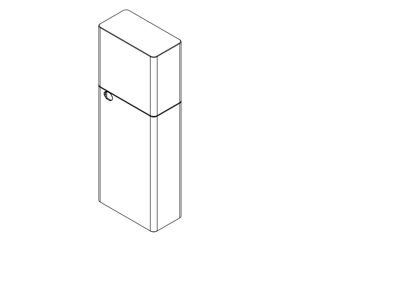

# M1 — slim shared case with a separate positive-retention cap

## User instruction and architecture

On 2026-10-14 the user selected M1 from the [slim SVG comparison](slim_exploration.md),
accepted a separate cap, rejected an exterior hinge, and authorized modelling.
The closing joint should be rounded rather than sharp and should resist popping
open when struck in a backpack. Minimal design and occupied size remain the goal.
Floss needs no space. The earlier approximate attached-brush and full-tube
measurements remain the contents basis; no flattening or head removal is assumed.
The earlier request for alternative-tube margin remains active and unqualified.

[Closure SVG](../renders/assembled/m1/m1_closure.svg) shows the joint and release;
[open CAD view](../renders/assembled/m1/m1_inspection_isometric.png) shows the
approximate contents. The diagrams are opaque cases, not transparent-material proposals.

Two printed PETG cups replace the old hinges, links, clips and organizers. Without
the catches this is still a coherent guided, seated two-cup enclosure, but cannot
reliably remain closed. Friction alone supplies no qualified retention, so two
small integral catches are justified by the backpack instruction. No hardware,
separate flexible material, loose release pieces or internal item divider is used.

The main body is 174 mm to the seam; a 12 mm sleeve projects into the 90 mm cap.
Its nonround section guides alignment and limits rotation. The cap rim seats on
the body shoulder, carrying closing/compressive loads. The overlapping sleeve
carries lateral bearing/prying loads before the catches. Catch shoulders behind
blind cap-pocket ledges obstruct straight withdrawal. The two guarded squeeze
points are on opposite broad body faces beside the brush column, below the seam:
pinch both inward with one hand, then pull the cap along the length with the other.
A bump pressing only one control leaves the other catch
engaged. Compression on both sides plus a pull can still open it; this is not a
safety lock or a proven impact rating.

Closing sequence: align the nonround mouths, hold both squeeze points inward,
push the cap onto its stop, then release. Both hooks recover into the pockets.
Entry ramps are included to help admission; passive push-to-snap operation is an
unqualified option for the physical test, not the verified prescribed-motion route.
Seated leaves are nominally relaxed rather than relying on continuous spring
preload. Rounded outside seam edges and sleeve entry are distinct from the flat
retaining shoulders; rounding away those shoulders would encourage pull-off.

## Dimensions and contents

The first construction uses **264 × 99.2 × 51.2 mm** exterior, 2 mm cup walls/end
panels, 6 mm cross-section corner radii, and 0.4 mm lap allowance **per side**.
The SVG target was 264 × 94 × 46 mm; about 5 mm extra width/thickness pays for the
double-wall joint without an outward collar or squeezing the full tube through
a narrowed opening. These are engineering dimensions, not measured fit limits.

The minimum main sleeve cavity is 91.2 × 43.2 mm with 2 mm inner corner radii.
The brush proxy uses the reported **30 mm** handle, 165 mm handle length and 90 mm
neck/head; the 62/28 mm split and centered head offset are unmeasured assumptions.
The toothpaste proxy is the full measured **160 × 55 × 40 mm** rectangular envelope.
Local closed channels behind the two leaves intrude only beside the brush and
leave the toothpaste column open. They are closure packaging, not item separators.
The full attached brush and tube must pass the complete lower-cup opening.

The common cavity permits item-to-item contact and motion. It does not prove
button safety or keep toothpaste away from bristles. Actual brush/head shape,
alternative tube sizes, handling and pressure protection remain physical questions.

## Research and provisional mechanics

The [Covestro snap-fit design guide](https://www.covestro.com/-/media/covestro/solution-center/brands/downloads/imported/1556891135.pdf?hash=9F31DDB0A518F6178A01C8C514CE191F&rev=4637b9463f2b47fa86b610b8a8405c6a)
distinguishes entry and return geometry and recommends relaxation after engagement.
Its material tables concern manufacturer engineering plastics, not this printed
PETG. [Protolabs Network's additive snap-fit guidance](https://www.hubs.com/knowledge-base/how-design-snap-fit-joints-3d-printing/)
also identifies root rounding, creep, clearance, fatigue and build direction as
consequential. Its generic tolerances do not calibrate this printer. In particular,
these integral leaves run along print Z; layer bonding is an unresolved risk,
accepted here to keep two parts and a simple support-free cup arrangement. Test
the actual orientation rather than treating the beam screen as material evidence.

The root is blended; nominal beam section is 10 × 1.6 mm, 33.4 mm long. The body
contact is 19 mm from the root; nominal terminal release travel is 2.1 mm (about
1 mm at the finger contact). The contact face is recessed 2.4 mm, so finger access
and wet-hand comfort need testing. A point-loaded rectangular-beam analogy, with
an unloaded overhanging tip, is a provisional strain/stiffness screen only. Allowing
1 mm for the root blend and +0.3 mm terminal travel gives **0.81%** predicted root
strain against an agent-selected, uncalibrated **1%** screen. An explicitly assumed
800–2200 N/mm² effective-modulus bracket predicts **1.34–3.69 N per leaf** at nominal
release, below a provisional **5 N per-leaf** screen. These are challengeable
engineering assumptions, not measured PETG properties or user force thresholds.
Neither the analogy nor geometric
catch obstruction establishes accidental opening force, drop resistance, creep,
fatigue or tactile effort. No force/drop-load acceptance number was supplied.

## Deliverables and checks

Authoritative parametric source: [m1_design.py](../m1_design.py). STEP is the primary
interchange file. Each STEP/STL pair selects identical millimetre geometry and
print placement; sources below are the fixed-purpose evaluation entry points.

| Layout | Deliverables | Scope |
| --- | --- | --- |
| **Joint test first** | [Python](../m1_joint_test.py), [STEP](../m1_joint_test.step), [STL](../m1_joint_test.stl) | Two open rings cropped from production; 49 mm body and 30 mm cap, whole rim/both leaves/pockets/liners retained |
| Full M1 | [Python](../m1_case.py), [STEP](../m1_case.step), [STL](../m1_case.stl) | Body and cap on one plate, exterior ends down and openings up |

Inspection sources `m1_closed.py` and `m1_inspection.py` select assembled poses;
the latter includes approximate display-only contents. **Do not print those poses.**
The short joint pair cannot become the full case; its open ends omit end panels,
long-wall flex and whole-case pressure protection. It preserves local manufacturing
orientation and geometry but does not calibrate the full shell's stiffness.

Final checks in [m1_checks.py](../m1_checks.py), composed through the shared
[verification entry point](../verification.py), pass for variant `slim-m1`:

- Connected body/cap and production-cropped test geometry; planned Q2C fit.
- Actual measured-envelope proxies and continuous axial extraction volumes clear
  the complete opening by at least the declared **0.8 mm CAD** criterion.
- Required rim seating and excess-closing obstruction, each hook's flat retaining
  shoulder blocking withdrawal even at ±0.4 mm transverse guide play. Removing
  the hooks removes pull-off obstruction (negative control).
- Five prescribed point-load leaf poses keep roots fixed and clear their channels
  and contents. A conservative continuous cap-withdrawal sweep, 16 actual cap poses
  and guide-play release checks clear the fixed body and depressed hooks.
- Ten squeeze-and-push admission poses clear; nonround sleeve geometry separately
  obstructs excess translation and twist. Passive snap-on effort is not established.
- Provisional beam screen above; physical/subjective obligations remain UNKNOWN.

The [native verification receipt](m1_verification.json) reports eight digital
checks PASS and `unresolved_evidence`, as intended for unprinted physical coverage.
No physical hold force, crush/drop rating, fatigue result or subjective approval
is inferred from these checks.

## Print and try

Use PETG, **0.4 mm nozzle / 0.2 mm layers**. Keep the delivered orientation: body
bottom down; cap exterior top down. The full pair's heights are 186/90 mm; test
heights are 49/30 mm. Both layouts fit the Q2C 270 × 270 × 256 mm envelope with the
checked 3 mm brim. The sources keep the two parts 112 mm apart. Do not scale the
models or change fit by independently scaling a half.

Both full and sample exports were smoke-sliced headlessly with **OrcaSlicer 2.4.2**,
center placement, the named Q2C/PETG profiles and local
[3 mm brim process](slicer_review/process_3mm_brim.json): two walls, 7% adaptive cubic.
The supplied profile triplet is **diagnostic**, not a calibrated user production
job. [Full receipt](slicer_review/m1_case.json) and
[test receipt](slicer_review/m1_joint_test.json) report acceptance, no notices and
no generated supports under the automatic-support probe. This is matching-STL
acceptance; it does not verify Orca's separate GUI STEP import.

Both cups have stable closed-end bed surfaces and end chamfers. The test rings
have flat annular bed contact. Actual exterior control rims have 0.25 mm blends
in addition to the rounded port profiles. Ordinary walls are 2 mm, sleeve/leaf sections 1.6 mm,
leaf-side slots 0.8 mm. The blind-pocket outer skin is 0.6 mm and needs inspection
for complete coverage. Diagonal port/pocket flanks reduce central roof spans to
about 6.8 mm; the hook underside projects 1.6 mm. These are intentional small
bridges/projections. [Actual headless toolpath crops](../renders/tests/m1/m1_toolpaths.svg)
show continuous leaf perimeters and the local bridge/overhang paths at those
features; they were visually inspected, not converted into material calibration.
Vertical leaf roots, deposited bridges, skin quality and layer bonding still need
the representative print. Use no supports for the first joint test under this
plan; supports on the retaining faces would alter its fit.

Diagnostic estimate for the final joint pair: **1 h 33 min / 54.1 g**.
Actual filament and printer settings change this estimate.

1. Print only the joint pair first. Inspect both leaves, bridges and pocket skins.
   Check comfortable finger access to both recessed contacts before forcing assembly.
2. Hold both contacts inward, slide the cap ring fully to its stop, then release.
   Check that **both** hooks engage. Try ordinary pulling and off-centre pulling
   without pressing; then press only one side and repeat gently. It should stay
   caught. Finally pinch both and pull; it should release without cracking or whitening.
3. Repeat opening/closing; check leaf recovery and holding after a closed dwell.
   Record binding, excessive play, difficult access or unintended release. Passive
   push-to-snap closure can be tried gently once the prescribed route works.
4. Pass the real handle and full tube through their respective sides of the open
   test ring. This checks the aperture, not the full brush/head/length fit.
5. If the joint is satisfactory, try the full pair. Remove the cap, grip the exposed
   brush neck and withdraw the attached brush. The tube tail is about 23 mm below
   the sleeve rim: tip the body into the other hand to retrieve it rather than
   expecting fingers to fit around a nearly full-width tube. Load brush butt and
   toothpaste cap toward the closed body end. Check dry-item fit, button contact,
   comfort, closure and loaded backpack handling before relying on the case.

No seal or ingress rating is claimed; the lined recesses prevent direct finger/item
contact but are not gaskets. This case protects a shared cavity; items may touch.
The earlier 60 × 44 mm tube allowance is not promised through this tight lap.
Desired alternative tubes remain an explicit physical UNKNOWN, consistent with
the earlier request for variation margin and the newer minimal-size preference.

## Physical print status

| Item | Print status | Artifact(s) | User result or remaining physical checks |
| --- | --- | --- | --- |
| Test piece(s) | Unknown — no M1 print report | `m1_joint_test.step` / `.stl` | Engagement, both-control release, recovery, holding, aperture and bridges |
| Final printable object(s) | Unknown — no M1 print report | `m1_case.step` / `.stl` | Complete fit, access, button contact, bulk and backpack protection |

Earlier baseline clip/socket success remains with that tested interface. It does
not qualify these new catches. Attribution is in [provenance](provenance.md).

The phase review kept the overlap, hard seat, catch and release contacts separate.
Moving the contacts below the cap fixed the two-hand release sequence without
adding parts. No shared-tool or skill change was needed; the existing headless
evaluator, assembly queries and verification CLI covered this design.
