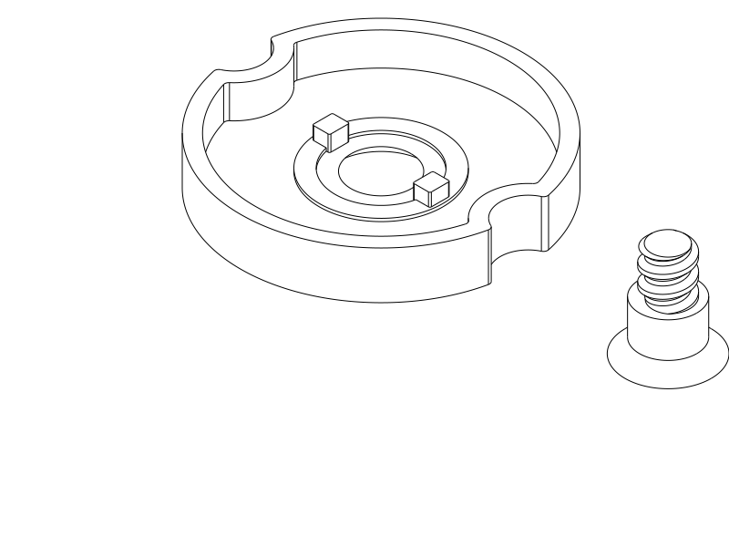

# Two-part repair for the printed rotary box

Print the replacement **wheel facecap and matching screw together**: [STEP](../rotary_matte_repair.step) · [STL](../rotary_matte_repair.stl) · [Python](../rotary_matte_repair.py). Keep the already printed body and lid, existing keyed wheel and printed nut. No metal hardware or shell reprint is needed. The replacement pair is not physically tested yet.

PLA, 0.4 mm nozzle, 0.2 mm layers, **four walls, 100% rectilinear infill, supports off**. Use your proven PLA temperature/chamber settings. The file places the cap with its exterior face on the bed and keys upward, and the screw with its broad head on the bed. Import both at the supplied orientation; they can be moved together or separated into objects without rotating them. The head socket opens toward the bed and has a tapered roof. Clear any first-layer lip before assembly.

Seat the two cap keys in the existing wheel pockets, align the scallops, then install the new screw into the existing nut with a **3 mm hex key**. Tighten gently until its shoulder seats on the body journal; the wheel must still rotate freely. Keep this cap and screw paired: the old screw is shorter. Check both OPEN and LOCK before loading the box.

## What changed and why

| Feature | Previous covered pair | Replacement |
| --- | --- | --- |
| Face and rim | 1.2 mm | **2.0 mm**, more material around the cup and key roots |
| Maximum cap span | 37.6 mm | **39.2 mm**, same scalloped grip family |
| Outward projection beyond wheel front | 1.6 mm | **2.4 mm**; new screw head remains flush |
| Rim construction | Offset curves and small roundovers | Direct circular scallops with 0.6 mm junction fillets; plain rim edges |
| Screw blind socket roof end | 0.04 mm polygon | **0.8 mm** polygon, avoiding a microscopic closing face |
| Coarse thread | Steep rising flank, 0.5 mm crest | Nominal **45° rising flank**, **0.6 mm crest**, same 2.4 mm pitch and 6 mm major diameter |
| Thread core | Solid 4.6 mm diameter | **Solid 4.6 mm diameter**, retained through the thread |

The thread tip cut now crosses the ridge away from its tangent transition, avoiding the old mismatched tessellation boundary. The head moves outward 0.8 mm with the thicker cap. Its fixed shoulder, thread position and seating geometry remain unchanged. The rear rim stays at the existing wheel back plane and preserves the hidden 0.4 mm face gap, hub spacer, two 1.8 mm engagement keys and spring space. Small scallop junctions are rebuilt directly rather than reproducing the old offset patches exactly.

This is a modest section increase, not a claim that matte PLA has been calibrated or that printed delamination is solved. The roof closure is now a short 0.8 mm bridge; material bonding, socket wear and actual fit remain physical checks. Do not compensate for poor co-rotation by tightening harder: inspect key seating and free spring motion.

## User feedback

The user reports that the body/lid are printed, but the wheel cap's thin walls are difficult to print in matte PLA and the screw is also troublesome. The import warning was specifically **STEP import**; the exact warning text and printed file hashes/settings are unknown. The user authorized small exterior changes and a wheel change if necessary, while prioritizing compatibility with the printed shells. No wheel or nut change was needed.

The earlier complete PLA quick rotary trial worked, with slight looseness at correct temperature. That trial qualifies its tested mechanism, not this new facecap/screw or matte-PLA strength. PETG has not been physically tried. No cause is inferred for the reported layer separation.

## Verification and remaining limits

[CAD checks](matte_rotary/cad.json) compose the retained full-case guide, seating, detent-before-release, lock and withdrawal checks with affected cover motion, key insertion, positive relative-turn obstruction, key-removed controls and translated spring-envelope clearance. Body, lid, wheel and nut are compared against the previous covered source and retain identical material. The new thread is checked against the unchanged nut along sampled screw withdrawal, with a separate axial pull obstruction witness. These are rigid geometry checks, not measured effort or strength.

[STEP diagnostic](matte_rotary/step.json) checks the actual exported parts because of the reported warning. The old covered export reopens with the facecap as an open shell rather than a solid, and its screw has mismatched triangle boundaries. The repaired STEP reopens as two valid solids with closed tessellation at the evaluator's 0.003 mm / 0.5 rad settings. Every root component is inspected; enumerating only solids would silently skip the failed old cap. This reproduces concrete export defects, **not the exact Orca GUI warning**. A separate material witness checks that the actual exported screw's thread core is filled.

[Native export/slice receipt](matte_rotary/native.json), [publication association](matte_rotary/publication.json), [local deposition checks](matte_rotary/paths.json) and [product verification](matte_rotary/verification.json) identify the delivered pair and evidence. The smoke slice uses OrcaSlicer 2.4.2, Q2C 0.4 mm, 0.2 mm, four walls and solid rectilinear fill with **diagnostic PETG filament**, because the user's matte-PLA profile is unavailable. The primary slice completes without notices, and the forced automatic-support probe generates no supports. Sixteen local sections have less than 0.1 mm uncovered width across the sampled key, face, rim and screw-core regions. Its temperatures are not a PLA recommendation. Actual matte-PLA bonding, first-layer finish, thread fit, handling, bag impacts, operating torque and durability remain unqualified.

The 2 mm face prints as ten nominal layers and the rim rises vertically from a broad bed face. Screw head and journal grow inward/upward; the revised thread's rising flank is nominally 45°. The only small closing roof is inside the driver socket. This reduces delicate sections and nominal overhang severity while preserving the existing assembly.

| Item | Print status | Artifact(s) | User result or remaining physical checks |
| --- | --- | --- | --- |
| Test pieces | **Yes — earlier quick PLA trial** | `rotary_quick_test.step` and earlier custom fasteners | Mechanism worked; slight looseness; exact settings/hash unknown. No new coupon needed. |
| Existing full box | **Partial — body/lid printed** | `rotary_covered_case.step` / `.stl` | Reuse these shells; old matte-PLA cap/screw print trouble reported. Full assembled use unaccepted. |
| Replacement final controls | **Unknown — no print report** | `rotary_matte_repair.py` / `.step` / `.stl` | Confirm clean walls, easy thread engagement, key seating, free rotation, deliberate indexing and loaded closure. |
| PETG physical trial | **No** | None reported | Development remains focused on PLA. |

## Engineering notes and attribution

Source validity and a successful STL slice did not establish a sound GUI STEP import. The specific warning justified inspecting the actual STEP components. Simplifying the scallop/edge construction and moving the thread-tip intersection away from a coincident transition corrected the demonstrated export defects; a generic bounds or volume audit would not have answered this question. No universal STEP round-trip checklist or new solver is introduced.

Primary language model: GPT-6 family; exact identifier and reasoning effort not exposed. Harness: Codex coding-agent environment. Provider: OpenAI. No subagents. User supplied physical print feedback and required compatibility with printed shells. Historical attribution remains in [covered rotary history](covered_rotary.md).
