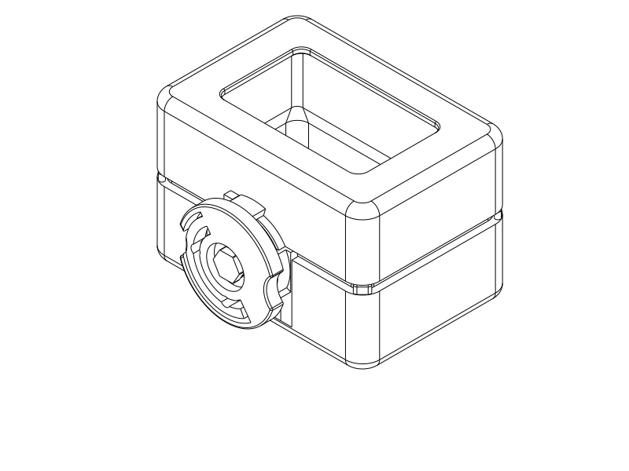
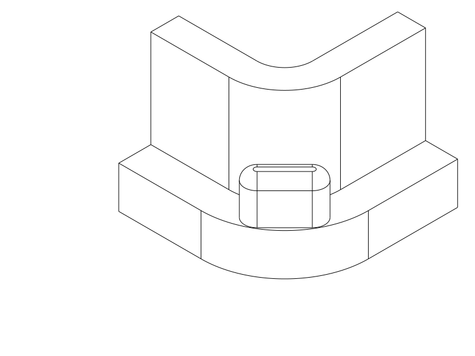
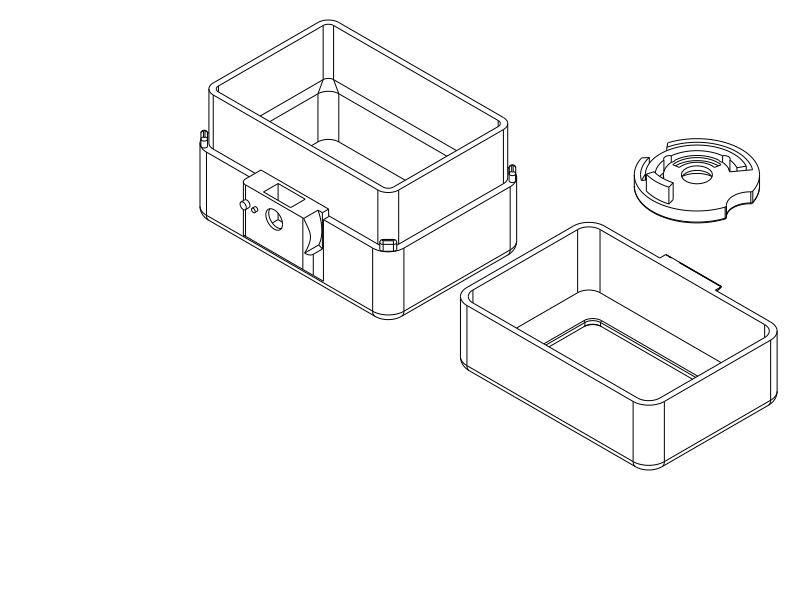

# Short open-ended rotary test piece

**Print this smaller PLA trial:** [shells + spring wheel STEP](../rotary_quick_test.step) · [STL](../rotary_quick_test.stl) · [Python](../rotary_quick_test.py). Add the unchanged [custom screw + printed nut STEP](../rotary_printed_fasteners.step) / [STL](../rotary_printed_fasteners.stl). Five printed parts total; no metal hardware. **The body now has rounded corner stops; re-download the updated shell file.** If the previous quick trial is already printed, only its body needs replacement: [body-only STEP](../rotary_quick_body.step) / [STL](../rotary_quick_body.stl) / [Python](../rotary_quick_body.py). The cap, wheel and fasteners are unchanged. **Do not print the older hollow M6 screw or repeat the larger 70 mm sample for this trial.** The full case remains on hold.

The sample is **50 mm closed**, reduced from 70 mm, with **50 × 30 mm rounded rectangular holes through both end panels**. The continuous end frames give fingers a place to pull; the hole edges have 0.4 mm chamfers. The body is 42 mm high and cap 23 mm in their separate print placements. The plan outline remains 75.8 × 52.8 mm.

## Rounded corner stops

The user finds the four exposed seating stops too sharp for a hand and explicitly prioritizes a softer contact shape over high push resistance. Each stop is now a **4.6 × 1.8 mm capsule** with **0.9 mm radius ends** and **0.7 mm roundovers around the top**. The remaining flat top is about **1.25 mm² per corner**. All four still seat the cap at the same height, preserving the **3 mm seam reveal**; the guide fit is unchanged. The pads stay within the outer case outline and share this construction with the full case. No measured force or hand-comfort rating is claimed.

This is a cropped CAD inspection view; the straight crop faces are not new product edges. The previous sharp-stop quick file from `212f4ed` is superseded for hand comfort; a print of that specific quick revision was not reported. Current revised print status remains unknown.

## What changed, and what did not

The coupon uses an **18 mm sleeve with 15 mm engaged**, retaining the **3 mm seam reveal and four independent seating stops**. The complete product's 30 mm sleeve is unchanged. The shorter guide and open end frames make this a cheaper mechanism/action trial; they change stiffness and tilt restraint and cannot qualify full-case side loads or long-overlap sliding effort.

**The guide's nominal fit did not change between R1a and the later indexed sample, and is unchanged here:** sleeve outside 71.2 × 48.2 mm, cap inside 71.8 × 48.8 mm, 0.30 mm clearance per side. The rounded guide profiles are retained. Overall heights, closed end panels and mechanism packaging did change in the later sample; that integration did not preserve identical shell stiffness.

The user now recalls accidentally printing the tight later PLA sample with the chamber closed, unlike the intended setup, and suspects overheating caused the dimensional problem. This is a plausible user hypothesis, **not an isolated cause or measured chamber temperature**. R1a's guide was reported to fit nicely. At the user's direction, this trial **preserves the guide clearance** rather than implementing the earlier proposed loosening/lead-in change. The observed tight print is still recorded; the earlier conclusion that the allowance necessarily needed revision was too strong with this process difference unresolved.

The **entire wheel, curved spring detent, shoulder screw and keyed printed nut are identical to the preceding custom-thread revision**. The cap keeper, body pins, pivot, protected storage-facing wall and local mechanism are retained; the four seating stops are deliberately rounded as described above. The shortened shell does not rescale the spring. The end openings are away from the keeper and journal pod. This trial is about three relationships: easy unlocked seating/removal, deliberate spring-indexed lock/release, and usable assembly of the coarse solid printed pair.

## Print two jobs with different infill

| Job | Files | Setup |
| --- | --- | --- |
| Body, cap, spring wheel | `rotary_quick_test.step` / `.stl` | **PLA**, 0.4 mm nozzle, 0.2 mm layers, 3 wall loops, 7% adaptive cubic, 5 mm automatic brim, accessible automatic tree supports. |
| Solid screw and printed nut | `rotary_printed_fasteners.step` / `.stl` | Same PLA/nozzle/layers; **4 wall loops, 100% rectilinear infill, supports off**, 5 mm automatic brim. |

Keep the supplied placements: body bottom frame down, cap end frame down, wheel outside face down; screw external hex down and nut flat face down. Do not print the `_assembled` inspection model. Use your PLA filament preset and the intended chamber conditions from the successful R1a print; the chamber temperature and exact earlier settings were not measured. PETG is untested and is not required for this experiment.

The retained diagnostic slicer estimates **52.81 g / 1 h 40 m 2 s** for the new shells/wheel and **0.99 g / 8 m 59 s** for the unchanged solid pair. The earlier 70 mm layout, including its obsolete fine screw, estimated **77.36 g / 2 h 13 m 56 s**. The new two-job total is about **54 g / 1 h 50 m**. These are tool estimates including print aids under the recorded PETG diagnostic presets, not PLA predictions or a strict identical-parts comparison. The shorter open shells produce the intended material/time saving without changing the spring or mating thread.

## Assemble and try

1. Remove brim and accessible support beneath the cap keeper, in the wheel recess and at the body’s external axle-entry bore. Clean the bore/top-loading nut slot before fitting the nut or axle. Keep support-removal marks away from the guide surfaces and spring.
2. **First try the body and cap without the wheel.** Use fingers through the end openings and pull approximately along the guide axis. Confirm easy seating/removal under the corrected PLA setup. If still tight, stop and identify where it rubs rather than blaming or tightening the lock.
3. Try the screw and printed nut together outside the model, square and gentle. Drop the nut into the body's top-loading pocket with its 10 mm dimension across the slot and 11 mm dimension vertical.
4. Place the wheel over the pins at LOCK. Pass the printed shoulder screw through it and engage the nut gently. Seat the shoulder lightly using an **8 mm socket with outside diameter at most 12.8 mm**. The wheel retains 0.5 mm nominal axial freedom; extra tightening is not the holding mechanism.
5. Turn to OPEN, seat the cap, then turn to LOCK. A gentle straight tug should encounter the keeper. Release pulling before unlocking. Look for a distinct resting position, deliberate resistance leaving LOCK, smooth release, spring return, thread damage and loosening over several cycles.

A good result supports the rotary mechanism and printed assembly in this shorter fixture. A loose pair that binds calls for thread-fit revision; guide binding with the wheel absent calls for checking actual printed contact/process; a freely spinning or damaged spring calls for detent revision. Do not infer full-case retention, far-edge peel strength, force, fatigue or bag-shake security from this print. Changed guide length and open ends are intentional limitations, not a controlled test of chamber heating alone.

## Verification, limits and print status

[CAD checks](quick_rotary/cad.json) establish the real through openings, connected end frames, unchanged critical local geometry and identical complete wheel/axle/nut, actual 0.30 mm flat guide gaps, independent seating/overclose stop, 21 locked capture witnesses across guide/axial play, unlocked withdrawal, sampled turning clearance and detent-before-release obstruction. It additionally checks each rounded stop’s flat land, contact and 0.1 mm overclosing obstruction in both the quick sample and full model, so mere top height cannot pass with a missing seating contact. Existing [solid thread/core evidence](printed_fasteners/cad.json), [fastener paths](printed_fasteners/core_paths.json) and [fastener publication](printed_fasteners/publication.json) remain applicable to the unchanged pair. No force or physical fit is inferred from rigid geometry.

[Native sample review](quick_rotary/print_review.json): CadQuery 2.8.0 exports the matching STEP/STL; **OrcaSlicer 2.4.2 completes with no notices**. Automatic support interfaces are generated at the wheel's open exterior head recess and the exterior cap keeper; non-interface support also occurs at the body’s external axle-entry bore. Clean that bore through its front opening and the top-loading nut slot before assembly; [actual support-path review](quick_rotary/support_review.json) confirms accessible removal and no support trapped by the new end openings. The [body-only native slice](quick_rotary/body_review.json) also completes with no notices; its [support review](quick_rotary/body_support_review.json) locates the same accessible external bore region. The print has stable continuous end frames on the bed; no bridge spans the large central holes. Native assembly inspection views were reviewed. [Source/export association](quick_rotary/publication.json).

The diagnostic setup remains Q2C 0.4 mm, 0.2 mm layers and the [existing three-wall support-enabled process](rotary_refinement/profiles/process.json), with **PETG diagnostic filament**. It establishes selected-profile paths/layout, not an actual PLA thermal setup, material test or GUI STEP-import result. Actual thread fit, sliding effort, comfortable grip, spring behavior and strength remain physical observations.

| Item | Print status | Artifacts | Result / next observation |
| --- | --- | --- | --- |
| R1a action sample | **Yes** | Unchanged `rotary_r1_test.step` / `.stl` | Works okay; user additionally recalls the guide fit was nice. |
| Previous 70 mm indexed sample | **Partial — shells printed and tried** | `rotary_index_test.step` / `.stl` at `d2e367c` | PLA guide very tight with wheel absent. User later recalls unintended closed chamber and suspects overheating; cause unconfirmed. Old screw has confirmed hollow CAD thread. |
| New 50 mm open-ended trial with rounded stops | **Unknown** | `rotary_quick_test.py` / `.step` / `.stl` | Print under intended PLA conditions; distinguish free guide action, usable thread assembly, intentional detent resistance and comfortable corner-stop contact. |
| Custom printed fastener pair | **No — screw not printed; nut unreported** | Unchanged `rotary_printed_fasteners.py` / `.step` / `.stl` | Fit, solidity in the real print, gentle seating and repeated operation await feedback. |
| Full rotary case | **N/A — sample phase** | None newly released | 30 mm sleeve retained in full model; loaded use, side forces and bag retention remain unqualified. |

## History and attribution

The [preceding square-stop reports](quick_rotary/history/square_stops/) preserve native input identities and CAD evidence for `212f4ed`; their artifact hashes refer to that commit, not the current overwritten quick-sample exports. Rounding the clipped thin remnants directly either failed to blend consistently or left a negligible flat seat; the current explicit capsule footprint avoids those acute corners and retains useful seating area. The user’s hand-comfort request concerns exposed support features, not a report of spring force or a printed-material calibration.

[Mechanism and hollow-thread correction](rotary_refinement.md) preserve the detailed print feedback, earlier guide diagnosis, geometry defects and custom screw reasoning. [R1a record](rotary_r1.md) preserves the accepted basic action and original dimensions. No old printable files were overwritten; the current short trial has distinct filenames.

Primary language model: GPT-6 family; exact model identifier and reasoning effort not exposed. Harness: Codex coding-agent environment. Provider: OpenAI. The user requested shorter, open-centre test pieces, preserving fit, and supplied the chamber-heating hypothesis and earlier good R1a fit. They subsequently required softer hand-contact corner stops, accepting reduced push resistance. Historical attribution is preserved in the linked records.
