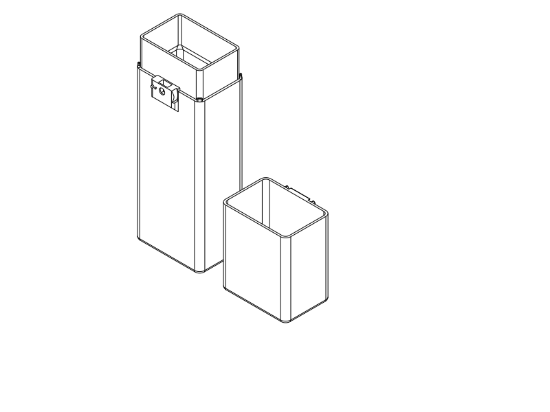

# Full rotary travel case

**Ready for the first full-size PLA print.** The complete quick trial works; this version makes its fit modestly tighter and widens the cap keeper to match the wheel. Closed shell: **75.8 × 52.8 × 264 mm**, plus the local wheel projection.

Print [body + cap + spring wheel STEP](../rotary_travel_case.step) / [STL](../rotary_travel_case.stl), [Python](../rotary_travel_case.py). Reuse the successful printed screw and nut, or print the unchanged [solid custom pair STEP](../rotary_printed_fasteners.step) / [STL](../rotary_printed_fasteners.stl), [Python](../rotary_printed_fasteners.py). The wheel is also unchanged and may be reused. Five printed parts total, no metal hardware. Inspection files containing `_assembled` or `detail` are not print layouts.

## What changed

| Relationship | Accepted quick trial | Full-size revision |
| --- | --- | --- |
| Sliding guide clearance | 0.30 mm per side | **0.20 mm per side** |
| Keeper/nose radial gap | 0.80 mm | **0.50 mm** |
| Cap holding ledge | Short central crown and one root | **34 mm wide**, rounded outline matching wheel span; front-open nose relief |
| Sleeve / engagement | 18 / 15 mm | **30 / 27 mm**, retained full-box dimensions |
| Ends | Large grip openings | Closed 2 mm floor and roof |
| Screw, nut, wheel and spring | Successful printed pair / detent | **Unchanged** |

The cap bore is now 71.6 × 48.6 mm around the 71.2 × 48.2 mm sleeve. Tightening is deliberately limited to guide play and keeper lift play; the rotating journal and custom thread retain their successful allowances. The shoulder screw still leaves 0.5 mm nominal wheel axial freedom and seats on the fixed journal. Extra screw tightening does not create the release resistance: the curved printed spring and body pin do that.

The wide keeper projects to the same front plane as before. Its rounded outer corners and front edge give a continuous ledge; the recessed annular channel clears the nose throughout the quarter turn. All four rounded capsule seating stops remain, setting the same 3 mm exposed seam and protecting hands from the earlier pointed corners. Interior walls remain uninterrupted beside the hardware.

## Print and assemble

| Job | Setup |
| --- | --- |
| Body, cap and spring wheel | **PLA, 0.4 mm nozzle, 0.2 mm layers, 3 walls, 7% adaptive cubic, 5 mm automatic brim; accessible automatic tree supports**. Keep the body bottom down, cap roof down, wheel outer face down as supplied. |
| Screw and nut, only if needed | Same PLA/nozzle/layers; **4 walls, 100% rectilinear infill, supports off**, hex head / nut flat face down. Reuse the existing successful pair if available. |

Use your successful PLA temperature and chamber setup. PETG has not been tried. Body height is 204 mm and inverted cap height 87 mm, within the Q2C's 256 mm build height. Closed length is not the print height. Keep the three-part layout or import STEP as its component parts without changing scale.

1. Remove brim/support at the cap's outside keeper/channel, wheel head recess and body exterior axle-entry bore. The keeper channel opens toward the front; the bore opens toward the front and top-loading nut pocket. Clear these before assembly. Protect guide surfaces and the spring from removal damage.
2. Try the body and cap **without the wheel**. They should slide and seat with less play than the accepted trial. Full-length guide friction and the new 0.20 mm allowance need confirmation on this print.
3. Drop the printed nut into its keyed top-loading pocket, 10 mm across and 11 mm vertically. Fit the wheel at LOCK over its pins, insert the solid shoulder screw and seat gently with an **8 mm socket, outside diameter no more than 12.8 mm**. Avoid using screw torque to clamp the wheel.
4. Rotate to OPEN, seat the cap, then turn to LOCK. Support the body underneath and open upright or diagonally. Release pulling pressure before turning to OPEN. The 3 mm seam and wider keeper provide purchase; loaded grip comfort is still to be tried.
5. Load the brush and toothpaste using the previously successful diagonal arrangement, toothpaste flat tail down/cap up. Check ordinary closure, opening and gentle side loading before bag use. Stop if there is thread damage, spring cracking or unintended release.

## User feedback and authorized adoption

The user reports **everything in the latest PLA trial printed and the idea works**: it stays together and is generally satisfactory, with a little looseness when printed at the correct temperature. They request slightly smaller tolerances, a full-length cap holding projection matching the wheel, and autonomous adoption into the full box. They subsequently confirm the intended change is **sideways across the wheel width**, because the shorter keeper looks visually strange beside its holder. Exact printed artifact and thermal settings were not supplied; attribution to the delivered quick trial is conversational.

Earlier reports remain valid within their scope: R1a fitted nicely; a later PLA sample bound even with the wheel removed, and the user subsequently recalled accidentally closing the chamber and suspects overheating. That cause was not isolated. The current successful corrected-temperature report supports modest tightening; it does not establish universal printer tolerances or a material calibration. See [quick-trial history](quick_rotary.md).

The earlier smooth-C request avoided backing bumps and used paired end snaps. Later instructions explicitly selected a compact one-sided rotary mechanism, permitted external packaging, demanded hidden hardware and an anti-release detent, and now require a projecting full-width keeper. Those later choices supersede the obsolete snap strategy and completely flush local mechanism expectation; aligned main sides and rounded contact surfaces remain. Historical support-free intent stays visible as unresolved in the verification plan: this authorized, printed mechanism uses removable exterior supports.

The full shell retains the larger smooth-C envelope. **Physical packing evidence already exists:** the printed M1 accepted the brush and toothpaste together diagonally, with effort, toothpaste tail down/cap up, plus a floss box. Its minimum sleeve opening was 65.1 × 42.1 mm; this model retains the larger **67.2 × 44.2 mm** passage. This is a useful packing basis, not proof of effortless loading or a new combined-envelope CAD test. [Original physical report](m1.md#packing-and-the-lesson-from-the-first-print).

## Verification, limits and print status

[Current CAD evidence](rotary_case/cad.json) composes the established rotary checks with the changed guide allowance and wide keeper. It covers 19 nominal wheel angles, 80 turn/play poses, 21 locked guide/axle-play capture witnesses, detent interference before release, clear unlocked withdrawal, all four seating/overclose contacts, protected storage-facing skins, recessed hardware and individual brush/tube passage. These are rigid geometric questions; spring interference is the declared compliant contact. No static overlap is reported as a measured retention force, side-impact rating or fatigue result.

The first wide-ledge construction exposed an invalid small-edge fillet: union silently lost the keeper despite the final shell being valid. The actual capture check rejected it. Rounding the outside before cutting the relief fixed the defect; the keeper now has its own construction-validity guard. A second targeted turn/play check found the relief too shallow at combined axial/guide limits; extending the exterior relief back to the shell surface cleared those poses without opening the storage wall.

[Native export/slice review](rotary_case/print_review.json), [support review](rotary_case/support_review.json), [source/export association](rotary_case/publication.json), and [product verification](rotary_case/verification.json) cover this revision. The retained custom-pair [publication](printed_fasteners/publication.json) and [solid-core/path checks](printed_fasteners/core_paths.json) apply to the unchanged pair. No old hollow M6 screw is recommended.

The smoke slice uses OrcaSlicer 2.4.2, Q2C 0.4 mm, the recorded three-wall support-enabled process and **PETG diagnostic filament**, because no supplied PLA preset exists in this repository. It checks the delivered STL layout and support paths, not PLA temperatures, physical fit or Orca GUI STEP import. Use your successful PLA preset for printing. Orca completed with no notices. Both support and support-interface paths were reviewed outside the protected storage passages. The diagnostic estimate is **199.97 g / 5 h 33 m 30 s** for the full shell/wheel job, including print aids; the unchanged pair adds about **0.99 g / 9 min** if reprinted. These are diagnostic PETG estimates, not PLA predictions.

| Category | Print status | Result / next step |
| --- | --- | --- |
| Quick rotary test pieces | **Yes — successful PLA complete trial** | Stays together; slightly loose; wider keeper requested. |
| Custom solid screw + nut | **Yes — included in successful complete trial** | Reused unchanged; separate strength/torque/wear not measured. |
| Full rotary final object | **Unknown — first print prepared** | Revised guide and keeper unprinted; loaded fit, side bumps, detent effort and long-term wear remain physical checks. |
| PETG trial | **No** | Not tested; no need to switch material for this phase. |

## Engineering record and attribution

Variant `rotary-full-pla` is exposed by `verification.py` through the shared product-verification CLI. It preserves prior user intent and leaves integrated use, force, side-impact and unsupported-printing questions visible as UNKNOWN. The successful coupon is scoped explicitly to sample operation; its revised geometry and the full box do not inherit a full physical PASS. Existing independent CAD checks answer the affected mechanism relationships rather than restarting obsolete snap-force simulations.

Primary language model: GPT-6 family; exact model identifier and reasoning effort not exposed. Harness: Codex coding-agent environment. Provider: OpenAI. No subagents. The user supplied successful PLA feedback, tighter-fit preference, keeper direction and full-box authorization. Historical attribution remains in linked records.
