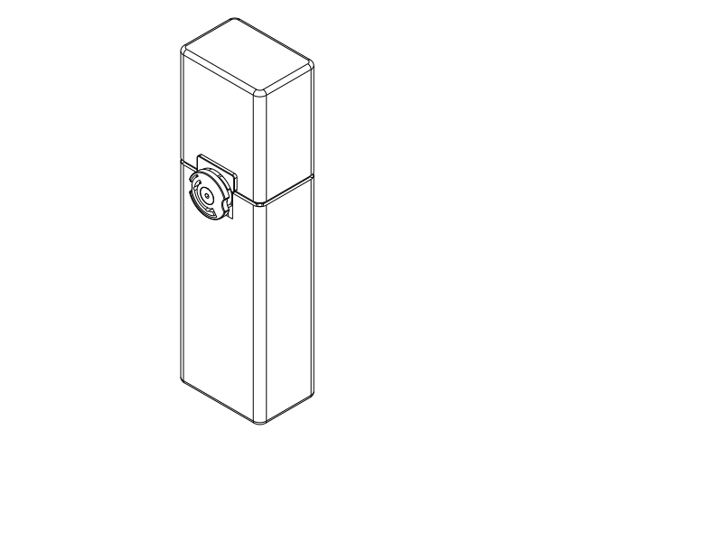
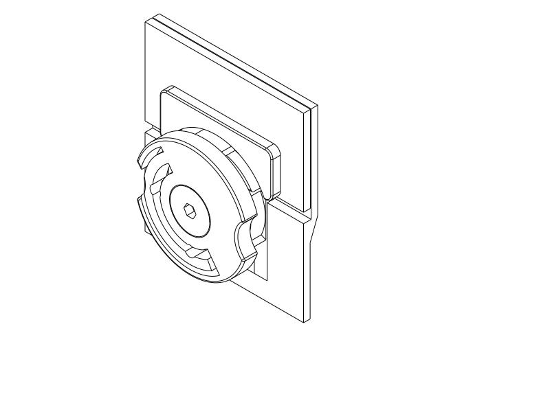
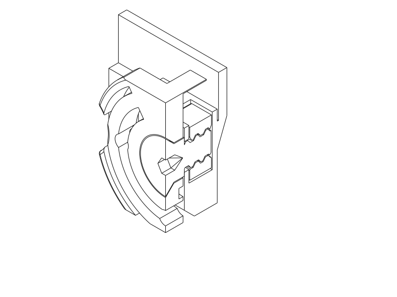
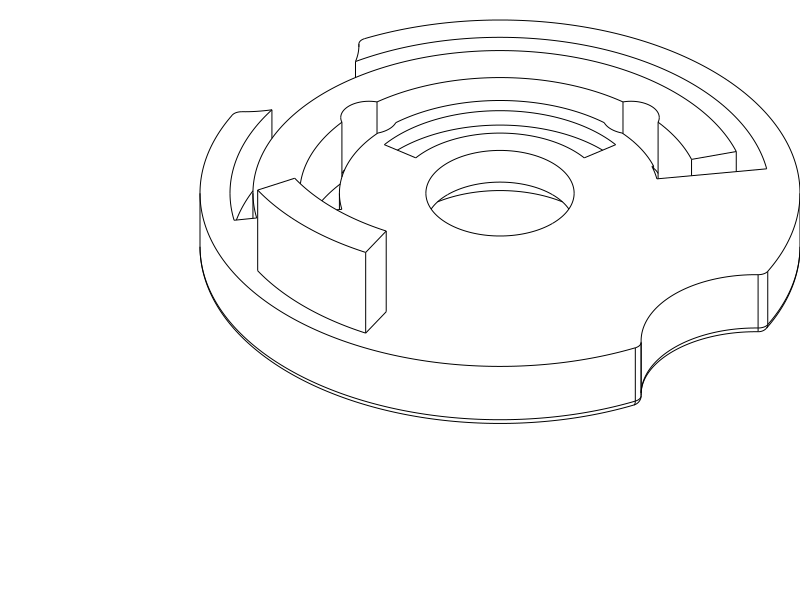

# Full rotary travel case

**Previous exposed-wheel revision; superseded by the [matching keyed facecap model](covered_rotary.md).** This record preserves its tapered wheel and matching flush hex-key screw. The previous wheel's face-down recess printed poorly; the new matched pair replaces its flat overhang with 45° tapers. Reuse the existing body, cap and printed nut. Closed shell remains **75.8 × 52.8 × 264 mm**, plus the local wheel projection.

For an existing trial or box, print only the replacement [wheel STEP](../rotary_conical_wheel.step) / [STL](../rotary_conical_wheel.stl) / [Python](../rotary_conical_wheel.py) and [screw STEP](../rotary_conical_screw.step) / [STL](../rotary_conical_screw.stl) / [Python](../rotary_conical_screw.py). **Change wheel and screw together.** For a complete new box, use the updated [body + cap + wheel STEP](../rotary_travel_case.step) / [STL](../rotary_travel_case.stl), [Python](../rotary_travel_case.py), plus the [matching screw + unchanged nut STEP](../rotary_conical_fasteners.step) / [STL](../rotary_conical_fasteners.stl). Five printed parts, no metal hardware. Inspection files containing `_assembled`, `section` or `detail` are not print layouts.

## What changed

| Relationship | Accepted quick trial | Full-size revision |
| --- | --- | --- |
| Sliding guide clearance | 0.30 mm per side | **0.20 mm per side** |
| Keeper/nose radial gap | 0.80 mm | **0.50 mm** |
| Cap holding ledge | Short central crown and one root | **34 mm wide**, rounded outline matching wheel span; front-open nose relief |
| Sleeve / engagement | 18 / 15 mm | **30 / 27 mm**, retained full-box dimensions |
| Ends | Large grip openings | Closed 2 mm floor and roof |
| Screw and wheel recess | External hex / stepped face-down recess | **Flush conical head, 3 mm hex-key drive / 45° recess** |
| Thread, nut and spring | Successful coarse printed thread / detent | **Unchanged** |

The cap bore is now 71.6 × 48.6 mm around the 71.2 × 48.2 mm sleeve. Tightening is deliberately limited to guide play and keeper lift play; the rotating journal and custom thread retain their successful allowances. The shoulder screw still seats on the fixed journal with the wheel clear of its conical head; the cone limits outward travel while the body limits inward travel. Extra screw tightening does not create the release resistance: the curved printed spring and body pin do that.

The wide keeper projects to the same front plane as before. Its rounded outer corners and front edge give a continuous ledge; the recessed annular channel clears the nose throughout the quarter turn. All four rounded capsule seating stops remain, setting the same 3 mm exposed seam and protecting hands from the earlier pointed corners. Interior walls remain uninterrupted beside the hardware.

## Conical wheel and screw revision

The user reports that the wheel's bed-facing recess is hard to print cleanly because of too much overhang, and requests co-designing its screw into a cone-shaped head with hex-key access and a smooth matching exterior. This is a surface/printability complaint; the earlier successful mechanism report remains valid.

The old wheel recess jumped from 13.2 mm to 8.4 mm diameter at a flat roof. The new recess tapers **12.4 → 8.4 mm over 2 mm**, 45° to the axis. It prints outer face down with a gradual inward step each layer. The matching screw head is **12 mm diameter**, flush with the wheel face, with **0.20 mm radial running clearance**. A fine circular seam is necessary for separate rotating parts; forcing zero clearance would make the head rub or clamp the wheel.

The screw has a **3.2 mm across-flats blind socket for a 3 mm hex key**, with 2.2 mm straight engagement followed by a 1.9 mm sloped hexagonal roof. The drive roof ends at local Z3.8, before the thread begins at Z4.2. **The entire threaded region remains solid.** The shoulder seat, thread pitch, thread diameter, nut and detent spring retain the successful dimensions. The head and wheel do not need support material between their mating tapers.

An initial head-up screw trial generated supports beneath its shoulder step. The final screw prints **broad head down**, retaining the successful thread orientation; the sloped socket roof avoids a wide flat ceiling. [Retained rejected-orientation slice](rotary_case/history/external_hex/conical_head_up_review.json). Existing body, cap and nut may be reused; the spring/nose outside the hub are geometrically unchanged. The old external-hex screw and new wheel are not a matching pair.

## Print and assemble

| Job | Setup |
| --- | --- |
| Replacement wheel only | **PLA, 0.4 mm nozzle, 0.2 mm layers, 3 walls, 7% adaptive cubic; supports off**, supplied outer-face-down placement. |
| Matching screw, or screw + nut | Same PLA/nozzle/layers; **4 walls, 100% rectilinear, supports off**. Supplied screw head down and nut flat face down. Reuse the existing nut if available. |
| Complete body, cap and new wheel | PLA, 0.4/0.2 mm, 3 walls, 7% adaptive cubic, 5 mm automatic brim; removable exterior tree supports at **body bore and cap keeper only**. Wheel needs no supports. |

Use your successful PLA temperature and chamber setup. PETG has not been tried. Body height remains 204 mm and inverted cap height 87 mm; the Q2C's 256 mm build height is sufficient. Keep the supplied part placements and scale.

1. For existing prints, remove the old screw and wheel. Retain the body, cap and printed nut. For a new full box, clean the accessible support at the exterior body bore and cap keeper before assembly. Avoid the guide surfaces and spring when trimming.
2. Print the matching wheel and screw in their supplied orientations. Remove brim carefully from the screw's head/socket mouth. Confirm the hex key enters the straight drive section; use light finger torque.
3. Place the nut in its keyed top-loading pocket, 10 mm across and 11 mm vertically. Fit the new wheel over its pins at LOCK and install the new conical screw. Seat the fixed shoulder gently using a **3 mm hex key**. Do not tighten against the wheel to generate release resistance.
4. Check the wheel turns freely and the head is flush. Turn to OPEN, seat the cap, then turn to LOCK. Release pulling pressure before turning to OPEN. Support the body underneath and open upright or diagonally.
5. For the full box, confirm the tighter 0.20 mm guide first without the wheel, then load brush and paste using the previously successful diagonal arrangement, toothpaste tail down/cap up. Full loaded handling and ordinary bag bumps remain physical checks.

## User feedback and authorized adoption

The user reports **everything in the latest PLA trial printed and the idea works**: it stays together and is generally satisfactory, with a little looseness when printed at the correct temperature. They request slightly smaller tolerances, a full-length cap holding projection matching the wheel, and autonomous adoption into the full box. They subsequently confirm the intended change is **sideways across the wheel width**, because the shorter keeper looks visually strange beside its holder. Exact printed artifact and thermal settings were not supplied; attribution to the delivered quick trial is conversational.

Earlier reports remain valid within their scope: R1a fitted nicely; a later PLA sample bound even with the wheel removed, and the user subsequently recalled accidentally closing the chamber and suspects overheating. That cause was not isolated. The current successful corrected-temperature report supports modest tightening; it does not establish universal printer tolerances or a material calibration. See [quick-trial history](quick_rotary.md).

The earlier smooth-C request avoided backing bumps and used paired end snaps. Later instructions explicitly selected a compact one-sided rotary mechanism, permitted external packaging, demanded hidden hardware and an anti-release detent, and now require a projecting full-width keeper. Those later choices supersede the obsolete snap strategy and completely flush local mechanism expectation; aligned main sides and rounded contact surfaces remain. Historical support-free intent stays visible as unresolved in the verification plan: this authorized, printed mechanism uses removable exterior supports.

The full shell retains the larger smooth-C envelope. **Physical packing evidence already exists:** the printed M1 accepted the brush and toothpaste together diagonally, with effort, toothpaste tail down/cap up, plus a floss box. Its minimum sleeve opening was 65.1 × 42.1 mm; this model retains the larger **67.2 × 44.2 mm** passage. This is a useful packing basis, not proof of effortless loading or a new combined-envelope CAD test. [Original physical report](m1.md#packing-and-the-lesson-from-the-first-print).

## Verification, limits and print status

[Current CAD evidence](rotary_case/cad.json) composes the established rotary checks with the changed guide allowance and wide keeper. It covers 19 nominal wheel angles, 80 turn/play poses, 21 locked guide/axle-play capture witnesses, detent interference before release, clear unlocked withdrawal, all four seating/overclose contacts, protected storage-facing skins, recessed hardware and individual brush/tube passage. These are rigid geometric questions; spring interference is the declared compliant contact. No static overlap is reported as a measured retention force, side-impact rating or fatigue result.

The first wide-ledge construction exposed an invalid small-edge fillet: union silently lost the keeper despite the final shell being valid. The actual capture check rejected it. Rounding the outside before cutting the relief fixed the defect; the keeper now has its own construction-validity guard. A second targeted turn/play check found the relief too shallow at combined axial/guide limits; extending the exterior relief back to the shell surface cleared those poses without opening the storage wall.

[Native export/slice review](rotary_case/print_review.json), [support review](rotary_case/support_review.json), [source/export association](rotary_case/publication.json), and [product verification](rotary_case/verification.json) cover this revision. The successful coarse thread/nut history remains the basis; [new head/core checks](rotary_case/conical_cad.json) and [delivered STEP/path checks](rotary_case/conical_print_paths.json) cover the changed screw. The old pair is retained as history, not the matching head for this wheel. No old hollow M6 screw is recommended.

The smoke slices use OrcaSlicer 2.4.2 and Q2C 0.4 mm, with the recorded three-wall wheel/shell and four-wall solid-fastener processes and **PETG diagnostic filament**, because no supplied PLA preset exists in this repository. It checks the delivered STL layout and support paths, not PLA temperatures, physical fit or Orca GUI STEP import. Use your successful PLA preset for printing. Orca completed with no notices. Both support and support-interface paths were reviewed outside the protected storage passages. The diagnostic estimate is **2.60 g / 8 m 51 s** for the standalone wheel and **0.53 g / 6 m 8 s** for the screw; the complete shell/wheel job is **199.87 g / 5 h 34 m 52 s**, including print aids. These are diagnostic PETG estimates, not PLA predictions. Both replacement parts slice without notices or automatically generated supports. The local path check includes the preset’s 0.15 mm first-layer elephant-foot compensation and 0.5 mm first-layer width; its larger first-to-second-layer shift still leaves nominal ring overlap. Actual cone/drive finish, easy rotation and printed drive strength remain untested.

| Category | Print status | Result / next step |
| --- | --- | --- |
| Quick rotary test pieces | **Yes — successful PLA complete trial** | Stays together; slightly loose; wider keeper requested. |
| Previous external-hex screw + nut | **Yes — included in successful complete trial** | Reuse the nut; change wheel and screw together for the taper revision. |
| Conical wheel + blind-drive screw | **Unknown — replacement files prepared** | Print finish, hex drive durability and free rotation await user report. The thread is unchanged and solid in CAD/STEP and sampled slice sections. |
| Full rotary final object | **Unknown — first print prepared** | Revised guide and keeper unprinted; loaded fit, side bumps, detent effort and long-term wear remain physical checks. |
| PETG trial | **No** | Not tested; no need to switch material for this phase. |

## Engineering record and attribution

Variant `rotary-full-pla` is exposed by `verification.py` through the shared product-verification CLI. It preserves prior user intent and leaves integrated use, force, side-impact and unsupported-printing questions visible as UNKNOWN. The earlier external-hex full-release receipts are preserved under [history](rotary_case/history/external_hex/publication.json), referring to exports at commit `10122fe`. The successful coupon is scoped explicitly to sample operation; its revised geometry and the full box do not inherit a full physical PASS. Existing independent CAD checks answer the affected mechanism relationships rather than restarting obsolete snap-force simulations.

Primary language model: GPT-6 family; exact model identifier and reasoning effort not exposed. Harness: Codex coding-agent environment. Provider: OpenAI. No subagents. The user supplied successful PLA feedback, tighter-fit preference, keeper direction, full-box authorization and the subsequent wheel-overhang complaint/conical-head request. Historical attribution remains in linked records.
