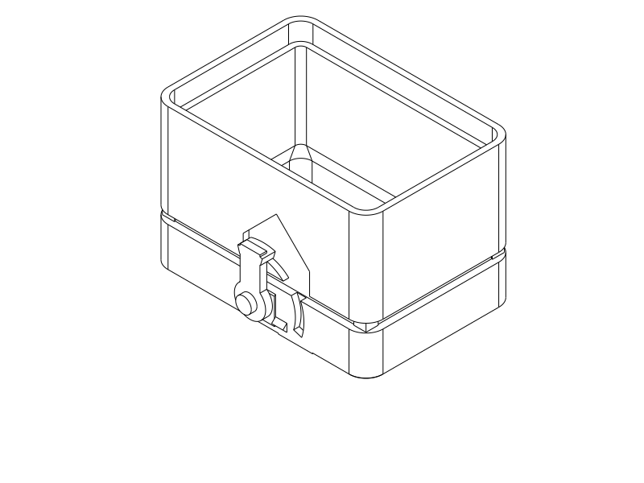

# R1a swivel-tab test piece

**Current status: printed; the user reports that R1a “kind of works” and is “okay” (2026-10-22).** The user subsequently clarifies the R1a guide fit was nice. This is positive qualitative fit/action evidence, without measured effort, durability or bag retention. Its exposed mechanism remains rejected as the final visual direction. [Current refinement](rotary_refinement.md) preserves the rotary concept.

This short **R1 mechanism sample** was delivered to understand the motion and try its fit in PLA: [STEP](../rotary_r1_test.step) · [STL](../rotary_r1_test.stl) · [Python](../rotary_r1_test.py). It contains **three printed parts: body ring, cap ring and swivel tab**. Add **one M3×12 screw and two plain M3 nuts** from the recorded stock. The full travel case remains on hold.

**Turn the tab sideways to OPEN; seat the cap and turn the tab upright to LOCK.** The tab stays on the body. Its inward nose swings above a curved keeper integral to the cap. Lifting the cap brings the keeper against the nose. The curved faces are concentric with the pivot, allowing rotation without forcing a square corner past the keeper. This sample deliberately has **0.8 mm nominal radial capture clearance**: expect some axial play, with no cam draw-down or forced snap during closing.

[Actual CAD operation SVG](../renders/tests/rotary_r1/operation.svg) · [open view](../renders/tests/rotary_r1/rotary_r1_test_open_isometric.png) · [print placement](../renders/tests/rotary_r1/rotary_r1_test_isometric.png).

## Print and assemble

Use ordinary **PLA, 0.4 mm nozzle, 0.2 mm layers, 3 configured wall loops, 7% adaptive cubic infill and a 5 mm automatic brim**. Select your own PLA filament preset. Print without supports in the supplied layout: body and cap upright, tab with its flat outer face on the bed and nose upward. Do not scale, or print the `_assembled` / `_open` inspection entries; those include nominal metal hardware for explanation.

The body is **44 mm high**, cap **33 mm**, and loose tab **4.6 mm thick** in print placement. Closed sample height is **50 mm**, based on the **75.8 × 52.8 mm** shell outline. The local tab projects about 3 mm beyond the body face; the displayed screw head reaches about 5.3 mm. This trial is not a flush final exterior.

1. Let the parts cool; remove brim and first-layer burrs. With the tab absent, slide the cap onto the body and confirm easy seating and withdrawal. There are no old snap teeth.
2. Remove the cap. Put the screw through the tab from its outside face, then through the body's pivot hole. The inward nose points toward the body; upright is LOCK.
3. Fit both M3 nuts inside the open body. Leave approximately **0.2–0.4 mm axial freedom** so the tab turns freely, then lock the nuts against each other while holding the first nut/screw. Use a matching screwdriver and narrow pliers or small 5.5 mm tools. **Do not clamp the tab tight against the body.** Check again after jamming the nuts; the pivot is a bearing, not the latch.
4. Turn the tab sideways to its stop, seat the cap gently, then turn upright. To open, release any upward pull, turn sideways, then lift. Upward load can increase bearing friction.

The body has a gabled inside pocket for nut/tool access. Nominal small opposing plier jaws clear in CAD, but actual tools and screw-head dimensions are unmeasured. No printed assembly tools are required. The shallow indexing bump is only a position cue; axle freedom may make it weak. Tightening the screw until rotation becomes stiff would hide that problem rather than establish useful indexing.

## What this sample represents

It retains the **whole guide perimeter, 30 mm sleeve height**, 2 mm sleeve wall and **0.30 mm guide clearance per side**. The minimum sleeve bore remains **67.2 × 44.2 mm**. A backed curved body recess lets the nose park sideways; at least 2.3 mm local backing remains behind that recess without narrowing the passage beyond the sleeve bore.

**The seating stop and 3 mm seam reveal are present.** Four small corner pads independently stop the cap, leaving the reveal open between them. These replace the previous internal sleeve-tip stop in this coupon so the cap can print upright without an internal ledge overhang. The gap is therefore intentional, although the stop construction differs from the old full case.

Both ends are open to save material and expose the mechanism. There is no full-length shell, roof, floor or contents. This changes stiffness and handling; a successful sample cannot qualify far-edge peel, sideways impacts, loaded packing, final exterior acceptability or bag security. No measured retention force or printed-strength claim is made.

## Useful observations

Try the tab alone before adding the cap. Does it turn easily, reach both stops and remain in each position without excessive pivot friction? Then seat/unseat in OPEN, lock and apply a gentle straight tug, unlock without pulling upward, and repeat several times. Watch for rubbing, keeper damage, nut loosening and unintended rotation. The slight lift before the keeper bears is expected.

- If the cap binds with the tab absent, revise the guide fit; do not compensate at the pivot.
- If only rotation binds, identify nose/recess rubbing versus an over-tight pivot before changing clearances.
- If LOCK prevents lift and deliberate opening is easy, the action is worth considering for a complete-case revision. Weak indexing, easy accidental rotation, awkward operation or unacceptable exterior bulk calls for revision or rejection even if the nose captures.

The immediate uncertainty is whether this rotating action is understandable and useful in a real PLA assembly. CAD can explain its contact and path but cannot establish feel. The open full-perimeter sample is more informative than a loose tab and substantially shorter than the complete box. Its result decides whether to develop R1 further, not whether the travel case is qualified.

## Evidence and print status

[CAD checks](rotary_r1/cad.json) cover named native assembly configurations, independent seating/overclosing obstruction, 19 sampled turn angles, 27 locked lift witnesses across guide and axle play, a nose-removed negative control, sampled unlocked withdrawal, angular stops, nominal hardware clearance and explicit narrow-jaw tool envelopes. The indexing bump is excluded only from rigid turn clearance and its interference is reported separately; this is not a force calculation. Radial axle wobble, elastic keeper behavior and opposite-edge peel remain unqualified.

[Final export/slice report](rotary_r1/print_review.json): valid CadQuery geometry and matching native STEP/STL; **OrcaSlicer 2.4.2 accepts the layout with no notices and no generated support**, including the automatic-support probe. The review uses Q2C 0.4 mm, the existing three-wall process and **PETG diagnostic filament**. It establishes selected-profile path generation, not PLA temperatures or a calibrated PLA process. Use your own PLA preset. The separate GUI STEP importer has not been tested. [Source/export association](rotary_r1/publication.json).

An initial circular nut-access pocket attracted support under its ceiling. Actual support paths identified that roof, rather than the cap keeper, as the cause; the final gabled tool pocket removes the request. [Earlier diagnosis](rotary_r1/support_review.json). Initial motion checks also caught the parked nose intersecting the body; the backed curved recess corrects that interference. These are local geometry lessons, not new force evidence. Existing C2/B1 files and evidence remain unchanged.

| Item | Print status | Artifact(s) | User result or remaining physical checks |
| --- | --- | --- | --- |
| R1a sample | Yes — qualitative action accepted | `rotary_r1_test.py` / `.step` / `.stl` | User reports “kind of works” / “okay”; precise settings, artifact hash, measured effort, indexing durability and bag retention unknown. Intended PLA. |
| Full R1 case | N/A | None | Sample phase only; no production revision. |

Primary language model: GPT-6 family; exact model identifier and reasoning effort not exposed. Harness: Codex coding-agent environment. Provider: OpenAI. Source, CAD checks and drawings are agent-authored. User supplied the concept choice and earlier C2 physical feedback; existing historical attribution is preserved.
