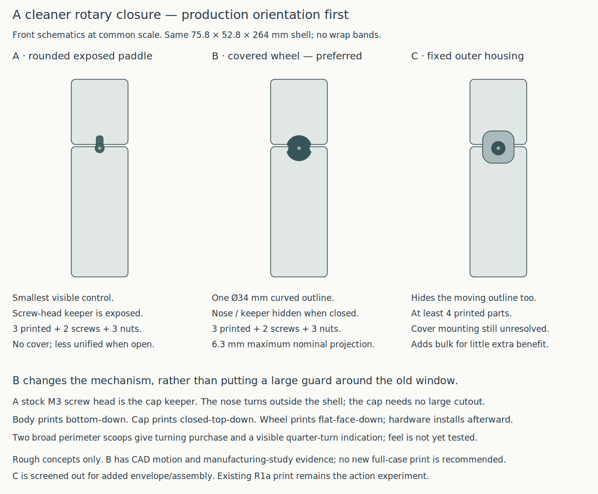
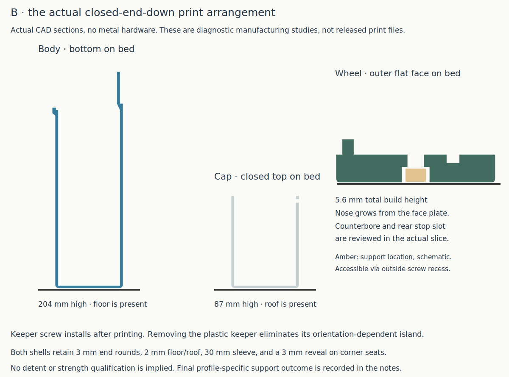

# Cleaner rotary closure in production print orientations

**The covered wheel is the preferred next direction.** [Compare the three appearances](../renders/concepts/rotary_refinement/comparison.svg), [see the actual engagement](../renders/concepts/rotary_refinement/mechanism.svg), and [see how the closed shells print](../renders/concepts/rotary_refinement/manufacture.svg). A rough complete CAD assembly and an actual full-shell manufacturing slice support the direction. **Do not print the full study yet:** wheel indexing, real hardware fit and strength are unresolved. Finish the [R1a action trial](rotary_r1.md) already underway.

The user reports the R1a PLA print underway, not finished, on 2026-10-22. They reject its exposed, fragmented mechanism as the final exterior and ask for autonomous research combining appearance with the actual final print orientations: **body on its bottom; cap on its closed top**. A housing or a changed mechanism is allowed. This is visual/manufacturing feedback, not a completed print or use result. No success is inferred from the ongoing print.

## What changes

The old nose reached into a cap window and caught a printed keeper crown. That was useful for seeing the action, but the keeper construction was arranged for the coupon cap printed upright. Inverting the cap changes how the crown and its side attachment first appear; the upright coupon's clean slice does not qualify that inverted feature.

The new study uses **a stock M3×10 screw head as the cap keeper**, held by an M3 nut. The nose stays completely outside the cap wall and swings above that head. A **34 mm wheel** covers the nose and body journal. It is the moving latch itself, so there is no separate decorative cover to fasten. The cap needs only a small screw bore; the gabled exterior opening and the old body parking relief disappear.

The cap screw's head and nut travel through an **open-ended 10.4 mm track in the sleeve**. That removes a local portion of the front guide wall, leaving the other guide walls and corner bearing. It is a deliberate tradeoff, not an unchanged full-perimeter guide. The keeper screw tip projects inside the passage; its location and loading clearance were checked with the actual nominal hardware. A shorter screw could reduce that intrusion later, but this study uses the recorded stock rather than requiring a purchase.

The body, cap and rotor are **three printed parts**. Hardware is **M3×12 + two M3 jam nuts for the pivot**, and **M3×10 + one M3 nut for the keeper**: five metal pieces altogether. Head shapes are nominal, not measurements of the user's screws. The keeper is tightened against the cap; the pivot nuts jam against each other with rotor endplay, as in the earlier trial. Both fasteners are accessible during assembly with the cap off; the keeper sits close to its open rim. Tool comfort has not been physically qualified.

## Appearance comparison

The A/B/C labels below belong to this comparison, not the earlier B1 sliding yoke or Smooth C case.

| Direction | Appearance and operation | Manufacturing / assembly | Decision |
| --- | --- | --- | --- |
| A — rounded exposed paddle | Smallest visible control; keeper remains visible. Smooth profiles replace the original angular stem. | Same three printed parts and five metal pieces. Rough CAD form comparison; its operating stops are not detailed. | Retain as the smaller-control alternative. It still exposes individual mechanism parts. |
| **B — covered wheel** | A single circular silhouette with two broad perimeter scoops. Quarter-turn changes scoop orientation. Nose, keeper and journal are hidden when closed. | Same three printed parts and five metal pieces. Flat outer face prints on the bed, with the nose growing upward. | **Preferred balance:** simpler appearance without an extra housing. Actual motion and manufacturing studies completed. |
| C — fixed outer housing | A stationary rounded pod surrounds a smaller control. Hides the changing outline too. | At least four printed parts; housing mounting/extra hardware are not resolved. Larger external envelope. Schematic only. | Screened out for now: adds bulk and assembly around parts B already conceals. |

[Open wheel assembly](../renders/concepts/rotary_refinement/rotary_refinement_open_isometric.png) · [rounded paddle CAD](../renders/concepts/rotary_refinement/rotary_refinement_paddle_isometric.png).

The shell remains **75.8 × 52.8 × 264 mm**. Nominal maximum control/head projection grows from about **5.3 mm on R1a to 6.3 mm here**. This is a cleaner, wider control, not a flush latch or a claim that its exterior is smaller in every direction. The overall body is not widened. Broad finger scoops and rounded plate edges aim to make turning obvious without a raised handle; actual grip and finish remain for a print to establish.

The full study includes **3 mm end rounds**, a **2 mm floor and roof**, a **30 mm sleeve** and the **3 mm seam reveal**, independently seated on four corner pads. Those pads remain distinct from the retention mechanism. The cap keeper can move about **0.8 mm** before bearing against the nose; this remains loose capture, with no deliberate compression ramp or draw-down. The wheel has a rear angular stop track, but **no completed position detent**. Pivot friction must not be used to disguise that omission.

## Research and manufacturing result

[Southco's E5 overview](https://southco.com/en_gb_int/resources/new-cam-latch-products-offer-improved-security-and-hand-actuation) distinguishes compact wing controls and quarter-turn closure; its [flush-cup latch literature](https://media.southco.com/media/static/Literature/01.en.pdf) illustrates the alternative of containing a control within a fixed cup. These support comparing a small actuator with a larger housing. Their metal hardware, loads and construction do not validate this printed mechanism. The screw-head keeper and the chosen proportions are object-specific proposals.

[Prusa's manufacturing guidance](https://help.prusa3d.com/article/modeling-with-3d-printing-in-mind_164135) recommends choosing orientation, splitting where useful, and considering access and surface quality when supports are needed. A separate flat-printed keeper was considered as an orientation fix, but would add a printed part and attachment. The stock screw head removes that printed overhang without another printed keeper.

The manufacturing study uses the **complete closed-ended shells**, not upright open rings:

- **Body:** bottom-down, **204 mm high** including sleeve. A ramp grows the local journal outward; the journal stays inside the nose sweep radius. Its nut access pocket has a gabled ceiling. The sleeve track opens at its top.
- **Cap:** closed-top-down, **87 mm high**. The cap wall has only a 3.6 mm keeper bore. The metal keeper installs afterward, so there is no inverted printed crown to start in air.
- **Wheel:** outer flat face down, **5.6 mm total build height**. Its 3.6 mm plate supports the inward nose. The central counterbore opens to the bed-facing outer surface; a rear stop slot opens upward. The perimeter has small rounds, not a raised central boss that would suspend the entire wheel above the bed.

**OrcaSlicer 2.4.2 completed the layout with no notices. Its support probe generated a small support under the wheel counterbore, and none in either shell.** Actual paths are confined to the wheel centre, ending at **Z1.8 mm** under its **Z2.0 mm** screw-head seat. The support can be reached through the outside **6 mm recess**. Removing it without roughening the seat remains a physical question. This is an explicit support/removal tradeoff; the study is not labelled support-free.

The diagnostic setup is Q2C 0.4 mm, 0.2 mm layers, three configured walls, 7% adaptive cubic and 5 mm automatic brim, using the existing **PETG diagnostic filament** profile. It checks this geometry and layout; it does not establish a PLA preset or physical PETG print quality. The supplied support-disabled primary slice and the separate automatic-support probe are both retained in the native report. A future print must deliberately enable the reviewed local support or qualify the small counterbore bridge. No print is sent to the machine.

## Verification, limits and print status

[CAD record](rotary_refinement/cad.json) checks the wheel candidate's seated shells and independent stop, nominal metal/printed clearance, **19 rotation poses**, **seven locked lift witnesses** with guide play, **eight unlocked lift poses** including keeper hardware, and angular overtravel obstruction. It also checks the **30 × 255 mm brush envelope** individually and a **55 × 40 × 160 mm tube** on a straight loading path shifted **1.7 mm toward the opposite wall** to clear the body pivot hardware. Those separate gauges are not simultaneous packing validation.

The nominal head is **5.5 mm diameter × 2 mm high**. Real head geometry, friction, indexing and tolerances are unknown. The current study does not establish opposite-edge peel, guide stiffness after the track cut, keeper/nut pull-through strength, printed retention force, bag impacts, wear or acceptable handling. No old C2 force/side result is transferred. The existing production verification plan is unchanged because this is an exploratory assembly, not an adopted variant or production release.

[Native manufacturing report](rotary_refinement/manufacture_review.json) · [actual support diagnosis](rotary_refinement/support_review.json) · [source/export association](rotary_refinement/publication.json). The matching [diagnostic STEP](../rotary_refinement_print_study.step) / [STL](../rotary_refinement_print_study.stl) exist to reproduce that study, **not as a new print recommendation**. The STL review does not verify the separate GUI STEP importer.

| Item | Print status | Artifact(s) | Result / remaining observation |
| --- | --- | --- | --- |
| R1a action trial | Partial — print underway | Existing `rotary_r1_test.step` / `.stl`, unchanged | User printing in PLA; no completed assembly/use result. Exposed form is not accepted for the final case. |
| New refinement sample | N/A | None | No additional coupon recommended while R1a prints. |
| Full refinement product | N/A — rough study only | `rotary_refinement_print_study.step` / `.stl` are diagnostic artifacts | No production adoption; indexing, hardware fit, retention and integrated use remain unresolved. |

The useful next decision is whether R1a's turn-to-release action feels worthwhile. The manufacturing/form work here can be reused independently of that outcome, but it does not infer success. If the action is accepted, B is the preferred package to refine; if not, a prettier wheel alone is insufficient reason to retain it.

## Development notes and provenance

The first rough turn exposed the journal interfering with the nose near 50 degrees. Trimming the journal inside a 12.7 mm pivot radius removes that obstruction while leaving the external nose inside radius13.3 and beyond the cap wall. This is a journal shape correction, not another groove through the enclosure. The original 5-degree stop-slot allowance was also increased to account for the finite stop peg width; the final quarter-turn clears and overtravel is blocked. The support diagnosis above led to retaining a removable local support rather than adding another printed cover or hiding an unsupported roof.

The transferable issue is already covered by the design guidance: a coupon's orientation and omitted closures need explicit transfer review. Here the old coupon was appropriate for seeing the action but did not establish production orientation or appearance. That limitation is now explicit in the object summary and the root index; no extra shared workflow or unmeasured force model is added.

Reproduce the rough geometry with `rotary_refinement_design.py`, the fixed-purpose `rotary_refinement_wheel.py` / `_paddle.py` / `_open.py` views, `rotary_refinement_checks.py`, and `rotary_refinement_draw.py`. The manufacturing entry is `rotary_refinement_print_study.py`. Builds use native CadQuery assemblies with explicit pair criteria through the shared assembly-geometry API. Original R1a, B1 and C2 sources/exports remain unchanged.

Primary language model: GPT-6 family; exact identifier and reasoning effort not exposed. Harness: Codex coding-agent environment. Provider: OpenAI. User supplied the print-in-progress report, final-orientation correction and appearance rejection. CAD, engineering choices and drawings are agent-authored; external sources are attributed above. Historical attribution is preserved.
