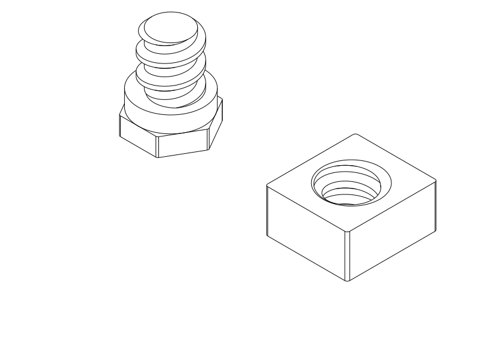

# Rotary closure with a solid custom printed screw and nut

**Print only the two replacement fastener parts:** [STEP](../rotary_printed_fasteners.step) · [STL](../rotary_printed_fasteners.stl) · [Python](../rotary_printed_fasteners.py). Keep the **body, cap and spring wheel already printing** from the indexed sample. Their geometry is unchanged; the new pair fits the existing bore and top-loading nut pocket. No metal nut or new material is needed. The full case remains on hold.

**Print the pair in PLA at 0.2 mm layers, 0.4 mm nozzle, four walls and 100% rectilinear infill, supports off.** The screw's external hex face and the nut's large flat face are already on the bed. Use a 5 mm automatic brim and your PLA temperature/flow preset. These solid settings apply to the fasteners only; the existing shells and spring wheel retain their own settings. [Diagnostic process](printed_fasteners/profiles/process.json).

## What the user requires and what changed

The latest instruction explicitly favors an **all-printed screw and matching nut**, with a custom thread sized for ordinary FDM rather than forced compatibility with a stock metal nut. It supersedes the earlier stock-only hardware approach. Installed hardware must remain recessed and outside storage, and the wheel must resist accidental opening independently of pivot tightening. Existing sample compatibility is desirable, not mandatory; it is achieved here.

The replacement has a **6 mm major diameter, 4.6 mm solid root diameter and 2.4 mm pitch**. This is a custom coarse thread, **not M6**. Its broad 0.5 mm crest and 0.6 mm flank rise replace the old 1 mm pitch / approximately 0.126 mm crest. The female thread is cut with 0.24 mm radial and 0.08 mm additional axial allowance per flank. The book-reading plate's successful coarse printed thread informed the profile and clearance; its larger diameter and strength are not transferred as validation of this pair.

The nut is a **10 × 11 × 5.2 mm keyed printed block**. Its flat sides fit the existing 10.4 mm slot. The screw retains the original **8 mm shoulder diameter**, **2 mm shoulder length**, recessed **8 mm external hex**, and total **10.6 mm length**. The unchanged body bore is 6.4 mm. The same shoulder seats against the body, leaving **0.5 mm axial wheel freedom**, rather than clamping the wheel for resistance. The detent, capture nose, keeper, 30 mm sleeve, 3 mm seam reveal and continuous storage walls are unchanged. Maximum local projection remains 10.4 mm.

## The old thread really was hollow

The user correctly identified an **empty centre in the model's threaded section**. A direct material witness through the old source and delivered `rotary_refinement_axle.step` confirms the entire 3 mm-diameter core witness is absent between 5 and 9 mm above the bed. This is a CAD defect, not merely sparse infill. The intended root cylinder initially existed; the following helical union/trim returned a hollow thread while the final shape still passed validity and connectivity checks. The precise kernel/sweep cause is not isolated.

The agent initially asserted the core was solid from reading the intended cylinder, then attributed the issue to printing before checking the exported geometry. Both statements were wrong. The corrected check tests material after the complete construction and in the actual exported STEP. The replacement retains an extended root cylinder during the sweep union and then trims the combined geometry; its complete axial-core witness passes. The old hollow geometry is retained as a negative control so the check must catch the known defect.

[Actual CAD thread sections: old and replacement](../renders/tests/printed_fasteners/thread_sections.svg).

The old diagnostic process also used sparse infill through parts of the head and shoulder. The new pair is explicitly **100% infill** and its sampled toolpaths fill the centre through head, shoulder and thread. Increasing infill alone could never repair the old CAD hole. [Actual old/new paths](../renders/tests/printed_fasteners/core_paths.svg) · [path evidence](printed_fasteners/core_paths.json).

## Assemble using the current sample

1. Finish the body, cap and wheel already printing. Set aside the old fine-thread screw and metal M6 nut; neither mates with this new pair. Remove the pair's brim and any first-layer burrs without sanding away thread flanks.
2. Try the new screw and nut **loose in your hands first**. Start square, back-turn until the lead finds its start, then turn gently. They should engage for about two turns without forcing, whitening or cracking. The nut is shallow to preserve compatibility; fit, stripping and durability remain untested.
3. With the cap off, drop the printed nut into the existing top-loading pocket. Its **10 mm side runs across the slot**, its 11 mm dimension is vertical, and its threaded hole points out toward the wheel. The pocket's flat walls keep it from spinning; backing separates it from storage.
4. Place the wheel over the body pins in LOCK and pass the new screw through it. Start the printed nut gently, then seat the shoulder using an **8 mm socket, maximum 12.8 mm outside diameter**. Do not tighten beyond light seating. The recessed head and protected interior remain as before.
5. Check that the wheel turns independently of screw tightness, rests in LOCK and OPEN, and needs a deliberate turn to leave LOCK. Seat the cap in OPEN, turn to LOCK and try a gentle straight tug; release pulling before unlocking. Watch for loosening, wear, strings, cracks or spring whitening over several cycles.

If the loose pair binds, stop and report where; do not force it in the sample. If the wheel binds only after assembly, distinguish shoulder seating, brim residue and pin rubbing from thread fit. A freely spinning wheel requires detent revision, not extra screw clamping. Shortened shells do not qualify full-case peel, loaded handling or bag shaking.

## Verification, limits and print status

[CAD evidence](printed_fasteners/cad.json) checks the replacement's complete solid core and the known hollow negative control, the exported old/new STEP thread centres, **25 helical insertion/removal poses**, straight withdrawal obstruction, nut drop-in access, and unchanged body/cap/wheel material. It also reuses the full and short sample checks for protected storage skins, shoulder seating, recessed head and socket access, detent-before-release, journal play, capture, stops, withdrawal and individual full-size contents passage. No measured torque, strength, wear or shake resistance is claimed.

[Native export/slice report](printed_fasteners/print_review.json): CadQuery 2.8.0 exports the matching pair; **OrcaSlicer 2.4.2 completes with no notices and no automatic-support paths**. Actual paths at head/shoulder/thread sections fill the central witness. The Q2C 0.4 mm diagnostic setup uses 0.2 mm layers, four walls and 100% rectilinear infill. Its filament preset is **PETG diagnostic**, so use your own PLA preset. This establishes selected-profile path generation, not physical print quality or the separate GUI STEP importer. [Source/export association](printed_fasteners/publication.json).

The compatible body/cap/wheel are those in [`rotary_index_test.step`](../rotary_index_test.step) / [STL](../rotary_index_test.stl) from `d2e367c`. Those exports are deliberately preserved to identify the ongoing print. If starting from scratch, print only those three parts from that layout, omit its old screw, and print this replacement pair with the solid fastener settings. Existing old sample/export reports are historical; current model/check calls explicitly select `printed-coarse`.

| Item | Print status | Artifact(s) | User result / remaining observation |
| --- | --- | --- | --- |
| R1a action sample | **Yes** | Unchanged `rotary_r1_test.step` / `.stl` | User reports “kind of works” / “okay” on 2026-10-22; quantitative effort, durability and bag security unknown. Exposed final appearance remains rejected. |
| Indexed spring sample, old M6 fastener revision | **Partial — printing** | `rotary_index_test.step` / `.stl` at `d2e367c` | User anticipates screw breakage / inability to join; no completed assembly or actual break reported. Hollow thread CAD defect confirmed. Retain shells and wheel. |
| Coarse printed replacement pair | **Unknown** | `rotary_printed_fasteners.py` / `.step` / `.stl` | Solid geometry/path checks pass; actual fit, strength and repeated use await printing. |
| Full rotary case | **N/A — study only** | No new production print release | Full case on hold; retention force, far-edge peel and bag shaking unqualified. |

## History, references and attribution

[Previous M6 revision and evidence](rotary_refinement_m6_history.md) preserve its dimensions, hardware packaging, support diagnosis, research links and attribution. Its original source/export reports describe `d2e367c`; they do not qualify the new pair. The earlier exposed-hardware study is preserved there at `4229ddb`. [R1a action record](rotary_r1.md) retains the newly reported qualitative success. Its hardware and geometry remain unchanged.

[Book-reading plate](../../book_reading_plate/README.md#what-changed-after-the-successful-l-sample) is positive physical evidence for that larger custom printed thread. It supports choosing a coarse, printable pair as a starting point rather than forcing an ISO interface; it does not calibrate this reduced 6 mm thread. The useful lesson is to co-design both mating parts and the intended solid print, then verify actual root material after all sweep/boolean operations. Stock hardware availability is an option, not a requirement to recreate metal-scale detail in plastic.

Primary language model: GPT-6 family; exact model identifier and reasoning effort not exposed. Harness: Codex coding-agent environment. Provider: OpenAI. User supplied the print feedback, identified the hollow model, and requested the fully printed custom pair and solid fasteners. Prior attribution is preserved in the historical record.
