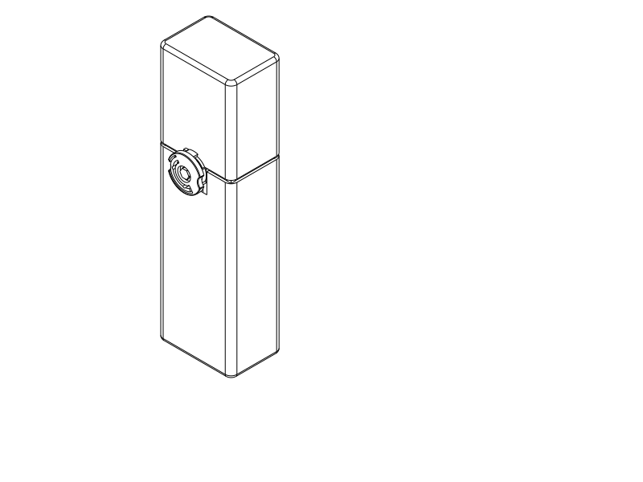
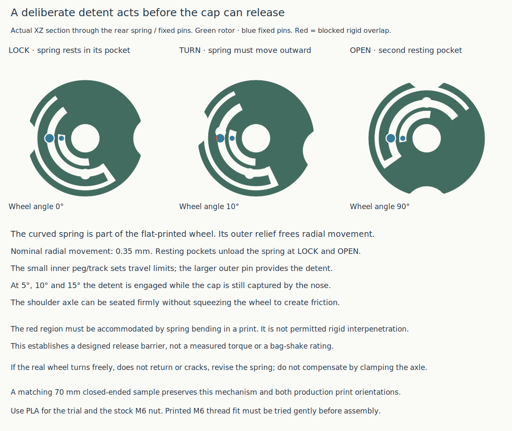

# Superseded M6 axle study — historical evidence

**Do not print the M6 axle.** The user subsequently identified its hollow thread centre, confirmed in the delivered STEP. Its CAD-validity and slice receipts did not test core material. R1a is now printed and reported okay; the indexed sample is printing. Use the [current custom printed replacement pair](rotary_refinement.md). All remaining instructions/status below describe the earlier `d2e367c` revision.

**The revised wheel uses four printed parts and one stock M6 nut.** Its printed shoulder axle is recessed, the nut sits in a blind external pocket, and the original storage-facing walls remain intact. A curved spring detent resists turning away from LOCK before the cap can release.

[Hardware / interior sections](../renders/concepts/rotary_refinement/packaging.svg) · [detent operation](../renders/concepts/rotary_refinement/detent.svg) · [print orientations](../renders/concepts/rotary_refinement/manufacture.svg).

**First useful print: the actual axle alone**, [STEP](../rotary_refinement_axle.step) / [STL](../rotary_refinement_axle.stl), to try gently with a stock M6 nut. A matching **70 mm closed-ended mechanism sample** is also delivered: [STEP](../rotary_index_test.step) / [STL](../rotary_index_test.stl) / [Python](../rotary_index_test.py). It tests the new detent and assembly. **Keep the full case on hold.** The R1a sample already printing remains a basic motion trial; it cannot qualify this new thread or detent.

## What the user requires and what changed

The user identifies installed screws/nuts as potential snags and asks for smooth, unobstructed interior and exterior surfaces, allowing local surface changes. They explicitly require **only stock materials**, permit custom printed fasteners or a printed/metal mix, and require resistance before release so shaking cannot simply spin the control open. The ongoing old sample has no completed print/use report. These are current design requirements and preferences, not observations of a tested rotary failure.

The preceding screw-head-keeper study hid hardware in the closed view but left tips and nuts inward. Its shifted loading gauge did not establish a protected surface. The current geometry removes the cap keeper screw and jam nuts, restores the full sleeve wall, and changes the pivot to a **printed M6×1 shoulder axle with one stock M6 nut**. There are no new purchased screws, adhesives or other materials.

- **Inside:** body and cap storage surfaces are unchanged from their regular shell profiles. Blind pocket backing keeps the nut and printed thread outside those surfaces. The former 10.4 mm guide track is gone; the full 2 mm front sleeve wall is restored. The toothpaste gauge now loads centrally, without the former 1.7 mm offset.
- **Outside:** the printed axle head sits **0.3 mm below the wheel face**, inside a rounded control. Its external 8 mm hex avoids a downward-facing drive-socket roof during printing. An access well and the spring's curved relief slots remain visible; this is not a completely featureless face.
- **Assembly:** the axle's 8 mm shoulder stops against the fixed body. The wheel has **0.5 mm nominal axial freedom** between that shoulder/head and its rear running face. Tightening the axle does not intentionally clamp the wheel to produce holding friction.
- **Keeper:** an integral rounded printed crown on the cap replaces the metal screw head. It sits outside the cap wall and behind the wheel when closed. With the cap removed, this small functional ledge is visible. The cap's top-down orientation needs accessible exterior support beneath its retaining face.

The material choice has a size cost: maximum control projection is **10.4 mm**, versus **6.3 mm** in the preceding rough study. The local mounting area houses a full stock M6 nut and a stout printed shoulder. The overall shell remains **75.8 × 52.8 × 264 mm**; this is a deeper local control, not a flush case. The smaller original R1a sample files are unchanged.

## Resistance before release

A fixed rounded body pin runs against a curved spring cut into the flat-printed wheel. At LOCK and OPEN it rests in a larger pocket, leaving the spring unloaded. Turning out of either pocket requires approximately **0.35 mm radial spring movement**. A separate smaller pin and track establish angular stops.

The initial detent barrier occurs while the nose still holds the cap: checks at **5°, 10° and 15°** show both the need for spring movement and blocked cap lift. The control therefore has a geometric resistance mechanism independent of pivot friction. The wheel cannot move as a free rigid rotor through those poses. Sampled shifts at the nominal 0.2 mm radial journal clearance also retain a detent barrier.

This is **not measured opening torque or bag-shake validation**. The curved leaf's force, PLA/PETG recovery, printed pin behavior and wear are unmeasured. If the trial spins freely, fails to return or cracks, revise the detent rather than tightening the axle against the wheel. Thread loosening and whole-case peel/impact behavior also remain physical questions. No previous C2 force or side-impact result is transferred.

## Print and assemble the small trial

The sample uses the same mechanism builder as the full study. It retains the **30 mm sleeve**, **3 mm seam reveal on four independent corner seats**, the entire guide perimeter, the same nut pocket, axle, keeper and detent. Its body is **54 mm high**, cap **43 mm**, and closed height **70 mm**. Floor and roof remain present so both production orientations are represented. Shortened shells do not reproduce complete-case stiffness, loaded handling or bag retention.

Use stock **PLA**, **0.4 mm nozzle**, **0.2 mm layers**, **3 configured wall loops**, **7% adaptive cubic**, and a **5 mm automatic brim**. Use your own PLA filament temperatures/flow. The [local process profile](rotary_refinement/profiles/process.json) enables automatic tree supports. Keep the delivered placement: body bottom-down, cap closed-top-down, wheel outer-face-down, axle external-hex-face-down with thread pointing upward. Print the matching current files; do not mix them with R1a parts or print an assembled inspection pose.

1. **Try the axle first.** Remove brim and accessible supports carefully. Start a stock M6 nut by hand, confirming several turns without forcing. The printed M6 profile has a deliberately reduced major diameter, but its fit is uncalibrated. Binding/cross-threading or a loose stripping thread calls for adjustment before a larger print.
2. Clean support from the cap keeper, wheel recess and axle without enlarging the running bore or removing the spring. Check that the spring is intact and free of strings.
3. With the cap off, drop one M6 nut into the body's top-loading external pocket. Place its two parallel flats against the slot sides; the pocket prevents rotation. It does not open into the contents passage.
4. Place the wheel over the fixed pins and align its detent pocket with LOCK. Pass the printed axle through the wheel and start it in the nut. Use a standard **8 mm socket with outside diameter no greater than 12.8 mm**. The CAD socket envelope reaches the external hex; actual tool dimensions are unreported. Seat the shoulder gently; stop if the printed thread or head deforms.
5. Check the wheel alone for a distinct resting position and a deliberate turn out of it. Turn 90° to OPEN, seat the cap, then return to LOCK. Release upward pulling before turning to open. The cap should resist a gentle straight tug in LOCK and lift after deliberate rotation.

The trial should distinguish thread fit, a clamped/binding pivot, a weak detent and a keeper clearance problem. Observe several cycles, return to LOCK, sensitivity to light contact, support-removal damage, whitening and loosening. It is an experiment, not a qualified travel closure. A useful R1a result does not automatically qualify this added detent.

## CAD and manufacturing evidence

[CAD record](rotary_refinement/cad.json) covers both full and sample geometry: connected spring/keeper/axle construction, complete front guide material, **1.2 mm minimum protected body skin** beside the pocket, unchanged cap inner skin, and hardware excluded from both complete storage voids. It checks the recessed head, shoulder seat, socket access, 19 turn poses, unloaded detent endpoints, the barrier before release, 21 guide/axial-play capture witnesses, angular stops and eight cap withdrawal poses. Full-size individual brush and centred toothpaste passage gauges pass; simultaneous packing is not qualified.

Only the declared spring/pin contact is excluded from rigid turn clearance. Actual blocked overlap is reported separately; no elastic force is inferred from that volume. The axle and stock nut display omit nut threads, so those envelope checks do not establish real thread compatibility. The printed external thread itself is modelled.

**OrcaSlicer 2.4.2 completes the full study, sample and separate axle with no notices. Supports are generated and reviewed, not suppressed.** Actual support interfaces occur at the wheel's head recess, around the axle shoulder/initial thread region and outside the cap keeper. All are exposed for removal; none is trapped inside the storage cavity. Thread/keeper finish after removal remains a physical unknown. The [support diagnosis](rotary_refinement/support_review.json) records source-associated path locations.

The diagnostic printer is Q2C 0.4 mm, using the stated support-enabled process with an existing **PETG diagnostic filament** preset. This establishes selected-profile layout/path generation, not a calibrated PLA setup. The separate GUI STEP import is untested. [Sample slice](rotary_refinement/sample_review.json) · [axle slice](rotary_refinement/axle_review.json) · [full manufacturing study](rotary_refinement/manufacture_review.json) · [source/export association](rotary_refinement/publication.json).

The [full-study STEP](../rotary_refinement_print_study.step) / [STL](../rotary_refinement_print_study.stl) remain diagnostic exports, not a production print recommendation. Only the axle and short sample are current experimental print deliverables.

| Item | Print status | Artifact(s) | Result / remaining observation |
| --- | --- | --- | --- |
| Old R1a action trial | Partial — print underway | Unchanged `rotary_r1_test.step` / `.stl` | No completed result reported; exposed form rejected for final case. |
| Printed axle fit trial | Unknown | `rotary_refinement_axle.py` / `.step` / `.stl` | Fit with one stock M6 nut; supported surface finish and shoulder seating. |
| Indexed short sample | Unknown | `rotary_index_test.py` / `.step` / `.stl` | Deliberate turning effort, detent return, repeated operation and keeper behavior. |
| Full rotary product | N/A — study only | Diagnostic `rotary_refinement_print_study.step` / `.stl` | No production adoption or physical bag/security validation. |

## History, references and attribution

The [preceding appearance comparison](../renders/concepts/rotary_refinement/comparison.svg) and [screw-head engagement drawing](../renders/concepts/rotary_refinement/mechanism.svg) are historical, superseded in their hardware details. That study at Git commit `4229ddb` used M3×10/M3×12 screws and three nuts, a 10.4 mm sleeve track, 1.7 mm shifted tube loading and 6.3 mm control projection. Its [historical reports](rotary_refinement/history/exposed_hardware/) retain their input identities; their artifact hashes refer to that commit, not the current overwritten diagnostic exports. The first R1a sample remains at `8a28271` unchanged.

The earlier research distinguished compact controls from fixed housings using [Southco's E5 overview](https://southco.com/en_gb_int/resources/new-cam-latch-products-offer-improved-security-and-hand-actuation) and [flush-cup literature](https://media.southco.com/media/static/Literature/01.en.pdf). [Prusa's manufacturing guidance](https://help.prusa3d.com/article/modeling-with-3d-printing-in-mind_164135) supports orientation and accessible-support planning. Commercial ratings do not qualify this mechanism.

The local threaded-axle construction adapts the repository's [book-plate sweep technique](../../book_reading_plate/components.py). That object's printed thread was physically accepted, but it used a much larger custom 16×2.4 profile. Its success is not transferred to this reduced M6×1 metal-nut interface. The external hex prints face-down without repeating that project's failed downward drive-socket roof.

The concrete lesson is that a shifted passage gauge can clear exposed hardware while leaving an unacceptable snag surface. This revision checks a continuous protective skin and the complete storage void as well as item passage. The stock-only directive belongs to this travel-case revision; it is not a repository-wide ban on other hardware.

Primary language model: GPT-6 family; exact identifier and reasoning effort not exposed. Harness: Codex coding-agent environment. Provider: OpenAI. User supplied the stock-only constraint, printed-fastener permission, hardware-snag concern, detent requirement and ongoing print report. Geometry, choices and drawings are agent-authored; existing historical attribution is preserved.
