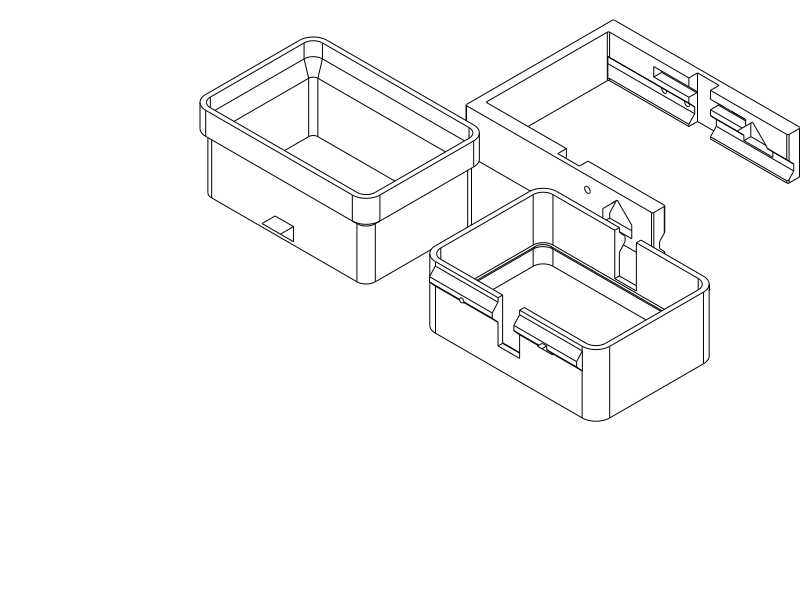
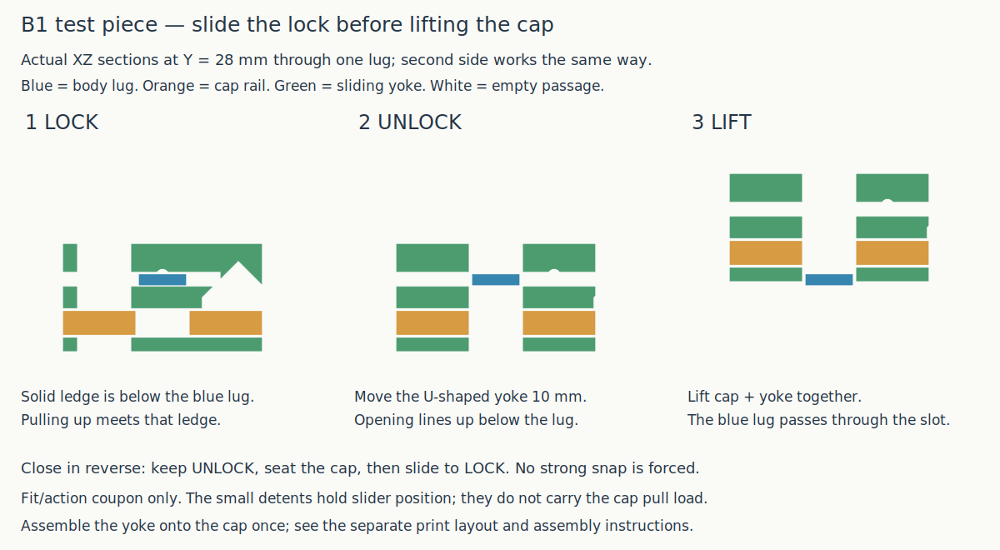

# B1 sliding-lock test piece

Print the **three-piece PLA B1 sample**: [STEP](../slider_b_test.step) · [STL](../slider_b_test.stl) · [Python](../slider_b_test.py). This is the authorized physical demonstrator of [proposal B](push_release.md), not a new full travel box. The previous PLA C2 pull-apart trial remains rejected for excessive opening/closing effort; do not repeat it unchanged.

The three parts are an open **body ring**, an open **cap ring**, and a **U-shaped sliding yoke**. The body is **34 mm** high, the cap **27 mm**, and the yoke **18.3 mm** in print placement. Closed height is **42 mm**. The body/cap outline is **75.8 × 52.8 mm**; exposed rails and the moving yoke extend outside that outline. Both ends are open to save material and make the mechanism understandable.

## What it does

**Push the closed end of the U toward the cap to UNLOCK. Lift the cap with the yoke still attached.** To close, keep UNLOCK, seat the cap, then pull the yoke outward **10 mm** to LOCK. There is no strong snap to overcome during seating or withdrawal. A light detent marks each slider position; it is not the structural catch and does not automatically relock.

[Enlarge the operation SVG](../renders/tests/slider_b/operation.svg) · [closed view](../renders/tests/slider_b/slider_b_test_assembled_isometric.png) · [lifted cap view](../renders/tests/slider_b/slider_b_test_open_isometric.png).

Two rigid body lugs project through slots in the cap. In LOCK, solid yoke ledges lie below their flat undersides. Upward cap load passes through the dovetail rails into those ledges and the body lugs. In UNLOCK, bottom-open yoke notches align with both lugs, letting the cap/yoke move upward without flexing the catches. The U joins the two sides around one end; nothing crosses the contents passage. Both body lugs can be seen before assembly; the yoke's exit notches and small viewing holes make their positions identifiable afterward.

The cap seats on the sleeve tip, preserving the **3 mm exterior seam reveal**. The new guide clearance is **0.30 mm per side**, not the rejected sample's 0.10 mm. This is a deliberate trial allowance, not a measured printer calibration. Sleeve overlap below the seat is **19 mm**; old 30 mm overlap and force estimates are not transferred. The minimum nominal sleeve bore is **67.2 × 44.2 mm**, but this open coupon tests no actual loaded packing.

## Print and assemble

Use **ordinary PLA, 0.4 mm nozzle, 0.2 mm layers, 3 configured wall loops, 7% adaptive cubic and a 5 mm automatic brim**. Use your own PLA filament preset. Keep the supplied three-part layout and orientation; do not scale or print an `_assembled`/`_open` inspection pose.

- **Body:** inverted, on the sleeve-tip annular end; the outer shoulder is beveled 2.2 mm to avoid a flat unsupported step. This makes the sloping tops of the lugs grow outward gradually; their flat retaining undersides print as supported upper surfaces.
- **Cap:** inverted, on its upper cut annular end. The 1 mm internal seat grows over a 1.5 mm taper. Rail/peg ramps are arranged to grow outward in this orientation.
- **Yoke:** U flat in XY on its lower edges. The dovetail groove and internal lug tunnel have sloping roofs; the travel-stop slots have 45-degree gabled roofs. The release notches are open from below behind 1.8 mm outside backing, so there is no release-window roof to bridge. The print review below determines support requirements for the supplied layout.

Let the pieces cool and remove brim/first-layer burrs. Keep the lug bearing faces and sliding grooves clean.

**One-time assembly:** with the body separate, point the yoke's open ends along the cap's two external rails and slide the U onto them from the cap's nose end. The cap's two small travel-stop pegs initially obstruct installation. Spread the free yoke arms outward just enough to pass those pegs (about **1.8 mm radial clearance at each peg**, not a validated elastic travel), then let the pegs enter the long closed slots. The cap is now held between the arms; the rail undercuts resist peeling them off, while the pegs limit sideways travel. Do not force a whitening or cracking arm. This temporary assembly flex is distinct from the rigid operating lock; its force and recovery need the print trial.

With the body still separate, move the yoke between its two positions and identify which aligns the large bottom-open notches. **Pushed toward the cap = UNLOCK**. Fit the cap over the body lugs in this position, seat it gently until the 3 mm reveal remains, then pull the U outward to LOCK. Do not try to force the body lugs through a locked yoke.

## What to test

First test the cap/yoke alone: does the slider move easily, reach both stops, stay captive and settle into each detent? Then test the complete sample: does it seat without strong force in UNLOCK, resist a gentle straight tug in LOCK, and lift freely after pushing UNLOCK? Repeat several times; record any binding, rail damage, detent wear, arm whitening or cracking. Test without pulling upward while moving the slider first: upward load can increase ledge friction.

If sliding is hard even with the body absent, the cap/yoke interface needs adjustment. If the cap binds with the yoke unlocked, investigate the body/cap guide or lug slots separately. If the slider moves too freely or shifts under a light bump, the position retention needs revision. If the added action/part feels inconvenient, that is a reason to reject B despite successful ledge capture. A useful result qualifies this mechanism trial only; full-case handling, packing and accidental-opening resistance remain separate.

The sample deliberately exposes and enlarges the external control area for understanding. It is not the final smooth exterior. Neither slider detent strength, printed ledge strength nor bag-impact security has been measured; do not use this open coupon to carry contents or transfer the old C2 force numbers.

## Evidence and print status

[CAD record](slider_b/cad.json) checks named native assembly configurations, the independent seating stop, both locked lugs across axial/diagonal guide-play cases, the complete sampled slider path excluding only the declared small detents, and unlocked withdrawal including slider end-stop slack. The rigid cap rails and stop pegs clear during sliding. End-stop obstruction and dovetail capture are checked separately. The return detents deliberately interfere by about **0.2 mm radially** between positions and clear their recesses at either endpoint; no elastic force is inferred from that interference. One-time arm-spreading installation remains a physical qualification, not a successful rigid insertion path.

[Native export and slice record](slider_b/print_review.json) identifies the delivered matching STEP/STL and source inputs. The diagnostic slice uses the Q2C 0.4 mm printer, existing three-wall process and **PETG diagnostic filament**; it checks geometry/path generation, not a qualified PLA process or temperatures. Use your PLA preset for printing. **Final OrcaSlicer 2.4.2 outcome: no notices and no generated support**, including the automatic-support probe. Print without supports in the supplied orientations. CAD sections, print and operating views were inspected. This STL review does not qualify the separate GUI STEP import. [Source/export association](slider_b/publication.json).

The first slice exposed floating peg starts and proposed support under the body shoulder and exit-window roof. Pegs were rooted back to the cap wall, the shoulder was beveled, and the exit became a backed notch; the final slice above covers those corrections. [Earlier support diagnosis](slider_b/support_review.json) records the actual interface-path locations and changed decisions.

This is a standalone mechanism sample with local assembly checks, not an adopted full-case variant. Native CadQuery assemblies and the shared assembly-geometry pair API preserve named poses and explicit contact/clearance criteria. No new full-case verification strategy or force simulation is implied. The established C2 files and physical feedback remain untouched.

| Item | Print status | Artifacts | Remaining physical observation |
| --- | --- | --- | --- |
| B1 sample | Unknown | `slider_b_test.py` / `.step` / `.stl` | Assembly, slider feel, ledge capture, wear and accidental slider motion. |
| Full B case | N/A | None | Only a sample is authorized and delivered. |
| Previous C2 sample | Yes | `smooth_joint_test.step` / `.stl` | PLA: too tight opening and closing; rejected unchanged. |

Primary model: GPT-6 family; exact identifier/reasoning effort not exposed. Harness: Codex coding-agent environment. Provider: OpenAI. Source, CAD checks and explanatory drawings are agent-authored; physical C2 feedback is the user's. Existing historical attribution is preserved.
