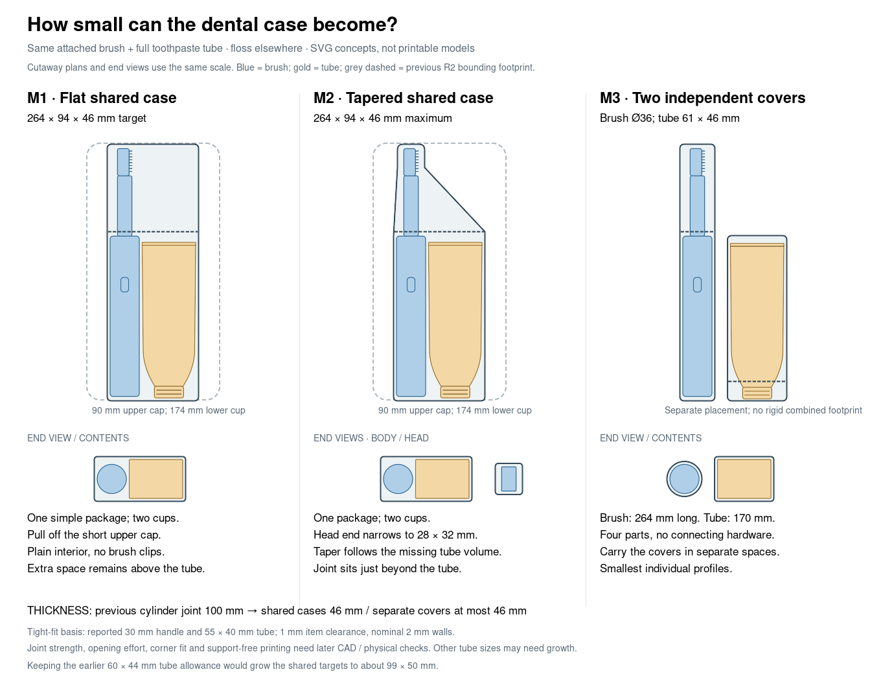

# Slim dental travel cases — SVG exploration

After viewing the implemented R2/C case and cylinder, the user finds the designs
bulky and is unsure about printing them. The new goal is minimal design **and**
minimal occupied size while protecting the attached toothbrush and full toothpaste
tube from other backpack contents and accidental pressure. Floss can travel
elsewhere; it contributes no required volume. This is visual feedback before
printing, not a demonstrated material or print failure.

The phase delivers SVG suggestions. Earlier models and their scoped CAD/slicer
results remain available, but are under reconsideration for bulk. No CadQuery
model, printable export or verification plan was changed in this exploration.

[Open the editable comparison SVG](../renders/concepts/slim_comparison.svg).
Plans are cutaway diagrams; the blue/gold items are display references, not a
proposal for transparent material. Dashed grey shows the earlier R2 bounding
footprint at the same scale. Body cross-sections show the reported 30 mm handle
and 55 × 40 mm tube envelope. The detailed sketches include the intended opening.

| Direction | Target exterior | Opening / approximate parts | Main tradeoff |
| --- | --- | --- | --- |
| [M1 — flat shared case](../renders/concepts/slim_m1_flat.svg) | 264 × 94 × 46 mm | Two cups; short upper cap pulls off | Simple single package, but empty width persists around the neck/head |
| [M2 — tapered shared case](../renders/concepts/slim_m2_tapered.svg) | Same maximum; head end narrows to 28 × 32 mm | Two cups; cap seam just beyond the tube/handle shoulder | Best single-package direction: remove empty head-end space while keeping the contents aligned |
| [M3 — independent covers](../renders/concepts/slim_m3_separate.svg) | Brush 264 mm long, Ø36 mm; toothpaste 170 × 61 × 46 mm | Four parts; each item has its own cap | Smallest individual profiles and full item separation; two opening actions and independent placement |

These are target body dimensions, not calibrated fit or finished joint dimensions.
Cap retention and overlap may require local growth. There are no proposed hinged
links, docking rails, internal brush clips or dedicated floss pockets. Positive
cap retention is still needed so the covers remain closed in a bag; friction
alone has not been qualified. Subtle recessed grip texture can stay within the
outline rather than adding a thick gripping collar.

## Why these can be smaller

The earlier R2 shell is 132 mm wide and 66 mm thick (about 136.7 mm wide including
the latch). Its hinge alcoves and raised retention arrangement cost storage
space. The earlier cylinder's main diameter is 94.4 mm and joint diameter 100.4 mm.
A flat arrangement can instead put the brush beside the tube while keeping
thickness close to the tube's existing thickness.

The tight shared cross-section uses the original approximate **30 mm** handle,
not the unmeasured 27 mm grip target inferred from clip feedback:

- Handle space: 30 + 2 × 1 mm clearance = 32 mm.
- Tube space: 55 + 2 × 1 mm clearance = 57 mm wide; 40 + 2 × 1 = 42 mm thick.
- Width: 32 + 57 + 1 mm between the clearance envelopes + 2 × 2 mm walls = **94 mm**.
- Thickness: 42 + 2 × 2 mm walls = **46 mm**.
- Length: 255 mm brush + 9 mm total end-wall/axial room = **264 mm**.

The clearance and 2 mm walls are agent-selected study assumptions, not measured
FDM tolerances or a qualified pressure-resistant shell. The full tube is not
assumed to flatten, and the brush head is not detached. In this flat orientation,
the reported 40 mm tube thickness sets the raw-item thickness before walls and
clearance; “minimal” cannot make that dimension disappear.

Some shrinkage also comes from reducing the earlier **60 × 44 mm** conservative
tube allowance to the reported current **55 × 40 mm** tube. For an equal comparison
with that earlier allowance, M1/M2 would grow to about **99 × 50 mm** across
(32 + 62 + 1 + 4 wide, and 46 + 4 thick). Room for unknown future tube versions
remains unresolved, rather than silently promised at the tight target.

M2 exploits the unequal lengths: the tube ends around 160 mm from its cap end,
and the handle reaches its shoulder around 165 mm from the butt. A seam at about
174 mm from the case's lower end leaves a 90 mm head-end cap. Over 66 mm, its
right edge tapers from the broad body to the narrow head end, followed by a
24 mm narrow tip. The approximate head section is 15 × 25 mm; its 90 mm combined
neck/head length uses the existing provisional 62 + 28 mm split. Actual head
offset and transition shape are still unknown.

M3 removes any requirement for a common outer bounding box. The drawing's
side-by-side spacing is illustrative: the two covers can occupy different bag
spaces. Their summed bounding-box proxy is about 0.82 L versus M1's 1.14 L;
this is occupied-envelope bookkeeping, **not internal capacity, plastic volume or
proof of better packing in a particular bag**. M2's rectangular tapered-section
proxy is about 0.94 L (roughly 18% below M1); rounding and actual closure geometry
will change that estimate. No claim of an absolute optimum is made.

## Protection, access and manufacturing questions

The sketches assume protection from outside bag contents. Shared M1/M2 cavities
allow the items to move and touch each other; they do not establish button safety
or separation of toothpaste from bristles. M2's narrow end limits the broad tube's
travel geometrically in the rigid envelope sketch, but a real flexible tube may
behave differently. If item-to-item contact must be excluded, M3 gives each item
its own cover without an internal organizer. The old hinged-case retention intent
and successful baseline socket observation are preserved in the historical
records; they do not force clips into these newly explored cap architectures.

M1/M2 aim for 174 mm lower cups and 90 mm caps printed closed-end down. M2's narrow
cap tip would sit on the bed and flare outward toward its mouth; the largest
one-sided widening is about 62 mm over 66 mm. The M3 components can likewise be
split below the Q2C's 256 mm print height. These are rough orientation screens,
not slicer or support-free qualification. Cap/catch roofs, bed stability, continuous
walls and minimum removal aperture still need actual CAD review. In particular,
a cap overlap must not choke the opening through which the full tube is removed.

The exterior must cover the contents continuously with a sensible overlapping
seam. No watertightness, impact or crush rating is claimed. Opening effort,
closed retention, wet-hand grip, cleaning access, actual fit and PETG recovery
remain unmeasured. A thin shell that fails protection would not satisfy the goal
merely because it occupies less space.

**Recommendation:** M2 for one case; M3 for the most compact individual pieces
if carrying them separately is acceptable. M1 is the simplest shared baseline.
The next choice is architecture/form, before refining closures or making new CAD.

## Physical print status for this phase

| Item | Print status | Artifact(s) | User result or remaining physical checks |
| --- | --- | --- | --- |
| Test piece(s) | N/A — SVG study | None | No new coupon or print proposed in this phase |
| Final printable object(s) | N/A — SVG study | SVGs/PNG previews only | Targets, closures, fit and protection are unqualified |

The earlier baseline clip/socket physical success remains scoped to that printed
interface. Neither earlier complete design has a reported print. All SVGs were
parsed and rendered headlessly, and the previews visually reviewed. See
[historical alternatives](current_design.md) and [attribution](provenance.md).
