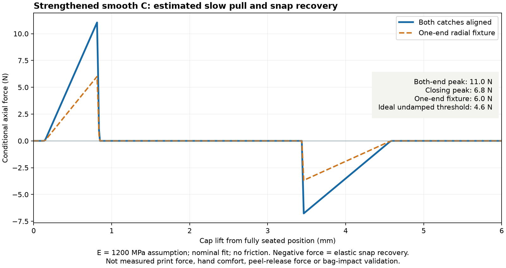

# Smooth C travel case

The PLA C2 joint sample has now been printed and was **too tight to open and close**. Pause unchanged C2 print recommendations and review the [push-to-release proposals](push_release.md). The user requests SVG exploration only; CAD and exports remain unchanged. Existing files and predictions below are retained as historical design evidence, not an accepted operation result.

The final reinforced C has smooth aligned sides, a `3 mm` exposed overlap collar, and no wrap bands or local exterior backing bumps. Exterior: **75.8 × 52.8 × 264 mm**. Ordinary main wall flats and sleeve are **2.0 mm**; floor/roof and catch-pocket backing remain **1.2 mm**. The bite is **0.75 mm**, with the original ramp construction. The main cavity and outside guide dimensions are retained; the sleeve bore is **67.6 × 44.6 mm**. Rounded R4 handled ends remain.

## Authorized C implementation

The user selected C after the SVG discussion and authorized engineering judgment: small dimension increases and more than three extrusion lines are acceptable. This supersedes the earlier thin-only / three-line restriction for this C pair, preserving the historical files and evidence. No new print result was reported.

The cap ends `3 mm` above the body shoulder, exposing a continuous sleeve rather than a hole into the box. Rounded opposing rim contacts provide the grip reveal. The cap covers `27 mm` of the `30 mm` sleeve. A tapered internal seat at `Z=204 mm` contacts the sleeve tip and prevents the cap being pushed down until the reveal disappears. It projects inward `1 mm` with a `1.5 mm` print-supporting taper above it. The stop is clear of the catches and sampled opening path. This is not a sealing claim.

[Actual final CAD sections](../renders/assembled/smooth_case_sections.svg) show the collar, seat, pockets and current wall sections.

## Retention-check authorization

The user requested research and checks of pull-apart force and sideways retention, with authority to improve C. They emphasized pragmatic evidence and rejected artificial passing checks. The old unsuccessful coupled-contact/impact branch remains historical; it was not restarted as a solver-development campaign.

The original C (`14d9fbf`) had only geometric capture checks. Its 1.2 mm sleeve proved too flexible: even assuming an infinitely stiff cap, the actual profile and mesh-compared body compliance give an optimistic **3.04 N** centered slow-pull estimate and **1.25 N** ideal undamped threshold at E1200 MPa ([bound](smooth_case/retention/original_body_bound.json)). Actual cap flexibility would lower those conditional values. Original cap jobs were stopped once their completion could not change that rejection.

The intermediate C1 used a 1.8 mm sleeve and 0.75 mm bite, predicting **8.13 N** aligned pull, but its side-bearing fixture remained flexible. The delivered C2 therefore uses 2 mm main walls and sleeve, adding only `1.6 mm` in both width and depth relative to the original thin case. These are explicit configurations in `smooth_case_design.py`; the printable entry points select `retention-c2`. C1 is retained as engineering evidence, not a print recommendation.

### Pull and closing estimates

| Quantity | Final C2 estimate | Meaning |
| --- | ---: | --- |
| Both catches, aligned slow pull | **11.0 N** | About the steady force of supporting 1.1 kg, not a payload rating. |
| Aligned closing peak | **6.8 N** | Reverse traversal of the same frictionless elastic path. |
| One-end radial fixture | **6.0 N** | Conditional one-end result, not an unrestricted corner-peel threshold. |
| Ideal undamped seated-release threshold | **4.6 N** | Initial play permits acceleration; this differs from the supported slow-pull peak. |

[Pull study](smooth_case/retention/final/pull.json) uses actual C2 geometry, separate body/cap deformation, paired and single-end radial loads, the exact section profile, 3D clearance witnesses and an elastic-energy derivative. Constant radial compression is not counted as axial holding force. A deliberately uncaptured control has zero elastic barrier. The individual compliance mesh changes are below **0.7%**; withdrawal-step precision and 3D/profile agreement pass the declared screens.

Assumptions: isotropic **E1200 MPa**, Poisson ratio **0.38**, linear elasticity and **no friction credit**. The body crop is clamped 16 mm below the seam; the complete cap roof is clamped. Mirror-reduced cap loads are halved, giving displacement per full-equivalent 1 N crest load. Full/half C1 cap responses agree within 1%, supporting the unchanged exact principal-plane symmetry reduction; asymmetric/diagonal impacts are excluded. Cap pressure windows are approximations, with selected areas retained, not measured uniform contact pressures.

The E900–2200 MPa / ±0.15 mm radial-fit scenarios give **6.3–25.0 N** centered pull. These are sensitivity scenarios, not confidence bounds or guaranteed printed limits. Hand grip, anisotropy, friction, rate, wear and creep are not calibrated. The old agent-selected 8–18 N and 3.5 N comparison targets are reported separately; they are not user acceptance or universal travel-case standards. The nominal C2 values lie within those targets. [Research and primary sources](smooth_case/retention/research.md).

### Sideways review

The fresh [side-bearing study](smooth_case/retention/final/side.json) adapts the old **2 N / 180 Nmm** comparison to C's actual 27 mm cap coverage. Both principal directions use equal/opposite body/cap tractions at `Z=180/201 mm`. It measures conditional bearing flexibility; it does not solve contact redistribution, sequential catch release, a free cap or a dynamic bag hit.

| Extrapolated extra roof-motion proxy | Intermediate C1 | Final C2 | Fine-response change |
| --- | ---: | ---: | ---: |
| Widthwise X | 3.97–4.34 mm | 2.79–3.11 mm | About **30% less** |
| Broad-face Y | 12.35–12.56 mm | 5.53–5.55 mm | About **56% less** |

Ranges show the checked coarse/fine responses. X retains **11.6%** mesh variation, above the original 10% precision target; that screen remains **INCONCLUSIVE**, not silently promoted. Y changes by about **0.4%**. The stiffness improvement is consistent across both meshes in both directions, sufficient for the thicker-wall prototype choice. More numerical precision would not establish bag retention. The previous thick case's 11.22 N estimate and 12.64 N incomplete side-contact snapshot remain scoped to their different geometry and fixtures; neither is imported as C2 validation.

### Verification, printing and physical trial

[CAD checks](smooth_case/cad.json) cover 20 main outline/wall sections plus six sleeve sections, seated clearance, hard-seat contact and overclosing obstruction, six independent-catch witnesses across guide play, 13 sampled axial poses, individual brush/tube passages and R4 handled ends. Individual gauges retain at least 1.8 mm body clearance and 2.8 mm cap clearance; they do not prove simultaneous loaded packing.

Print the body upright on its floor (**204 mm**), cap inverted on its roof (**87 mm**): PETG, **0.4 mm nozzle / 0.2 mm layers / 3 configured wall loops / 7% adaptive cubic / 5 mm automatic brim** using the established [process profile](short_lap/profiles/process.json). Thicker walls use additional strokes; three strokes are not a requirement. The established rounded/chamfered feet provide bed contact. The seat grows inward 1 mm over 1.5 mm print height; small bite ramps retain supported layer overlap. No new disconnected islands or trapped supports are planned. The selected-profile slice determines layout/support acceptance; [native review](smooth_case/print_review.json) and [source/export association](smooth_case/publication.json) identify the delivered pair.

The remaining decision is physical: actual opening/closing force, useful seam purchase, elastic return, loaded packing and bag-knock resistance. Print the matching pair, check empty operation and a fully seated uniform collar, then try the real loaded box in the intended bag against broad faces, ends and corners. Inspect a partly lifted end as well as complete opening. If a scale is available, record slow axial pull peaks and grip positions; squeezing/clamping the catch walls changes the question. No new arbitrary bump severity or safe payload is specified. The STL slice does not verify Orca's separate GUI STEP importer.

Detailed setup/recovery evidence and the small shared mesh-control improvement are in [study decisions](smooth_case/retention/decision.md). Failed/interrupted solves supply no force evidence. The [verification report](smooth_case/verification.json) keeps physical requirements UNKNOWN.

## Earlier SVG exploration (historical)

The [closed-shape comparison](../renders/concepts/smooth_exterior_comparison.svg) and [enlarged grip / catch sections](../renders/concepts/smooth_exterior_details.svg) record the alternatives before C was selected. PNG previews accompany both. They are schematic proposals; the actual CAD sections above govern the implemented geometry.

The user reviewed the unprinted three-line wrap-grip case and found the exterior too conspicuously interrupted. They proposed keeping only the useful side of the body grip, making the remaining upper surface straight, reducing or removing the cap band, and exposing some recessed overlap as a natural grip. At the drawing stage, a small body/cap size difference was acceptable to explore; no dimension or design had yet been selected. “Button case” is interpreted here as the bottom/body piece. Flat means a continuous side profile with the established rounded corners and ends retained.

| Drawing | Exterior change | Unresolved consequence |
| --- | --- | --- |
| NOW | Existing 0.7 mm recessed wrap bands and 0.65 mm local cap backing pads | Existing physical grip, retention and loaded packing remain untested. |
| A | Body has one lower shoulder, then stays about 0.4 mm inset per side up to the seam; cap band removed, catch pads retained | Insetting the body needs a deliberate transition into the sleeve. Smooth-cap grip and any packing loss need review. |
| B | Both bands removed; shorten the cap rim to expose about 3 mm of the continuous sleeve | The shallow collar may give little finger purchase. Shortening the rim must preserve the catch position and useful guidance. Pads still interrupt the cap outline. |
| C | B's seam reveal plus a continuous cap envelope out to the old pad maximum; align body exterior to it | About 1.3 mm extra nominal width (75.5 rather than 74.2 mm) if using the outward route; affected cap end walls become about 1.85 mm away from recesses. Changed wall stiffness affects the snap. Other walls can remain 1.2 mm. |

C was the agent's suggested starting direction in the drawing phase; the later authorization above selects it. The second sheet also shows an inward alternative: keep the original exterior size and move the sleeve/catches inward. That is a mating-region redesign, not simple uniform body scaling, and may reduce contents clearance. Do not shrink the whole body without preserving brush and toothpaste space.

The cap's raised pads are not grip decoration. `short_lap_thin.py` adds 0.65 mm locally so the recess/runout retains 1.2 mm of backing. Removing this material alone would leave about 0.55 mm. A flat exterior must carry that thickness across a larger area, relocate the mating geometry inward, or adopt another justified catch design. There is no basis here for claiming that a smaller catch alone retains the previous retention behavior.

The comparison uses the current 264 mm closed length, 174 mm body seam, 90 mm cap and 74.2 mm nominal width as its visual baseline. B/C illustrate a shortened cap rim while keeping the roof at the same height, not lifting the existing cap out of its seated catch. Their visible overlap remains an inner sleeve, not a hole into the case; this is not a sealing claim. Colors distinguish body, cap and visible sleeve made from the same PETG. Detail depths are exaggerated for legibility.

Before developing a selected direction, check the affected catch seat and release path, sleeve guidance/overlap, wall thickness and contents space. Those questions are now addressed by the C records above where geometric. Grip effectiveness and feel remain physical questions. No CAD, simulation or slice was run during the earlier drawing phase.

## Short PLA joint trial

**Printed feedback, 2026-10-22:** the user printed the short sample in PLA, not the full box, and found both opening and closing too tight. No force measurement, exact slicer settings, damage or cycle result was supplied. They suspect PETG would have the same problem; that remains untested. Positive retention is still wanted, now with a deliberate push-to-disengage action. Cantilevers are not rejected; explore other architectures first. The following instructions describe the delivered trial before this feedback and are no longer a repeat-print recommendation.

The user requested a much shorter, minimal-material PLA trial of the current retention mechanism. [Source](../smooth_joint_test.py), [print STEP](../smooth_joint_test.step), [STL](../smooth_joint_test.stl), and [print view](../renders/tests/smooth_pla/smooth_joint_test_isometric.png) describe one matching two-piece specimen, directly cropped from `retention-c2`. It keeps the full **75.8 × 52.8 mm** perimeter, **2 mm** ordinary walls and sleeve, **0.75 mm** bites, **0.10 mm per-side** guide clearance, both recesses/runouts, the complete **30 mm sleeve / 27 mm cap coverage**, and the **3 mm collar / internal axial stop**. No PLA-specific clearance or catch adjustment has been guessed.

The body retains **16 mm below the seam** and prints **46 mm high**. The cap retains **10 mm above the sleeve-tip seat** and prints **37 mm high**. The closed specimen is **56 mm high**. Both distant ends are open: no floor, roof, extra handles or stiffening plates. Keeping the full perimeter preserves wall coupling better than an isolated tooth strip; omitting the long ends saves most of their wall height and both end panels. Cropping also changes axial restraint and rocking response. This is an economical local fit/action experiment, not a force-equivalent miniature or a substitute for a loaded complete case.

**Print:** ordinary PLA with your calibrated PLA filament preset, **0.4 mm nozzle / 0.2 mm layers / 3 configured wall loops / 7% adaptive cubic / 5 mm automatic brim / no supports**. The thin walls may be filled entirely by perimeters. Print both in the supplied placement: body upright on its cut annular end; cap inverted on its cut annular end. Those cuts are away from mating surfaces. Preserve these layer directions, avoid scaling, and remove brim/first-layer burrs before assembly. The continuous ring footprints provide bed purchase. The retained 1 mm seat grows inward over 1.5 mm print height in the inverted cap; the catch ramps and tracks use production geometry, with no newly added horizontal roofs.

**Try:** let the parts cool, align the two catches, push the cap down until the internal stop seats with the 3 mm collar visible, then pull straight apart while supporting the body. Hold the ordinary walls rather than squeezing the catch locations inward. Start gently; record whether it seats completely, clicks, stays captured under a gentle tug and releases with useful effort. Repeat about ten cycles, looking for whitening, cracks, permanent spreading, loss of return or noticeably weaker retention. If measuring with a force scale, record closing/opening peaks and grip locations; these are coupon measurements only. A light sideways wiggle can reveal obvious play or escape, but it is not a bag-impact trial.

If it binds before the stop, record the contact location before changing clearance. If it cracks or stays spread, the unchanged C2 interface needs a PLA-specific revision. If it seats, returns and retains usefully, it supports a full-size PLA trial; it does not qualify the PETG force estimates, whole-case handling or impact resistance. There is no prescribed pull-force pass number for this cropped specimen.

[Scoped CAD checks](smooth_case/pla_trial/cad.json) passed for the cropped pair's seated clearance, preserved stop, both independent catches across guide play and sampled withdrawal clearance. [Native export/slice review](smooth_case/pla_trial/print_review.json) records the valid paired geometry and layout: OrcaSlicer 2.4.2 completed with no notices or generated support. The print view was inspected. The smoke slice uses the existing **PETG diagnostic filament profile**, with the Q2C 0.4 mm printer and three-wall process; it checks path/layout/support generation, **not a qualified PLA process or temperatures**. Use your PLA preset for the actual print. Printed fit, effort, recovery and durability remain unknown.

## Phase evidence and attribution

The CAD print/closed views, actual sections and force plot were visually inspected. The proposal SVGs/PNGs remain historical form evidence.

| Item | Print status | Artifact(s) | User result or remaining physical checks |
| --- | --- | --- | --- |
| Test pieces | Yes | `smooth_joint_test.step` / `.stl` | PLA trial reported 2026-10-22: too tight to open and close. Measured force, print settings and recovery/damage details unknown. |
| Final printable object | No | `short_lap_case_smooth.step` / `.stl` | User reports the full box was not printed; on hold after PLA sample rejection. |

Primary language model: GPT-6 family; exact model identifier and reasoning effort not exposed. Harness: Codex coding-agent environment. Provider: OpenAI. Drawings, implementation and checks are agent-authored from the current source and user feedback; historical attribution remains in the existing records.
