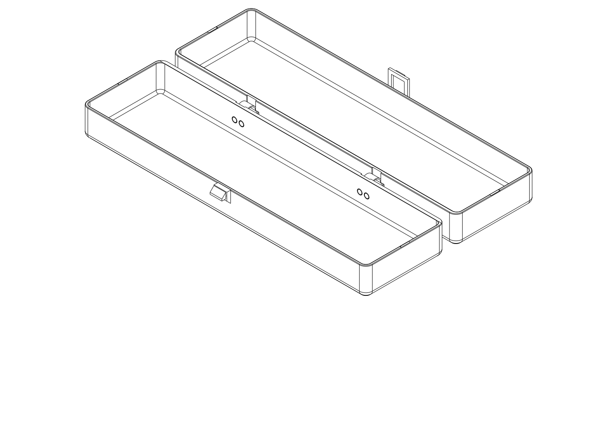

# C8 — clear interior and a flat-opening flexible spine

**Current status — 2026-10-19: printed box failure; work paused at the user's
request.** The shortened loop broke immediately on the first attempt to push it.
The TPU strips have **not** been printed. No redesign, analysis or further print
is authorized by this report; the user requests recording it only.

## Printed feedback — shortened loop breaks on first push

The user reports printing the box and finding that the shortened plastic loop
could not withstand the first push: it broke immediately. The exact printed
file/size, actual material, nozzle/layer settings, force, push direction and
fracture location were not supplied. The exact printed export and cause remain
unknown; this feedback is recorded against the current C8 conversation.

The shortened-loop interface is inadequate in this reported print. Previous CAD
motion, capture geometry and slicing results remain evidence within their stated
scope; they did not establish printed loop strength. The TPU spine, its mounting
buttons and integrated hinge operation remain physically untested.

Source: direct user print feedback, 2026-10-19. Action: record only and pause.
Assembly/printing procedures below describe the earlier candidate and are not
current recommendations to print again or continue development.

## Retained candidate and computational evidence

The published candidate uses PETG shells and two small, replaceable TPU 95A
spines. The rear is flush when closed; the inside has a
continuous flat rear wall instead of hinge barrels and shelves. A prescribed
CAD folding path reaches **180° with both broad exterior panels on the same
plane**. This is a more practical spatial architecture than C7, while printed
hinge life, mounting-button retention and handling remain unmeasured.

The user rejects C7 **before printing**, based on its visible interior projections
and the obstruction they create during opening/closing. They also request flat
opening if feasible. This is a product-architecture rejection, not a new physical
print failure. C7 sources and numerical evidence remain historical; its print
recommendations are retired in the [C7 record](internal_hinge.md).

## Start with the shapes

[Full-size case opened flat](../renders/concepts/spine/c8_full_open_isometric.png) ·
[Complete mini box at 90°](../renders/concepts/spine/c8_mini_half_open_isometric.png) ·
[Mini box opened flat](../renders/concepts/spine/c8_mini_open_isometric.png) ·
[Closed rear](../renders/concepts/spine/c8_mini_closed_isometric_back.png) ·
[Actual sections and mounting-head detail](../renders/concepts/spine/clear_interior.svg)



The full-size model is an inspection/motion configuration, not an adopted full
print layout. The published trial is the **complete 64 × 40 × 51.2 mm mini
box**, which includes the hinge connection, shortened front loop and matching
keeper. It has five printed parts: base, lid, keeper and two TPU spines; no hinge
screws, nuts, separate pins or glue. Two material plates are required, rather
than a multi-material print or a single PETG print-in-place assembly.

## Compare the useful tradeoffs

| Architecture | Storage obstruction | Closed rear projection | Opening and decision |
| --- | --- | --- | --- |
| C7 recessed rigid pivots | Local barrels/webs reach 7.8 mm inward from the normal rear cavity wall; rotating skirts occupy access space | 0 | Limited to checked 100°; rejected by user before printing |
| **C8 recessed TPU spine** | Rear wall thickens uniformly by **.8 mm**; heads are recessed flush, with no rigid hinge shelf inside | **0** | Feasible sampled path to **180°**; selected complete mini-box candidate |
| Small edge-pin alternative | Nominal barrel reaches the ordinary inner wall plane without a shelf | 2.6 mm | CAD path clears to 180°, but retains the exterior bump the user dislikes; axial pin retention remains undeveloped |

The [authoritative source](../spine_design.py) models both C8 directions; the
[study](../spine_study.py) compares mini and full-size configurations with C7.
The small pin concept uses a 4.6 mm barrel and filament-sized bore, with local
clearance slots in the opposite shell. Simply placing a full barrel against an
uncut wall intersected it; the corrected slots resolve that geometric defect.
It is a rough alternative, not an exported or retained-pin-qualified product.

The flexible spine avoids the rigid pivot entirely. Its **.8 mm thick, 8 mm wide,
16 mm long free strip** lies in a shallow exterior recess when closed. Two wider
end pads attach it to the shells. During opening it curls between the backs,
allowing lid translation as well as rotation. The two spines are spaced apart
for guidance. This is a compliant connection, not a fixed-axis hinge, and it is
not expected to hold an arbitrary lid angle like a friction hinge.

At flat opening, the illustrated bend has about a **5.1 mm neutral radius** and
leaves about **9.4 mm between the backs**. The fold stays below the open rims and
outside storage. The front loop and keeper remain external projections; “flush”
here describes the rear connection, not the entire enclosure.

## What happens to the interior

The full shell remains **264 × 74.2 × 51.2 mm**, with 2 mm main walls and broad
panels. The straight nominal interior changes from 260 × 70.2 × 47.2 mm to
**260 × 69.4 × 47.2 mm** because the entire rear wall becomes 2.8 mm thick.
This visible .8 mm width cost replaces C7's much deeper local obstructions.
The uniformly thicker wall reduces total cavity volume slightly; it improves
minimum clearance at the hinge locations and removes the moving shelves.
The accepted real-item packing basis is retained; the slightly narrower new
configuration has not been physically repacked or digitally calibrated against
an invented toothpaste shape. Existing liner work is outside this phase.

The spine's soft heads sit in countersunk pockets and end at the flat inner
wall plane. Nothing projects into the declared continuous cavity. Two short,
.6 mm-high V locating seats stay **within the existing end-wall thickness** at
the rim; matching grooves help centre the closed lid. They are not interior
shelves or a new pull-off latch. Their printed alignment and closed joint
stiffness remain unmeasured.

The CAD checks both shell lengths against a continuous rounded cavity gauge,
including the actual spines and heads. It also checks the moving cap against
the lower-half clear region through opening. C7 fails the same cavity comparison;
C8 passes within the declared gauge, after explicitly accounting for the .8 mm
rear-wall increase. Total hinge-material volume alone would miss C7's practical
access problem; maximum projection and its motion matter more here.

The fixed full-height cavity gauge is not a measured set of contents. The check
on the moving lid protects the lower-half keepout; unusually tall contents near
a rim still need an actual loading/withdrawal check. No universal contents-sweep
or full-product backpack qualification is claimed.

## Mounting and operating the mini box

| Material plate | STEP — preferred | Matching STL | Layout |
| --- | --- | --- | --- |
| **PETG mini box** | [C8 shells and keeper](../c8_mini_shells.step) | [STL](../c8_mini_shells.stl) | Base floor down, lid roof down, keeper on its proven side-print face |
| **TPU 95A spines** | [Two matching spines](../c8_spines.step) | [STL](../c8_spines.stl) | Flat strip faces on bed, mounting buttons upward; print separately from PETG |

[PETG plate view](../renders/tests/c8/c8_mini_shells_isometric.png) ·
[TPU plate view](../renders/tests/c8/c8_spines_isometric.png)

Each spine has two mounting buttons on each end pad: **eight buttons in total**.
The stems are 2.6 mm diameter in 3.0 mm holes, with 4.2 mm soft heads captured
behind flat shoulders. The wall has 4.6 mm counterbores; the soft head ends at
the inner surface. The local PETG collar between recesses is 1 mm thick. These
are provisional assembly dimensions, not measured fit or strength tolerances.

Seat one pad on the outside of the base, gently compress/tuck its soft heads
through their holes, and check each head is fully seated in its inner recess.
Attach the matching pad to the lid in the same way. Repeat for the second spine.
Support the wall while seating the buttons. Mounting happens during assembly;
these snaps are not operated on every closing cycle. If the heads require
unreasonable force, damage the collar, or pull back out easily, revise this
attachment before printing a full case. Do not treat soft material as proof of
adequate retention.

Slide the E keeper into the front receiver. Hold the front loop outward while
closing, let it recover under the keeper, and pull it outward before lifting.
The existing shortened C6 loop is unchanged; its original E keeper is a working
reference, but the shortened PETG flexure still lacks a physical print report.
Support the base during opening; the spines are not self-supporting stays.

Test the complete box: normal closing/release effort and noise, alignment at the
rim, flat opening, repeated recovery, and whether the mounting pads remain seated
when the rear connection is gently pulled. Reject torn heads, collar cracks,
permanent strip distortion, button pull-through or an unreliable front latch.
Printed mount retention, side-to-side guidance, flex life and full-size shell
behavior remain physical questions. No hanging-mass or pull-off force rating
is assigned to these new TPU attachments.

## What the computation establishes

The exact-CAD study samples **0, 1, 2, 5, 10, 20, 45, 70, 90, 120, 150 and 180°**.
It checks shell/receiver clearance, prescribed front-loop release, cavity
intrusion, continuous spine solids, and spine/shell interference at both sizes.
The closed rear material is also checked against the original outer plane.
At 180° the lid's exterior panel is coplanar with the base panel.

The spine is represented as a constant-neutral-length circular bend, with end
pads moving with their shells. This exhibits **one feasible folding route** with
no hidden stretch of the strip; it is not a solved TPU force-equilibrium model,
a unique natural opening path, or a stress/fatigue qualification. The retained
geometric outer-fibre strain estimate is a deformation demand, not a material
allowable or a numerical PASS. No unmeasured TPU modulus or strength is tuned.

A separate control shifts an actual seated spine outward: its heads meet the
flat retaining lands. Removing the heads makes the same rigid motion clear.
This identifies the real capture surfaces but does **not** predict pull-out
force: soft heads can fold through the holes. Their retention is a deliberate
physical question for this complete-box trial, not a binary overlap approval.

## Manufacturing evidence and limits

The PETG plate uses the established diagnostic Q2C .4 mm / .2 mm, two-wall,
7% adaptive-cubic setup, with a 5 mm brim. Broad panels have flat bed contact.
The original floating-cantilever notice remains, and the support probe suggests
a tree beneath the front loop's two-ended, nominal 12 mm bridge. Actual strokes
at Z32 are 11.6 mm. This is the existing experimental supports-off rail trial;
inspect sag and the retaining land before judging closure force. Local hole and
recess bridges have much shorter native strokes, under about 2.9 mm in the
retained bridge-labelled layers. Auto-support absence at those locations does
not measure hole accuracy or collar strength.

The TPU plate uses the existing **TPU 95A / .4 mm nozzle / .2 mm layer / solid
infill / two-wall / Classic** profiles, with 25 mm/s walls and the current
9 mm³/s filament flow cap. The strip is four layers thick, printed flat; each
button grows upward from it. OrcaSlicer 2.4.2 completes the plate with **no native
notice or generated support**. Bridge-labelled strokes appear at the small
button shoulders, Z2.0, with maximum length about 2.33 mm. Inspect all eight
undersides and head shapes; sliced paths do not guarantee TPU shoulder quality,
fit or fatigue life. Temperatures/flow remain diagnostic settings for the
unknown-brand stock TPU, not a calibrated production recipe.

The [actual path/support plot](spine/support_locations.png) and
[publication/native evidence](spine/publication.json) bind source, paired exports,
material profiles and G-code identities. The TPU is a second material plate, not
silently sliced with the PETG profile. The full-size case is rough CAD only; its
print placement, contents and integrated load behavior must be resolved before
full-size C8 publication.

## Reproduction and status

```sh
./execute.py --threads 1 model/dental_travel_case/spine_study.py
./execute.py --threads 1 model/dental_travel_case/spine_drawings.py
./execute.py --threads 1 model/dental_travel_case/verification.py --variant spine-c8-mini
```

[Motion data](spine/motion.json), [verification](spine/verification.json) and the
[SVG generator](../spine_drawings.py) retain the comparison and its limits.
The focused regression run passed **120 tests**, including the new spatial
negative reference, flush mounting/headless control and retained dental intent.
The retained pre-feedback verification reports physical questions UNKNOWN alongside
scoped CAD and manufacturing results. It predates the loop-break report above
and does not supersede that physical failure; no numerical report was rerun.
The earlier reproduction procedure uses `evaluate_model.py --slice` on each
material wrapper, selecting the complete TPU profile triplet for `c8_spines.py`;
retain native runs for `spine_evidence.py` and review changed warnings before
updating the object-local manufacturing review.

| Item | Print status | Artifact(s) | Physical result / remaining checks |
| --- | --- | --- | --- |
| Latest C8-context box trial | Partial — box printed; shortened loop failed on first push; TPU strips not printed | Published C8 files retained; exact printed file/size not identified | 2026-10-19 user report: immediate loop fracture. TPU mounting/hinge and integrated operation untested; work paused |
| C8 full dental case | N/A — rough architecture/motion phase | Full-size inspection CAD; no print exports | Actual contents packing, full print setup and integrated loads/use |
| C7 recessed-pivot mini boxes | Unknown — no print reported; design rejected | Historical C7 files retained | Interior shelves obstruct practical use and the opening does not reach flat |

Attribution: GPT-6, reasoning effort not exposed; Codex CLI / OpenAI. No delegated
review or sub-agents used, following the user's instruction.
