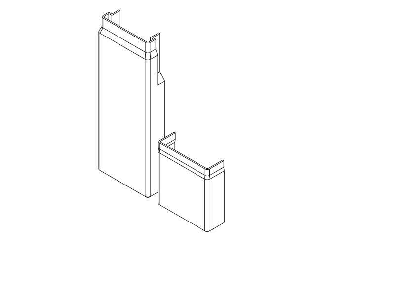

# S16 liner for the printed slim dental travel box

Two TPU cups cushion the contents of the existing **264 × 74.2 × 51.2 mm narrow
M1**. The body insert follows the internal catch guards and continues through the
overlap sleeve; the cap insert begins above the sleeve. The rigid box is unchanged.
This accessory does not repair the box's reported pull-apart retention failure.

**Printed with wall defects and installation breakage — reports, 2026-10-19/20.** Both the contents-side
and shell-side skins have locally broken areas. Printed wall integrity is not
accepted; the cause is unresolved. See the [physical report and comparison](#wall-print-feedback--2026-10-19).
The user now reports further breakage while pushing the liner into the old box;
installation integrity is not accepted. Completed seating, contents fit and
damping remain unreported. The [new support sketches](../tpu_damping_box/README.md#wall-support-concepts--2026-10-20)
are for discussion; existing geometry, exports and print presets remain unchanged.

Primary print interchange: [STEP](dental_travel_case_liner.step), matching
[STL](dental_travel_case_liner.stl), [Python entry](dental_travel_case_liner.py),
[parametric design](design.py). The delivered compound contains both inserts,
openings up, with the cap at X +82 mm. Preserve their positions and orientation.



## Intent

On 2026-10-16 the user requests a sound damping liner for the recently printed
slim dental travel box, following existing instructions. When asked about the
already tight packing, the user explicitly chooses **“Use the full S16 liner;
there is room.”** This authorizes the accessory; it does not reopen the stopped
rigid-box redesign. The [printed-box report](../dental_travel_case/notes/m1.md)
remains authoritative for the shell and closure.

The starting profile is the user's [preferred printed S16](../tpu_damping_box/README.md#s16--s12-print-feedback--2026-10-16):
**0.4 mm backing + 0.8 mm air core + 0.4 mm contact skin**, with **0.9 mm ribs**.
This is a starting architecture, not physical approval of this larger liner.

## Geometry and coverage

Nominal lateral installation allowance is **0.2 mm per side**. Both ends reserve
0.2 mm for thin attachment material. Ordinary lower-body lined space is
**66.6 × 43.6 mm**. The sleeve's lined opening is **61.5 × 38.5 mm**, with
**51.5 mm local width between the lined catch guards** near the centre of the
depth. These are nominal sectional dimensions, not a rectangular packing volume.
The narrower regions follow the actual M1 source. The user confirms space for the liner; no measured model
of the combined toothpaste, brush and floss is invented.

The body insert occupies assembled Z **2.2–185.6 mm**; the cap insert
Z **186.4–261.8 mm**, leaving a **0.8 mm seam gap** clear of the rigid overlap.
The body and cap print heights are consequently **183.4 and 75.4 mm**.
End tapers preserve clearance from the rigid R2 interior end blends.

Ribs follow the perimeter normal, including rounded bends and the concave catch
guard notches. Their spacing is at most 4.4 mm, tightened slightly to distribute
the final remainder. Different perimeter patterns meet through 0.4 mm solid
connecting bands. The floor perimeter/root frame, end blends, opening caps and
short transition regions remain locally solid. The sloping guards and sleeve
transition do not have identical compliance to ordinary flat walls. No claim
of uniform cushioning or decibel reduction follows.

The liner's sleeve corners use **R3 mm** instead of following the shell's tight
R1.45 mm cavity bend. This rounds farther inward and leaves room for a real
corner core. An initial smaller-radius draft left one corner completely occupied
by a rib; the corrected design checks every curved bend, including the sleeve.
Coverage is checked on this geometry rather than inherited from straight-wall
samples. Both skins are retained; exposed
open-backed structures are not substituted. No identification recess cuts a skin;
the long body insert and short cap insert are visually distinct.

## Installation

1. Remove strings, inspect both contact skins and clean the inserts before use.
2. Install each insert with the rigid halves separated. Gently collapse/fold the
   TPU walls to pass the narrow mouths, then unfold and seat them. A rigid axial
   drop-in route is not claimed: the body bottom is wider than its sleeve mouth.
3. The indented walls of the body insert align with the existing internal catch
   guards. Never tuck material inside the catch channels or under the hooks.
4. If retention is needed, use small strips of compatible removable double-sided
   tape, **at most 0.2 mm installed thickness**, under the end backing. Do not use
   thick foam tape or fill the air cores with adhesive. Actual adhesion is unknown.
5. Close the empty case gently, check both releases and inspect for pinching.
   Then load the actual contents and compare ordinary carrying noise. Remove or
   adjust an insert that buckles, prevents seating or obstructs a release.

The cups are removable for cleaning and drying. Printed TPU surface cleanliness,
moisture retention and adhesive compatibility are unqualified; no sterilization
or watertightness claim is made. The liner adds no new drainage holes to the
existing closed case. Contents can still strike one another, and seam noise or
the existing closure's movement may remain audible.

## Printing and evidence

TPU 95A is the stock starting assumption; brand and calibrated properties are
unknown. Use the Qidi Q2C and 0.4 mm nozzle. Two walls and 100% rectilinear fill
apply to the modeled material; CAD voids create the air core. The reference
smoke setup uses the local [0.2 mm closed-skin TPU process](profiles/tpu-s16-0p2-process.json),
[TPU filament](../tpu_damping_box/profiles/tpu95a.json) and
[Q2C printer](../../.codex/skills/orca-slicer-printability/profiles/qidi-q2c-petg/qidi-q2c-0.4-nozzle.json).
It retains Arachne and thin bridges from the research process and uses
**0.2 mm layers**, including the first layer. The user confirms all earlier
liner prints also used 0.2 mm despite the 0.1 mm instructions; see the
[shared correction](../tpu_damping_box/README.md#actual-liner-layer-height-correction--2026-10-16).
Each horizontal skin
has two layers, and the 0.8 mm core spans four layers. This setup needs its own
gap/path review; the research's 0.1 mm evidence is not transferred. It is a
diagnostic setup, not recovered settings from the user's prints.

Print the full end backings on the bed, openings upward, supports **off**.
Trapped core supports would alter the cushioning. End transitions grow outward
gradually; inward guard ramps, thin skins and narrow sleeve bends require actual
TPU print inspection. Floor roofs bridge between the substantial ribs; the
delivered orientation and process direct their first roof paths across the ribs.
Keep scale at 100%. Opening lips stay flat to preserve the thin skins; they sit
inside the rigid mouths. The narrow flexible lip is intentionally unlettered and has
small plan-view corner radii in the sleeve; it is internal to the rigid box.

The user's [50% ironing-flow preference](../sunglasses_case_liner/README.md#ironing-flow-print-feedback--2026-10-16)
is a starting trial for the upward floor contact face. The reference process has
ironing off. Ironing cannot smooth the vertical walls; if used, inspect the skin
and air channels afterward. Do not confuse ironing flow with normal extrusion flow.

[Verification entry](verification.py) uses the shared command with explicit variant:

```sh
./execute.py model/dental_travel_case_liner/verification.py --variant slim-m1-s16
```

CAD fit is distinct from flexible installation, adhesive retention and actual
quietness. Those physical/subjective questions remain UNKNOWN; the later print
report below establishes local skin defects, not application performance.
STL smoke acceptance does not establish Orca's separate GUI STEP import.

The [current verification receipt](notes/verification.json) reports CAD PASS for
all three groups: installed fit/catch movement/sampled cap withdrawal; preserved
flat S16 profile and connected cups; air coverage through every curved bend,
including the small sleeve corners. A deliberately displaced liner is rejected
by the same collision criterion. The [cutaway receipt](notes/inspection.json)
and inspected image show the stepped body, guarded regions and separate cap.
These checks do not establish a rigid insertion path or physical fit.

The [final native receipt](notes/final_review.json) confirms valid geometry and
matching STEP/STL exports. OrcaSlicer **2.4.2**, supplied 0.2 mm TPU triplet,
centred without rotation: primary slice completed with **no keyword notices**.
Estimated pair: **80.50 g / 21 h 58 min 37 s**, not measured.
That retained estimate used the then-current **4 mm³/s** filament limit. The
shared TPU preset now defaults to **9 mm³/s**, as requested by the user on
2026-10-16; wall/infill speeds remain capped at 25 mm/s. The saved slice has not
been rerun for this settings-only change.

The [actual path review](notes/path_review.json) and
[headless preview](renders/path_review.png) cover **56 wall/core regions**, including
each curved bend and the guard detours; minimum sampled skin separation is
**0.577 mm** against a local 0.5 mm criterion. Sampled ribs retain at least
**two substantial tracks**. Six floor-channel witnesses remain open; first contact
skins cross the ribs. Native bridge heights are approximately **0.2 mm**.
These are path metadata, not measurements of sagged or compressed printed TPU.
Other insert outlines may appear in the preview where both share a print layer.

The automatic probe proposes **support interfaces only at Z 1.0 mm**, within
the shallow floor channels. No support remains proposed up the guard/sleeve
walls after correction. Primary supports stay off: the floor roofs intentionally
bridge the rib-bounded 3.5 mm channels, and trapped support would fill the core.
The native `review_required` flag is retained with this inspected scope;
actual bridge quality and channel survival remain physical checks.

An [initial 0.1 mm slice](notes/initial_0p1_review.json), before the guard-ramp
correction, completed with a floating-region notice and automatic support signal.
It estimated **43 h 54 min / 84.07 g**. The inner guard cut began abruptly and
created an unsupported initial ledge; the current cutter extends the same
diagonal beyond the cavity so the inner skin starts gradually. The taller
application also motivates reviewing 0.2 mm layers instead of inheriting the
research's requested 0.1 mm diagnostic setting. The user subsequently confirms
all actual liner prints already used 0.2 mm. This historical receipt does not cover
the delivered geometry or setup; no print of that draft was reported.

### Toolpath reader correction

The initial local bridge-height scan expected an extrusion token starting with a
digit. Orca 2.4.2 emitted valid compact values such as `E.89832`, so that scan
collected no bridge heights; its combined assertion misleadingly suggested a
height violation. The corrected reader accepts both compact and leading-zero
forms and separates missing samples from excessive height. This was a reader
failure, not evidence of thick bridge extrusion. Material paths use the shared
`orca_linear_paths` parser; the additional scan reads its missing height metadata.

## Wall print feedback — 2026-10-19

The user printed the liner for the already printed **old slim dental box** and
reports locally broken walls on **both interior and exterior sides**. They say
the sunglasses liner did not have this problem. The exact defect appearance,
height/location, affected cup(s), onset during printing versus removal/handling,
and correspondence to ribs, seams or transitions are unknown. No photograph or
actual project/G-code was supplied. Associate this with the slim-M1 accessory;
the exact printed revision/file/hash remains unknown.

The user recalls **80 mm/s for the earlier successful liner** (apparently the
sunglasses liner), versus a **9 mm³/s maximum volumetric setting for the dental
liner**, with **0.4 mm nozzle / 0.2 mm layers**. They also recall using 9 mm³/s
on the small damping box without this side-wall problem being noticeable.
The 80 mm/s setting's exact role and the actual speeds reached on each print
are unverified. TPU is the reported experiment context; exact brand/hardness,
drying/storage, actual printer, temperatures, cooling, retractions, pressure
advance and complete process profile are unknown. The user suspects speed,
Arachne, pocket dimensions or the longer project; none is a confirmed cause.

### What differs from the successful sunglasses liner?

Comparison of current source and recorded dimensions, not metrology of the prints:

| Feature | Dental liner | Sunglasses liner |
| --- | --- | --- |
| Backing / core depth / contact skin | 0.4 / 0.8 / 0.4 mm | Same |
| Straight rib width / pitch / open width | 0.9 / at most 4.4 / about 3.5 mm or less on ordinary straight regions | 0.9 / 4.4 / 3.5 mm |
| Cup print height | Body 183.4 mm; cap 75.4 mm | Both 30.8 mm |
| Wall channels | Split into height zones by solid bands; rounded and concave guard detours, sleeve and ramps | Mostly uniform vertical channels; three curved pockets per corner |

The ordinary air gap is **not wider or deeper** in the dental design. The complete
pockets do differ in height, segmentation and corner shape. Greater unsupported
skin height between restraints and motion of a tall flexible print are plausible
contributors, but this comparison cannot establish them. A longer job also gives
more opportunity for feed or filament-condition changes; elapsed time alone
does not diagnose a failure. During ordinary vertical growth, skins build on
the preceding layer rather than bridging the full 3.5 mm channel width on each
layer. Channel closures and ramps are distinct from those straight vertical walls.

### Speed and Arachne questions

**9 mm³/s is a ceiling, not a commanded 9 mm/s wall speed.** A rectangular-bead
estimate gives `Q ≈ width × layer height × speed`: at 0.4 × 0.2 mm, 80 mm/s
is about **6.4 mm³/s**, while 9 mm³/s permits about **112.5 mm/s** before other
limits. Rounded bead cross-sections and Arachne widths change the exact result.
Actual wall speed also depends on process caps, acceleration and cooling.
[Orca's volumetric-limit documentation](https://github.com/OrcaSlicer/OrcaSlicer/wiki/material_volumetric_speed_limitation)
explains this separate cap. The repository's diagnostic dental preset caps
ordinary walls at **25 mm/s** (about 2 mm³/s by that approximation); raising
its filament limit to 9 would not alone command faster ordinary walls. The
user's actual job may use a different process. Thus the two recalled numbers
do not establish whether the dental walls printed faster.

[Arachne varies extrusion width to retain thin geometry](https://github.com/OrcaSlicer/OrcaSlicer/wiki/quality_settings_wall_generator).
Both reference liner setups use it. Width transitions and extrusion starts
are worth correlating with damage, but a correct preview cannot establish
deposited skin integrity. There is no evidence here that Arachne caused the
damage or that Classic would fix it; changing generators can also change
retention of the thin skins/ribs.

Inconsistent extrusion, inadequate bonding, moisture or tall-wall movement are
alternative hypotheses. [Prusa's flexible-material guidance](https://help.prusa3d.com/article/flexible-materials_2057)
describes feed/speed difficulties; its printer-specific speed advice is not a
calibrated Q2C limit. [Moisture guidance](https://help.prusa3d.com/article/drying-filament_332086)
describes bubbles and poor bonding as possible wet-filament symptoms. None of
these symptoms has been confirmed in this print.

### Installation breakage — 2026-10-20

The user clarifies that some walls were already locally broken, and **the liner
broke further while being pushed into the old dental box**. This establishes a
failure during installation/handling in addition to the earlier wall defects;
it does not establish when the original damage began. Exact cup, damage location,
fracture mode, force, printed revision and complete settings remain unknown.
The user suspects insufficient mutual support between the skins and unsuitable
extrusion routing. These are hypotheses, not confirmed causes. Installation is
part of the liner's required use: the existing CAD/slicer results do not qualify
it as a usable, intact liner.

The user requests **SVG alignment first** on two support ideas in the
[TPU experiment](../tpu_damping_box/README.md#wall-support-concepts--2026-10-20),
eventually followed by complete inserts for its existing rigid box. The goal is
the minimum practical sandwich thickness that survives insertion and handling
while retaining useful damping. No replacement dental liner is delivered in this
visual phase.

### Retained diagnostic options from 2026-10-19

First use the existing print and saved actual job: locate damage against Z,
seams/restarts, ribs, guard ramps and upper channels; inspect actual speed,
volumetric-flow and width previews at those locations. Missing/thin stretches
after restarts would favor investigating extrusion/retraction; rough bubbly
areas would favor checking filament condition; defects increasing with height
or observed nozzle contact would favor wall stability. These patterns guide a
test, rather than prove a cause. If actual dental wall speeds exceed the
successful setup, compare matched speeds before changing core geometry or
the wall generator. Do not change several factors together.

The [TPU experiment's deferred side-wall work](../tpu_damping_box/README.md#deferred-side-wall-printing-investigation--2026-10-19)
must distinguish upright wall integrity from horizontal roof finish and preserve
representative wall height/restraint where those could matter. No new sample
or full-liner reprint was prescribed by that recording phase. The 2026-10-20
authorization above now advances support concepts to SVG discussion. Existing CAD/path
receipts remain valid within their scope; they do not overrule the physical defect.

## Print status

| Item | Print status | Artifact(s) | User result or remaining physical checks |
| --- | --- | --- | --- |
| Test pieces | N/A — no new coupon required | Existing S16 research has separate physical approval | Sample approval does not establish application fit or noise reduction |
| Final printable objects | Yes — wall defects 2026-10-19; installation breakage 2026-10-20 | Associated `dental_travel_case_liner.step/.stl`; exact printed files/revision unknown | Both inner and outer wall skins locally broken; further breakage while pushing the liner into the old box. Wall and installation integrity not accepted; cause unresolved. Completed seating, contents fit, attachment, closure clearance, internal channel survival and damping unreported. Reported 0.4 mm nozzle / 0.2 mm layers, 9 mm³/s limit; actual wall speeds/complete profile unknown. |

## Attribution

Primary language model: GPT-6 family (exact runtime identifier and reasoning
effort not exposed). Harness: Codex shared-workspace agent; provider OpenAI.
No subagents. Uses the existing M1 shell dimensions and local S16 design evidence;
geometry authored for this accessory. The derived process retains AGPL-3.0;
see its [changes and attribution](profiles/ATTRIBUTION.md) and the upstream
[Orca/Qidi attribution](../tpu_damping_box/profiles/ATTRIBUTION.md).
