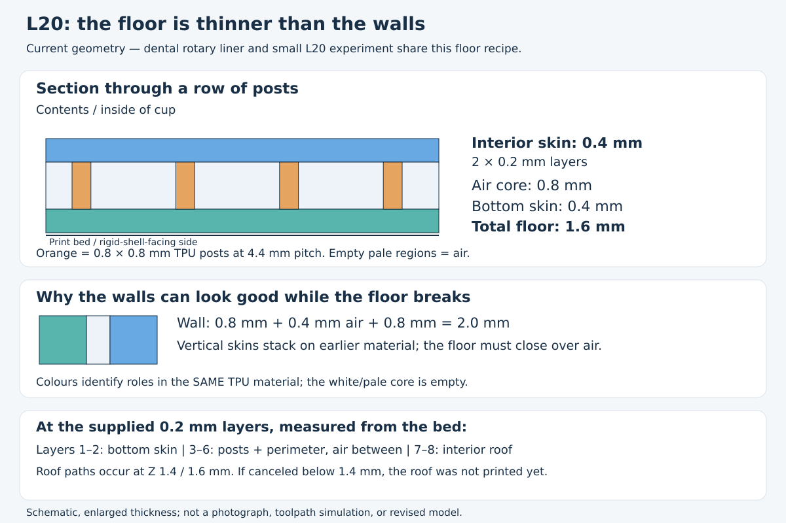
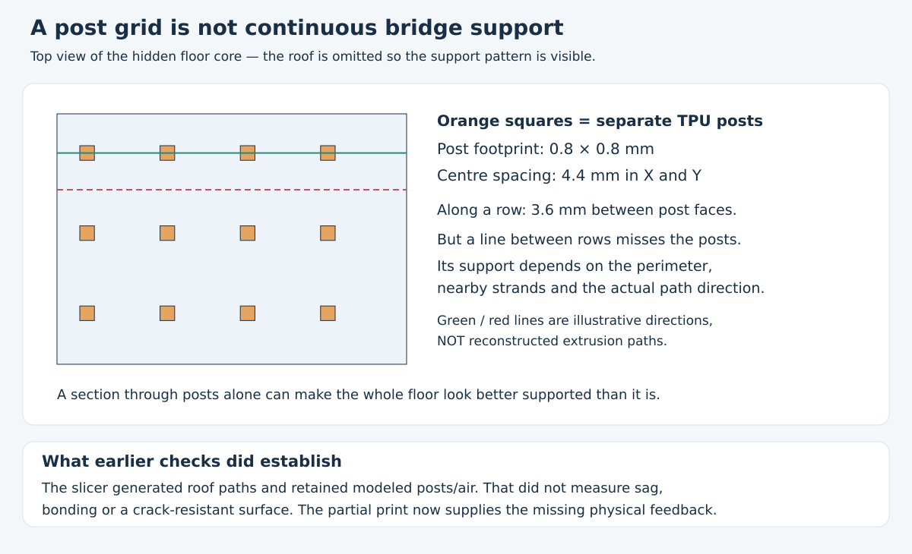
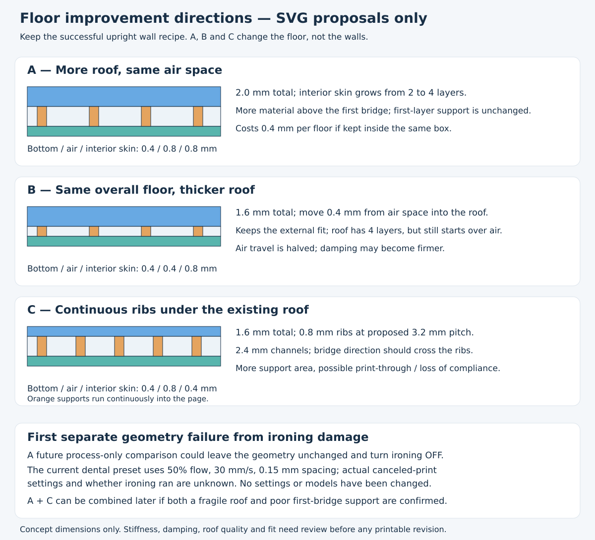

# Historical floor review before the uniform L20 correction

The [uniform L20 revision](uniform_l20.md) now implements identical 0.8/0.4/0.8 walls and floors. This record preserves the prior construction, observations and decision process.

The user canceled the rotary dental liner print because its **contents-facing bottom surface showed broken/cracking regions**, while the wall regions printed so far looked okay. This is the same unresolved floor-quality problem seen in the previously approved small experiments; L20 is not reported to be worse. Keep its successful wall/damping direction, but do not treat the earlier approval as a robust-floor result. **Models, STEP/STL files and print profiles are unchanged.**

In this report, the spoken “AL20” means the repository's **L20**, and “interior button/bottom” means the cup's **contents-facing floor**, not the rotary lock or toothbrush button. The reported case, replacement wheel cap and screw now print and work well; that separate success is recorded in the [case record](../../dental_travel_case/notes/matte_rotary.md#user-feedback).

## What is actually in the floor?

[Open section SVG](../renders/floor_review/current_floor.svg) · [PNG preview](../renders/floor_review/current_floor.png).

| Region, from bed upward | Thickness | Nominal 0.2 mm layers | Purpose |
| --- | --- | --- | --- |
| Shell-facing backing | **0.4 mm** | 2; paths at Z 0.2 and 0.4 mm | Continuous base on the bed |
| Air space with square posts | **0.8 mm** | 4; post paths at Z 0.6–1.2 mm | Separation/deformation space |
| Contents-facing interior skin | **0.4 mm** | 2; paths at Z 1.4 and 1.6 mm | Closes the air space; touches contents |
| Complete floor | **1.6 mm** | 8 | Both skins plus core |

Posts are **0.8 × 0.8 mm on a 4.4 mm square pitch**, with solid perimeter lands. The upright walls instead use **0.8 / 0.4 air / 0.8 mm**, totaling 2.0 mm, with discrete ties. The improved 0.8 mm wall skins were **not** transferred to the horizontal floor skins: those stayed at 0.4 mm. The small L20 cup and the dental cups share these nominal floor skins/core/post dimensions; their footprints, perimeter treatment and label regions differ. The dental liner does not recess a label into its floor.

These values come from [dental constants and floor construction](../rotary_l20_design.py), the experiment's [L20 builder](../../tpu_damping_box/thin_gap_design.py), and its inherited [horizontal-core constants and posts](../../tpu_damping_box/t_skin_design.py). The retained dental [actual-path record](rotary_l20/paths.json) confirms floor skin paths at 0.2/0.4/1.4/1.6 mm, post material and empty inter-post space. The dental profile also requests two top and bottom shell layers. Increasing a slicer's top-layer count alone cannot create an extra 0.4 mm outside the modeled floor without changing the geometry or consuming part of a preserved modeled void.

## Why support and skin thickness both matter

[Open post-support SVG](../renders/floor_review/post_support.svg) · [PNG preview](../renders/floor_review/post_support.png).

Along a row, the nominal gap between post faces is **4.4 − 0.8 = 3.6 mm**. That is **not a guaranteed maximum bridge span**: a line between rows can miss the isolated posts entirely. Actual support depends on path direction, perimeter anchoring and neighboring extrusion. The plan SVG uses illustrative lines, not reconstructed G-code. Earlier local path-presence checks did not establish that every roof strand had good support or that a smooth, tough printed skin would result.

A 0.4 mm interior roof leaves just two layers: the first has to establish the closure, and only one later layer remains to build over it. This makes **thin roof plus sparse support** a plausible geometric contributor. It is not a proven diagnosis of this canceled print. Prusa's [flexible-material guidance](https://help.prusa3d.com/article/flexible-materials_2057) specifically warns that poor bridging combined with thin layers can produce holes and protrusions. Its printer-specific temperatures/speeds are not being substituted for this Q2C setup.

There is also a separate process question. The supplied dental preset enables ironing at **50% flow, 30 mm/s, 0.15 mm spacing**. Prusa's [ironing explanation](https://help.prusa3d.com/article/ironing_177488) describes repeated hot-nozzle smoothing, sensitivity to flow, and increased nozzle pickup with flexible materials. That supports considering ironing as a variable; it does not prove that ironing caused these defects. It cannot replace a sound first bridge or add several structural layers.

**The stopped layer is unknown.** Below Z 1.4 mm, the interior roof has not yet been printed: posts and intentional air may still be exposed. Between Z 1.4 and 1.6 mm it is incomplete. Breaks already present in the first 0.4 mm would instead concern the bed-supported backing, not the upper roof. We should not attribute damage to a roof or ironing pass that may not have happened. Filament condition, extrusion consistency, actual temperatures and actual ironing execution are unreported.

## Three geometry directions, before modelling

[Open options SVG](../renders/floor_review/floor_options.svg) · [PNG preview](../renders/floor_review/floor_options.png). These are proposals, not printable revisions or new variant IDs.

| Direction | Bottom / air / interior skin | What it addresses | Main tradeoff |
| --- | --- | --- | --- |
| **A: thicker interior roof** | 0.4 / 0.8 / **0.8 mm** = 2.0 mm | Four roof layers instead of two; preserves core height | First bridge support unchanged; extra material and less inside length |
| **B: redistribute the existing floor** | 0.4 / **0.4** / **0.8 mm** = 1.6 mm | Four roof layers within the same external fit | Halves available air-space height; may feel firmer or bottom out sooner |
| **C: continuous directional ribs** | 0.4 / 0.8 / 0.4 mm = 1.6 mm; proposed **0.8 mm ribs at 3.2 mm pitch** | Replaces isolated islands with continuous anchors; nominal 2.4 mm channels when paths cross ribs | Roof still two layers; more contact area may stiffen damping or show through the surface |

My preferred decision sequence is to separate the failure stage first, rather than tune every setting together. If a future comparison is chosen, an **unchanged floor with ironing off** would isolate the finishing pass. No preset has been changed for that comparison. If a completed, un-ironed roof is intact but fragile, A isolates thickness. If its first closing layer is already broken or sagging, C addresses support more directly; **A + C** is a reasonable combined direction after considering the resulting firmness. B is an alternative where preserving cavity length matters more than retaining the present core height.

Do not blindly thicken both dental floors inward: A adds 0.4 mm per cup and could reduce the recorded **256.2 mm** clear length to **255.4 mm**, leaving just 0.4 mm nominal total margin for a 255 mm brush. That is arithmetic on the existing record, not a revised fit result. A future model must decide whether to change the shell-facing geometry, floor allocation or application allowance. Successful walls should remain unchanged during a floor comparison.

The existing [F0–F7 surface studies](../../tpu_damping_box/README.md#surface-finish-coupons--2026-10-17) already explore analogous thicker roofs, ribs, grids and sloped shoulders. They have no user print report. Their historical S16-based, Arachne/ironing setup differs from the current post-supported L20/Classic floor; they are useful conceptual precedents, not evidence that these proposals work. The rejected fully solid damping controls and too-firm T16 are not being recommended again.

## Physical record and scope

Report date: **2026-10-23**. Material family: TPU liner; exact spool, profile, stopped layer and artifact hash unknown. Prior user-confirmed liner layer height is 0.2 mm; the current supplied preset also uses 0.2 mm. The visible defect is recorded as reported broken/cracking surface, without inferring measured tensile fracture, delamination, moisture or a thermal cause.

| Item | Print status | Artifacts / remaining checks |
| --- | --- | --- |
| Earlier L20 experiment | **Yes — walls/damping preferred; floor quality unresolved** | Existing `thin_gap_L20` files unchanged; prior preference preserved with the new floor limitation |
| Rotary dental L20 liner | **Partial — canceled after early layers** | Existing `rotary_l20_liner` files unchanged; early wall regions look okay, interior floor rejected. Complete tall walls, installation and combined packing remain untested |
| This explanatory study | **N/A — SVGs only** | Three SVGs and PNG previews; no new printable geometry |

This review uses authoritative source dimensions and retained path evidence. No new CAD evaluation, slice or material simulation is needed for explanatory SVGs; neither a successful old slice nor small-cup acceptance overrides the physical surface report. The updated experiment and application summaries link here. Historical machine-readable receipts remain historical digital evidence, not new physical approval.

Attribution: GPT-6 family; exact model identifier and reasoning effort not exposed. Codex shared-workspace coding-agent environment, OpenAI. No subagents. User supplies physical print observations; source geometry is unchanged. External material/ironing guidance is linked above and does not calibrate this printer or spool.
