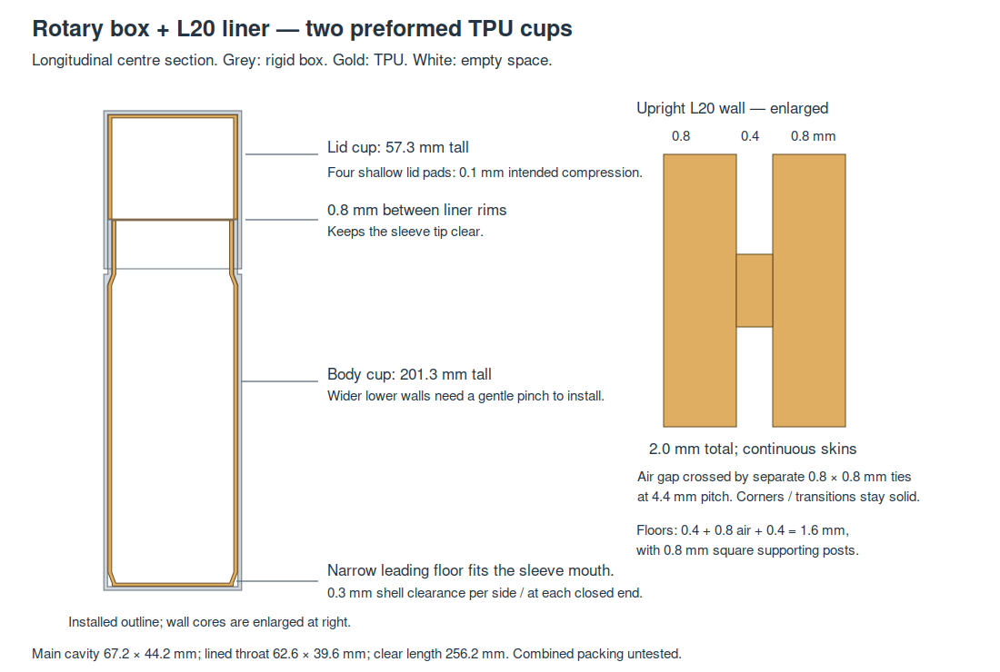
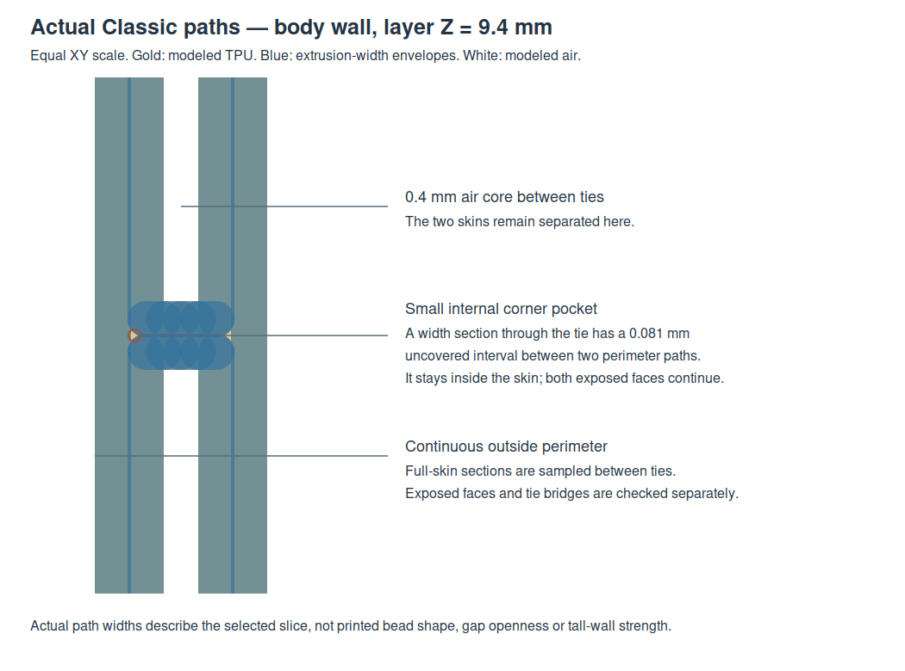

# L20 liner for the current rotary dental box

Print the two TPU cups from [STEP](../rotary_l20_liner.step), [STL](../rotary_l20_liner.stl) or [Python](../rotary_l20_liner.py). This version belongs to the latest 75.8 × 52.8 × 264 mm [rotary case](../../dental_travel_case/notes/covered_rotary.md), whose hard parts are unchanged. The old M1 S16 liner is retained only as rejected history.

## User direction

The user asks for a recap before modelling, confirms **L20** as the intended standard, then explicitly authorizes a new liner for the latest rotary box being prepared for printing. L20 replaces the earlier M1/S16 profile and target for this new variant. Historical M1 requirements and evidence remain available under `slim-m1-s16`; current work uses `rotary-l20`.

## Construction and fit

| Feature | Current geometry |
| --- | --- |
| Upright flats | 0.8 mm backing + 0.4 mm air gap + 0.8 mm contact skin = 2.0 mm |
| Connections | Separate 0.8 × 0.8 mm ties at 4.4 mm pitch in both directions |
| Floors | 0.4 mm backing + 0.8 mm post-supported air + 0.4 mm contact skin = 1.6 mm |
| Corners | Solid 4 mm wall-end lands; generous inner corner radii; no fragile clipped ties |
| Body cup | Installed Z 2.3–203.6; 201.3 mm high |
| Lid cup | Installed Z 204.4–261.7; 57.3 mm high |
| Main lined body cavity | 67.2 × 44.2 mm |
| Lined sleeve passage | 62.6 × 39.6 mm |
| Available axial space | 256.2 mm between contact floors |
| Lid cup seating | Four rounded ramped TPU pads, 4 mm wide × 4 mm tall, projecting 0.4 mm; local 0.1 mm intended compression |
| Installation allowance | 0.3 mm per side, 0.3 mm at closed ends, 0.8 mm between cup rims |

The body cup follows the shell's changing width. Its complete leading 1.6 mm floor fits through the 67.2 × 44.2 mm mouth. Above that floor, a gradual six-millimetre flare reaches the broader lower walls. Those walls still need elastic compression through the throat; the design does not claim a rigid sliding installation. The former S16 liner's thinner skins tore while printing and during forced insertion. This version retains L20's thicker 0.8 mm skins and discrete ties, but their full-height installation strength is not measured.

The six-millimetre shoulder taper and lower flare keep solid walls instead of forcing an air channel through every change of section. Most upright area retains the L20 sandwich. Air cores stop short of solid corner/end lands, transition roots and the 0.4 mm rim closure. Floors use complete 0.8 mm square posts on the 4.4 mm grid, preserving separate skins. No text is recessed into a working skin.

[Editable section SVG](../renders/rotary_l20/liner_sections.svg). Four local pads give the lid cup a defined seating interface while retaining clearance over most of its height. Each pad has a one-millimetre entry and exit ramp and a two-millimetre plateau; its rounded footprint grows upward without a flat unsupported ledge. Only these pads intentionally enter the rigid lid cavity wall by 0.1 mm. Their friction, compression and holding force remain physical checks. The two cups remain the entire printed assembly.

## Printing and installation

Use the [Classic process](../profiles/rotary-l20-process.json), [TPU 95A filament](../../tpu_damping_box/profiles/tpu95a.json) and [Q2C 0.4 mm printer](../../../.codex/skills/orca-slicer-printability/profiles/qidi-q2c-petg/qidi-q2c-0.4-nozzle.json). Both cups print closed ends down and openings up, at supplied XY centres (60,60) and (142,60); retain the model's placement and orientation. The body is below the 256 mm build height. Broad continuous backing provides bed contact without a brim. Normal and first layers are 0.2 mm, Classic two walls, thin-wall detection off, 100% rectilinear material fill, supports off and 9 mm³/s maximum flow. The modeled air voids remain empty despite 100% fill.

Top-surface ironing is enabled at **50% flow, 30 mm/s and 0.15 mm spacing**, using the earlier accepted sunglasses floor-coupon recipe. The latest small L20 print had ironing enabled but its exact settings were unreported; this setting is an explicit starting choice, not a reconstruction of that print. The tall wall skins remain ordinary perimeter paths. The outer flare and shoulder move only about 0.077 mm per 0.2 mm layer. Enclosed floor roofs bridge between posts; adding support inside them would fill the damping core.

1. Clear stringing and inspect both skins before installation. Do not repeat a full print with torn skins.
2. With the hard halves separated, insert the long cup's narrow closed end first. Gently pinch the wider walls as they pass the sleeve mouth; stop if insertion needs force or causes whitening/tears. Its rim sits just below the sleeve tip.
3. Seat the short cup against the lid roof, gently compressing its four shallow pads. Confirm it stays in place when the empty lid is inverted; do not force a pad that catches. Keep both TPU rims away from the hard seam, seating pads and wheel.
4. Close and release the empty box first. Check that the liner stays seated and does not enter the overlap or obstruct the lock. Then load the actual brush and toothpaste together and test quietness.

## Verification and limits

[CAD](rotary_l20/cad.json), [native print/slice](rotary_l20/print_review.json), [actual paths](rotary_l20/paths.json), [publication association](rotary_l20/publication.json), [product verification](rotary_l20/verification.json). Native checks use the latest covered-box builder and conservative filled liner envelopes for shell/hardware clearance and sampled cap withdrawal. The four lid-pad contacts are checked separately: actual overlap must be positive, entirely within the pads and no deeper than the nominal 0.1 mm contact band (0.001 mm numerical allowance). Material/air witnesses inspect actual skins, separate ties, floor posts and floor sandwich. Individual 30 × 255 mm brush and stored 55 × 40 × 160 mm tube gauges are separate checks, not a combined packing claim. A full rectangular 40 mm tube cross-section is wider than the 39.6 mm throat; real tube deformation and combined fit remain unknown.

[Editable actual-path detail](../renders/rotary_l20/wall_path_detail.svg). A first check sampled directly through a tie and demanded nearly solid fill across the entire 0.8 mm skin. At layer 9.4 mm, the Classic perimeter's rounded turn leaves a 0.08056 mm internal corner pocket between its paths; the outside face itself is continuous. The final review distinguishes full skins between ties, exposed-face continuity through the tie columns, and connected tie bridges. It does not reinterpret an internal corner pocket as a missing skin or infer printed strength from path presence.

The final local path review covers **10,224 full-skin sections**, **10,224 exposed-face sections**, **4,820 core sections** and **36 tie sections**, plus floor skins, posts and voids. The sampled between-tie core retains **0.4 mm** width in the slicer's width-envelope model. The forced support probe has 2,737 interface segments, all at or below 1.2 mm inside the floor-core height; the primary slice keeps supports off. Native publication and useful views are retained separately from these local path judgments.

The print review uses the supplied TPU setup, not the PETG fallback. Actual Classic paths are reviewed through upright layers, both skins and open cores, with sampled tie/post and floor-skin sections. The automatic-support signal is reviewed separately; an enclosed short floor roof is kept unsupported in the primary print, following the accepted small L20 construction. Slicer acceptance does not establish printed air-gap separation, tall-wall stability, insertion effort, subjective noise, adhesion or long-term wear. No new force, fatigue or acoustic rating is claimed.

| Category | Print status | Artifact / observation |
| --- | --- | --- |
| Small L20 reference | Yes — accepted / preferred | [Recorded user comparison](../../tpu_damping_box/notes/thin_gap/README.md#physical-feedback--2026-10-21). |
| Separate application test pieces | N/A | Full-size pair is the authorized first application trial. |
| Rotary L20 final liner | Unknown — unprinted | `rotary_l20_liner.py`, `.step`, `.stl`; check intact walls, gentle installation, seating and combined packing. |
| Earlier M1 S16 liner | Printed — damaged | Original files and [physical history](../README.md#wall-print-feedback--2026-10-19) remain; do not reprint as this rotary version. |

## Engineering notes and attribution

The small accepted L20 cup's wall recipe is transferred deliberately; the old failed S16 geometry and native receipts are not promoted. Solid transition bands avoid unsupported starts at the shoulder. The reduced leading floor addresses entry separately from the wider walls' unqualified elastic insertion. Four shallow lid pads address retention separately from installation clearance; they do not turn an unmeasured interference into a force rating. Source-owned parametric models remain authoritative; only raw files are delivered.

The current case uses legacy flat sibling imports. The liner temporarily adds that object's directory while importing/building, verifies the case module's owner, and restores the caller's import path. It does not export or modify the hard box. Product requirements for the old S16 variant are retained separately; the new user's target/profile selection has its own provenance.

Primary language model: GPT-6 family; exact runtime model identifier and reasoning effort not exposed. Harness: Codex shared-workspace coding agent. Provider: OpenAI. No subagents. L20 physical preference and authorization are user supplied. Historical attribution remains with the original records. Geometry is MIT; the derived Orca profile retains [AGPL-3.0 attribution](../profiles/ATTRIBUTION.md).
