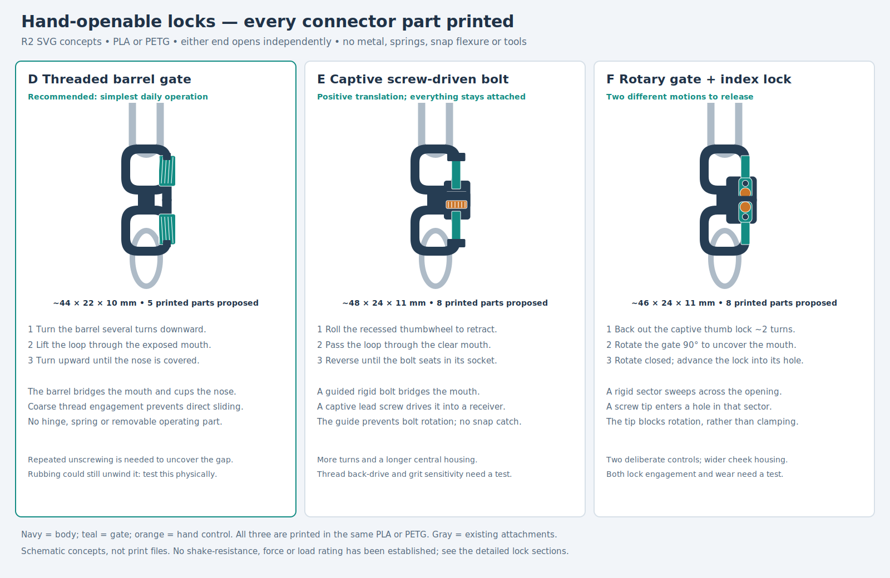

# Two-ended connector — all-printed hand locks

**First CAD increment: D, the threaded barrel connector.** It has a complete
assembled model, an open pose, an assembly-order view and a print layout containing
eight separated parts. Each end operates independently by hand. Every component
is printed; the normal opening action removes no parts.

[**D assembled**](renders/d/d_barrel_gate_inspections/closed.png) ·
[**D one end open**](renders/d/d_barrel_gate_inspections/open.png) ·
[**Assembly order**](renders/d/d_barrel_gate_inspections/assembly.png) ·
[**Lock section**](renders/d/d_barrel_gate_inspections/section.png)

**D trial files:** [STEP](d_barrel_gate.step) · [STL](d_barrel_gate.stl) ·
[Python entry point](d_barrel_gate.py). Read the [assembly and print instructions](notes/d_model.md).
The STEP/STL are the separated print layout; the pictures show the actual assembled
geometry. Print as supplied in PLA or PETG, 0.4 mm nozzle, 0.2 mm layers, solid fill.
Use the 5 mm brim for the small stems and screws; supports off for the first trial.
D remains physically untested and has no load or shaking rating.

**Sequence:** D is the first modelled increment. E, then F remain next; their
[current SVG comparison](renders/hand_locks/hand_lock_options.svg) is retained
for reference. The old A/B/C proposals are superseded. Do not print an assembled
pose as a single fused part.

## Concept comparison retained for E and F

D's CAD differs from its sketch: separate keyed stems and a two-piece frame make
its assembly route possible, giving eight parts rather than the proposed five.
The dimensions are approximately 62 × 23 mm in plan, with 10.8 mm barrels. The
comparison below preserves the schematic concept targets; these are not CAD
measurements for E/F.

| Retained concept SVG | Original sketch envelope | Daily operation | Original sketch part count |
| --- | --- | --- | --- |
| [D — threaded barrel gate](renders/hand_locks/d_barrel_gate.svg) | 44 × 22 × 10 mm | Turn the barrel down to expose a mouth; turn back until it cups the opposite horn. No hinge. | 5: body, two barrels, two printed stop tips |
| [E — captive screw-driven bolt](renders/hand_locks/e_retracting_bolt.svg) | 48 × 24 × 11 mm | Turn a recessed thumbwheel; a guided bolt retracts into the central body. Reverse to seat it in the opposite horn. | 8: body, cover, two bolts, two lead screws, two printed cover screws |
| [F — rotary gate with index lock](renders/hand_locks/f_rotary_index.svg) | 46 × 24 × 11 mm | Back out a captive thumb lock, then rotate the gate clear. Close and advance the lock tip into its hole. | 8: body, cover, two rotors, two thumb locks, two printed cover screws |

All include both ends. Assembly screws and stop tips are printed too; they are
not removed during normal opening. Two-hand operation is assumed. None self-closes.

## Holding and deliberate release

D needs repeated rotation before the opening appears; its sleeve bridges the
mouth while engaged. E converts repeated thumbwheel rotation into bolt travel;
the bolt cannot retract directly without turning the lead screw. F uses a lock
tip crossing a rotor hole to block gate rotation, rather than squeezing the rotor
with friction. Withdrawing the tip alone leaves the gate covering the opening.
Each detail sheet shows the two-ended object, one open end, an enlarged lock
section, the release sequence and proposed assembly.

These are different ways to resist an accidental single pull or bump. **None has
proved resistance to shaking.** Thread back-out, rubbing against other keys,
wear and deliberate opening effort remain physical questions. No springless lock
here is claimed to be automatically vibration-proof. D has the fewest parts;
E conceals gate travel but needs more housing; F adds a distinct second motion.

## Sizing and manufacture assumptions

The user delegated generic sizing. Retain ~3.2 mm cord section, key-ring wire up
to 3 mm, ~6 mm loading mouths and slim free horns targeting ~3.2 × 4 mm local
sections. The cord's nominal bore is 7.6 mm across flats. Actual horn passage,
attachment routing, gate travel and finger clearance must be checked in CAD if a
concept proceeds; the enlarged lock sections are not dimensioned part drawings.

Separate parts are intended to print without freeing a print-in-place joint.
Body, covers and flat gates print broad face down; coarse screws upright and
barrels upright with an open bore. Assume a 0.4 mm nozzle and 0.2 mm layers.
Coarse thread lead, assembly retention, fit, clearances and load-bearing sections
are still design work. The mechanisms require rigid relative motion, not useful
PLA/PETG spring behavior. This is not yet a printability or strength result.

## Evidence and print status

The retained SVGs were generated, XML-parsed, rendered to PNG and visually reviewed.
The comparison uses consistent object scale; lock sections are enlarged separately.
Navy is body, teal gate, orange hand control or stop; all are the same printed
material. Gray indicates existing attachments, not supplied parts.

| Item | Print status | Artifact(s) | Remaining work |
| --- | --- | --- | --- |
| D complete prototype | Unknown | `d_barrel_gate.step`, `d_barrel_gate.stl` | Thread fit, assembly by hand, opening effort, shaking, wear and pull remain physical tests. |
| E / F | N/A | SVG concepts retained | Next sequential CAD increments, not printable yet. |
| Final rated connector | N/A | None | Experimental mechanism comparison only. |

[D geometry and assembly](notes/d_model.md) · [D native CAD/slice receipt](notes/d_cad_review.json) ·
[D requirement checks](notes/d_verification.json) · [Development record](notes/development_record.md) ·
[Current decisions and correction](notes/hand_lock_decisions.md) ·
[Historical A/B/C rationale](notes/concept_decisions.md) ·
[Historical A/B/C handoff](notes/r1_handoff.md).
Regenerate only the retained concept sheets with
`./execute.py model/double_ended_connector/draw_hand_locks.py`.
The [generator](draw_hand_locks.py) is drawing source, not a CadQuery model.

## Attribution

Primary language model: GPT 6.1, reasoning F4 Medium, as explicitly supplied by
the user; runtime identity and effort are not independently exposed. Harness:
Codex CLI. Provider: OpenAI. No external artwork or third-party mechanism drawing
was used. Material contributors: user requirements, clarification and cord print
feedback. Historical A/B/C attribution remains in the linked handoff.
