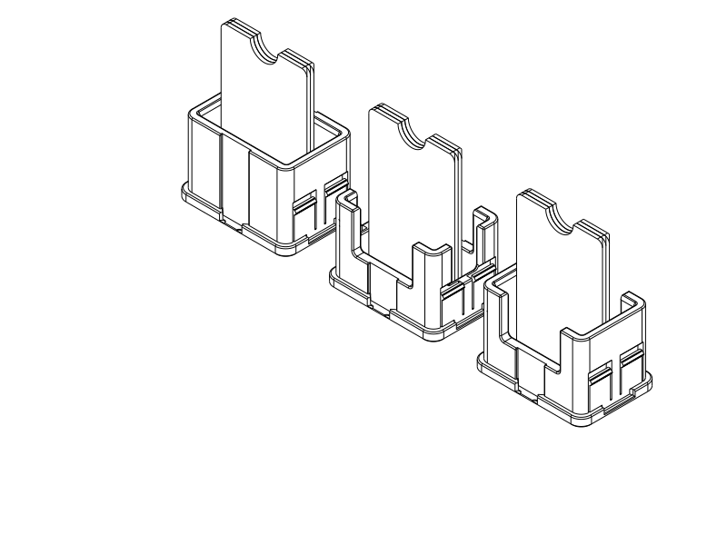
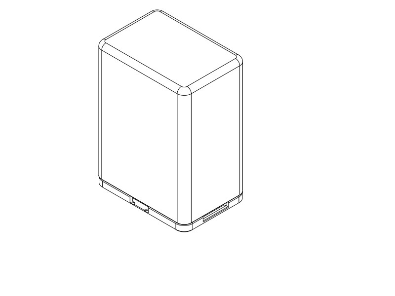

# Filament Swatch Storage — Display Bases & 15-Card Archive Box

Modular PETG storage for standard filament swatch cards (`52.9 × 35.6 × 2.8 mm`, stored vertically notch-up), sharing a common `64 × 44.8 mm` footprint, a clear lift-off hood (**`G`**), and a snap-in base joiner key (**`I key 3`**).

---

## At a Glance: What Works, What to Print & What to Ignore

| Workstream | Status | What to Print / Action |
| --- | --- | --- |
| **1. Compact 15-Card Archive Box (`Archive R2 A`)** | **PRINTED & ACCEPTED** (2026-10-04) | **Ready to print & use:** • **Base:** [`archive_r2_walled_15.step`](archive_r2_walled_15.step) ([`.stl`](archive_r2_walled_15.stl)) • **Hood (`G`):** [`cap_g_hood_5.step`](cap_g_hood_5.step) ([`.stl`](cap_g_hood_5.stl)) • **Joiner Key (`I3`):** [`cap_i_grip_keys.step`](cap_i_grip_keys.step) ([`.stl`](cap_i_grip_keys.stl) — use **Key 3**) Holds 1–15 cards cleanly on a desk, joins `J4`, and lifts a full 15-card stack by the hood without dropping the base. |
| **2. Five-Card Display Base (`J4` / `K4`)** | **PARTIAL — FIXES DEFERRED** (2026-10-04) | **Preferred display base:** [`cap_j4_base_5.step`](cap_j4_base_5.step) ([`.stl`](cap_j4_base_5.stl)) with the same `G` hood and `I3` key. Upward-facing side grip recesses and `J4` key joining work well, but seated cards still tilt slightly (and `K4`'s key stop only catches at one end). **User deferred further display-base edits.** |
| **3. TPU Quiet-Closure Prototypes (`Q1`, `Q1F`, `G-TPU`)** | **DISCONTINUED** (2026-10-06) | **Do NOT print.** `Q1F` joining worked, but TPU sliding noise, upper fit, and contrasting appearance were unsatisfactory. **Damping work for this box is permanently closed.** |

---

## 1. Accepted 15-Card Archive Box (`Archive R2 A`)

The 15-card archive module replaces individual card slots with a shared `50.4 × 30.3 mm` pocket inside the standard `64 × 44.8 mm` base footprint, so it shares the exact **`G` hood** and **`I3` joiner key** with the 5-card display bases.
- After rejecting `Archive R1`'s deep side scoops before printing, we built four `Archive R2` retaining geometries (`A`–`D`).
- The user printed and accepted **Variant `A` (continuous `40 mm` walls)**: even a single loose card stays contained during desk browsing, and when loaded with all 15 cards, lifting the closed `G` hood lifts the entire loaded base securely ([full A print report](notes/cap_comparison.md#archive-r2-a-print-report--2026-10-04)).

| Variant | Retaining Geometry | Status | Files (`.py` / `.step` / `.stl`) |
| --- | --- | --- | --- |
| **`A` — Walled (Recommended)** | **Continuous `40 mm` high walls** (`18 mm` low front/back window centers) | **Printed & Accepted** | [`archive_r2_walled_15.py`](archive_r2_walled_15.py) · [`archive_r2_walled_15.step`](archive_r2_walled_15.step) · [`archive_r2_walled_15.stl`](archive_r2_walled_15.stl) |
| `B` — Slim | Four L-corners (`4 × 3 mm` returns) | Unprinted alternative | [`archive_r2_slim_15.py`](archive_r2_slim_15.py) · [`archive_r2_slim_15.step`](archive_r2_slim_15.step) · [`archive_r2_slim_15.stl`](archive_r2_slim_15.stl) |
| `C` — Corner | Four L-corners (`8 × 6 mm` returns) | Unprinted alternative | [`archive_r2_corner_15.py`](archive_r2_corner_15.py) · [`archive_r2_corner_15.step`](archive_r2_corner_15.step) · [`archive_r2_corner_15.stl`](archive_r2_corner_15.stl) |
| `D` — Side guides | Two side cheeks (`8 mm` returns) | Unprinted alternative | [`archive_r2_side_guides_15.py`](archive_r2_side_guides_15.py) · [`archive_r2_side_guides_15.step`](archive_r2_side_guides_15.step) · [`archive_r2_side_guides_15.stl`](archive_r2_side_guides_15.stl) |

- **Print settings:** Floor down on the bed, PETG, `0.4 mm` nozzle, `0.2 mm` layers, 2 walls, `7%` adaptive cubic infill, no supports. Pair with [`cap_g_hood_5.step`](cap_g_hood_5.step) (printed roof-down in clear/translucent PETG) and Key 3 from [`cap_i_grip_keys.step`](cap_i_grip_keys.step).
- **Visuals & receipts:** [Comparison SVG](renders/concepts/archive_structure_options.svg) ([PNG](renders/concepts/archive_structure_options.png)) · [CAD checks](notes/archive_r2_checks.json) · [Corner support study](notes/archive_corner_support.json) · [Slice receipt A](notes/archive_r2_walled_review.json) ([B](notes/archive_r2_slim_review.json), [C](notes/archive_r2_corner_review.json), [D](notes/archive_r2_side_guides_review.json)).

---

## 2. Five-Card Display Bases (`J4` & `K4`)

- **Files:**
  - **`J4` (Preferred — broad spring follower):** [`cap_j4_base_5.step`](cap_j4_base_5.step) · [`cap_j4_base_5.stl`](cap_j4_base_5.stl) · [`cap_j4_base_5.py`](cap_j4_base_5.py)
  - **`K4` (Domed shoulder follower):** [`cap_k4_base_5.step`](cap_k4_base_5.step) · [`cap_k4_base_5.stl`](cap_k4_base_5.stl) · [`cap_k4_base_5.py`](cap_k4_base_5.py)
- **How the recessed grip works:** Two `18 mm` long × `2.2 mm` deep side recesses sit inside the `64 × 44.8 mm` footprint above a `2 mm` floor. Reach a fingertip edge into the `3 mm` side gap below the closed `G` hood to hold the base down while lifting the hood ([access cross-section](renders/recessed_grip_section/inspect_recessed_grip_section_front.png)).
- **Printed result (2026-10-04, [detailed report](notes/cap_comparison.md#j4k4-print-report--2026-10-04)):**
  - Both `J4` and `K4` were printed. The upward-facing side grips work well, and `J4`'s `I3` key slot works at both ends.
  - **Remaining issues (deferred by user):** Seated cards in `J4` still tilt slightly (suspected bottom clearance); `K4` holds cards more loosely and its key stop only blocks the key at one end.

### Core Requirements to Preserve (If Display Work Resumes Later)
- Store cards vertically (`52.9 mm` tall) with the notch at the top, fully enclosed by the `G` hood.
- Keep seated display cards upright and aligned even when only 1–3 slots are occupied; funnel card insertion from both X and Y so thin cards do not catch on narrow slot edges.
- Maintain `64 × 44.8 mm` base compatibility with the accepted `G` hood and `I3` joiner key.

---

## Print Status, Verification & Attribution

| Workstream / Item | Print status | Artifact(s) | User result or remaining physical checks |
| --- | --- | --- | --- |
| **Test pieces** | Yes (early `D`/`H`/`I` samples); N/A for full bases | `cap_i_grip_keys.step/.stl` (`I3` accepted) | `H` key rejected as too loose; `I` key 3 accepted; full bases tested directly. |
| **15-Card Archive (`R2 A`)** | **Yes — Printed & Accepted** (2026-10-04) | `archive_r2_walled_15.step/.stl` + `cap_g_hood_5.step/.stl` + `I3` key | Single/sparse card browsing, `J4` joining, and lifting a full 15-card load by the `G` hood all work as intended. (`B`/`C`/`D` unprinted; `R1` rejected before print.) |
| **5-Card Display (`J4` / `K4`)** | **Partial — Printed, fixes deferred** (2026-10-04) | `cap_j4_base_5.step/.stl`, `cap_k4_base_5.step/.stl` | Upward grips liked; `J4` preferred and joins cleanly, but seated card tilt remains; `K4` looser with one-ended key stop. (`J3`/`K3` & `V1` rejected.) |
| **TPU Quiet Prototypes (`Q1F` / `G-TPU`)** | **Discontinued** (2026-10-06) | Historical files in [`notes/development_record.md`](notes/development_record.md) | `Q1F` and full-TPU `G` hood printed; joining worked, but sliding noise and upper fit failed user expectations. |

### Automated Product Verification
Run `./execute.py --threads 2 model/filament_swatch_box_study/verification.py --variant q1f` (or `q1`, `q1f-tpu-hood`, `replacement-fixture`). The verification plan preserves user requirement IDs (`swatch.storage`, `swatch.open`, `swatch.join`, `swatch.quiet`, `swatch.appearance`, `swatch.upper-fit`) and recorded physical outcomes (`PASS` on `A`/`G`/`I3` storage and `Q1F` joining; `FAIL` on `Q1F` noise/appearance/upper-fit) while keeping the discontinuation directive explicit ([`notes/verification_sources.json`](notes/verification_sources.json)).

### Attribution
- **Primary CAD & Engineering:** Primary language model **GPT-6.1 Sol**, reasoning effort **high** (user-provided); Codex harness in shared repository workspace; provider OpenAI; no subagents. Swatch card dimensions derive from the user-supplied [`filament_archive_swatch`](../filament_archive_swatch/README.md) SCAD model.
- **Quiet TPU & Verification Phases:** GPT-6-based Codex (exact runtime variant/effort not exposed); OpenAI; no subagents. Orca profile snapshots in [`notes/quiet_q1_profiles/`](notes/quiet_q1_profiles/ATTRIBUTION.md) are [AGPL-3.0](notes/quiet_q1_profiles/LICENSE.txt).
- **Effort & Performance Records:** [Selected token/timing record](notes/agent_effort.md) · [Archive reflection & memory policy review](../../performance/reviews/2026-10-04-152419-archive-reflection-and-memory-policy.md) ([shared RAM controls removed](../../performance/reviews/2026-10-04-163751-shared-memory-controls-removed.md)).

---

## Navigation: Detailed History & Superseded Designs

All historical phases, print reports, and retired prototypes live in [`notes/cap_comparison.md`](notes/cap_comparison.md) and [`notes/development_record.md`](notes/development_record.md) (anchors below are preserved for automated verification provenance):

- **Archive & Display Comparisons ([`notes/cap_comparison.md`](notes/cap_comparison.md)):**
  - [Archive R2 A print report (2026-10-04)](notes/cap_comparison.md#archive-r2-a-print-report--2026-10-04) & [Four retaining forms (`A`–`D`)](notes/cap_comparison.md#archive-r2--four-retaining-forms)
  - [J4/K4 print report (2026-10-04)](notes/cap_comparison.md#j4k4-print-report--2026-10-04) & [J/K print feedback and revisions](notes/cap_comparison.md#jk-print-feedback-and-revisions)
- **Full Chronological Development Record ([`notes/development_record.md`](notes/development_record.md)):**
  - [TPU damping discontinued, 2026-10-06](notes/development_record.md#tpu-damping-discontinued-2026-10-06) & [Damped prototype print feedback and SVG exploration, 2026-10-06](notes/development_record.md#damped-prototype-print-feedback-and-svg-exploration-2026-10-06)
  - [Named assembly engineering, 2026-10-06](notes/development_record.md#named-assembly-engineering-2026-10-06)
  - [Quiet TPU revision — Q1F with the accepted exterior, 2026-10-05](notes/development_record.md#quiet-tpu-revision--q1f-with-the-accepted-exterior-2026-10-05) & [Q1 prototype, 2026-10-05](notes/development_record.md#quiet-tpu-revision--q1-prototype-2026-10-05)
  - [Archive R1 — rejected before printing](notes/development_record.md#archive-r1--rejected-before-printing-retained-history) & [J3/K3 upward-facing ledges — rejected before printing](notes/development_record.md#j3k3-upward-facing-ledges--rejected-before-printing)
  - [Preserved J2/K2 card-support revisions](notes/development_record.md#preserved-j2k2-card-support-revisions), [V1 single-wall vase hood](notes/development_record.md#v1-single-wall-vase-hood--additional-transparency-trial), and earlier iterations [K](notes/development_record.md#k--existing-dome-shoulder-with-less-seated-spring-bend), [J](notes/development_record.md#j--centered-broader-card-panels), [I](notes/development_record.md#i--printed-replacement-key-result), [H](notes/development_record.md#h--connector-without-a-handle), [G](notes/development_record.md#g--retained-modular-five-card-proof), [F](notes/development_record.md#f--smooth-exterior-hood), [E](notes/development_record.md#earlier-thin-hood--e), [D](notes/development_record.md#printed-reference--d), and [physical history](notes/development_record.md#physical-history-and-print-status).
