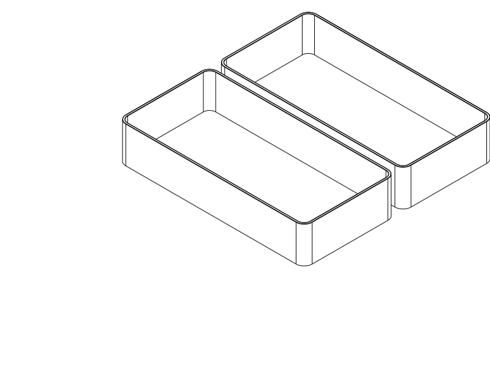

# S16 damping liner for the printed sunglasses case

Print [sunglasses_case_liner.step](sunglasses_case_liner.step), or its matching
[STL](sunglasses_case_liner.stl). The plate contains **two identical TPU cups**,
one for each half of the existing [accepted E case](../sunglasses_case/notes/printing_and_design.md).
Source: [print entry](sunglasses_case_liner.py), [parametric builder](design.py).



## Intent

User instruction, 2026-10-16: S16 and S12 have both been printed and work;
S16 is preferred over S12/I22 and feels good compared with I30/original 4 mm I.
Record that preference and a reusable lesson first, then adapt S16 into a liner
for the already printed sunglasses box. The user confirms enough interior room.
The [original physical report](../tpu_damping_box/README.md#s16--s12-print-feedback--2026-10-16)
qualifies the sample profile, not this new accessory's quietness or fit.
The original case and its accepted source/exports are preserved.

## Geometry and adaptation

The target is the printed reduced E case: **158 × 78 × 63 mm**, 7 mm inner corner
radius. Each cup is **157.6 × 77.6 × 30.8 mm**, outer corner radius 6.8 mm;
0.2 mm nominal allowance per side. S16 is preserved locally:

| Feature | Dimension |
| --- | --- |
| Shell-side backing / air core / contents-side skin | 0.4 / 0.8 / 0.4 mm |
| Total floor and wall sandwich | 1.6 mm |
| Straight ribs / pitch / nominal inter-rib channel | 0.9 / 4.4 / 3.5 mm |
| Solid top closure of wall channels | 0.4 mm |
| Rounded opening edges | 0.2 mm radius |

Floor ribs run along the short direction, with bridge paths across them. Wall
ribs run vertically. Both skins remain continuous; corners and short pattern
remainders are solid TPU, rather than scaled or stretched cells. The floor/wall
junction is solid locally. This adaptation changes coverage and corner stiffness;
it does not claim that the coupon's subjective response transfers unchanged.
No printed labels cut the thin skins; the two inserts are interchangeable.

A seated backing is nominally 0.2 mm above its rigid exterior panel's inner face,
reserved for tape. Each insert ends 0.5 mm below the rigid mating rim, leaving
**1 mm between opposing liner rims** when closed. The case closure is unchanged.
The residual rounded interior is nominally **154.4 × 74.4 × 59.4 mm** with the
0.2 mm backing allowance occupied; this is available geometry, not a measured
glasses envelope. The narrow seam band is deliberately unlined to avoid pinching.

## Installation

1. Print the supplied two-cup layout, backing down and openings up. Remove
   strings and clean the contact faces before placing glasses inside.
2. Dry-fit each cup in an open case half, with its flat backing against the
   panel. It should seat without buckling and stay below the rigid rim.
3. Use small strips of **thin removable double-sided tape, at most 0.2 mm total
   installed thickness**, under the flat backing, particularly for the lid cup.
   Start near the perimeter; do not fill channels, glue the rim, or use thick
   foam tape. Select tape compatible with the actual TPU and shell; adhesion is
   untested. The design does not rely on an unqualified friction fit.
4. Close the empty box gently and check the latch. Then check the actual glasses
   for clearance and compare contact noise. Check that the lid insert stays in
   place after repeated opening. No case reprint or new fasteners are needed.

## Printing and manufacturing review

Use TPU (Generic 95A is the reference assumption), **0.4 mm nozzle, 0.10 mm
layers including first layer, Arachne, two requested walls**, 100% material fill.
The air channels are CAD voids. Reuse the S16 reference
[process](../tpu_damping_box/profiles/tpu-closed-process.json),
[filament](../tpu_damping_box/profiles/tpu95a.json) and
[Q2C printer](../../.codex/skills/orca-slicer-printability/profiles/qidi-q2c-petg/qidi-q2c-0.4-nozzle.json).
Actual successful sample print settings and TPU brand/hardness were not reported;
these profiles are diagnostic references, not recovered settings or calibration.

Keep supports **off**, both thick bridge options **off**, bridge directions
**180°**, and the supplied unrotated layout. Each 0.4 mm vertical skin is
intentionally one bead; the 0.9 mm ribs need multiple substantial paths.
Horizontal skins have four 0.1 mm layers. The unsupported floor roofs span
3.5 mm between ribs; wall-channel top caps span the 0.8 mm core. Trapped automatic
support would be inaccessible, so the probe is a review signal, not an instruction
to enable supports. Physical bridging, sag and channel separation remain untested.

The layout is **157.6 × 161.2 × 30.8 mm**, with 6 mm between cups, inside the
Q2C's 270 × 270 × 256 mm envelope. Broad uninterrupted bottom skins provide
bed contact; flat backings remain available for tape. Exposed opening edges are
rounded, and corners retain the case outline. Cup orientation keeps the vertical
ribs upright and leaves no detached wall starts.

## Verification

[CAD checks](checks.py) address continuous S16 skins and open channels, connected
cups, the residual rounded cavity, complete-case insertion, closed fit and
sampled hinge travel. A deliberately shifted insert must fail the same shell
collision criterion. Contact/overlap criteria are local CAD screens, not measured
fit or a physical holding-force claim. Rigid opening is sampled every 10°;
installation is sampled at 0, 0.5, 5, 20 and 35 mm above the seated position.
The accepted original shell/latch evidence is retained in the case's own record;
this accessory does not inherit physical PASS for the lined assembly.

[Product verification receipt](notes/verification.json): profile, nominal fit and
sampled motion checks **PASS**, including the collision negative control. It keeps actual fit,
attachment, glasses clearance and subjective quietness **UNKNOWN** until reported.
[Final evaluator receipt](notes/final_review.json) owns geometry/export/slice
status, tool identities, profile selection and placement.
[Path receipt](notes/path_review.json) and [preview](renders/path_review.png) own
the scoped channel, bridge-height, wall-skin and rib-path review.
STL slicing does not verify Orca GUI STEP import or actual printed behavior.

Final slice: **OrcaSlicer 2.4.2**, supplied TPU triplet, centred compound with
rotation disabled; **no keyword notices**. Estimated batch consumption is
**65.08 g / 27 h 24 min 45 s**, not measured. The automatic probe places support
interfaces in the floor channels at **Z 0.8–1.0 mm** (teal in the reviewed preview).
These are enclosed shallow channels, with short roofs spanning the existing ribs.
The primary unsupported slice preserves transverse first-skin bridges; supports
remain off. The native `review_required` signal is retained, with this rationale;
the print must still demonstrate acceptable bridging.

Path review passed **18 floor-channel samples**, **48 wall-gap samples** and
**30 rib sections** (at least two substantial tracks each). Minimum sampled
wall gap is **0.799 mm**; bridge extrusion height is **0.10 mm**. Both first
contact-skin layers cross the floor ribs. These are local metadata witnesses,
not a guarantee of gap survival or quietness in the print.

Reproduce from the repository root:

```sh
./execute.py --threads 1 model/sunglasses_case_liner/verification.py --variant s16-retrofit
./evaluate_model.py model/sunglasses_case_liner/sunglasses_case_liner.py --views none --slice --slice-keep-run --slice-printer .codex/skills/orca-slicer-printability/profiles/qidi-q2c-petg/qidi-q2c-0.4-nozzle.json --slice-process model/tpu_damping_box/profiles/tpu-closed-process.json --slice-filament model/tpu_damping_box/profiles/tpu95a.json --report model/sunglasses_case_liner/notes/final_review.json
./execute.py model/sunglasses_case_liner/review_paths.py
```

## Print status

| Item | Print status | Artifact(s) | User result or remaining physical checks |
| --- | --- | --- | --- |
| Test piece(s) | N/A — complete accessory is the trial | No new coupon; printed S16 evidence belongs to the damping-box record | Preferred sample does not qualify this application. |
| Final printable object(s) | Unknown — no user print report | `sunglasses_case_liner.step/.stl` | Fit, adhesion, glasses clearance, quietness, skin integrity and wear require actual use. Existing case is printed and accepted. |

## Attribution

Primary language model: GPT-6-based Codex; exact model variant and reasoning effort
not exposed. Harness: Codex shared-workspace API agent. Provider: OpenAI. No
subagents. Uses the existing accepted E case geometry and the user-approved S16
profile; their historical attribution remains in their respective records.
