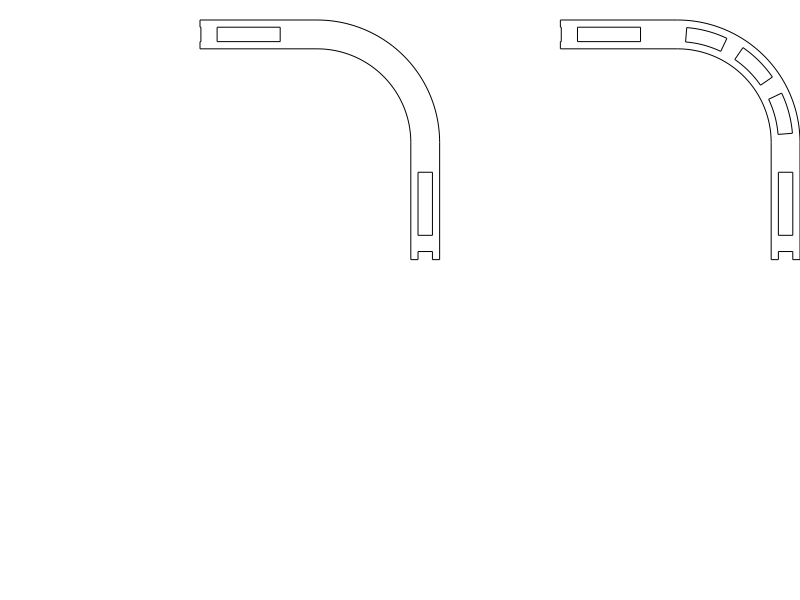

> **Detailed Agent & Engineering Log:** This file preserves the complete phase-by-phase engineering logs, slice diagnostics, and historical notes for `sunglasses_case_liner`. For the human overview of what works now and what to print next, see **[`../README.md`](../README.md)**.

# S16 damping liner for the printed sunglasses case

The **revised curved-corner liner** uses three air pockets around each rounded
bend, in addition to the straight-wall channels. Print
[sunglasses_case_liner.step](../sunglasses_case_liner.step), or its matching
[STL](../sunglasses_case_liner.stl). The plate contains **two identical TPU cups**,
one for each half of the already printed [accepted E case](../../sunglasses_case/notes/printing_and_design.md).
[Print entry](../sunglasses_case_liner.py) · [Parametric builder](../design.py).



## Current status and next step

**Printed and accepted — user report, 2026-10-17.** The liner fits inside
the sunglasses case and provides damping; the user reports that it works well
with no problems. See [print feedback](#full-liner-print-feedback--2026-10-17)
for the report and its limits.

The earlier corner correction adds air cores/ribs around all four bends while
preserving the installed envelope. See the
[corner investigation](#corner-coverage-investigation--2026-10-16) for the earlier
design issue and the checks supporting that correction.

A separate small ironing sample was printed: 50% ironing flow is preferred for
that setup, at **0.2 mm actual layer height** (user clarification, 2026-10-16).
All prior liner prints used 0.2 mm despite the old 0.1 mm instructions. This
sample does not qualify the full liner or prove a cause. See the
[shared layer-height correction](../../tpu_damping_box/README.md#actual-liner-layer-height-correction--2026-10-16)
for that report's scope and the
[sample report](#ironing-flow-print-feedback--2026-10-16) before transferring the
setting. The full-liner report now establishes application fit and damping;
[installation](#installation) and [print setup](#printing-and-manufacturing-review)
remain available for repeat prints.
No further geometry revision is requested by this record. The rigid E case
remains accepted and unchanged; [print status](#print-status) keeps the two scopes separate.

## Intent

User instructions, 2026-10-16: S16 and S12 were both printed and work; S16 is
preferred over S12/I22 and feels good compared with I30/original 4 mm I. Record
that preference and a reusable lesson, then adapt S16 to the already printed
sunglasses case, which the user confirms has enough interior room. The
[original physical report](../../tpu_damping_box/README.md#s16--s12-print-feedback--2026-10-16)
qualifies the sample profile, not this new accessory's fit or quietness.

The user then held off before printing after noticing the solid corners, asked
for investigation, and explicitly authorized updating the model and recording
that **future adaptations must check corners**. The current revision implements
that correction. The accepted rigid case and its source/exports are unchanged.

## Geometry and adaptation

Target cavity: **158 × 78 × 63 mm**, 7 mm inner corner radius. Each cup remains
**157.6 × 77.6 × 30.8 mm**, with a 6.8 mm outer corner radius and 0.2 mm nominal
allowance per side. The correction removes material only inside the corner cores;
it preserves the installed envelope, opening and shell clearances.

| Feature | Dimension |
| --- | --- |
| Shell-side backing / air core / contents-side skin | 0.4 / 0.8 / 0.4 mm |
| Total floor and wall sandwich | 1.6 mm |
| Straight ribs / pitch / nominal open channel | 0.9 / 4.4 / 3.5 mm |
| Corner pockets | Three curved vertical pockets per bend; 12 per cup |
| Corner ribs | Radial, minimum nominal 0.9 mm chord at the inner core radius |
| Corner sector pitch | 30°, about 3.14 mm along the core centreline |
| Solid top closure of wall channels | 0.4 mm |
| Rounded opening edges | 0.2 mm radius |

Floor ribs run along the short direction; first-skin bridges cross them.
Wall and corner ribs run vertically. Both skins remain continuous through the
rounded bends. The floor/wall junction, short pattern remainders, rib roots and
top cap remain solid locally. There is no claim of identical compliance at every
point or calibrated acoustic transfer from the S16 sample. No labels cut the
thin skins; the two inserts are interchangeable.

Each backing reserves **0.2 mm** for tape against the rigid panel. Each cup ends
**0.5 mm below the rigid mating rim**, leaving **1 mm between liner rims** when
closed. This narrow seam band remains unlined to avoid pinching. The remaining
rounded interior is nominally **154.4 × 74.4 × 59.4 mm**, including the tape
allowance. This is available geometry, not a measured glasses envelope.

## Rib-bounded bottom-panel sample — ironing comparison

Use the explicitly named [bottom_sample_18p5mm.step](../bottom_sample_18p5mm.step) ·
[matching STL](../bottom_sample_18p5mm.stl) · [source](../bottom_sample.py).
The [named export entry](../bottom_sample_18p5mm.py) uses the same authoritative crop;
the earlier `bottom_sample.step/.stl` names remain compatible aliases.
This is a **18.5 × 18.5 × 1.6 mm** crop from the centre of the actual liner bottom,
with the same **0.4 mm backing / 0.8 mm ribbed air core / 0.4 mm contact skin**.
It includes the full bottom-panel sandwich, rather than just the first print
layer. Backing faces the bed; the glasses-contact skin faces upward for ironing.
No labels, added edge frame, side walls or corner geometry change the test area.
The crop ends at the outside faces of two complete ribs, retaining four full
3.5 mm air pockets between them. This removes the previous 20 mm crop's 0.75 mm
unsupported outer lips on each bridge-end edge. The other pair of cut edges
exposes the channels for inspection; the top skin bridges between ribs there.
The user explicitly allows a slightly smaller sample to avoid the irrelevant
cantilever. Source checks require continuous rib support at both trimmed ends.

Print the **same file twice**, using the liner's [TPU print setup](#printing-and-manufacturing-review)
and supplied unrotated orientation. Keep material, plate, temperatures,
flow and other process settings the same. Use ironing **off** for one print
and ironing on the **top surface** for the other, using the ironing settings you
want to assess. Mark which is which after removal rather than changing the CAD
surface. The supplied reference smoke slice is the **ironing-off baseline**;
it does not select or qualify ironing temperature, flow, speed or spacing.
Ironing evaluates the upward contact face; the bed-facing underside's texture
is a separate observation.

After cooling, compare the central top area's visible lines, smoothness, ridges,
flatness and any nozzle drag. Check the exposed channel edges for sag/fusion and
whether the top skin remains intact. Prefer the finish you find better only if
it preserves the sandwich; a smoother but damaged/fused skin calls for adjusting
or omitting ironing before using it on the full liner. The reported flow
comparison below now prefers 50%. This coupon omits corners, walls, adhesion, glasses fit and
full-panel toolpath length/cooling; it qualifies a small flat surface comparison,
not complete-box damping or necessarily the full panel's finish.

[Native sample receipt](bottom_sample_final.json) covers source association,
paired exports and reference slicing. [Local path review](bottom_sample_paths.json)
checks the retained channels, substantial rib tracks and transverse first contact
skin. The sample deliberately keeps the cut edges sharp in CAD to preserve the
exact crop; it lies flat on its full backing, and its only short unsupported
features are the intended channel roofs bridging between complete ribs.

Historical **0.1 mm diagnostic** baseline review: valid CAD and paired STEP/STL
exports; OrcaSlicer **2.4.2**,
supplied TPU triplet, centred without rotation, **no keyword notices**, ironing
off. Estimated **0.48 g / 9 min 9 s** per sample, not measured. The local path
check passed **12 open-channel samples**, **9 interior rib sections** and
**6 outer-edge rib sections** with at least two substantial tracks, continuous
outer rib support, and the first contact-skin bridge direction. The automatic
probe proposes support in the shallow channels at **Z 0.8–1.0 mm**; primary
supports remain off, with the native `review_required` signal retained. These
short roofs reproduce the liner's supported 3.5 mm spans; the trimmed bridge-end
edges terminate on full ribs. Trapped support would defeat the air
channels. Surface-finish feedback is recorded below; printed sag and channel
integrity remain unmeasured. STL slicing does not
verify GUI STEP import. The full liner's existing geometry and exports are
unchanged by this added sample.

### Ironing-flow print feedback — 2026-10-16

**The sample has been printed. The user's preferred ironing flow is 50%.**
The user reports a starting/default ironing flow of 10% and tried 10%, 30%, 50%
and 100%. These percentages refer to **ironing flow**, not normal extrusion flow.

| Ironing flow | User observation | Decision for this sample/setup |
| --- | --- | --- |
| 10% | Gaps remain between surface lines after ironing | Not preferred. |
| 30% | Gaps remain between surface lines after ironing | Not preferred. |
| **50%** | Finish described as “perfect” | **Preferred tested value.** |
| 100% | Top surface bulges/bumps upward instead of remaining flat | Not preferred. |

Associated design: the supplied rib-bounded S16 bottom-panel sample at `de98e8f`,
nominally 18.5 × 18.5 × 1.6 mm. The user identified the ironing sample and flow
levels, not an exact printed filename/hash or measured dimensions. TPU is the
intended material; the user now confirms **0.2 mm layers for this and all liner
prints so far**. Actual spool/hardness, printer, nozzle, separate first-layer
override, ironing speed,
spacing, temperature, orientation and whether other settings were held identical
remain unreported. The supplied diagnostic profiles are not evidence of the
actual settings used. This is subjective physical surface-finish feedback, not
a measured roughness/flatness result or material calibration.

**Future S16 adaptation suggestion:** when ironing a comparable TPU contact skin
over S16 air pockets, use **50% ironing flow as the initial trial value**, then
check finish and channel/skin integrity in the adapted print. This records the
user's explicit reuse request; it does not change normal extrusion flow or make
50% a universal TPU setting.

**User hypothesis:** TPU combined with the skin bridging the air pockets may
explain why the higher ironing flow was needed. This comparison did not isolate
material from bridged-roof construction: no solid-backed or other-material
control was reported. The cause remains unconfirmed; the preferred finish at
50% remains the reported physical observation.

Record **50% as preferred for this reported sample/setup** and a starting reference
for a comparable follow-up. There is no reported ironing-off control result,
channel-integrity measurement, damping comparison or full-liner ironing report.
The small sample's successful finish does not automatically qualify the larger
panel, corners, or another filament/process. Existing CAD and reference slices
remain unchanged, including the ironing-off baseline.

### Reported STEP/STL mismatch

The user reported that the STEP still looked unchanged while the STL looked
correct. A targeted [file inspection](sample_export_inspection.json),
[reproducible checker](../inspect_sample_exports.py), re-imported the actual STEP:
**18.5 × 18.5 × 1.6 mm**, with zero symmetric material difference from the current
CAD. The delivered STL has matching dimensions within float32 representation;
the preceding STEP at `14ecd3c` was **20 × 20 × 1.6 mm**. This exceptional STEP
re-import/mesh-coordinate check addresses the specific reported mismatch and
is not a new routine audit. The inspected local files were synchronized; which
file/state the user's viewer displayed remains unknown.

To distinguish the revision clearly, the same geometry is republished under the
`bottom_sample_18p5mm` name. [Native export receipt](bottom_sample_18p5mm_export.json)
owns that publication. The matching STL bytes are checked against the previously
sliced current sample, so the existing reference slice is reused without another
slice. No geometry or process settings changed to address this report.

## Installation

1. Print the supplied layout, backing down and openings up. Remove strings and
   clean the contact faces before placing glasses inside.
2. Dry-fit each cup in an open half. It should seat without buckling and stay
   below the rigid rim.
3. Use small strips of **thin removable double-sided tape, at most 0.2 mm total
   installed thickness**, under the flat backing, particularly for the lid cup.
   Start near the perimeter; avoid thick foam tape and adhesive in the channels.
   Select tape compatible with the actual TPU/shell; adhesion is untested.
   The design does not rely on an unqualified friction fit.
4. Close the empty box gently and check the latch. Then check the actual glasses
   for clearance and compare contact noise. Check that the lid insert stays in
   place after repeated opening. No case reprint or new fasteners are needed.

## Printing and manufacturing review

Use TPU (Generic 95A is the reference assumption), **0.4 mm nozzle, 0.20 mm layers
including first layer, Arachne, two requested walls**, 100% material fill.
The channels are CAD voids. Reuse the S16 reference
[process](../../tpu_damping_box/profiles/tpu-closed-process.json),
[filament](../../tpu_damping_box/profiles/tpu95a.json) and
[Q2C printer](../../../.codex/skills/orca-slicer-printability/profiles/qidi-q2c-petg/qidi-q2c-0.4-nozzle.json).
The successful sample's layer height is user-confirmed as **0.2 mm**; other actual
settings and TPU brand/hardness remain unreported. These profiles are diagnostic
references, not a recovered full profile or calibration. The retained 0.1 mm
receipts below are historical diagnostic evidence and do not establish current
0.2 mm full-liner toolpaths. The successful full-liner print is reported below;
its complete actual profile has not been recovered.

Keep **supports off**, both thick bridge options **off**, bridge directions
**180°**, and the supplied unrotated layout. Each 0.4 mm vertical skin is
intentionally one bead; the ribs need multiple substantial paths. Horizontal
skins have two 0.2 mm layers. The floor roofs span at most 3.5 mm between ribs;
wall and curved-corner cap regions bridge the narrow 0.8 mm core with support
from adjacent ribs/skins. Trapped support would be inaccessible. The primary
unsupported slice and automatic probe are reviewed separately; physical sag,
spreading and channel survival remain unknown.

The **157.6 × 161.2 × 30.8 mm** layout, including 6 mm between cups, fits the Q2C
270 × 270 × 256 mm envelope. Broad uninterrupted bottom skins give bed contact
and flat tape backing. Rounded opening edges and corners retain the accepted
outline. Vertical ribs grow from the existing floor/wall junction; the corner
change introduces no detached wall starts.

## Verification

[Product verification](../verification.py) uses the shared CLI with explicit
`s16-retrofit` selection. [Current receipt](verification.json) distinguishes
CAD coverage from actual fit, adhesion, glasses clearance and subjective
quietness. Fit and damping now have positive user feedback (2026-10-17);
the retained automated reports still describe their original scope.
[Checks](../checks.py) cover profile, connected cup, residual cavity, installation,
closed fit, sampled opening and the new corner obligation. The original solid
corners must fail the same coverage checker; a shifted insert must fail the
shell collision criterion. Hinge travel is sampled every 10° and insertion at
0, 0.5, 5, 20 and 35 mm above seating; these are sampled rigid checks.

Corner CAD witnesses check air at 15°, 45° and 75° at three heights in each bend
(**36 air and 72 skin locations**), plus **24 radial-rib locations**. The retained
solid-corner baseline is a negative control. [Corner comparison](../corner_study.py)
now uses these same production builders; [native view receipt](corner_view.json).
No duplicated experimental corner builder selects the printable geometry.

[Retained export and 0.1 mm diagnostic receipt](final_review.json) owns its source association,
paired exports, tool identities, profile selection, placement and slice status.
[Path receipt](path_review.json), [floor/support preview](../renders/path_review.png)
and [corner paths](../renders/corner_paths.png) cover straight and radial sections,
multiple rib tracks, first corner caps, floor bridges and bridge extrusion height.
These are slicer metadata, not measured deposited polymer. STL slicing does not
verify Orca GUI STEP import or physical damping.

Current CAD checks: profile, corner coverage (including the solid-corner negative
control), nominal fit and sampled motion all **PASS**. User feedback now confirms
fit and damping in use; quantitative acoustic performance remains unmeasured.
The retained native evaluator reports valid geometry and
successful matching STEP/STL exports. OrcaSlicer **2.4.2**, supplied TPU triplet,
centred compound without rotation, **0.1 mm diagnostic layers**: slice completed
with **no keyword notices**.
Diagnostic batch estimate: **63.95 g / 28 h 10 min 4 s**, not measured.

The revised slice retains **72 corner air-gap sections**, minimum **0.782 mm**,
**48 corner rib sections** with at least two substantial tracks, and **24 first
corner-cap sections** at Z 30.5 mm. Existing straight-region checks also pass:
18 floor-channel samples, 48 wall-gap sections (minimum 0.799 mm) and 30 rib
sections with at least two tracks. Bridge extrusion height is 0.10 mm. The
reviewed corner preview shows the separate curved skins, radial rib joins and
cap coverage. These local witnesses do not guarantee deposited gap survival.

The automatic probe still proposes trapped support interfaces only in the floor
channels at **Z 0.8–1.0 mm**, with none proposed at the new corner caps. The
primary slice keeps supports **off**: floor bridges cross the 3.5 mm inter-rib
gaps, and the new cap paths close the narrow curved core. The native
`review_required` signal is retained with this reviewed rationale, rather than
being relabeled as unconditional print qualification. Actual bridging needs a
print report.

Reproduce the **historical 0.1 mm diagnostic** from the repository root. The
path reader below targets that old setup; future printing uses the current
0.2 mm process linked above, with fresh setup-specific evidence when needed.
The historical reader now accepts compact Orca extrusion tokens (`E.89832`) as
well as leading-zero values and reports missing samples separately from an
excessive bridge height. Its 0.1 mm criterion still belongs to the old setup.

```sh
./execute.py --threads 1 model/sunglasses_case_liner/verification.py --variant s16-retrofit
./evaluate_model.py model/sunglasses_case_liner/sunglasses_case_liner.py --views none --slice --slice-keep-run --slice-printer .codex/skills/orca-slicer-printability/profiles/qidi-q2c-petg/qidi-q2c-0.4-nozzle.json --slice-process model/tpu_damping_box/profiles/tpu-closed-0p1-historical-process.json --slice-filament model/tpu_damping_box/profiles/tpu95a.json --report model/sunglasses_case_liner/notes/final_review.json
./execute.py model/sunglasses_case_liner/review_paths.py
```

## Corner coverage investigation — 2026-10-16

The first liner (`60784df`) had hollow straight walls but solid rounded bends.
The user's preprint concern led to the curved-core study (`ab43b48`). The
[original corner FAIL](corner_coverage_solid.json) and
[initial CAD study](corner_study.json) are retained as historical evidence;
that study's `production_files_changed=false` describes the exploration phase.
The user then authorized incorporating the curved core into the printable model.
The previous successful straight-wall slice did not qualify corner coverage.

Solid corners remove air-core deflection space at diagonal contacts. This does
not establish zero damping in solid TPU or quantify acoustic improvement. Future
S16 transfers must check all distinct contact regions, particularly curved
corners, in both CAD and sliced paths. Sample approval alone cannot qualify a
larger liner's complete coverage. This lesson is recorded in
[print planning](../../../.codex/skills/cadquery-3d-design/references/print-planning.md#functional-process-co-design)
and the [reusable evidence index](../../../.codex/skills/cadquery-3d-design/references/reusable-model-lessons.md).

## Full-liner print feedback — 2026-10-17

The user reports having printed the sunglasses-box liner: it fits inside, works
well and provides damping, with no problems reported. Accept the existing liner
for the reported fit and damping; no geometry or process change is requested.
The exact printed artifact/revision, material, orientation and printer/profile
were not identified. Current deliverables are the revised curved-corner cups.
Earlier 0.2 mm layer-height and ironing feedback remain separately scoped to
those reports. This observation does not measure damping quantitatively or
establish long-term wear, tape adhesion or internal channel condition.

**Comparison clarification, 2026-10-19:** the user says this liner did not have
the local inner/outer wall breakage now seen on the old slim dental liner. They
recall 80 mm/s for the earlier successful liner, apparently this one; the exact
speed field and actual attained wall speeds are unverified. This supplements
the successful report without identifying the full process or printed revision.
See the [dental comparison](../../dental_travel_case_liner/README.md#wall-print-feedback--2026-10-19)
for shared skin/core dimensions, different wall heights and why 80 mm/s cannot
be compared directly with a 9 mm³/s filament limit. No change to this accepted
liner is requested.

## Print status

| Item | Print status | Artifact(s) | User result or remaining physical checks |
| --- | --- | --- | --- |
| Test piece(s) | Yes — ironing sample, reported 2026-10-16 | Associated `bottom_sample_18p5mm.step/.stl`; 0.2 mm layers confirmed; exact printed file/other settings unknown | 10%/30% ironing flow leave line gaps; 50% described as perfect and preferred; 100% produces raised/bumpy top. No ironing-off control or full-liner finish result reported. Original S16 damping approval remains scoped to its fixture. |
| Final printable object(s) | Yes — reported 2026-10-17; comparison 2026-10-19 | Current deliverables: revised `sunglasses_case_liner.step/.stl`; exact printed file/revision unknown | Successful fit and damping; user says dental-style wall breakage was absent. Recalled earlier 80 mm/s setting, exact role/actual speeds unverified. Actual material, orientation and full profile unknown; tape adhesion, internal channel condition and long-term wear not separately assessed. |

## Attribution

Primary language model: GPT-6-based Codex; exact model variant and reasoning effort
not exposed. Harness: Codex shared-workspace API agent. Provider: OpenAI. No
subagents. Uses the existing accepted E case and user-approved S16 profile;
their historical attribution remains in their respective records.
