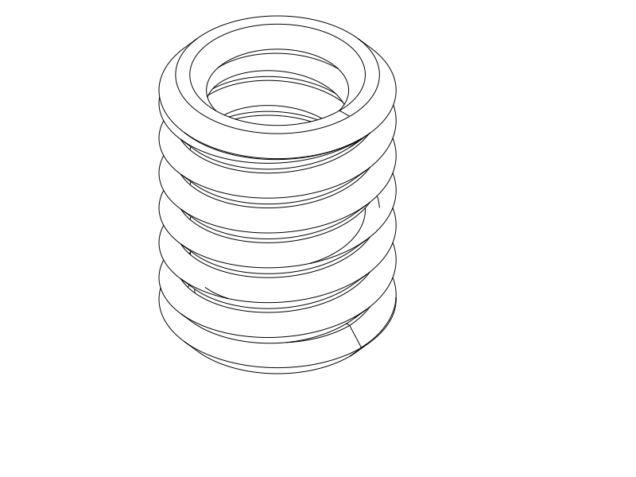

# TPU coil cord — first print experiment

A short, tightly packed **3D helical spring** with closed hook rings across both ends. This is one sample to establish printing, turn separation and spring recovery before comparing thicknesses.

Print the [STEP](tpu_coil_cord.step) or matching [STL](tpu_coil_cord.stl), upright as supplied. The [parametric source](tpu_coil_cord.py) owns the geometry. This is an experimental print, awaiting physical feedback.

| Setting | First trial |
| --- | --- |
| Printer / nozzle | Qidi Q2C / 0.4 mm |
| Material | TPU 95A; actual spool brand unknown |
| Layers | 0.20 mm |
| Walls / fill | 3 walls / 100% material fill, Classic |
| Speed | 25 mm/s nominal walls/fill; 15 mm/s first layer/bridges |
| Orientation | Spring axis vertical; bottom ring on bed |
| Supports / brim / ironing | Off / off / off |

## Shape and use

The coil is 20 mm outside diameter, with a 12 mm central bore and a nominal
24.8 mm total height. Its six helical turns use a 4.0 mm radial × 3.2 mm axial
faceted section, 3.6 mm pitch and 0.4 mm nominal axial clearance. Chamfered
undersides reduce abrupt ledges; 1.2 mm flat lands provide bed contact and
broader printing paths than a sharp diamond tip. These facets are intentional
print geometry, rather than cosmetic sharp edges on a round cord.

Both attachment eyes are full annular end rings. They intentionally merge into
the terminal portions of the helix; do not try to peel those joints apart. The
middle turns should separate. Attach metal hooks through the end rings, bearing
on the rings themselves rather than catching an intermediate turn.

The section is deliberately substantial and printed solid to prioritize recoil.
TPU recovery, creep and useful extension are unknown. Tight packing increases
stored cord length, but does not establish safe stretching travel or spring force.

## First print and decision

Let the print cool, remove it, and work around the middle turns gently by hand.
Small stringing or light tack may need peeling apart. If turns are welded so
firmly that freeing them tears the cord, stop: that is a failed print experiment,
not a reason to force it or cut deeply into the spring. Keep the end-ring joints
intact.

Start with a small extension through the end rings, release, and gradually
increase only if it returns without damage. Report whether the gaps open, where
it sags or tears, how much extension feels useful, and whether it retracts
promptly or remains elongated. A ruler photo before stretching and after release
would make permanent set visible. No target load or maximum travel is qualified.

If printing and hand release work, retain this as the control for the later
thickness comparison. If they fail, revise gap/process or end-ring support first.
If recoil is weak, the later comparison must address stiffness and recovery;
printability alone cannot accept that behavior. This small complete specimen
preserves both end junctions and real upright layer direction at little material
cost; it omits any longer cord or attached payload.

## Evidence and print status

CAD validity and matched STEP/STL export passed with CadQuery 2.8.0. OrcaSlicer
2.4.2 accepted the centered upright STL with the supplied Q2C/TPU setup and no
reported notices; its automatic-support probe generated no support. The effective
settings were 0.2 mm layers, three walls, 100% rectilinear fill, 0.42/0.45 mm
outer/inner widths, TPU 230 °C and bed 35 °C. Temperatures are profile values,
not spool calibration. The 20 × 20 × 24.8 mm planned envelope fits the selected
270 × 270 × 256 mm machine. The annular bottom land supplies stable bed contact.
Layer bonding through the upright spring and end transitions remains a physical
risk under pulling/twisting.

The narrow inter-turn clearances and tapered end-ring undersides remain sag/fusion
risks despite support-free path generation. Do not add trapped supports between
the turns for this trial. Slicing does not establish hand release, retraction,
fatigue, safe load/travel, or Orca's separate GUI STEP import.

Final CAD/slice evidence is recorded in [the native review](notes/cad_slice_review.json).
All 18 sampled middle-turn material/gap witness pairs passed, and both eye-center
witnesses were empty. The [actual extrusion layers](notes/actual_layers.png) at
0.2, 5.4 and 22.0 mm were opened and reviewed: closed first-layer ring, middle
helical section and top-ring approach remain present. No Bridge-labelled
extrusion occurs in the primary G-code; overhang paths do occur. This is a
selected-layer review, not proof that TPU will resist sagging. The
[targeted results](notes/targeted_checks.json) retain that scope.

Development decisions and inspection details are in [the development record](notes/development_record.md).

| Item | Print status | Artifact(s) | User result or remaining physical checks |
| --- | --- | --- | --- |
| Test piece(s) | Unknown | `tpu_coil_cord.step`, `tpu_coil_cord.stl` | Print quality, release, hook access, recoil and permanent set untested |
| Final printable object(s) | N/A | None | Samples-only phase |

## Attribution and reproduction

Primary model: **GPT 6.1**, reasoning **F4 Medium**, as explicitly supplied by
the user. Agent environment: Codex CLI; provider: OpenAI. Runtime model identity
and effort are not independently exposed. No other material contributors.

The [process profile](profiles/coil-solid-process.json) derives from the existing
[TPU solid profile](../tpu_damping_box/profiles/tpu-solid-process.json). Its Orca
upstream attribution and AGPL-3.0 licence are retained through
[profile attribution](profiles/ATTRIBUTION.md); CAD and notes use the repository's
normal licence. This first trial uses the existing shared Q2C printer and TPU
filament profiles, not a recovered profile from the user's printer.
