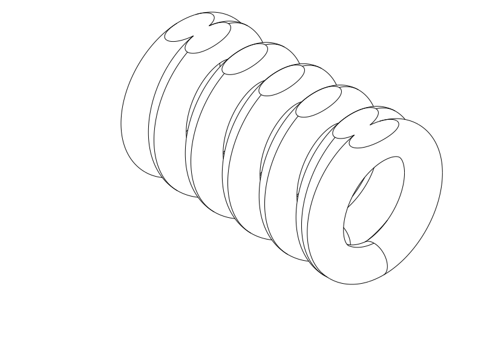

# TPU coil cord — R6 short circular print experiment

**Next print: R6**, a **25.2 mm-long** circular coil with round cord and two
shallow opposite flats for bed contact. The bore and winding are circular;
there are no octagonal corners. R5 remains the accepted printed control.

Print [R6 STEP](coil_r6_round_flats.step) or [STL](coil_r6_round_flats.stl),
flat-down in the supplied horizontal orientation.
[Parametric Python source](coil_r6_round_flats.py) owns the geometry.
This is one short TPU experiment; the approximately 70 mm version remains deferred.
Do not repeat R3/R4 unchanged; their smaller gaps printed stuck together.

| Item | R6 trial |
| --- | --- |
| Relaxed length / circuits | 25.2 mm / five full winding circuits |
| Round envelope / print height | 15 mm diameter / 14 mm after opposite flats |
| Nominal round bore | 8.6 mm diameter |
| Round cord / gap / pitch | 3.2 mm diameter / 1.2 mm axial gap / 4.4 mm pitch |
| Flat trimming | 0.5 mm off each of the outer top and bottom caps |
| Material / nozzle / layers | TPU / 0.4 mm / 0.20 mm |
| Walls / fill | Classic, 3 walls + 100% fill, or the previous high-wall solid approach |
| Supports / brim / ironing | Off / off / off for this experiment |
| Placement | Horizontal axis X, flat on bed, as supplied |
| Bridge direction | Automatic; [existing horizontal TPU profile](profiles/r2-horizontal-process.json) |

[End view: circular bore and two shallow exterior flats](renders/print/coil_r6_round_flats_right.png)

## Shape and test

R6 replaces R5's polygonal winding and faceted cord with smooth circular curves.
Only the two contact planes interrupt the round exterior. Their boundary edges
remain; a completely circular exterior cannot also have a finite flat footprint.
The opposed flats preserve two mirror axes in the transverse envelope. Integral
closed terminal turns stay within the coil envelope for hooks.

The short length, nominal cord thickness and turn spacing match R5. Round cord
has a different section area, and the bore/mean radius are slightly larger, so
this is a printability and shape trial rather than a controlled stiffness test.
No stronger spring return is promised.

Print without supports to test whether the flats and circular overhangs work
well enough together. A brim could join neighboring feet, and supports inside
the bore/gaps would complicate cleanup. Let the sample cool, then inspect:

- Whether the flat feet stayed attached throughout printing.
- Whether the middle coils remain separate without tearing them apart.
- Whether the curved inner roof has sagging or strings, compared with R5.
- Only then, whether gentle extension and recovery feel useful.

Keep the intentional terminal joins intact. The circular roof is the main
remaining printing uncertainty; the flats address adhesion geometry rather than
making the roof self-supporting.

## Evidence and print status

The [native CAD/export/slice report](notes/r6_cad_slice_review.json) records valid
CadQuery 2.8.0 geometry, paired STEP/STL in the supplied placement and a completed
OrcaSlicer 2.4.2 slice with supports off and no reported notices. The centered Q2C
layout was accepted with the supplied 0.4 mm / 0.2 mm solid TPU profiles.
Reference temperatures are 230 °C nozzle / 35 °C bed; use spool-appropriate values.

[Local checks](notes/r6_targeted_checks.json) passed 36 winding/gap/bore witness
sets and open terminal centers. Four sampled middle feet each have **10.01 mm²**
planar contact; total contact is **60.77 mm²**. Local adjacent-turn clearance is
**1.192 mm**. These are geometric results, not adhesion or tolerance calibration.

The model views and [actual path plot](notes/r6_actual_paths.png) were opened and
reviewed. Separate bed footprints and middle turns are retained. Blue is ordinary
TPU extrusion, orange is bridge/probe support, gray is prior-layer roof material.
The automatic-support probe proposes support inside the curved roof through
Z12.2 mm. This flag remains accepted for an experimental supports-off print.
All 101 checked bridge midpoints lie in current-layer CAD material; this bounded
screen does not verify complete bead widths or every path.

No R6 physical report exists yet. Reference slicing does not establish Cura
behavior, GUI STEP import, adhesion, clean separation, roof quality, force,
maximum extension or fatigue life. Exact spool and user print settings remain
unknown. R5's reported acceptance does not qualify R6's changed overhangs.

| Item | Print status | Artifact(s) | Result or remaining checks |
| --- | --- | --- | --- |
| R1 sample | Yes | `tpu_coil_cord.step`, `tpu_coil_cord.stl` | Works reasonably well; rough separation and weak recoil; preferred earlier control |
| R2 sample | Yes | `coil_r2_horizontal.step`, `coil_r2_horizontal.stl` | Thickness, projecting frames and house-shaped outline rejected |
| R3 sample | Partial | `coil_r3_round.step`, `coil_r3_round.stl` | Canceled after turns merged and print lifted |
| R4 sample | Yes | `coil_r4_four_flats.step`, `coil_r4_four_flats.stl` | Idea can work, but sticking and form/overhang issues remained; adhesion/recoil not explicitly reported |
| R5 short sample | Yes | `coil_r5_octagonal.step`, `coil_r5_octagonal.stl` | User reports printed R5 is okay; no measured force, recovery or durability result |
| R6 short sample | Unknown | `coil_r6_round_flats.step`, `coil_r6_round_flats.stl` | CAD/reference slice reviewed; flat adhesion, curved roofs and separation await printing |
| Final 70 mm object | N/A | None in this phase | Future work deferred |

[Current R6 decisions](notes/r6_decisions.md) ·
[Development record](notes/development_record.md) · historical
[R1](notes/r1_baseline.md), [R2](notes/r2_baseline.md), [R3](notes/r3_baseline.md),
[R4](notes/r4_baseline.md), [accepted R5](notes/r5_baseline.md).
Earlier sources, exports and native evidence remain unchanged.

## Attribution and reproduction

Primary model: **GPT 6.1**, reasoning **F4 Medium**, explicitly supplied by the
user; runtime identity/effort are not independently exposed. Codex CLI, OpenAI.
Historical attribution is preserved. No other material contributors.

R6 reuses the Q2C printer, solid TPU automatic-bridge process and TPU 95A
reference filament profiles. Exact identities are in the native report.
[Profile attribution and AGPL-3.0 licensing](profiles/ATTRIBUTION.md) remain;
CAD and notes use the repository's normal licence. Evaluate from the repository
root with `./evaluate_model.py model/tpu_coil_cord/coil_r6_round_flats.py`.
