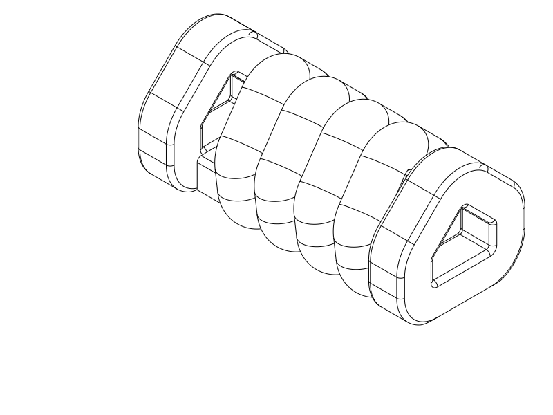

# TPU coil cord — stronger horizontal R2 trial

A compact **3D winding with a rounded house-shaped outline**, thicker cord and
sideways gaps, aimed at stronger pullback and cleaner separation. The first
upright coil has been printed and works reasonably well; its turn-release
surfaces are rough and its recoil is weaker than wanted.

**Next print: R2**, [STEP](coil_r2_horizontal.step) ·
[STL](coil_r2_horizontal.stl) · [parametric source](coil_r2_horizontal.py).
Keep it horizontal as supplied, with its flat feet on the bed. This is one new
experimental sample. Retain your printed R1 for comparison; there is no need to
reprint it.

| Setting | R2 trial |
| --- | --- |
| Printer / nozzle | Qidi Q2C / 0.4 mm |
| Material / layers | Same TPU as R1 if available / 0.20 mm |
| Walls / fill | Classic; solid: 3 walls + 100% fill, or R1's very high wall count |
| Speeds | 25 mm/s nominal walls/fill; 15 mm/s first layer/bridges |
| Supports / brim / ironing | Off / off / off |
| Bridge direction | Automatic; use the R2 profile |
| Placement | Horizontal spring axis along X; supplied feet down |

## What changed and why

R2 replaces the 4.0 × 3.2 mm faceted cord with **5.2 mm round cord**, and six
circuits with **four**. Those changes aim for a substantial stiffness increase.
The untrimmed cord has about 2.55 times R1's cross-sectional area. R1 was already
printed practically solid, so more infill is not the solution.
R2 gives up some stored cord length and extension capacity to gain pull force.
It remains compact: nominally 40.2 mm long, 19.2 mm wide and 17.4 mm high,
with a low peaked roof.

The **0.8 mm turn gaps run sideways**, avoiding the broad stacked faces that
needed peeling apart on R1. Each circuit starts on its own flat foot. Sloping
roof sections and rounded corners address the overhang at the top of a normal
circular coil laid on its side. Closed frames at both ends retain hook openings.
Short solid foot tabs connect the outboard frames to the winding; these terminal
connections stay intact.

I compared a thicker upright helix, a circular sideways helix and this horizontal
rounded-house winding before selecting it. See the [concept drawing](renders/concepts/r2_architecture_screen.svg)
and [reasoning, research and experiment plan](notes/r2_decisions.md).

## How to compare the print

After cooling, check whether the middle turns are already free, with only light
string cleanup. Avoid peeling the intentional end-frame joints. If the turns
are welded or the roof has collapsed, stop and report that before stretching.

Pull gently through both end frames, then compare R1 and R2 using the **same
extra end-to-end extension** and similar pull/release speed. Start small and
increase only if the cord recovers undamaged. Compare pull force, return speed,
surface cleanliness and the length left after release separately. A stronger
pull that still returns slowly is useful feedback: stiffness and TPU recovery
are different questions. No load or maximum extension is qualified.

## Evidence, limits and print status

The [final CAD/export/slice report](notes/r2_cad_slice_review.json) records valid
CadQuery 2.8.0 geometry, matched STEP/STL placement and a completed OrcaSlicer
2.4.2 support-free TPU slice with no reported notices. It covers the supplied
Q2C profile, centered placement, 0.2 mm layers, three walls and 100% rectilinear
fill. Reference temperatures are 230 °C nozzle / 35 °C bed; they are not spool
calibration. The layout fits the profile's 270 × 270 × 256 mm build space.

The [targeted checks](notes/r2_targeted_checks.json) passed 20 middle-turn
material/gap witness pairs and both eye bores. Three isolated native gap
measurements were 0.7438–0.7442 mm, above the chosen 0.6 mm geometric screen.
The [actual path review](notes/r2_actual_paths.png) shows all circuit feet on
the first layer and bridges across the end-frame roof openings. The automatic
probe still proposes low supports at Z0.2–0.6 mm around foot flanks; no supports
are proposed higher in the spring. That review signal is retained in the native
report. This trial deliberately uses **supports off**: the enlarged flat feet
and short growing overhangs are the selected approach, and some bottom-edge
roughness/sag remains possible. Do not fill the turn gaps with support.

The final model and path images were opened and reviewed. Pulling still loads
curved, layered TPU and the foot-to-frame transitions; the digital evidence does
not establish their printed strength.

The prior R1 passed CAD and TPU smoke slicing; the user's physical print adds
"works reasonably well", rough turn separation and weak recoil. It used an
effectively unlimited wall count, giving practically solid material. Other actual
settings, exact printed file hash, force and recovery measurements are unknown.

TPU hysteresis and recovery remain material-dependent. R2 has no assembly
preload, and cannot promise metal-spring snap-back or finite tension at rest.
Printed bonding, turn release, force, safe extension, fatigue and creep remain
physical questions. A headless STL slice does not test Orca's GUI STEP import.

| Item | Print status | Artifact(s) | User result or remaining physical checks |
| --- | --- | --- | --- |
| Test piece R1 | Yes | `tpu_coil_cord.step`, `tpu_coil_cord.stl` | Works reasonably well; rough separation, weak recoil; practically solid via high wall count |
| Test piece R2 | Unknown | `coil_r2_horizontal.step`, `coil_r2_horizontal.stl` | Cleaner release, stronger pull force and recovery need the next print |
| Final printable object(s) | N/A | None | Experimental samples only |

The [R1 record](notes/r1_baseline.md) preserves its
[source](tpu_coil_cord.py), [STEP](tpu_coil_cord.step), [STL](tpu_coil_cord.stl),
original settings and scoped evidence. The [development record](notes/development_record.md)
preserves implementation history.

## Attribution and reproduction

Primary model: **GPT 6.1**, reasoning **F4 Medium**, as explicitly supplied by
the user; runtime identity/effort are not independently exposed. Environment:
Codex CLI, provider OpenAI. Historical R1 attribution is preserved. No other
material contributors.

R2 uses its [horizontal process profile](profiles/r2-horizontal-process.json),
with automatic bridge direction; R1 retains the original
[solid TPU process](profiles/coil-solid-process.json). Both use the shared Q2C
printer profile and TPU 95A filament profile. Profile attribution and
AGPL-3.0 licensing are in [profile attribution](profiles/ATTRIBUTION.md); CAD,
drawings and notes retain the repository's normal licence. Actual profile paths
and settings are recorded in each native evaluator report. These reference
profiles are not the recovered settings from R1's physical print.
