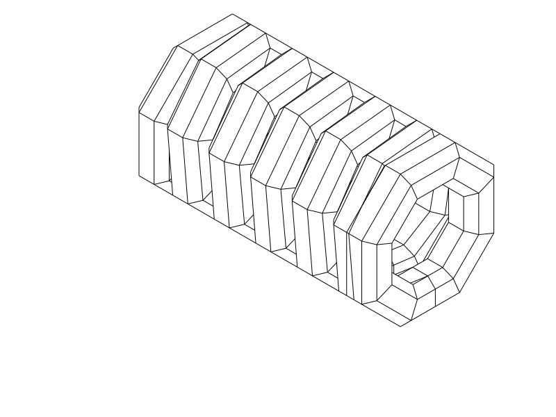

# TPU coil cord — R5 short octagonal print sample

**R5 printed and accepted as okay by the user. Further cord development is deferred.**

The accepted **25.2 mm-long** sample has matching octagonal inner and
outer outlines, a faceted cord section and **1.2 mm nominal turn gaps**. This
replaces R4's outer-only flats and 0.4 mm spacing, which still printed stuck
together. The latest report is that R5 is okay. It supplies a useful printed baseline;
no measured force, durability or maximum-extension result was supplied.

Print [R5 STEP](coil_r5_octagonal.step) or [STL](coil_r5_octagonal.stl), flat-down
as supplied. [Python source](coil_r5_octagonal.py) owns the geometry. This phase
contains **one short sample**. The approximately 70 mm version remains a future
target; the user explicitly defers returning to the cord while exploring a
separate connector.
Do not repeat R3 or R4 unchanged for this test.

| Item | R5 trial |
| --- | --- |
| Compressed length / turns | 25.2 mm / five full winding circuits |
| Outer octagon | 14 mm across flats, approximately 15.2 mm across corners |
| Inner octagon | 7.6 mm across flats |
| Cord section | 3.2 × 3.2 mm chamfered-square octagon, 0.8 mm corner chamfers |
| Axial gap / pitch | 1.2 / 4.4 mm |
| Flat cord lands | 1.6 mm; corners are mitered to retain parallel wall facets |
| Material / nozzle / layers | Same TPU if available / 0.4 mm / 0.20 mm |
| Walls / fill | Classic; solid: 3 walls + 100% fill, or the high-wall-count approach |
| Supports / brim / ironing | Off / off / off for this experiment |
| Bridge direction | Automatic; [existing horizontal TPU profile](profiles/r2-horizontal-process.json) |
| Placement | Horizontal axis X, broad bottom facet on bed, as supplied |

[End view: matching inner and outer octagons](renders/print/coil_r5_octagonal_right.png)

## Shape and test

Both walls follow an eight-sided outline. The winding has flat bottom, top and
side sections, joined by 45-degree shoulders. The cord itself also has eight
faces, with flat lands and 45-degree chamfers. This replaces the round bore,
round cord and isolated external clipping patches of the previous geometry.
The outer and inner outlines have matching symmetry, including perpendicular
and diagonal axes; the continuous 3D winding still advances along its axis.
Closed terminal turns remain within the winding envelope for metal hooks.

Eight sides were selected over sixteen to keep substantial flats and 45-degree
shoulders. Sixteen would introduce shallower faces near the bore ceiling. A
short flat roof still needs bridging; faceting is a print experiment, not a
promise of support-free TPU bridge quality.

The 1.2 mm gap is **three times R4's nominal spacing**. The 3.2 mm cord at 4.4 mm
pitch keeps the winding reasonably packed while allowing a meaningful clearance
change after repeated sticking. This is not a calibrated minimum TPU gap.

Let the part cool, then check whether the middle turns are already separate,
where any strings or sag occur, and whether the base stayed attached. Keep the
intentional terminal-loop joins intact. Only after freeing it gently should you
compare feel and recovery. Do not force apart a joint that tears the cord.
No safe load, maximum extension or fatigue life is qualified. Actual Cura setup,
spool and the cause of previous fusion remain unknown.

## Evidence and print status

The [native CAD/export/slice report](notes/r5_cad_slice_review.json) records valid
CadQuery 2.8.0 geometry, matching horizontal STEP/STL exports and a completed
OrcaSlicer 2.4.2 TPU slice with supports off and no reported notices. The supplied
Q2C profile accepted the centered layout. It used 0.4 mm nozzle, 0.2 mm layers,
three walls and solid rectilinear material. Reference temperatures 230 °C nozzle
and 35 °C bed are not spool calibration or recovered physical-print settings.

[Targeted checks](notes/r5_targeted_checks.json) confirm flat inner and outer
walls in all eight directions, 24 material/gap witnesses, open terminal bores
and connected end-to-middle material. Native local turn clearance is **1.190 mm**,
above the 1.0 mm geometric screen. Four sampled middle feet each have **9.28 mm²**
planar bed contact; total contact for the short sample is **56.47 mm²**. These
are CAD contact and clearance results, not measured adhesion or print tolerance.

The model views and [actual path plot](notes/r5_actual_paths.png) were opened.
The plot covers the bed, middle side walls, support probe and roof. Blue is
ordinary TPU extrusion, orange is bridge/probe support, and gray is the prior
roof layer. The support probe still proposes support/interface under the roof
through Z11.2 mm. The selected sample keeps supports off to avoid TPU support
removal between turns; roof sag remains a physical question. A bounded check
found all 105 bridge-path midpoints inside current-layer CAD material, rather
than sampled deposits in the coil gaps; it does not check complete bead widths
or every deposition path. Slicing is reference Orca evidence, not Cura or GUI
STEP-import qualification.

| Item | Print status | Artifact(s) | Result or remaining checks |
| --- | --- | --- | --- |
| R1 sample | Yes | `tpu_coil_cord.step`, `tpu_coil_cord.stl` | Works reasonably well; rough separation and weak recoil; preferred earlier control |
| R2 sample | Yes | `coil_r2_horizontal.step`, `coil_r2_horizontal.stl` | Thickness, projecting frames and house-shaped outline rejected |
| R3 sample | Partial | `coil_r3_round.step`, `coil_r3_round.stl` | Canceled after turns merged and print lifted |
| R4 sample | Yes | `coil_r4_four_flats.step`, `coil_r4_four_flats.stl` | User: idea can work, but turns still stick and inner/outer form and overhangs need revision; adhesion/recoil not explicitly reported |
| R5 short sample | Yes | `coil_r5_octagonal.step`, `coil_r5_octagonal.stl` | User reports printed R5 is okay. No detailed separation/adhesion, force, recovery or durability measurements provided. |
| Final 70 mm object | N/A | None in this phase | Future work deferred by the user |

[Current decisions and construction evidence](notes/r5_decisions.md) ·
[Development record](notes/development_record.md) · historical
[R1](notes/r1_baseline.md), [R2](notes/r2_baseline.md), [R3](notes/r3_baseline.md),
[R4](notes/r4_baseline.md). Earlier sources, exports and native evidence remain
unchanged and retain their physical limits.

## Attribution and reproduction

Primary model: **GPT 6.1**, reasoning **F4 Medium**, explicitly supplied by the
user; runtime identity/effort are not independently exposed. Codex CLI, OpenAI.
Historical attribution is preserved. No other material contributors.

R5 reuses the Q2C printer, solid TPU automatic-bridge process and TPU 95A
reference filament profiles. Their exact identities are in the native report.
[Profile attribution and AGPL-3.0 licensing](profiles/ATTRIBUTION.md) remain;
CAD and notes use the repository's normal licence.
