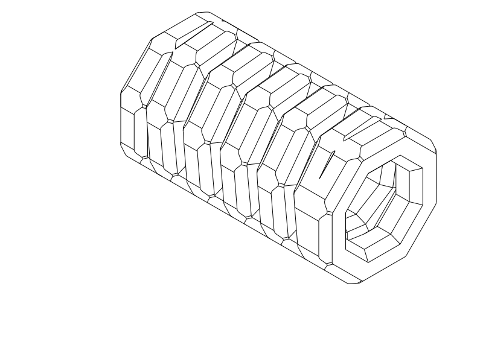

# TPU coil cord — R9 recessed octagon corners

**R9 printed successfully.** The user reports it works okay, with no particular
problem, and that the edges feel less obvious when extended. Eight shallow
negative scallops bite into the winding's
outward octagon vertices, targeting the protruding corner tips visible and felt
after extension. The broad-face cord section and inner octagonal roof are retained.
**R8 is kept as a separate control**, as requested.

Print [R9 STEP](coil_r9_corner_recess.step) or [STL](coil_r9_corner_recess.stl),
horizontal/flat-down as supplied. [Python source](coil_r9_corner_recess.py) owns
the corner cuts, starting from unchanged R8 geometry.
Retained controls: [R8 STEP](coil_r8_soft_octagon.step) / [STL](coil_r8_soft_octagon.stl),
and the explicitly printed working [R5 STEP](coil_r5_octagonal.step).
Do not repeat R7's defective circular print or R6's rejected form. This is one
short sample; the ~70 mm version remains deferred.

| Item | R9 trial |
| --- | --- |
| Relaxed length / circuits | 25.2 mm / five full winding circuits |
| Broad exterior flats / bore | Original octagon, 14 mm / 7.6 mm across flats |
| Cord away from corner cuts | Retained 3.2 × 3.2 mm faceted section |
| Corner bite | 0.55 mm radial depth from original R5 tip; 1.0 mm tangent half-width |
| Cut shoulders | Mirrored smooth curves, tangent to the adjacent flat faces |
| Nominal turn gap / pitch | 1.2 mm / 4.4 mm |
| Material / nozzle / layers | TPU / 0.4 mm / 0.20 mm |
| Walls / fill | Classic; 3 walls + 100% fill, or the previous high-wall solid approach |
| Supports / brim / ironing | Off / off / off |
| Placement / bridge direction | Horizontal X axis, original flat facets on bed / automatic |

[End view: the eight corner bites](renders/print/coil_r9_corner_recess_right.png) ·
[Actual corner comparison](renders/print/coil_r9_corner_recess_inspections/negative-corner.png)
(gray: retained R8; teal: recessed R9).

## What this changes

R8's small edge rounds are retained on the starting geometry. R9 makes a much
larger subtractive change at the eight winding vertices. The new recess depth
is measured from the original sharp tip; R8's small blend removed only about
0.04 mm there. This targets the octagon silhouette rather than making the cord's
cross-section rounder.

The recesses have smooth shoulders instead of the sharp lips a simple circular
gouge would leave. Broad octagonal faces remain between the cuts, and the original
inner facets and integrated terminal loops stay in place. The corner-to-corner
envelope becomes smaller deliberately.

Print with the same solid TPU setup as the working octagonal control if possible.
After cooling, check that the middle turns separate and that the feet and roof
printed cleanly. Then extend gently and compare the exposed corner tips with R8:
are the protrusions less noticeable, and do the cut regions remain intact?
Keep the intentional terminal joins. Notch feel and durability remain physical
questions; this sample does not have a load or extension rating.

## Evidence and print status

The [native CAD/export/slice report](notes/r9_cad_slice_review.json) records final
geometry, paired horizontal STEP/STL, tool identities and the selected setup.
CadQuery 2.8.0 reports valid geometry; OrcaSlicer 2.4.2 completed the centered
solid-TPU slice with no reported notices. Reference temperatures are 230/35 °C;
use spool-appropriate values.
[Targeted comparison checks](notes/r9_targeted_checks.json) cover negative corner
removal, material behind the recesses, actual radial ligaments, retained inner
facets, flat contact, turn gaps and connected terminal loops. The
[actual path image](notes/r9_actual_paths.png) shows bed paths, middle walls,
automatic-probe supports and roof deposition. The measured recesses are **0.55 mm**
deep, with **2.91 mm** radial material behind them at the sampled corner sections.
Middle feet retain **5.81 mm²** planar contact each, above the retained 5 mm²
trial screen; total planar contact is about **67% of R8**. Local turn clearance
is **1.190 mm**, and all eight inner facet planes remain. These are geometry
results, not strength or adhesion ratings. Blue is ordinary extrusion,
orange bridge/probe support, gray the prior roof layer.

The automatic probe still proposes internal support through Z11.2 mm. The
short test keeps supports off to avoid TPU cleanup in the bore and gaps; roof
quality remains a print question. All 105 checked bridge midpoints lie in
current-layer CAD material within that limited screen.

The user has now printed R9 and reports it works okay, with less noticeable
edges when extended: a physical improvement over the previous form. No specific
problem was reported. Recovery force, fatigue life and load capacity were not
measured; the report does not separately qualify every roof or foot. Exact
spool/Cura settings and the cause of R7 defects remain unknown. Reference Orca
STL slicing does not qualify Cura behavior or GUI STEP import. Full criteria,
measurements and support-probe interpretation are in [R9 decisions](notes/r9_decisions.md).

| Item | Print status | Artifact(s) | Result or remaining checks |
| --- | --- | --- | --- |
| R1 sample | Yes | `tpu_coil_cord.step`, `tpu_coil_cord.stl` | Reasonable function; rough separation and weak recoil; preferred earlier control |
| R2 sample | Yes | `coil_r2_horizontal.step`, `coil_r2_horizontal.stl` | Thickness, projecting frames and house-shaped outline rejected |
| R3 sample | Partial | `coil_r3_round.step`, `coil_r3_round.stl` | Canceled after fusion and lifting |
| R4 sample | Yes | `coil_r4_four_flats.step`, `coil_r4_four_flats.stl` | Idea can work; sticking and form/overhang issues remained; adhesion/recoil not explicitly reported |
| R5 short sample | Yes | `coil_r5_octagonal.step`, `coil_r5_octagonal.stl` | Printed and okay; user reconfirms octagonal architecture works |
| R6 short sample | No — rejected | `coil_r6_round_flats.step`, `coil_r6_round_flats.stl` | Visually rejected before print; isolated shaved patches misinterpreted the intended section |
| R7 short sample | Yes — rejected | `coil_r7_flat_section.step`, `coil_r7_flat_section.stl` | Many print defects; circular direction discontinued; exact defects/settings/cause unknown |
| R8 short sample | Unknown — retained | `coil_r8_soft_octagon.step`, `coil_r8_soft_octagon.stl` | User calls R8 okay/not bad and asks to keep it; remaining protruding vertices after extension motivate R9. Explicit R8 print confirmation absent |
| R9 short sample | Yes — works okay | `coil_r9_corner_recess.step`, `coil_r9_corner_recess.stl` | User reports no particular problem and less obvious edges when extended; an improvement. Durability and recovery force remain unmeasured |
| Final 70 mm object | N/A | None in this phase | Future work deferred |

[Current R9 decisions](notes/r9_decisions.md) · [Development record](notes/development_record.md) ·
[R8 retained control](notes/r8_retained.md) · historical [R1](notes/r1_baseline.md),
[R2](notes/r2_baseline.md), [R3](notes/r3_baseline.md), [R4](notes/r4_baseline.md),
[working R5](notes/r5_baseline.md), [rejected R6](notes/r6_rejected.md),
[printed/rejected R7](notes/r7_rejected.md). Earlier model source and exports remain unchanged.

## Attribution and reproduction

Primary model: **GPT 6.1**, reasoning **F4 Medium**, explicitly supplied by the
user; runtime identity/effort are not independently exposed. Codex CLI, OpenAI.
Historical attribution is preserved. No other material contributors.

R9 reuses the Q2C printer, solid TPU automatic-bridge process and TPU 95A
reference filament profiles. Their exact identities are in the native report.
[Profile attribution and AGPL-3.0 licensing](profiles/ATTRIBUTION.md) remain;
CAD and notes use the repository's normal licence. Evaluate from the repository
root with `./evaluate_model.py model/tpu_coil_cord/coil_r9_corner_recess.py`.
