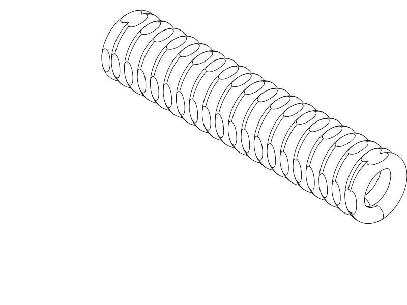

# TPU coil cord — R4 with wider gaps and four flat sides

**Next trial: R4.** This revision addresses R3's merging turns and mid-print
lifting with more turn clearance and broad bed-contact faces. Four identical
flats give the outer cross-section equal top, bottom, left and right sides.
The terminal loops remain integrated into the winding.

Print [R4 STEP](coil_r4_four_flats.step) or [STL](coil_r4_four_flats.stl),
horizontally as supplied. [Python source](coil_r4_four_flats.py) owns the geometry.
**Do not repeat R3 unchanged:** its print was canceled after fusion and lifting.
Keep R1 as the preferred earlier physical control; R2 is also superseded.

| Item | R4 trial |
| --- | --- |
| Compressed length | 71.6 mm nominal, approximately 7 cm |
| Maximum envelope / across flats | 15 mm / 14 × 14 mm |
| Cord / turns / axial gap | 3.2 mm before trimming / 19 turns / 0.40 mm |
| Four flats | 0.5 mm trimmed equally from each outer side |
| Material / nozzle / layers | Same TPU if available / 0.4 mm / 0.20 mm |
| Walls / fill | Classic; solid material: 3 walls + 100% fill or the high-wall-count approach |
| Supports / brim / ironing | Off / off / off for this trial |
| Bridge direction | Automatic; [existing horizontal TPU profile](profiles/r2-horizontal-process.json) |
| Placement | Horizontal axis X, one broad flat facing the bed, as supplied |

[End-profile and terminal detail](renders/inspection/coil_r4_four_flats_inspections/sheet.png)

## What changed

The gap grows from **0.15 mm to 0.40 mm**, a 0.25 mm increase, while nineteen
turns keep the relaxed sample close to the requested 7 cm length. This is a new
clearance experiment; R3's physical fusion overrides its earlier successful
CAD gap and slice checks.

Each turn and each terminal loop has four matching external flats. The rounded
corners retain the 15 mm envelope; the flats are 14 mm apart. Every flat can
serve as a resting side. These are part of the spring itself, without extra
projecting feet or rings. The inner bore remains nominally 8.6 mm. The outer
trim reduces local radial cord thickness to about 2.7 mm at the center of each
flat, so feel and durability must be tested again.

The larger plane against the plate is the geometry change for adhesion. Actual
adhesion also depends on the printing process; the user named Cura 3D for R3,
but the precise settings, bed surface and root cause of lifting are unknown.
The reference Orca check below is not a reconstruction of that Cura print.

## Print and compare

Keep the supplied flat-down placement and your appropriate TPU material settings.
A brim is omitted to avoid joining separate turns at the bed. The spring still
has curved inner roofs; the selected support-free trial needs a roof-quality
check as well as an adhesion check.

After cooling, inspect whether the turn gaps stayed open and whether the long
print stayed attached. Free middle turns gently if needed; keep the intentional
terminal-loop joins intact. If freeing tears the cord, stop and report where.
Only then pull gently through the ends and compare feel/recovery with R1. No
safe load, maximum extension or lifetime is qualified.

## Evidence and print status

The [native CAD/export/slice report](notes/r4_cad_slice_review.json) records
valid CadQuery 2.8.0 geometry, paired STEP/STL in the same flat-down placement,
and a completed OrcaSlicer 2.4.2 supports-off TPU slice with no reported notices.
The centered layout fits the selected 270 × 270 × 256 mm Q2C profile. Effective
settings include 0.2 mm layers, three walls and 100% rectilinear material fill;
230 °C nozzle and 35 °C bed are reference values, not spool calibration.

[Targeted checks](notes/r4_targeted_checks.json) measured **200.8 mm² total native
planar bed contact**, with approximately **10.0 mm² per sampled middle foot**,
above the 5 mm² geometric trial screen. All four flat sides are present. A native
adjacent-turn witness measured **0.3981 mm clearance**, above the 0.30 mm screen;
24 material/gap pairs passed. Terminal bores are open and both end loops connect
to the middle winding.

The complete isometric view, end view and [focused section inspection](notes/r4_inspection_review.json)
were opened and reviewed: four matching flats, an open bore and integral terminal
joins are retained. The section preview is display-only; printable files contain
the complete spring.

The [actual path comparison](notes/r4_actual_paths.png) shows R3 and R4 reference
first layers, the R4 support probe and the end-roof bridge layer at Z11.8 mm.
Blue is ordinary TPU extrusion, orange is bridge/probe support, and gray is the
previous roof layer. These are reference Orca paths, not the user's Cura G-code.
The automatic probe still proposes support/interface in the bore up to Z11.2 mm.
That review flag is retained; the selected trial keeps supports off to avoid
trapped TPU removal. Increased planar contact is a geometry result, not measured
bed adhesion. TPU spread can still close gaps; roof sag, layer bonding, recovery,
creep and fatigue require the actual print. A headless STL slice does not
qualify GUI STEP import or the user's Cura configuration.

| Item | Print status | Artifact(s) | User result or remaining checks |
| --- | --- | --- | --- |
| Test piece R1 | Yes | `tpu_coil_cord.step`, `tpu_coil_cord.stl` | Works reasonably well; rough separation and weak recoil; practically solid via high wall count |
| Test piece R2 | Yes | `coil_r2_horizontal.step`, `coil_r2_horizontal.stl` | R1 preferred; thickness, outboard frames and house-shaped outline rejected |
| Test piece R3 | Partial | `coil_r3_round.step`, `coil_r3_round.stl` | Failed trial: user canceled after turns merged and the print lifted; precise settings and lift cause unknown |
| Test piece R4 | Unknown | `coil_r4_four_flats.step`, `coil_r4_four_flats.stl` | Adhesion, separated turns, roof quality and feel need the next physical print |
| Final printable object(s) | N/A | None | Experimental samples only |

The [R4 decision record](notes/r4_decisions.md) holds engineering detail. Earlier
[R1](notes/r1_baseline.md), [R2](notes/r2_baseline.md), [failed R3](notes/r3_baseline.md)
and [development records](notes/development_record.md) preserve valid history.
Their model sources, exports and native evidence remain unchanged.

## Attribution and reproduction

Primary model: **GPT 6.1**, reasoning **F4 Medium**, as explicitly supplied by
the user; runtime identity/effort are not independently exposed. Codex CLI,
OpenAI. Historical attribution is preserved. No other material contributors.

R4 reuses the Q2C printer, solid TPU automatic-bridge process and TPU 95A
reference filament profiles. These are not recovered physical-print settings.
The native report owns exact identities. [Profile attribution and AGPL-3.0
licensing](profiles/ATTRIBUTION.md) remain; CAD and notes use the repository's
normal licence.
