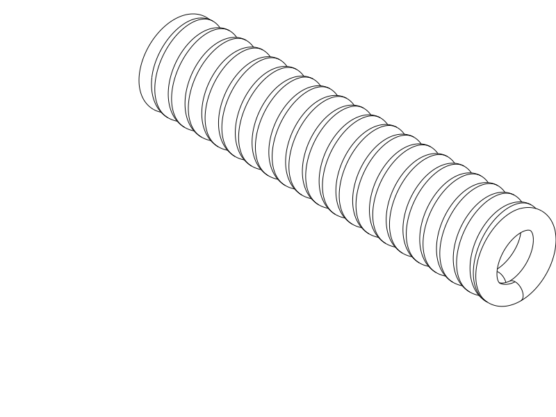

# TPU coil cord — round horizontal R3, about 7 cm

**Next trial: R3** — a round, tightly packed 3D helix with closed terminal turns
merged into the winding, printed horizontally. R1 felt better in use than R2;
R2's thickness, outboard frames and house-shaped outline are superseded.

Print [R3 STEP](coil_r3_round.step) or [STL](coil_r3_round.stl), horizontal as
supplied. [Python source](coil_r3_round.py) owns the geometry. Keep the existing
R1 as a comparison; do not repeat R2 for this follow-up.

| Item | R3 |
| --- | --- |
| Compressed overall length | 70.2 mm nominal |
| Round coil outside / bore diameter | 15.0 / 8.6 mm nominal |
| Cord / turns / axial gap | 3.2 mm round cord / 20 turns / 0.15 mm |
| Material / nozzle / layers | Same TPU if available / 0.4 mm / 0.20 mm |
| Walls / fill | Classic, solid: 3 walls + 100% fill, or the high-wall-count approach |
| Supports / brim / ironing | Off / off / off for this trial |
| Bridge direction | Automatic; [existing horizontal TPU profile](profiles/r2-horizontal-process.json) |
| Orientation | Axis along X, round underside on bed; do not stand it upright |

## Shape and test

R3 restores the round winding and integral terminal loops preferred on R1.
The same 15 mm circular envelope continues around the spring axis, including
the terminal loops. There are no outboard eye frames, tabs or asymmetric feet.
Hook through the closed terminal turns and keep their intentional joins intact.

The 3.2 mm circular cord has 8.04 mm² nominal material area, close to R1's
8.32 mm² faceted section and well below R2's 21.24 mm² round section. A round
cord also avoids the narrow radial tip of R1's faceted section when laid on its
side. Twenty turns provide the requested approximately 7 cm compressed sample;
this longer winding is a different spring, so R1's feel or pull force does not
transfer automatically.

The requested tight-gap experiment uses **0.15 mm**, versus R1's 0.4 mm and
R2's 0.8 mm axial CAD gaps. That is deliberately aggressive, not a calibrated
printed clearance. After cooling, check whether the middle turns are free or
need light hand separation. If freeing them tears the cord, stop and report
where. Do not separate the terminal-loop joins.

Pull gently through the terminal loops and note surface cleanup, preferred feel,
recovery and permanent set. If comparing samples, use the same extra end-to-end
extension and similar pull/release speed. No safe maximum extension or load has
been established. The present goal is the requested form, preferred feel and compact spacing.

## Evidence and print status

The [native CAD/export/slice report](notes/r3_cad_slice_review.json) records
valid CadQuery 2.8.0 geometry, matched horizontal STEP/STL exports, and a
completed OrcaSlicer 2.4.2 TPU slice with supports off and no reported notices.
The selected Q2C setup uses 0.2 mm layers, three walls, solid rectilinear fill,
230 °C nozzle and 35 °C bed reference temperatures. Those temperatures are not
spool calibration. The planned 70.2 × 15 × 15 mm envelope fits its 270 × 270 ×
256 mm build area; the slicer accepted the centered layout.

[Targeted CAD checks](notes/r3_targeted_checks.json) passed 24 material/gap
witness pairs. Two local native surface measurements gave about **0.1494 mm**
clearance, above the 0.10 mm geometric screen. A single connected native solid
contains material in both terminal turns and the middle, and both end bores
remain open. The [render](renders/print/coil_r3_round_isometric.png) and
[actual path review](notes/r3_actual_paths.png) were opened and inspected.
First-layer contacts are retained; bridge paths at Z12.2 mm close the end-loop
roofs over existing side paths. The longest bridge-labelled deposition segment
is 2.14 mm including anchors, not a measured unsupported span.

**This remains a support-free print experiment.** The automatic probe proposes
support and interface through the bore up to Z11.8 mm, rather than only at the
feet. That review flag remains in the native report. Filling the long bore and
tight turn gaps with TPU support would make removal difficult, so the selected
trial keeps supports off and preserves the requested round geometry. Roof sag,
bed adhesion and turn fusion remain real physical risks; neither slice completion
nor the geometric gap check proves clean printing. Recoil, strength, fatigue
and creep remain physical questions. An STL slice does not qualify GUI STEP
import.

| Item | Print status | Artifact(s) | Result or remaining physical checks |
| --- | --- | --- | --- |
| Test piece R1 | Yes | `tpu_coil_cord.step`, `.stl` | Works reasonably well; rough turn separation, weak recoil; practically solid via high wall count |
| Test piece R2 | Yes | `coil_r2_horizontal.step`, `.stl` | User prefers R1; too thick in feel, extra end frames and non-round outline unwanted. Exact settings and comparative force/cleanup unknown |
| Test piece R3 | Unknown | `coil_r3_round.step`, `.stl` | Tight-gap release, horizontal round-coil print quality and preferred feel await printing |
| Final printable object(s) | N/A | None | Samples only |

R2's user-reported print is not a quantified strength/recovery result. The
[historical R1 record](notes/r1_baseline.md), [historical R2 record](notes/r2_baseline.md)
and [development record](notes/development_record.md) preserve observations,
original settings and engineering evidence. Prior sources and exports remain
unchanged; they are historical controls, not the current next print.

## Attribution and reproduction

Primary model: **GPT 6.1**, reasoning **F4 Medium**, explicitly supplied by the
user; runtime identity/effort are not independently exposed. Codex CLI, OpenAI.
Historical attribution is preserved. No other material contributors.

R3 reuses the existing Q2C printer, solid TPU automatic-bridge process and TPU
95A reference filament profiles. These are not recovered physical-print settings.
The native report owns their exact identities. [Profile attribution and AGPL-3.0
licensing](profiles/ATTRIBUTION.md) remain; CAD and notes use the repository's
normal licence. The [R3 decision record](notes/r3_decisions.md) retains the
construction history, user directives and scoped checks.
