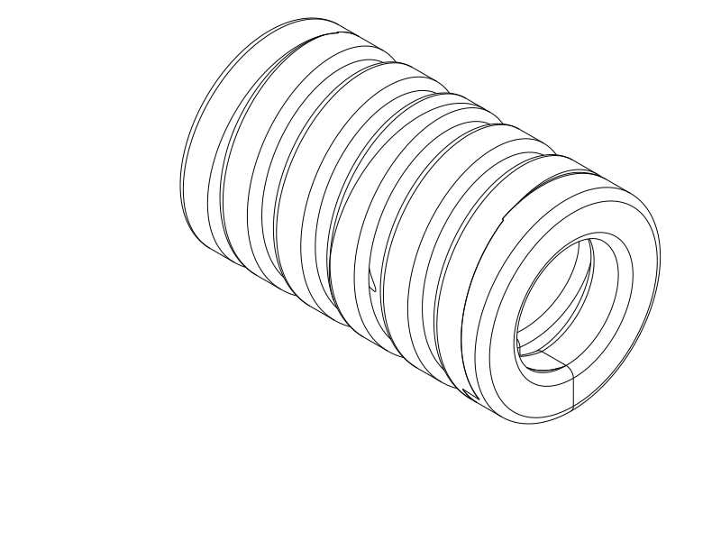
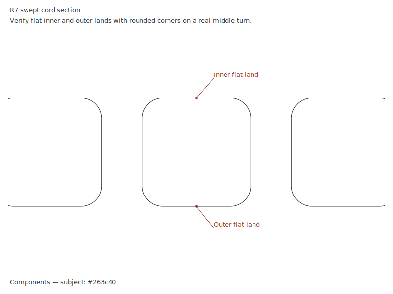

# R7 historical circular trial — printed and rejected

**R7 was printed and rejected for many print defects. Do not repeat it.**
The user discontinues circular winding and returns to working R5. The following
preserves the historical proposal and digital evidence.

Historical R7 design: A circular helix sweeps a rounded-square cord section,
so the inner, outer and end-facing lands belong to the profile and continue
along the winding. This corrects the isolated shaved patches on R6's round cord.
**R6 was rejected before printing; do not print it.** R5 remains the accepted
printed control.

Print [R7 STEP](../coil_r7_flat_section.step) or [STL](../coil_r7_flat_section.stl)
in the supplied horizontal placement. [Python source](../coil_r7_flat_section.py)
owns the geometry. One short sample is supplied; the ~70 mm version remains deferred.
Do not repeat R3/R4 unchanged; their smaller gaps printed stuck together.

| Item | R7 trial |
| --- | --- |
| Relaxed length / circuits | 25.2 mm / five full winding circuits |
| Circular outer diameter / bore | 15 mm / 8.6 mm nominal |
| Cord section | 3.2 × 3.2 mm rounded square |
| Corner radius / straight lands | 0.6 mm / 2.0 mm on all four section sides |
| Nominal axial gap / pitch | 1.2 mm / 4.4 mm |
| Material / nozzle / layers | TPU / 0.4 mm / 0.20 mm |
| Walls / fill | Classic, 3 walls + 100% fill, or the previous high-wall solid approach |
| Supports / brim / ironing | Off / off / off for this experiment |
| Placement / bridge direction | Horizontal axis X as supplied / automatic |

The actual section below shows the flat inner and outer lands and rounded corners.
The left and right straight sides are the end-facing lands. The same profile
forms the terminal loops, which merge within the winding envelope.

[End view: circular winding envelope](../renders/print/coil_r7_flat_section_right.png)

## Shape and test

The winding is circular; the cord section is flat-sided. Its lands sweep into
continuous bands around the circle rather than being limited to cut-away patches.
Rounded corners soften the section edges while keeping useful flat widths.

The outer band is straight across its section land and curved around the winding.
In horizontal placement its ideal bed contact is a tangent line; the first
printed layer has finite width. The experiment tests those natural first-layer
footprints. The circular inner roof still needs to print across changing overhangs.

Keep the sample horizontal, use solid TPU and supports/brim off. A brim could
join neighboring feet; TPU supports in the bore/gaps would complicate freeing.
After cooling, inspect adhesion, whether middle turns separate cleanly, and
roof sag or strings. Keep the intentional terminal joins intact; then compare
gentle extension and recovery with R5. No stronger recoil is promised by this
shape correction.

## Evidence and print status

The [native CAD/export/slice report](r7_cad_slice_review.json) records valid
CadQuery 2.8.0 geometry, paired horizontal STEP/STL exports and a completed
OrcaSlicer 2.4.2 slice using the existing supplied Q2C/solid-TPU profiles. The
centered layout was accepted with no reported notices. Effective settings retain
0.4 mm nozzle, 0.2 mm layers, three walls and 100% rectilinear fill, supports/brim
off. Reference temperatures are 230/35 °C; use spool-appropriate values.

[Targeted checks](r7_targeted_checks.json) cover continuous flat-section
material, the rejected R6 negative control, open winding/gap/bore witnesses,
first-layer sections and local turn clearance. All **96 middle flat-land** and
**120 terminal-section** witnesses pass; the rejected R6 profile fails the
corresponding middle-land control. Local turn clearance is **1.191 mm**. Four
middle sections at Z0.1 mm each have about **6.17 mm²** material area; this is
a first-layer midplane section, not planar bed contact or adhesion measurement.
The [actual path image](r7_actual_paths.png) shows bed paths, middle side
walls, automatic-probe supports and roof deposition. Blue is ordinary extrusion,
orange is bridge/probe support and gray is the prior roof layer. Model views,
the actual cord section and path image were opened for review.

The automatic-support probe still proposes support inside the curved roof
through Z11.6 mm. All 54 sampled bridge midpoints at Z12 lie in current-layer
CAD material; complete bead widths and all deposition paths are outside that screen.
Supports-off is an experimental print choice, not a claim of self-supporting
geometry. Reference slicing does not establish Cura behavior, GUI STEP import,
adhesion, clean release, roof quality, load capacity, maximum extension or
fatigue life. Exact spool and user settings remain unknown.

| Item | Print status | Artifact(s) | Result or remaining checks |
| --- | --- | --- | --- |
| R1 sample | Yes | `tpu_coil_cord.step`, `tpu_coil_cord.stl` | Reasonable function; rough separation and weak recoil; preferred earlier control |
| R2 sample | Yes | `coil_r2_horizontal.step`, `coil_r2_horizontal.stl` | Thickness, projecting frames and house-shaped outline rejected |
| R3 sample | Partial | `coil_r3_round.step`, `coil_r3_round.stl` | Canceled after turns merged and print lifted |
| R4 sample | Yes | `coil_r4_four_flats.step`, `coil_r4_four_flats.stl` | Idea can work, but sticking and form/overhang issues remained; adhesion/recoil not explicitly reported |
| R5 short sample | Yes | `coil_r5_octagonal.step`, `coil_r5_octagonal.stl` | User reports printed R5 is okay; no measured force, recovery or durability result |
| R6 short sample | No — rejected | `coil_r6_round_flats.step`, `coil_r6_round_flats.stl` | Rejected before printing: round swept cord with isolated shaved exterior flats misinterpreted the intended section |
| R7 short sample | Yes — rejected | `coil_r7_flat_section.step`, `coil_r7_flat_section.stl` | User reports many print defects; circular direction discontinued. Actual defect types, material/settings and cause unconfirmed |
| Final 70 mm object | N/A | None in this phase | Future work deferred |

[Current R7 decisions](r7_decisions.md) ·
[Development record](development_record.md) · historical
[R1](r1_baseline.md), [R2](r2_baseline.md), [R3](r3_baseline.md),
[R4](r4_baseline.md), [accepted R5](r5_baseline.md),
[rejected R6](r6_rejected.md). Historical sources, exports and digital
evidence remain preserved within their original scope.

## Attribution and reproduction

Primary model: **GPT 6.1**, reasoning **F4 Medium**, explicitly supplied by the
user; runtime identity/effort are not independently exposed. Codex CLI, OpenAI.
Historical attribution is preserved. No other material contributors.

R7 reuses the Q2C printer, solid TPU automatic-bridge process and TPU 95A
reference filament profiles. Exact identities are in the native report.
[Profile attribution and AGPL-3.0 licensing](../profiles/ATTRIBUTION.md) remain;
CAD and notes use the repository's normal licence. Evaluate from the repository
root with `./evaluate_model.py model/tpu_coil_cord/coil_r7_flat_section.py`.
