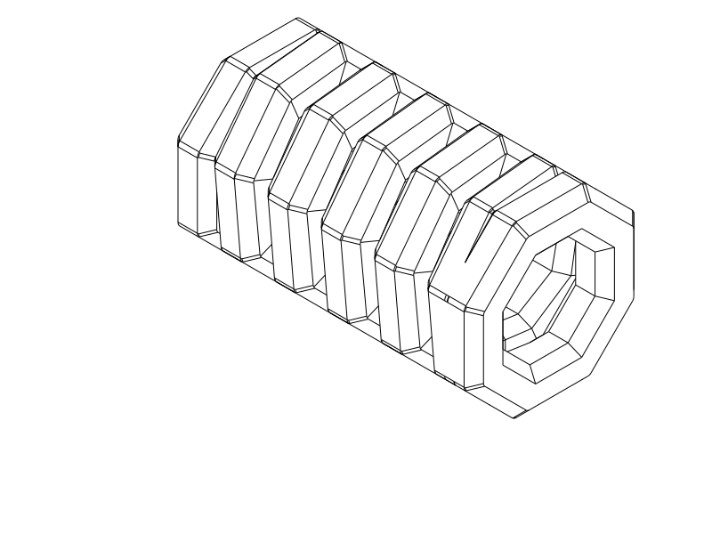

# R8 retained control — exterior edge blends

**R8 is retained by the user as an okay/not-bad iteration.** R9 explores negative
cuts into the winding vertices; R8 source and exports remain unchanged. The latest
feedback does not explicitly confirm an R8 print. The following preserves the
R8 design and digital checks; see [current object record](../README.md).

R8 control: The working R5 octagonal coil now has small
rounded blends on its exterior ridges, so the corners are gently recessed and
the transition between faces is less abrupt. The broad facets and inner
printing geometry remain octagonal.

Print [R8 STEP](../coil_r8_soft_octagon.step) or [STL](../coil_r8_soft_octagon.stl),
horizontal and flat-down as supplied. [Python source](../coil_r8_soft_octagon.py)
applies the edge treatment to the unchanged [R5 source](../coil_r5_octagonal.py).
[R5 STEP](../coil_r5_octagonal.step) remains the accepted printed control.
**Do not repeat R7:** it was printed with many defects and the user discontinues
the circular direction. R6 was rejected before printing. The ~70 mm version
remains deferred; this is another short sample.

| Item | R8 trial |
| --- | --- |
| Relaxed length / circuits | 25.2 mm / five full winding circuits |
| Octagonal envelope | 14 mm across flats, original corner envelope ~15.15 mm |
| Bore | Original inner octagon, 7.6 mm across flats |
| Cord / nominal turn gap / pitch | Original 3.2 × 3.2 mm faceted section / 1.2 mm / 4.4 mm |
| New treatment | 0.5 mm radius on convex exterior ridges; original inner facets retained |
| Material / nozzle / layers | TPU / 0.4 mm / 0.20 mm |
| Walls / fill | Classic; 3 walls + 100% fill, or the previous high-wall solid approach |
| Supports / brim / ironing | Off / off / off |
| Placement / bridge direction | Horizontal axis X, bottom facet on bed, as supplied / automatic |

[End view](../renders/print/coil_r8_soft_octagon_right.png) ·
[Corner comparison](../renders/print/coil_r8_soft_octagon_inspections/outer-corner.png)
(gray: original R5; teal: rounded R8).

## What changed and what to test

Small tangent rounds replace the sharp exterior ridges, including where the
cord's outside face meets its original chamfers. The inside half and faceted
roof are retained. Integrated terminal loops keep the original form.
This keeps the octagonal printing approach that the user reports works.

Extra straight bevels would add more visible facet boundaries. Much larger
rounds would remove more of the flat printing lands and move toward the circular
shape that printed poorly. R8 uses a modest edge treatment instead. Its printed
appearance remains an experiment; CAD rounds cannot guarantee a smoother finish.

Use the same solid TPU setup as the working octagonal print where possible.
After cooling, compare exterior appearance and feel with R5, then check the feet,
roof and whether the middle turns separate without tearing. Leave the intentional
terminal joins intact. This iteration changes edge appearance, not a measured
return-force target.

## Evidence and print status

The [native CAD/export/slice report](r8_cad_slice_review.json) owns final
geometry, matching horizontal STEP/STL, tool identities, placement and effective
settings. CadQuery 2.8.0 reports valid geometry, and OrcaSlicer 2.4.2 completed
the centered supports-off TPU slice with no reported notices. Reference
temperatures are 230/35 °C; use spool-appropriate values.
The [local comparison checks](r8_targeted_checks.json) cover
connected end loops, winding gaps, unchanged inner facets, exterior recession
and remaining planar bed contact. Sampled middle feet retain **8.62 mm²** each
(vs. R5’s 9.28 mm²); total planar contact is about **93% of R5**. The measured
local turn gap is **1.190 mm**, and all eight original inner facet planes remain.
The [actual path image](r8_actual_paths.png)
shows bed deposition, middle side walls, support-probe locations and roof paths.
Blue is ordinary extrusion, orange is bridge/probe support, gray is prior-layer
roof material.

The automatic-support probe still proposes roof support through Z11.2 mm, as
on the R5 reference review. The selected short experiment keeps supports off;
roof quality still needs printing. All 105 sampled bridge midpoints remain in
current-layer CAD material, within that check’s limited scope.

These are digital checks. R8 is retained, with explicit print confirmation still unavailable. R5's successful print
does not automatically qualify changed corner transitions. Actual surface finish,
adhesion, clean separation, roof quality, load capacity, extension and durability
remain physical questions. The actual Cura/spool setup and the cause of R7's
print defects are unknown. Reference Orca slicing does not qualify Cura or GUI
STEP import. Detailed measurements and probe interpretation are in
[R8 decisions](r8_decisions.md).

| Item | Print status | Artifact(s) | Result or remaining checks |
| --- | --- | --- | --- |
| R1 sample | Yes | `tpu_coil_cord.step`, `tpu_coil_cord.stl` | Reasonable function; rough separation and weak recoil; preferred earlier control |
| R2 sample | Yes | `coil_r2_horizontal.step`, `coil_r2_horizontal.stl` | Thickness, projecting frames and house-shaped outline rejected |
| R3 sample | Partial | `coil_r3_round.step`, `coil_r3_round.stl` | Canceled after turns merged and print lifted |
| R4 sample | Yes | `coil_r4_four_flats.step`, `coil_r4_four_flats.stl` | Idea can work; sticking and form/overhang issues remained; adhesion/recoil not explicitly reported |
| R5 short sample | Yes | `coil_r5_octagonal.step`, `coil_r5_octagonal.stl` | Printed and okay; user reconfirms this octagonal design works |
| R6 short sample | No — rejected | `coil_r6_round_flats.step`, `coil_r6_round_flats.stl` | Visually rejected before print: isolated shaved patches misinterpreted the intended section |
| R7 short sample | Yes — rejected | `coil_r7_flat_section.step`, `coil_r7_flat_section.stl` | Printed with many defects; circular direction discontinued. Specific defects/settings/cause unknown |
| R8 short sample | Unknown | `coil_r8_soft_octagon.step`, `coil_r8_soft_octagon.stl` | Retained by user; protruding octagon vertices after extension motivate a separate R9 variant. Print status not explicitly confirmed |
| Final 70 mm object | N/A | None in this phase | Future work deferred |

[Current R8 decisions](r8_decisions.md) · [Development record](development_record.md) ·
historical [R1](r1_baseline.md), [R2](r2_baseline.md), [R3](r3_baseline.md),
[R4](r4_baseline.md), [accepted R5](r5_baseline.md),
[rejected R6](r6_rejected.md), [printed/rejected R7](r7_rejected.md).
Earlier source, exports and digital evidence remain preserved in their original scope.

## Attribution and reproduction

Primary model: **GPT 6.1**, reasoning **F4 Medium**, explicitly supplied by the
user; runtime identity/effort are not independently exposed. Codex CLI, OpenAI.
Historical attribution is preserved. No other material contributors.

R8 reuses the Q2C printer, solid TPU automatic-bridge process and TPU 95A
reference filament profiles. Exact identities are in the native report.
[Profile attribution and AGPL-3.0 licensing](../profiles/ATTRIBUTION.md) remain;
CAD and notes use the repository's normal licence. Evaluate from the repository
root with `./evaluate_model.py model/tpu_coil_cord/coil_r8_soft_octagon.py`.
