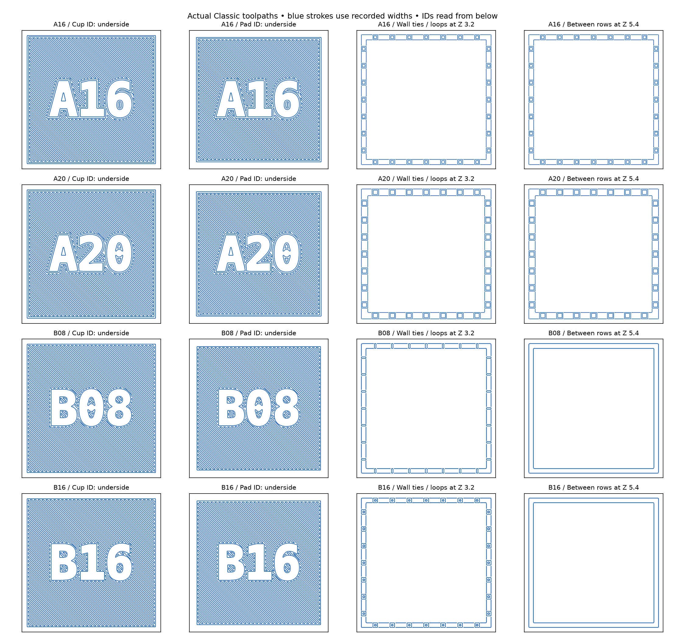

# Flat-Faced TPU Damping Box Experiment

A small `38.4 × 38.4 × 42.4 mm` rigid test enclosure (two M3 screws/nuts + a loose metal nut) that accepts interchangeable `34 × 34 × 34 mm` TPU 95A liner cups and lid pads. It is used to test impact quietness, upright wall durability, and object-facing surface finish before printing full-scale liners for the [sunglasses case](../sunglasses_case_liner/README.md) and [slim dental case](../dental_travel_case_liner/README.md).

---

## At a Glance: Current Status & What to Print

| Workstream | Status | What to Do / Printable Files |
| --- | --- | --- |
| **1. Current Golden Standard (`T08 M1`)** | **Printed & Approved (2026-10-21)** | **`T08 M1`** ([`t_skin_T08_m1.step`](t_skin_T08_m1.step) / [`.stl`](t_skin_T08_m1.stl)) is the **current golden standard**: `2.2 mm` wall (`0.8 mm` skins around a `0.6 mm` gap, separated `0.8 × 0.8 mm` B-style ties, solid `4 mm` corners, compact `M1` corner label). Printed damping equals earlier `B08`/`S16` while visual surface quality is substantially better ([details & report](#t08t16-with-m1--2026-10-21)). Earlier `B08`/`B16` and `S16` remain historical approved baselines. |
| **2. Next Print Trial: Thinner `T08` Follow-Up (`L20` & `L18`)** | **Ready to Print (`Unknown`)** | Tests how thin the approved `T08` architecture can go by keeping `0.8 mm` skins and reducing the upright air gap to `0.4 mm` (**`L20`**, `2.0 mm` total wall) and `0.2 mm` (**`L18`**, `1.8 mm` total wall).<br>• **Fastest test (reuses printed `T08` pad):** [`thin_gap_cups.step`](thin_gap_cups.step) ([`.stl`](thin_gap_cups.stl))<br>• **Full cup+pad pairs:** [`thin_gap_L20.step`](thin_gap_L20.step) ([`.stl`](thin_gap_L20.stl)) and [`thin_gap_L18.step`](thin_gap_L18.step) ([`.stl`](thin_gap_L18.stl)) ([setup below](#thinner-t08-follow-up)). |
| **3. Optional Flat Surface Coupons (`F0`–`F7`)** | **Optional / Deferred (`Unknown`)** | Eight `30 × 30 mm` flat bottom-plate coupons ([`surface_samples.step`](surface_samples.step) / [`.stl`](surface_samples.stl)) testing whether thicker skins or denser ribs reduce `50%`-ironing waviness ([setup below](#surface-finish-coupons--2026-10-17)). |
| **4. Rejected / Superseded Variants** | **Do NOT Print** | • **`T16 M1`** (`3.8 mm` wall): Printed and **rejected** — too firm and somewhat noisier than `T08`.<br>• **R2 `A16` / `A20`** (square frames) & **Solid `C12` / `C16`**: Printed and **rejected** — insufficient damping.<br>• **R1 support pairs**: Rejected before printing (missing Classic walls).<br>• **`I10`** (`1.0 mm` open-backed): Printed and **rejected** (broken shell-side skin). |

> **Reuse your existing rigid test shell:** All `T08`, `L20`/`L18`, `B08`/`B16`, and `S16` liners fit the original `38.4 mm` rigid enclosure (`test_enclosure.step` / `.stl`). Do **not** reprint the rigid box.

---

<a id="thinner-t08-follow-up"></a>
## 1. Active Print Trial: Thinner `T08` Follow-Up (`L20` & `L18`)

After approving **`T08 M1`** as the new golden standard and rejecting **`T16 M1`** as too firm, the next question is how much wall thickness can be saved without losing `T08`'s visual surface quality or damping.

**`L20`** and **`L18`** keep `T08`'s `0.8 mm` inner and outer upright skins, `0.8 × 0.8 mm` separated ties, solid `4 mm` corner lands, `1.6 mm` floor/pad sandwich, and compact `M1` corner labels, while narrowing the upright air gap ([full study & toolpath details](notes/thin_gap/README.md)):

| Variant | Total Wall | Upright Sandwich (Outer / Gap / Inner) | Clear Cavity | Deliverables |
| --- | --- | --- | --- | --- |
| **`L20` (`M1`)** | **`2.0 mm`** | `0.8 / 0.4 / 0.8 mm` | `30.0 mm` cube | [`thin_gap_L20.step`](thin_gap_L20.step) · [`.stl`](thin_gap_L20.stl) · [`.py`](thin_gap_L20.py) |
| **`L18` (`M1`)** | **`1.8 mm`** | `0.8 / 0.2 / 0.8 mm` | `30.4 mm` cube | [`thin_gap_L18.step`](thin_gap_L18.step) · [`.stl`](thin_gap_L18.stl) · [`.py`](thin_gap_L18.py) |
| **Two-cup fast plate (`L20` + `L18` cups only)** | `2.0` & `1.8 mm` | Reuses your already-printed `T08 M1` lid pad | — | [`thin_gap_cups.step`](thin_gap_cups.step) · [`.stl`](thin_gap_cups.stl) · [`.py`](thin_gap_cups.py) |

- **Print setup:** Use the shared Classic TPU process [`profiles/tpu-support-classic-process.json`](profiles/tpu-support-classic-process.json), [`profiles/tpu95a.json`](profiles/tpu95a.json), and [`qidi-q2c-0.4-nozzle.json`](../../.codex/skills/orca-slicer-printability/profiles/qidi-q2c-petg/qidi-q2c-0.4-nozzle.json) (`0.2 mm` layers, Classic wall generator, `detect_thin_wall = OFF`, `2` wall loops, `100%` rectilinear fill, supports `OFF`).
- **What to check when printed:** Compare **`L20`** first against printed **`T08 M1`** using the same rigid shell and loose nut, then test **`L18`** to see whether the `0.2 mm` upright gap stays open and cushions without fusing or bottoming out.

---

<a id="t08t16-with-m1--2026-10-21"></a>
## 2. Current Golden Standard: `T08 M1` (and Rejected `T16 M1`)

Following the B-series print approval and the [14-probe Classic tie/skin toolpath study](notes/tie_surface_study/README.md) (which showed that `B08`'s `0.5 mm` skin places two `0.42 mm` passes only `0.08 mm` apart where tie joints disturb the outer perimeter), two full `34 mm` cup/pad pairs were built with thicker skins, solid `4 mm` corner lands, and compact `M1` corner markings ([full delivery & physical report](notes/t_skin/README.md)):

| Variant | Status | Upright Wall (Outer / Gap / Inner) | Total Wall | Deliverables (1 Cup + 1 Pad) | Physical Result (2026-10-21) |
| --- | --- | --- | --- | --- | --- |
| **`T08 M1`** | **APPROVED (Golden Standard)** | `0.8 / 0.6 / 0.8 mm` (`0.8 mm` ties) | **`2.2 mm`** | [`t_skin_T08_m1.step`](t_skin_T08_m1.step) · [`.stl`](t_skin_T08_m1.stl) · [`.py`](t_skin_T08_m1.py) | **Approved:** Damping feels equivalent to earlier approved `B08`/`S16`, and visual appearance is substantially better. |
| **`T16 M1`** | **REJECTED** | `1.6 / 0.6 / 1.6 mm` (`0.8 mm` ties) | **`3.8 mm`** | [`t_skin_T16_m1.step`](t_skin_T16_m1.step) · [`.stl`](t_skin_T16_m1.stl) · [`.py`](t_skin_T16_m1.py) | **Rejected:** Too firm and somewhat noisier than `T08`. |

- **Supporting design notes & full agent logs:**
  - **[Complete Historical Development & Agent Log (`notes/development_record.md`)](notes/development_record.md)** — preserves the full 1,280-line phase-by-phase engineering log (`R1`/`R2`, `C12`/`C16`, `F0`–`F7`, `S16`/`S12`, `I22`/`I30`/`I10`, `A`–`I`). Append detailed future agent logs here or in dedicated `notes/<topic>/` folders rather than cluttering this `README.md`.
  - [Thinner `T08` air-gap study (`L20` & `L18`)](notes/thin_gap/README.md) — full setup and path review for the current print trial.
  - [`T08` / `T16` with `M1` delivery & physical report](notes/t_skin/README.md) — full record of the current golden standard.
  - [Compact bottom-label comparison (`M1` selected)](notes/marking_options.md) — moves the ID to a `10 × 6.5 mm` solid corner land (`0.2 mm` recess) so the central floor skin is never thinned.
  - [B-derived tie/curve/skin toolpath study](notes/tie_surface_study/README.md) — compares 14 wall probes under Classic slicing.
  - [Gyroid infill path study (`G20`/`G30`/`X20`)](notes/infill_study/README.md) and [N1–N3 preformed surface concepts](notes/preformed_surface_concepts.md) — retained as a separate candidate branch at the user's request.
  - [Print-first concept review](notes/print_first_concepts.md) and [surface decoupling / solid-corner history](notes/surface_decoupling.md) — documents why thin separate cups and folding liners were retired.

---

<a id="four-printable-support-pairs--2026-10-20"></a>
<a id="ordinary-classic-repair--r2"></a>
<a id="wall-support-concepts--2026-10-20"></a>
<a id="solid-c12c16-controls--2026-10-20"></a>
## 3. Completed R2 Support (`A16`/`A20`/`B08`/`B16`) & Solid Control (`C12`/`C16`) Comparison

When the full-height [slim dental case liner](../dental_travel_case_liner/README.md) suffered local skin tears during printing (2026-10-19) and tore further during insertion (2026-10-20), six `34 × 34 × 34 mm` Classic-sliced pairs were built and physically compared on 2026-10-21 ([full physical report & B surface concepts](notes/b_surface_concepts.md)):
- **Why R2 replaced R1:** The initial R1 batch ([`notes/rejected_r1/README.md`](notes/rejected_r1/README.md)) used `0.3–0.4 mm` upright skins that vanished under ordinary Classic slicing (`0.42 mm` outer / `0.45 mm` inner widths, `detect_thin_wall = OFF`). **R2** thickened all continuous upright skins to **`0.5 mm`** so every layer slices cleanly under standard repository defaults.

| Variant | Architecture | Total Wall | Deliverables | 2026-10-21 Physical Print Result |
| --- | --- | --- | --- | --- |
| **`B08 R2`** | Separated `0.8 × 0.8 mm` cross-gap ties (`4.4 mm` X/Z pitch) | `1.6 mm` (`0.5/0.6/0.5`) | [`support_B08.step`](support_B08.step) · [`.stl`](support_B08.stl) · [`.py`](support_B08.py) | **Approved (superseded by `T08 M1`):** Good damping similar to `S16`, better contact finish than `S16`, fewer print artifacts than `B16`. |
| **`B16 R2`** | Separated `1.6 × 1.6 mm` cross-gap ties (`4.4 mm` X/Z pitch) | `1.6 mm` (`0.5/0.6/0.5`) | [`support_B16.step`](support_B16.step) · [`.stl`](support_B16.stl) · [`.py`](support_B16.py) | **Approved (superseded by `T08 M1`):** Similar damping to `B08`/`S16`; minor stringing/seam artifacts remained, motivating `T08`. |
| **`A16 R2`** | Horizontal square frames (`0.2 mm` openings) | `1.6 mm` (`0.5/0.6/0.5`) | [`support_A16.step`](support_A16.step) · [`.stl`](support_A16.stl) · [`.py`](support_A16.py) | **Rejected:** Poor damping compared to `S16`/`B`. |
| **`A20 R2`** | Horizontal square frames (`0.6 mm` openings) | `2.0 mm` (`0.5/1.0/0.5`) | [`support_A20.step`](support_A20.step) · [`.stl`](support_A20.stl) · [`.py`](support_A20.py) | **Rejected:** Poor damping compared to `S16`/`B`. |
| **`C12` Solid** | Fully solid TPU wall/floor/pad control (no air gap) | `1.2 mm` (`1.4 mm` pad) | [`solid_C12.step`](solid_C12.step) · [`.stl`](solid_C12.stl) · [`.py`](solid_C12.py) | **Rejected:** Almost no damping effect. |
| **`C16` Solid** | Fully solid TPU wall/floor/pad control (no air gap) | `1.6 mm` (`1.8 mm` pad) | [`solid_C16.step`](solid_C16.step) · [`.stl`](solid_C16.stl) · [`.py`](solid_C16.py) | **Rejected:** Almost no damping effect. |



---

<a id="surface-finish-coupons--2026-10-17"></a>
## 4. Optional Trial: Flat Surface-Finish Coupons (`F0`–`F7`)

Because `50%` top-surface ironing on `S16` improved smoothness but still left slight waviness over internal ribs, this batch provides **eight `30 × 30 mm` flat bottom-plate coupons** on a single `138 × 66 mm` layout (`27.6 × 18.8 mm` unlettered test field, solid `1.2 mm` border, recessed `F0`–`F7` labels).

- **Files:** [`surface_samples.step`](surface_samples.step) · [`surface_samples.stl`](surface_samples.stl) · [`surface_samples.py`](surface_samples.py) · [Layout preview](renders/print/surface_samples_top.png) · [Path review](renders/surface_path_review.png)
- **Slicer setup:** Print backing-down, unrotated, with [`profiles/tpu-surface-process.json`](profiles/tpu-surface-process.json) (`0.20 mm` layers, Arachne, `2` walls, `100%` rectilinear fill, supports `OFF`, `180°` X-directed bridges, top-surface ironing ON at **`50%` flow, `30 mm/s`, `0.15 mm` spacing**).

| ID | Hidden Core / Changed Factor | Contact Skin | Total | Comparison Goal vs. `F0` |
| --- | --- | --- | --- | --- |
| **`F0`** | `S16` baseline: `0.9 mm` straight ribs at `4.4 mm` pitch (`3.5 mm` channels) | `0.4 mm` | `1.6 mm` | Baseline `S16` reference |
| **`F1`** | Same core + 1 extra skin layer | `0.6 mm` | `1.8 mm` | Does a `0.6 mm` roof hide rib print-through? |
| **`F2`** | Same core + 2 extra skin layers | `0.8 mm` | `2.0 mm` | Further skin thickness vs. stiffer contact |
| **`F3`** | Straight ribs at `3.2 mm` pitch (`2.3 mm` bridges) | `0.4 mm` | `1.6 mm` | Shorter bridges vs. more rib lines |
| **`F4`** | Straight ribs at `2.4 mm` pitch (`1.5 mm` bridges) | `0.4 mm` | `1.6 mm` | Very short bridges vs. denser rib lines |
| **`F5`** | Orthogonal `0.9 mm` rib grid at `4.4 mm` pitch (`3.5 mm` square cells) | `0.4 mm` | `1.6 mm` | Cross-grid support vs. grid print-through |
| **`F6`** | Baseline rib feet with `45°` sloped upper shoulders (`2.3 mm` roof bridge) | `0.4 mm` | `1.6 mm` | Shorter roof bridge without adding rib feet |
| **`F7`** | Fully solid TPU control (no air channels) | `0.4 mm` zone | `1.6 mm` | Controls for top-extrusion texture without any core |

---

<a id="deferred-side-wall-printing-investigation--2026-10-19"></a>
<a id="upcoming-iteration-priorities--2026-10-19"></a>
<a id="actual-liner-layer-height-correction--2026-10-16"></a>
<a id="s16--s12-print-feedback--2026-10-16"></a>
<a id="closed-skin-follow-up"></a>
<a id="setup-and-assembly"></a>
<a id="i22--i30--i10-print-feedback--latest-report"></a>
<a id="thinner-i-experiment"></a>
<a id="user-print-feedback--2026-10-16"></a>
<a id="retained-baseline-why-these-four"></a>
<a id="printing-and-manufacturing-review"></a>
<a id="research"></a>
<a id="user-intent"></a>
## 5. Earlier Damping Baselines (`S16` / `S12`, `I22` / `I30` / `I10`, `A`–`I`)

All physical TPU liner comparisons were printed at **user-confirmed `0.2 mm` layer height** (correcting an early `0.16 mm` planning note).

### Phase 3 — Closed-Skin `S16` & `S12` (2026-10-16, Approved Historical Baseline)
Built after open-backed `I10` tore on its shell side, `S16` (`1.6 mm` total: `0.4 mm` backing + `0.8 mm` air channel + `0.4 mm` inner skin, `0.9 mm` straight ribs at `4.4 mm` pitch) and `S12` (`1.2 mm` total: `0.4 mm` air channel) restored continuous inner and outer skins:
- **Physical result:** Both `S16` and `S12` printed intact and damped well; **`S16` was preferred** (Noticeably quieter than `S12` with only `0.4 mm` per side thickness penalty) and successfully powered the [sunglasses-case liner](../sunglasses_case_liner/README.md).
- **Files:** [`skin_liners_batch.step`](skin_liners_batch.step) ([`.stl`](skin_liners_batch.stl), [`skin_liners_batch.py`](skin_liners_batch.py), process [`profiles/tpu-skin-process.json`](profiles/tpu-skin-process.json)).

### Phase 2 — Thinner `I` Derivatives: `I30`, `I22`, `I10` (2026-10-16)
Tested `3.0 mm` (`I30`), `2.2 mm` (`I22`), and `1.0 mm` open-backed (`I10`) derivatives of `I` ([`thin_liners_batch.step`](thin_liners_batch.step) / [`.stl`](thin_liners_batch.stl)) with enlarged `10 mm` bold labels:
- **Physical result:** **`I22` (`2.2 mm`)** damped nearly as well as `I30` ("good enough", though internal lines looked close to touching). **`I10` (`1.0 mm` open-backed) failed** with broken shell-side regions, proving that **both continuous inner and outer TPU skins are mandatory**.

### Phase 1 — Initial `4.0 mm` Damping Batch: `A`, `E`, `H`, `I` (2026-10-15 – 2026-10-16)
Informed by [corrugated/chevron TPU energy-absorption literature](https://doi.org/10.3390/polym17192622) and [linear frame compliance screening](notes/compliance_screen.json), the focused batch [`quiet_liners_selected.step`](quiet_liners_selected.step) ([`.stl`](quiet_liners_selected.stl)) and rigid enclosure [`test_enclosure.step`](test_enclosure.step) ([`.stl`](test_enclosure.stl)) compared four `4.0 mm` designs (`A` solid control, `E` two-stage offset ribs, `H` alternating oblique parallelogram webs, `I` opposed chevron diamond core; earlier 6-liner batch in [`liners_batch.step`](liners_batch.step)):
- **Physical result:** `A` remained noisy; `E` and `H` gave moderate damping; **`I` (opposed chevron core) was much quieter and explicitly approved**, launching the thin-liner series. (`6 mm` labels were too small, fixed in all subsequent batches.)

---

<a id="verification-and-physical-status"></a>
## 6. Verification, Limitations & Print Status

### Standard Print Status Block

| Category | Status | Summary |
| --- | --- | --- |
| **Test pieces (`T08 M1` golden standard, `B08`/`B16`, `S16`/`S12`, `I22`/`I30`, `A`/`E`/`H`/`I`)** | **Yes — Printed & Evaluated** | **`T08 M1` (`2.2 mm` wall) is the approved golden standard** (damping equals `B08`/`S16`, visual finish substantially better). `B08`/`B16` and `S16` remain earlier approved references. `T16`, `A16`/`A20`, `C12`/`C16`, and `I10` were printed and rejected. |
| **Test pieces (`L20`/`L18` thinner follow-up & `F0`–`F7` surface coupons)** | **Unknown — Unprinted** | `thin_gap_cups.step` (`thin_gap_L20.step`, `thin_gap_L18.step`) and `surface_samples.step` pass CAD, toolpath, and OrcaSlicer `2.4.2` checks; physical print feedback pending. |
| **Final object** | **N/A — Experimental Study** | Comparative test coupons only; application liners are tracked in [`sunglasses_case_liner`](../sunglasses_case_liner/README.md) (accepted) and [`dental_travel_case_liner`](../dental_travel_case_liner/README.md) (on hold). |

### Scope Limits & Reproduction Commands
- **What digital checks prove vs. physical unknowns:** CAD and toolpath checks (`notes/thin_gap/*_verification.json`, `notes/t_skin/*_verification.json`, `notes/support_verification_*.json`, `notes/solid_verification_*.json`, `notes/surface_verification_*.json`) verify clearance, continuous skins, open core channels, solid corners, and every upright 0.2 mm sliced layer under Classic. They do **not** calibrate TPU 95A hardness, bridge sag, tall-wall buckling in the `264 mm` dental case, or acoustic decibels, and CLI STL slicing does not test Orca's GUI STEP importer.
- **Reproduce verification from the repository root:**
  ```sh
  ./execute.py model/tpu_damping_box/verification.py --variant T08
  ./execute.py model/tpu_damping_box/verification.py --variant L20
  ```

---

<a id="attribution"></a>
## Attribution

- **Primary language model:** GPT-6.1 (reasoning effort medium, user-supplied for 2026-10-15/16 baseline and thin-I phases) and GPT-6 family (2026-10-17 surface coupons, 2026-10-20 R1/R2 wall-support & solid C12/C16 phases, and 2026-10-21 B-feedback, surface-isolation, N1–N3/infill, tie-surface study, `T08`/`T16 M1`, and thinner `L20`/`L18` phases; exact runtime ID/effort not exposed).
- **Harness & provider:** Codex shared-workspace CLI/API agent; provider OpenAI (no subagents). Documentation restructured for readability in Antigravity.
- **Sources & licensing:** CadQuery geometry, compliance screen, and path readers authored in-repository under MIT. Orca/Qidi profile snapshots in `profiles/` carry separate [AGPL-3.0 attribution](profiles/ATTRIBUTION.md).
