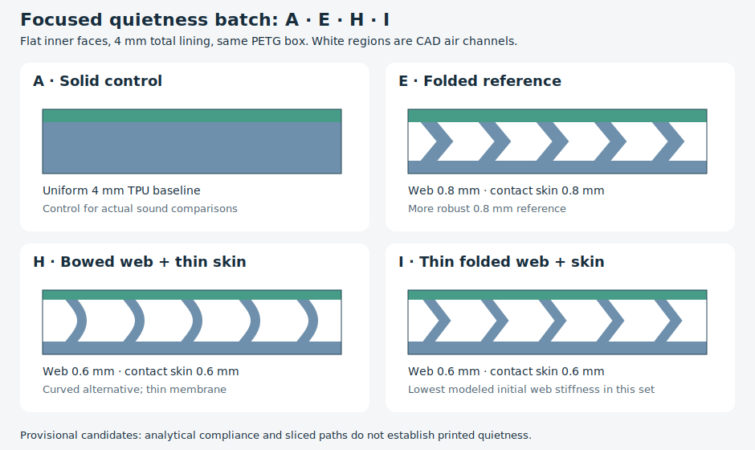

# Flat-faced TPU damping box experiment

**S16 is the user's preferred printed damping profile (2026-10-16).**
S16 and S12 were both printed and both work. Subjectively, S16 feels better than
S12 and I22, and good even compared with I30 and the original 4 mm I. The user
selects S16 for reuse in rigid-shell/TPU damping, starting with the already
printed sunglasses case.

**Current follow-up (2026-10-17):** the user reports visibly wavy/lined contact
surfaces despite some improvement with 50% ironing. S16 remains preferred for
damping, but surface flatness is unresolved. Print the new
[eight small surface coupons](#surface-finish-coupons--2026-10-17) when convenient;
no replacement full box is included.

## Current result and reading routes

This is a comparative liner fixture, not a finished storage product. **No full S16 cup
reprint is needed for damping selection**: both S16/S12 work and S16 is the approved starting profile.
The next application is the separate [sunglasses-case liner](../sunglasses_case_liner/README.md),
whose fit and quietness are not established by these samples.

- For the current geometry/files/setup, read [closed-skin follow-up](#closed-skin-follow-up)
  and [setup](#setup-and-assembly).
- For what the preference actually establishes, read the [S16/S12 report](#s16--s12-print-feedback--2026-10-16).
- For why open-backed I10 was retired, read the [I22/I30/I10 feedback](#i22--i30--i10-print-feedback--latest-report).
- For earlier comparisons and manufacturing evidence, read [retained baseline](#retained-baseline-why-these-four),
  [path review](#printing-and-manufacturing-review) and [physical status](#verification-and-physical-status).

Older batch/test instructions below describe those experiments; they do not
replace the current closed-skin choice. Quietness preferences are subjective
reported observations at user-confirmed 0.2 mm layers. Other exact settings,
acoustic mechanism and durability remain unknown. Detailed negative results
remain useful for judging future transfers.

## Surface-finish coupons — 2026-10-17

**Print batch: [surface_samples.step](surface_samples.step)** ·
[matching STL](surface_samples.stl) · [CadQuery entry point](surface_samples.py) ·
[parametric builders](surface_design.py) ·
[required comparison process](profiles/tpu-surface-process.json).
Eight separate **30 × 30 mm** plates fit one **138 × 66 mm** unrotated layout,
with 6 mm between parts. These are bottom-plate/flat-contact coupons, not cups,
replacement box lids or a damping-qualified liner. The requested phase stops at
these samples; the user will print later.

The user's latest report is that 50% ironing improves the finish slightly but
leaves clearly visible waviness/lines. They suspect a thin skin revealing the
underlying supports; exact printed file, spool, complete settings, measured
flatness and whether all lines follow ribs are unknown. This report limits the
earlier local description of 50% as “perfect”: that was a scoped ironing-flow
preference, not qualification of full-panel flatness. Preserve the approved S16
damping result while investigating finish separately.

The user requests four to eight roughly three-centimetre square plates, with a
flat test face and exterior overhangs filled solid, before another full-box trial.
All eight have a planar contact field, continuous backing, a solid **1.2 mm
perimeter** and a **10 mm solid label band inside the square**. The unlettered
test field is **27.6 × 18.8 mm**; compare there rather than over the label or
frame. Large bold F0–F7 IDs are recessed 0.2 mm in the band. Vertical outside
corners have a 0.6 mm radius; top and bed edges stay square to preserve planar
contact. No exterior cantilevers, loose core supports or removable internal
supports are included. Internal roof bridges are deliberately retained.

| ID | Hidden geometry / changed factor | Contact skin | Total | Intended comparison to F0 |
| --- | --- | --- | --- | --- |
| F0 | S16 local baseline: 0.9 mm straight ribs, 4.4 mm pitch | 0.4 mm | 1.6 mm | Same-process reference; 3.5 mm nominal channels |
| F1 | Same core, one extra skin layer | 0.6 mm | 1.8 mm | Does a thicker roof hide the rib pattern? |
| F2 | Same core, two extra skin layers | 0.8 mm | 2.0 mm | Further skin thickness versus harder contact |
| F3 | Straight ribs at 3.2 mm pitch | 0.4 mm | 1.6 mm | Shorter 2.3 mm bridges versus more supports |
| F4 | Straight ribs at 2.4 mm pitch | 0.4 mm | 1.6 mm | Shorter 1.5 mm bridges versus still more supports |
| F5 | Orthogonal 0.9 mm rib grid at 4.4 mm pitch | 0.4 mm | 1.6 mm | Break long channels into 3.5 mm square cells; risk grid print-through |
| F6 | Baseline rib feet, upper 0.6 mm grows 0.6 mm each side | 0.4 mm | 1.6 mm | Sloped shoulders shorten final roof bridge to 2.3 mm without more rib feet |
| F7 | Fully solid TPU at F0 thickness | Nominal 0.4 mm top zone | 1.6 mm | Control for ordinary top-path texture without any air core |

F0–F6 retain the S16 **0.4 mm backing, 0.8 mm core depth and 0.9 mm rib feet**.
They reuse its parameters without the cup pad's extra 0.1 mm assembly preload.
The original skins/support dimensions transfer locally; coupon size, solid edge
band and lack of side walls change restraint, so F0 is not a new damping approval.
More skin material, denser ribs, grid intersections and wider rib shoulders can
increase stiffness even while improving surface support. Retaining nominal air
space makes these sensible *candidates* for damping comparison, not proven damping
improvements. F7 intentionally removes air space. No calibrated material, dynamic
loss, impact or acoustic prediction is available; further simulation would not
establish the requested printed finish or subjective quietness.

### Shared print setup and evidence

Print **backing down, IDs/contact face up**, all eight together, using the same
TPU spool. Keep the supplied layout unrotated with no scaling. The supplied
process uses **0.4 mm nozzle, 0.20 mm layers including first layer, Arachne,
two requested walls, 100% rectilinear material fill, supports off**, thin external
and internal bridges, and 180° X-directed bridges across the principal ribs.
CAD channels remain empty with 100% material fill. Top surfaces are monotonic;
ironing is enabled on all top surfaces at **50% flow, 30 mm/s, 0.15 mm spacing**.
Only the flow is user-preferred; speed/spacing and other spool settings are
reference values, not recovered or calibrated physical settings. Use the supplied
[TPU filament profile](profiles/tpu95a.json) (requested 9 mm³/s limit) and the
[Q2C printer profile](../../.codex/skills/orca-slicer-printability/profiles/qidi-q2c-petg/qidi-q2c-0.4-nozzle.json).
Hold the process constant across this batch; varying ironing simultaneously
would confound the geometry comparison. Future ironing-off trials are optional.

[Native evaluation/export/slice receipt](notes/surface_final.json): valid CAD,
paired STEP/STL from the same geometry and placement, Orca **2.4.2**, centered
layout, supplied TPU triplet, no keyword notices. Slicer estimate **13.36 g /
2 h 32 min 24 s**, not measured. The automatic-support probe proposes interfaces
at **Z = 1.0 mm inside F0/F1/F2/F3/F5/F6 cores**; none in F4/F7. These are trapped
internal suggestions, inspected in the [path view](renders/surface_path_review.png),
not external ledges. Keep primary supports off. The native `review_required`
flag remains; bridging, sag and fusion need the physical print. STL slicing does
not verify Orca GUI STEP import.

[Layout preview](renders/print/surface_samples_top.png). All [F0](notes/surface_verification_F0.json)–[F7](notes/surface_verification_F7.json)
CAD receipts pass field-skin, planar-face, filled-edge, rib, broad air-witness and
label checks. [Local path review](notes/surface_path_review.json), from
[review_surface_paths.py](review_surface_paths.py), checks all four core layers
on every structured coupon: local channel witnesses remain unfilled and ribs
retain two or more 0.38–0.65 mm paths. All seven first roof layers have transverse
bridge paths; bridge height metadata is **0.2 mm**, and every coupon has ironing
paths. These are selected local path witnesses, not measurements of deposited
polymer or complete-volume gap clearance. F7 passes the opposite, filled-core
control. The reviewed source/export association in
[the existing inventory](notes/verification_sources.json) prevents the path reader
from qualifying stale exports after builder/profile changes. Physical finish/damping stay **UNKNOWN**; retained full-box requirements
also stay UNKNOWN for these coupons because the assembly and six-sided coverage
are omitted. Old S16 evidence remains scoped to the old print.

Reproduce from the repository root:

```sh
./evaluate_model.py model/tpu_damping_box/surface_samples.py --views none --slice --slice-keep-run --slice-printer .codex/skills/orca-slicer-printability/profiles/qidi-q2c-petg/qidi-q2c-0.4-nozzle.json --slice-process model/tpu_damping_box/profiles/tpu-surface-process.json --slice-filament model/tpu_damping_box/profiles/tpu95a.json --report model/tpu_damping_box/notes/surface_final.json
./execute.py model/tpu_damping_box/review_surface_paths.py
./execute.py model/tpu_damping_box/verification.py --variant F6
```

### What the later print should decide

First compare the central fields under the same low-angle light and with a light
fingertip sweep. Photograph all IDs together; distinguish fine top-extrusion lines
from broad periodic ribs/grid, skin tears, raised areas or sag. Check whether
waviness tracks the core pattern. F7 shows the attainable solid-surface texture
under the same process. If all samples including F7 remain similarly wavy, do not
pick a core as the cause; revisit the surface process. If a changed core visibly
improves F0 without tears/fusion, retain it for damping comparison. If denser ribs
print through as a finer pattern, reject that finish direction rather than
assuming that shorter bridges won.

Later, place each coupon backing-down on the same rigid backing and compare
light, repeatable contact/taps with the same object on the test field, away from
the solid border. Listen for sharp ticks and compare bottoming and recovery
against F0/F7; use the same motion and contact location. This is a qualitative
screen, not a calibrated damping measurement or a replacement for the original
closed-box shake comparison. A smoother but noticeably harder/noisier sample
needs revision; prefer retaining S16 damping over a finish-only winner. Reject
ruptured, fused or clearly bottoming candidates. Transfer the promising result
to a full liner only after feedback; side walls, corners, shell fit, assembled
restraint, impact sound and durability remain untested here. Small coupons save
material and a feedback cycle while preserving local skin/core/layer dimensions;
CAD and another full box would not answer the surface question more cheaply.

| Item | Print status | Artifact(s) | User result or remaining physical checks |
| --- | --- | --- | --- |
| New finish test pieces F0–F7 | No — user plans to print later | `surface_samples.step`, `surface_samples.stl` | Finish, readable IDs, actual core integrity, comparative damping and recovery untested |
| Final printable object | N/A — samples-only phase | None new | Existing S16 remains preferred for damping; full-liner finish unresolved |

## Actual liner layer-height correction — 2026-10-16

The user explicitly confirms: **every liner they have printed so far used
0.2 mm layers**, including the S16/S12 experiments and ironing sample whose
instructions/reference slices requested 0.1 mm. Attribute the reported quietness,
failures and surface finish to **0.2 mm actual layer height**. The 0.1 mm receipts
below describe diagnostic toolpaths, not the user's physical print settings.
A separate first-layer override, exact profile, nozzle, temperatures, speeds,
brand/hardness and artifact hashes remain unknown where not separately reported.

Future liner instructions and the current `tpu-closed-process.json` use 0.2 mm.
The exact old 0.1 mm preset is retained as
[`tpu-closed-0p1-historical-process.json`](profiles/tpu-closed-0p1-historical-process.json)
for historical receipts/readers. No geometry, acceptance of S16, rejection of
I10, or old diagnostic report is rewritten by this correction. No new print
or complete research re-slice is requested.

## S16 / S12 print feedback — 2026-10-16

Associated designs: `skin_design.py`, `liners_closed.step/.stl` at the pre-report
revision. User identified IDs; **actual layer height is now confirmed as 0.2 mm**.
Exact printed hashes, printer/profile, TPU hardness/brand, orientation and measured
sound levels are unknown. Continuing
fixture is understood as the existing PLA shell with TPU liners. Both work;
detailed skin/channel integrity and durability were not reported. The reason
for the preference is unknown: this is subjective physical approval, not
acoustic or material calibration.

S denotes the closed-skin straight-support series; 16/12 denote 1.6/1.2 mm nominal
total lining. I is the earlier folded-web series; I22/I30 denote 2.2/3.0 mm,
and original I is 4.0 mm. The project is called an experiment because it compares
removable liners in a common rigid test box.

**Approved reusable starting profile:** 0.4 mm backing + 0.8 mm air core +
0.4 mm contact skin; 0.9 mm straight ribs at 4.4 mm pitch, leaving 3.5 mm nominal
open channels. Preserve both skins and these local dimensions when adapting
coverage. New corners, spans, attachment, shell material and contents need
application review. The sample approval does not establish sunglasses-case fit
or quietness.

**Printing future S16 adaptations:** for a comparable TPU contact skin over air
pockets, the user's [printed ironing-flow lesson](../sunglasses_case_liner/README.md#ironing-flow-print-feedback--2026-10-16)
suggests **50% ironing flow as an initial trial value** when ironing is used.
Verify finish and skin/channel integrity in the new application. The user
suspects the TPU/bridged-skin combination; the cause is unconfirmed. This later
surface-finish trial does not establish the original damping samples' other
settings; the later user correction establishes 0.2 mm layers for all liner prints.

I22 remains a historical accepted reference. I10 remains rejected for broken
shell-side regions; the open-backed architecture is retired. I22's nearly joined
internal lines remain unresolved.



## Closed-skin follow-up

**Printed comparison batch: [liners_closed.step](liners_closed.step)** ·
[matching STL](liners_closed.stl) · [entry point](liners_closed.py) ·
[builders](skin_design.py) · **[required reference process](profiles/tpu-closed-process.json)**.
The plate contains exactly **S16 and S12**, one cup/pad pair each. Keep your printed
I22 as a historical reference; S16 is now preferred. No reprint is needed.

| ID | Nominal total lining | Thinner than I22 | Outer skin / core / contact skin | Internal supports |
| --- | --- | --- | --- | --- |
| I22, printed reference | 2.2 mm | Reference | 0.6 / 1.0 / 0.6 mm | 0.9 mm chevrons, 3.6 mm pitch |
| **S16** | **1.6 mm** | **27%** | **0.4 / 0.8 / 0.4 mm** | **0.9 mm straight supports, 4.4 mm pitch** |
| **S12** | **1.2 mm** | **45%** | **0.4 / 0.4 / 0.4 mm** | Same supports and pitch |

S16 is the preferred printed candidate; S12 also works. Both have continuous
inner and outer skins over floor, roof and four walls. Their straight supports
remove the closely returning chevron geometry and give **3.5 mm nominal open
channels** between ribs, compared with about 2.46 mm same-layer horizontal
separation in the I22 CAD. Supports intentionally join both skins; channels
between supports should remain open. The reported near-joining feature in I22
is not yet identified, so this comparison does not diagnose the printed cause.

This is a different support arrangement, not a calibrated acoustic improvement.
Wider membrane spans and less support area may help, but thinner skins and smaller
stroke can bottom out, sag or fuse. Both now have subjective working print reports; detailed skin/channel
integrity remains unreported. No universal minimum printable TPU
feature or guaranteed damping thickness is established.

### Setup and assembly

Use a **0.4 mm nozzle, 0.20 mm layers including the first layer, Arachne**, and
the supplied [tpu-closed-process.json](profiles/tpu-closed-process.json). Both
`thick_bridges` and `thick_internal_bridges` are **off**. Line widths are nominally
0.4 mm, with two requested wall loops; each thin vertical skin uses one bead,
while the 0.9 mm internal ribs retain multiple paths. Each horizontal skin has
two 0.2 mm layers. This is an intentional boundary experiment with two physical
skins, not an instruction to make every skin two extrusion paths thick.

Keep **supports off**, 180° external/internal bridge direction and the supplied
unrotated layout. CAD channels remain empty regardless of the 100% material-fill
setting. Use the same TPU as I22 if available. Filament temperature/flow in the
reference triplet assume Generic TPU 95A; actual spool settings are unknown and
not calibrated by this review. The retained gap/path receipts below used 0.1 mm;
they are historical setup-specific evidence, not 0.2 mm toolpath validation.
The actual 0.2 mm prints have subjective approval, with detailed channel integrity
still unmeasured. Bridge thickness, layout and perimeter changes need their own review.

The older reference profile had thick internal bridges enabled. It is unknown
whether the user used that profile or whether it affected the observed joining.
The new setting avoids assigning thick bridge extrusions inside these shallow
CAD gaps. Actual bridging/sag still needs the print trial.

All cups retain the **34 × 34 × 34 mm** envelope and 0.2 mm per-side shell
allowance. Pads are **32.8 mm square**, with 0.2 mm per-side pocket allowance.
Nominal clear cavities are **30.8 mm cube (S16)** and **31.6 mm cube (S12)**.
Pads include **0.1 mm axial preload**, reduced from I22's 0.2 mm, so their printed
thicknesses are **1.7 and 1.3 mm**. Actual squeeze and retention remain unmeasured.
Match IDs; the old I22 pad has different dimensions and is not the matching pad.

Large **12 mm bold S16/S12** labels are recessed **0.1 mm** into exterior backings,
leaving a continuous 0.3 mm floor backing locally (pad has an extra preload layer).
All object-contact faces remain planar. Cup opening and pad contact face print
upward, backing down. The four-part layout is **76 × 74.4 mm**, 34 mm tall, with
broad flat bed contact. Nominal unsupported roof gaps are at most 3.5 mm and land
on ribs/frames at both ends. There are no exposed shell-side rib feet as in I10.

### Verification and print trial

**Historical 0.1 mm diagnostic evidence:** the
[native export/slice receipt](notes/closed_final.json) records valid CAD and matching
STEP/STL placement; Orca **2.4.2**, supplied TPU triplet, centered compound,
0.10 mm layers. No keyword notices. The support probe proposes trapped interface
support in S16's shallow cores, Z 0.8–1.1 mm; none on S12. Primary supports stay
off, with native `review_required` retained. [Path view](renders/closed_path_review.png)
shows the proposals and transverse first-skin paths. STL slicing does not verify
GUI STEP import. Estimated batch: **15.22 g / 6 h 43 min 55 s**, not measured.

CAD receipts: [S16](notes/closed_verification_S16.json),
[S12](notes/closed_verification_S12.json): shell fit, insertion, full contact and
outer-backing witnesses, broad full-depth air-channel witnesses, labels and
selection. [Path receipt](notes/closed_path_review.json) checks **72 open core
channel samples**, **24 multiple-path support sections**, **96 wall-gap sections**
and all **four first-skin layers**. Minimum sampled uncompressed metadata gaps
between skins are **0.800 mm / 0.400 mm**. Modeled bridge heights in G-code are
0.10 mm; no thick bridge height is retained. [Gap preview](renders/closed_gap_review.png)
and [label preview](renders/closed_labels.png) were reviewed headlessly.
These are local path-metadata checks, not measurements of deposited polymer.
Stringing, material spreading, clamping and sag can still close a printed gap.

Compare each pair against printed I22 using the same shell, nut, TPU and grip.
Shake empty first; then gentle and firmer X/Y/Z shaking and tumbling. Record
quietness, sharp ticks/bottoming, outer/inner skin integrity and whether channels
remain visibly distinct. Larger cavity travel and changed core architecture are
confounds; the user used the same 0.2 mm layer height throughout. The planned
finer layer change was not used in the physical comparison.

Reproduce the **historical 0.1 mm diagnostic**, not the current printing setup,
from the repository root (the path reader below targets these old 0.1 mm layers):

```sh
./evaluate_model.py model/tpu_damping_box/liners_closed.py --views none --slice --slice-keep-run --slice-printer .codex/skills/orca-slicer-printability/profiles/qidi-q2c-petg/qidi-q2c-0.4-nozzle.json --slice-process model/tpu_damping_box/profiles/tpu-closed-0p1-historical-process.json --slice-filament model/tpu_damping_box/profiles/tpu95a.json --report model/tpu_damping_box/notes/closed_final.json
./execute.py model/tpu_damping_box/review_closed_paths.py
./execute.py model/tpu_damping_box/verification.py --variant S12
```

### I22 / I30 / I10 print feedback — latest report

Historical report; superseded for preference by S16 above.

Associated source: `3758cb6`; user identified IDs, not artifact hashes. The
continuing setup is understood as the existing PLA shell and TPU liners; actual
printer, filament/hardness, profile, orientation and nut remain unreported.
The later correction confirms **0.2 mm layers** for these prints too.

| ID | User observation | Current decision |
| --- | --- | --- |
| I22 | Good enough, little perceived difference from I30; internal lines appear very close/almost joined | Accepted noise reference; investigate separation rather than claiming intended gaps survived printing. |
| I30 | Little perceived difference from I22 | Retain physical reference; no reprint needed. |
| I10 | Regions near the shell are broken; some apparent damping, I22 better | Reject for use and retire open-backed architecture. Absence of outer skin is the user's suspected cause, not an isolated diagnosis. |

The reusable lesson is recorded in the design skill's print-planning and
user-preference references: preserve required skins, check open space as well as
material paths, and inspect bridge height in shallow cores. I10's earlier local
path checks and support probe were insufficient evidence of printed integrity.
S16/S12 added closed-skin and open-gap checks; their later print report above
now prefers S16. Slicing alone did not establish this outcome.

Latest request: one or two meaningfully thinner candidates than I22, with both
continuous skins for print stability, improved separation and slicer changes if
needed. Exact minimum thickness is not supplied by the user. Printed acceptance
of I22 is not automatic approval of any thinner candidate.

<a id="thinner-i-experiment"></a>

### Retained thin-series geometry

The unchanged [thin_design.py](thin_design.py) and [R6 native receipt](notes/thin_final.json)
retain the geometry associated with the latest physical report. I22 has 0.6 mm
outer and inner skins, a 1.0 mm chevron core and 0.9 mm webs at 3.6 mm pitch.
I30 uses 0.6 / 1.8 / 0.6 mm skins/core and 0.5 mm chevrons. I10 had no continuous
outer skin: 0.6 mm inner skin, 0.4 mm gap and 1.2 mm exposed supports, with local
label panels and locating rim. It is now rejected; do not reprint the old plate
as the follow-up. Older CAD/path passes remain evidence of nominal geometry and
toolpaths, not successful printed integrity.

### I26 replacement request — 2026-10-16

The user has not printed I26 and sees little value in its intermediate thickness.
They request a much larger downward step beyond I22 while retaining I30 and I22.
This is a change in experimental priorities, not a physical rejection. The user
specifies no numerical minimum or guaranteed damping target; 1.0 mm and the open
rib architecture are engineering choices. CAD plus actual sliced sections are the
appropriate evidence for manufacturing; a material-calibrated impact/acoustic
model is unavailable, so quietness remains a physical experiment.

### Thin-feature rejection and prevention

After inspecting the batch before printing, the user rejected **I24/I20 at
`5efd0e2`** because their lines were too thin for the intended normal 0.4 mm
nozzle workflow. No failed print was reported. I30 seemed printable to the user;
that is a provisional assessment, not physical qualification. The user clarified
that **thin means total liner depth, not necessarily thinner webs** and requested
replacement models committed/pushed before this retrospective.

The corrected models were committed and pushed first as **`0723297`**. I26/I22
retain three-layer skins/backings and 0.9 mm webs while reducing total depth by
35%/45%; I30 is unchanged. Larger labels are retained. Quietness is still unknown.
The slightly thicker envelopes preserve more core space than the retired pair.

The earlier CAD checks established geometry and the earlier path review found
material at selected loci. Neither established adequate manufacturing margin:
**one retained extrusion path can pass a presence witness while remaining a
marginal design choice for this user**. The prior review failed to distinguish
those conclusions. No evidence shows that every 0.4 mm feature is universally
unprintable; this is a rejection of the delivered design/setup choice.

Prevention now lives in the design skill and its print-planning/user-preference
references: choose the overall envelope and local minimum sections separately;
preserve successful local dimensions where practical; inspect widths, distinct
path count, continuity and supporting layers for critical webs; and avoid claiming
printed robustness from slice completion or path presence. The replacement check
uses an explicit local criterion, at least two 0.38–0.65 mm paths, not a global
printer limit. At R5, the I26/I22 witnesses contained two or three paths, widths 0.381–0.589 mm.
R6 changes the selected architecture and witnesses as described above.

[Regression evidence](notes/web_track_regression.json) uses the retained
[original native slice receipt](notes/retired_thin_r4.json) from `5efd0e2`:
[check_web_tracks.py](check_web_tracks.py) must reject the old single-track I24/I20
floor samples. R5 had 36 successful I26/I22 witnesses; the updated R6 consumer
requires the 26 declared I22/I10 sections. It consumes saved
G-code; its raw-file paths must remain available to reproduce it. The receipt
stores source/G-code identity and local scope. This verifies that the new check
can distinguish the relevant path allocation; it does not measure print success,
TPU properties or quietness. No extra CAD/slice is needed for this retrospective.

## Print files

| Print | Primary STEP | Matching STL | Parametric entry point |
| --- | --- | --- | --- |
| Historical R6 plate — includes rejected I10; not the current print | [liners_thin.step](liners_thin.step) | [liners_thin.stl](liners_thin.stl) | [liners_thin.py](liners_thin.py) |
| New S16/S12 closed-skin batch | [liners_closed.step](liners_closed.step) | [liners_closed.stl](liners_closed.stl) | [liners_closed.py](liners_closed.py) |
| Existing shared shell (PLA in user test); no reprint needed | [tpu_damping_box.step](tpu_damping_box.step) | [tpu_damping_box.stl](tpu_damping_box.stl) | [tpu_damping_box.py](tpu_damping_box.py) |
| Retained A/E/H/I set; I approved | [liners_selected.step](liners_selected.step) | [liners_selected.stl](liners_selected.stl) | [liners_selected.py](liners_selected.py) |

[design.py](design.py) and [selection.py](selection.py) own the unchanged baseline.
Its selected plate contains exactly eight named parts:
one cup and one matching pad per ID. Do not print duplicate copies to rank sound:
repeat the shaking comparison with each same pair first.

The PETG enclosure and A/E geometry are unchanged from the first batch.
[Native export reassociation](notes/petg_selected_association.json) rebuilt the
current PETG entry point and reused its unchanged paired exports. An existing
PETG print, if available, needs no redesign for H/I. The original enclosure slice
remains scoped to the same geometry/settings; no print is inferred from it.

The closed box is **48 × 48 × 39.6 mm**, excluding screw heads.
All four baseline variants retain
an identical **26 × 26 × 26 mm clear shaking cavity** and **4 mm nominal lining**.
The cup is 34 mm square × 34 mm tall; its top pocket takes a 32 mm square pad.
The selected plate occupies about **76 × 158 mm** before print aids.
Diagnostic estimates: **25 g / about 1 hour PETG**, and **68 g / 10 h 13 min TPU**
for the four-set plate. These are slicer estimates, not measured prints. The
historical six-set batch was approximately 99 g / 14 h 37 min with its old profile;
part count and process both differ, so this is not an isolated speed comparison.

## Assembly and test object

Use **two M3 × 12 mm screws and two M3 nuts** from recorded stock for closure,
and **one separate M6 nut** as the loose test object. Use the existing driver
matching the actual screw head. Closure-nut proxies assume 5.5 mm across flats
and 2.4 mm thickness; actual stock measurements are unreported. A 12 mm cube
proxy can travel 14 mm on each cavity axis; it is not a measured M6 nut model.

1. Slide the two M3 nuts horizontally into the external corner ports, with flats
   parallel to the slot. The nuts bear beneath PETG roofs outside the chamber.
2. Match the recessed **A, E, H or I** on the cup underside and pad backing. The
   letters are 6 mm high and 0.3 mm recessed; no label interrupts an impact face.
3. Insert the cup and loose nut. Place the matching pad in its top pocket with
   the letter facing upward toward the PETG lid.
4. Fit the lid and tighten both screws evenly, just enough to seat it. The body
   rim is the hard stop. An intentional 0.2 mm axial pad squeeze aims to suppress
   liner movement; actual squeeze, effort and shake retention are unqualified.
5. Remove screws/lid and tip out the loose pad and nut to change sets. Flex/lift
   the cup out. Cup insertion allowance is 0.2 mm per side; retention comes from
   the closed housing, not an assumed friction fit.

The rim seats/stops, screw bores guide alignment, and captured nuts provide
clamping. With the fasteners omitted the parts still seat, but have no designed
closed retention. No glue, hinge, printed driver or multi-material print is needed.

## Retained baseline: why these four

| ID | Hidden structure on all six faces | Role in the focused print |
| --- | --- | --- |
| A | Uniform solid 4 mm TPU | Essential control: cellular structures must outperform actual solid TPU, not just bare PETG. |
| E | Chevron webs, 0.8 mm normal thickness; 0.8 mm contact skin | Retained folded reference with less demanding feature thickness. |
| H | Bowed webs, nominal 0.6 mm normal thickness; 0.6 mm contact skin | New pre-curved load path with a more compliant contact membrane. |
| I | Chevron webs, 0.6 mm normal thickness; 0.6 mm contact skin | New thinner version of E; lowest modeled initial web stiffness in this selected set. |

All use 0.8 mm outer backing and 3.6 mm web pitch. E has a 2.4 mm core; H/I have
2.6 mm core depth so thinning the skin does not change the 4 mm envelope. The
chevron centreline runs −0.5 / +0.5 / −0.5 mm through the depth. H bows 0.65 mm
sideways with a sine centreline, approximated by 32 short CAD segments. Its
thickness is nominally graph-normal; the curved profile is an approximation,
not an exactly offset mathematical surface.

The new skins are intentionally thinner, not perforated. Continuous inner corners
and roof-pad edge frames remain; their direct load paths may dominate some impacts.
The top-pad seam sits over TPU walls away from the PETG rim. Floor/pad cores print
horizontally and side cores vertically; FFF anisotropy remains part of the trial.

<a id="research"></a>

### Grounding and limits

The target is a compliant impact interface that reduces force transmitted into
the rigid shell during **light nut impacts**. High absorbed energy in a much larger
crash/drop test does not establish quietness here. Softness, impact pulse duration,
rebound, membrane vibration, friction and subjective sound remain different outcomes.

- [HSE impact-press case study](https://www.hse.gov.uk/noise/casestudies/soundsolutions/impactpress.htm)
  reports actual impact-noise reduction by cushioning metal contact with an
  elastomer insert. This supports the general contact-cushioning strategy. Its
  industrial press, proprietary materials and 8 mm inserts do not qualify our
  4 mm printed TPU liners or supply a transferable decibel estimate.
- [Agarwal and Jin, Architected Lattices with a Topological Transition](https://doi.org/10.1002/adem.202301192)
  uses experiments and simulations to investigate staged deformation with curved
  members bending before later contact/compaction. It informs the pre-bent H/I
  rationale, not their exact dimensions, initial stiffness or acoustic ranking.
- [TPU sandwich impact study (2021)](https://pmc.ncbi.nlm.nih.gov/articles/PMC8622326/)
  shows that geometry, strut thickness and boundary/collapse effects matter;
  thinner is not universally better. Its much larger impact specimens are not a
  validation of a light-nut test.
- [Buckling metamaterials study (2023)](https://doi.org/10.1002/adma.202301747)
  demonstrates nonlinear vibration damping associated with buckling. We therefore
  avoid assuming that structures successful after buckling will activate under
  a light nut impact. The new candidates have pre-bent load paths from the outset.

[compliance_screen.py](compliance_screen.py) provides a **linear Timoshenko-frame
screen of isolated 1 mm-wide webs**, normalized to E=1. Both end rotations are fixed;
base position is fixed; top normal displacement gives stiffness, with fixed/free
lateral-position sensitivity. Poisson ratio 0.49 and 0.3 are assumptions. The
unit displacement is a linear normalization, not a claimed operating deflection.

With lateral position fixed, relative initial web stiffness is E=1, H≈0.97 and
I≈0.55; C≈4.71, D≈3.43 and G≈2.46. The tiny H/E difference is not a robust ranking:
H mainly adds a different curved geometry and a thinner skin. The skin's idealized
bending-stiffness thickness factor is (0.6/0.8)³≈0.42, not a whole-liner stiffness
or measured material property. Model discretization at 64/128 segments changes H
stiffness by about 0.018%, below the declared 0.5% numerical screen.

The [input-associated result](notes/compliance_screen.json) also reports the free
lateral-end and Poisson-ratio sensitivities. These simplified boundary conditions
cannot establish which restraint the real membrane supplies. G changes from about 2.46×E stiffness with lateral restraint to about 0.54×E
when lateral travel is free; E/H/I are much less sensitive in this screen. That
constraint uncertainty is why G is omitted from the focused plate, not evidence
that G can never be quiet. The model omits the
skins, corners, frames, material rate dependence, contact, trapped/venting air,
printed anisotropy, impact dynamics and acoustics. It supports candidate selection
and explicitly **does not establish printed quietness or an optimum topology**.
No calibrated TPU modulus, loss factor or predicted decibels are reported.

### Screened but not on this plate

B/C are straight compression webs; D is the original inclined web; F has a thin
skin over straight webs; G is a new thin inclined concept retained in source for
comparison. The fixed-lateral screen gives less promising compliance than folded
members, so the focused plate spends its prints on E/H/I. Boundary sensitivity
and missing acoustic evidence mean this is a provisional selection, not proof
that every omitted design is worse.

Other possible future directions are separated supports under the flat skin,
a more fully suspended inner cup, or a graded core with a soft initial region
and a later stop. They are not added to this print: sparse supports risk long
unsupported skin spans; suspension requires resolving edge/clamping bypasses;
and a graded stop needs actual impact travel to place it usefully. A gyroid is
also possible but has no demonstrated advantage in this shallow core. Do not
multiply speculative topologies before testing whether I/H improve the actual sound.

## Printing and manufacturing review

Intended printer: Qidi Q2C, **0.4 mm nozzle, 0.2 mm layers**. PETG: two walls and
7% adaptive cubic as the existing starting setup. TPU: **two requested walls and
100% rectilinear fill**. The channels are CAD voids, not slicer infill. Keep TPU
spool, drying, orientation and settings the same across the selected batch.

For the selected batch use:

- [tpu-selected-process.json](profiles/tpu-selected-process.json)
- [tpu95a.json](profiles/tpu95a.json)
- [Q2C printer profile](../../.codex/skills/orca-slicer-printability/profiles/qidi-q2c-petg/qidi-q2c-0.4-nozzle.json)

The selected process uses **Arachne** to preserve the new 0.6 mm webs; such thin
regions can use a single variable-width extrusion rather than two ordinary paths.
This is a deliberate sample feature, not a strength qualification. Nominal
wall/solid/fill speeds are 25 mm/s; first-layer/bridge speeds 15 mm/s. Generic TPU
95A resolves to 230°C nozzle, selected cool plate 30°C (hot-plate setting 35°C),
flow ratio 1 and a **9 mm³/s filament limit**, updated from 4 at the user's request
on 2026-10-16. The 25 mm/s ordinary process speeds remain separate caps. Existing
slice receipts/estimates retain their original 4 mm³/s setup; this default change
does not recompute them. These are diagnostic settings, not spool
calibration; actual temperatures and bed preparation must suit the TPU and plate.

**Supports OFF.** Hidden-core supports would be trapped and would alter compliance.
External/internal bridge direction is **180°**, relative angle off, aligned to the
model. In this delivered orientation roof paths cross the Y-running webs along X.
Do not auto-orient individual parts. Import the compound keeping the eight part
positions/orientations; GUI STEP import is untested. A changed layout or profile
needs a new hidden-roof direction review. The old automatic direction bridged
along channels on two historical pads, despite short cross-channel CAD spans.
[Orca bridge-angle documentation](https://github.com/OrcaSlicer/OrcaSlicer/wiki/strength_settings_advanced#bridge-infill-direction)
explains the 180° override for absolute zero direction.

Wide flat backs provide bed contact. Side skins/webs grow from the floor; folded
webs have no newly floating islands. Flat skins close short channels (roughly
3 mm spans; some cup perimeter spans are 3.2 mm). H/I contact skins are three
nominal layers. Short TPU bridge sag, bonding, warping and intact channels remain
physical checks; CAD flatness is not printed-surface qualification.

The PETG body/lid retain R4.5 plan corners and 1.2 mm bed-edge chamfers. Nut-slot
roofs span the 5.8 mm slot width. Prior automatic supports were external near
these ports; the primary slice had none. Inspect/clean the accessible slots
before assembly and keep loose fragments out of the chamber.

## Verification and physical status

[Selected slice receipt](notes/selected_final.json): matching STEP/STL exports,
OrcaSlicer **2.4.2**, Q2C 0.4 mm, supplied TPU triplet, centered compound placement,
0.2 mm layers, two walls, 100% rectilinear fill, no brim, primary supports off.
The slice completes without keyword notices. The automatic probe proposes support
inside shallow cores; its native status remains `review_required`.

[Headless path inspection](renders/selected_path_review.png) checks all six
structured floor/pad first-roof layers: paths cross the webs, not along channels.
Eighteen local material-path witnesses on H/I cup floors, roof-pad cores and
side cores have no uncovered width at the selected positions. This shows the slicer retained thin webs at those
witnesses; it does not establish their printed thickness, modulus or damping.
[review_selected_paths.py](review_selected_paths.py) and its
[native-path-derived receipt](notes/selected_path_review.json) record the local scope.

The shared product verification CLI exposes A–I, I30/I22/I10, S16/S12 and F0–F7 explicitly.
The thin variants have independent CAD checks and no inherited physical approval.
Receipts for [A](notes/selected_verification_A.json), [E](notes/selected_verification_E.json),
[H](notes/selected_verification_H.json) and [I](notes/selected_verification_I.json)
report CAD PASS for fit, closure, six flat skins, channels, labels and declared
selection. The source-associated analytical screen is separately labeled. A fresh
[focused analytical receipt](notes/selected_compliance_I.json) includes the final
source-boundary chord refinement check; its omitted CAD checks remain UNKNOWN
there and are covered by the full receipts above.
These historical receipts predate the feedback below. Detailed physical handling
and skin quality remain UNKNOWN; old labels are physically rejected as too small;
subjective quietness has user evidence;
`unresolved_evidence` is expected. Original A–F receipts remain historical R1 evidence.

Negative CAD controls reject missing floor/ceiling skins, filled channels, a shifted
cup, a lid on the wrong screw diagonal and an unknown variant. The screw witness
traverses the complete body/lid joint. The common CLI conformance suite passes
87 tests. The beam assembly reproduces the exact axial straight-bar solution;
its mesh/discretization refinement is numerical evidence only.

Reproduce from the repository root, without a runtime deadline:

```sh
./evaluate_model.py model/tpu_damping_box/liners_selected.py --views none --slice --slice-keep-run --slice-printer .codex/skills/orca-slicer-printability/profiles/qidi-q2c-petg/qidi-q2c-0.4-nozzle.json --slice-process model/tpu_damping_box/profiles/tpu-selected-process.json --slice-filament model/tpu_damping_box/profiles/tpu95a.json --report model/tpu_damping_box/notes/selected_final.json
./execute.py model/tpu_damping_box/review_selected_paths.py
./execute.py model/tpu_damping_box/compliance_screen.py
./execute.py model/tpu_damping_box/verification.py --variant I
./execute.py model/tpu_damping_box/check_witnesses.py
```

The [selected half-section scene](selected_inspection.py) is inspection-only;
do not print it. The exported STEP/STL pair shares units, selected geometry,
orientation and component positions. STL slicing does not verify Orca GUI STEP import.

| Item | Print status | Artifact(s) | User result or remaining physical checks |
| --- | --- | --- | --- |
| Test piece(s) | Yes — A/E/H/I and shell reported 2026-10-16 | `tpu_damping_box.step/.stl`; `liners_selected.step/.stl`, named designs at `41e1e04`; exact printed files unknown | Liner layers 0.2 mm. PLA shell. I approved, much quieter than E/H; E/H damp somewhat; A noisy. Previous labels too small to read. Other detailed settings, fit and damage unknown. |
| Thin test piece(s) | Yes — latest report | `liners_thin.step/.stl`, associated with `3758cb6`; exact printed artifacts unknown | Layers 0.2 mm. I22 good enough, little difference from I30. I10 shell-side features broken and rejected. I22 lines appear nearly joined; cause/other settings unknown. |
| Closed-skin follow-up | Yes — S16/S12, 2026-10-16 | `liners_closed.step/.stl`; 0.2 mm layers confirmed; exact hashes/other settings unknown | Both work; S16 preferred over S12/I22, good compared with I30/original I. Detailed skin integrity/durability unreported. |
| Final printable object(s) | N/A | None — research samples only | S16 is preferred; I10 rejected, no final application qualified. |

## Shake experiment and feedback

Use the same loose nut, shell, fasteners and grip for every trial. First shake
empty to distinguish fixture/liner rattles from nut impact. Compare A/E/H/I in a
shuffled order and then reverse it. Shake X, Y and Z separately for roughly ten
similar strokes, then tumble freely. Keep stroke/cadence similar; X/Y addresses
side faces, Z the floor/pad, and tumbling includes corners. Recheck the perceived
winner against A and E without looking at its letter if practical. Fixed microphone
position/gain helps recording; automatic phone gain does not give calibrated dB.

Report the letter/axis, quieter/same/louder than A, sound character (sharp tick,
dull thud, squeak, empty-box rattle), liner-swap effort and any skin damage or
bulging. Repeat gentle and firmer shaking: soft structures may bottom out or
change behavior with amplitude. A loose screw or torn skin is a failure to record,
not a quietness result.

### User print feedback — 2026-10-16

| ID | User observation | Decision |
| --- | --- | --- |
| A | Still makes a lot of sound | Retain historical solid control. |
| E | Some damping effect | Retain reference. |
| H | Some damping effect | Retain reference. |
| I | Much more damping than the others; explicitly approved | Preserve 4 mm design; make three much thinner derivatives. |

**Additional label feedback, 2026-10-16:** the previous batch's 6 mm font-size
labels were too small to read. The user requests much larger and/or bolder labels
before printing the thin batch. This is a physical labeling failure; I's damping
approval remains valid. New label readability remains untested until printed.

Associated repository design: `41e1e04`, focused A/E/H/I set. The user identified
letters, not artifact hashes. The box was printed in PLA instead of PETG. Liner
material is understood as TPU; actual liner layers are **0.2 mm**. Hardness,
brand, actual printer/profile,
orientation, test nut, shake protocol, decibels, skin integrity and wear are
unknown. Supplied TPU 95A profiles are planning assumptions, not actual settings.
This is a subjective physical comparison, not material calibration.

The new instruction approves I and authorizes three substantially thinner
derivatives. No reprint of A/E/H/I is needed. Reduced stroke and changed cavity
size can alter sound; thinner variants have no physical approval yet.
Results do not automatically transfer to heavier contents, another TPU hardness,
impact speed or larger box.

## Historical batch

The initial [A–F STEP](liners_batch.step), [STL](liners_batch.stl),
[source](liners_batch.py), [core diagram](renders/core_sections.png) and
[slice report](notes/tpu_final.json) are retained as historical exports; the exact
plate the user printed is unknown. They are not the
recommended current batch. A/E geometry is reused unchanged; G is a screened
thin-inclined source concept with no agreed standalone printable export. Initial
research also included [Chapa et al.](https://doi.org/10.1155/amse/1234886), whose
impact-force and absorbed-energy rankings differ across TPU honeycomb topologies.
The present selection prioritizes light-impact compliance, not those large-impact rankings.

## User intent

Source: the user's 2026-10-15 request and clarifications. Build a small closable
PETG box for a loose stock nut, with separately printed, interchangeable,
permanently labeled TPU liners; explicit CAD damping structures on all six faces;
batch printing. The user then specified **flat object-contact faces with structures
inside the liner**, and research on effective damping structures.

Latest directive: **maximize quietness while keeping the liner thin**, retain
solid control A, and supply a focused STEP print set favoring stronger candidates
rather than printing every concept. That request authorized additional
promising suggestions and implementation, with no measured acoustic target.
The 2026-10-16 report subsequently approves I and requests two or
three (preferably three) much thinner I derivatives. The original solid control
remains available and need not be reprinted. Dimensions, shortlisted IDs,
webs/skins and manufacturing settings remain agent decisions. This separate
research does not resume the
stopped swatch-box TPU project.

## Attribution

Initial and focused revisions: primary model GPT-6.1, reasoning effort medium,
**as supplied by the user**; exact runtime model identifier and configured effort
are not independently exposed. Harness: Codex shared-workspace CLI/API agent,
GPT-6 family; provider OpenAI. No subagents. Independently authored CadQuery
geometry, linear frame screen and core diagrams; cited research informs hypotheses,
not physical qualification. Orca/Qidi JSON profiles have separate
[AGPL-3.0 attribution](profiles/ATTRIBUTION.md). No published specimen meshes or
figures were copied. Research/model dates: 2026-10-15 (baseline), 2026-10-16
(thin derivatives, enlarged labels, closed-skin follow-up and user feedback).
Thin revision: same user-supplied model/effort attribution; runtime identifier not exposed.

Surface-coupon phase, 2026-10-17: primary language model GPT-6 family; exact
runtime identifier and reasoning effort not exposed. Harness: Codex shared-workspace
CLI/API agent; provider OpenAI. No subagents or third-party geometry. Prior
user-supplied attribution above is historical and is not inferred for this phase.
