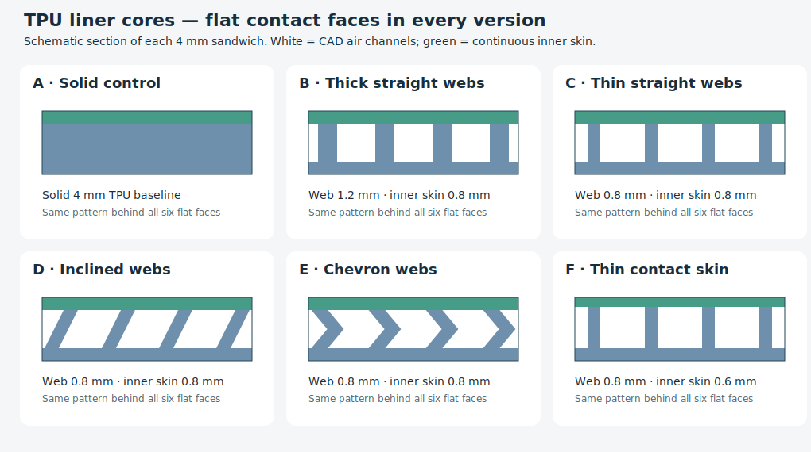
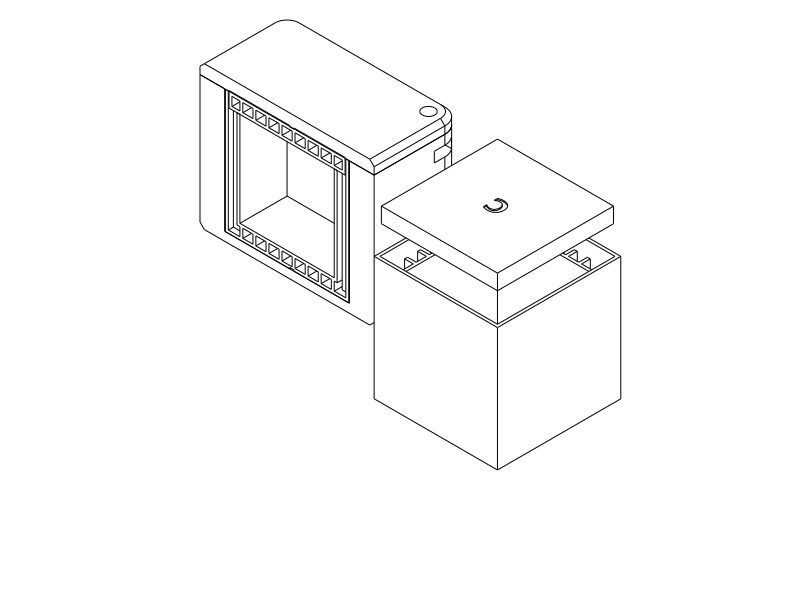

# Flat-faced TPU damping box experiment

One reusable PETG enclosure and six interchangeable TPU 95A cup/roof-pad pairs.
This is a **physical research batch**, with no measured noise ranking yet.
Every object-contact face is flat. CAD webs and air channels sit behind the flat
TPU skins on the floor, ceiling and all four walls.



## Files and use

| Print | Primary STEP | Matching STL | Parametric entry point |
| --- | --- | --- | --- |
| PETG body + lid, once | [tpu_damping_box.step](tpu_damping_box.step) | [tpu_damping_box.stl](tpu_damping_box.stl) | [tpu_damping_box.py](tpu_damping_box.py) |
| TPU batch, all six cup/pad pairs | [liners_batch.step](liners_batch.step) | [liners_batch.stl](liners_batch.stl) | [liners_batch.py](liners_batch.py) |

[design.py](design.py) owns all geometry and dimensions. Print layouts are already
on the bed: body/cups open upward, lid exterior down, pads backing/letter down.
Keep the component orientations and positions. If importing a compound, keep its
parts together on the plate; do not auto-orient them. GUI STEP import is untested;
Orca's headless review uses the matching STL.

The closed box is **48 × 48 × 39.6 mm**, excluding screw heads. Each liner provides
an identical **26 × 26 × 26 mm clear cavity** within a 4 mm nominal lining envelope.
The cup is 34 mm square × 34 mm tall; its upper pocket accepts a 32 mm square pad.
The TPU batch occupies about 118 × 158 mm before any print aids.

Use **two M3 × 12 mm screws and two M3 nuts** from the recorded stock for closure,
plus **one separate M6 nut** as the loose impact object. Head style/tool depends on
the actual stock screw; use its existing matching driver. M3 nut proxies assume
5.5 mm across flats × 2.4 mm thick; actual stock measurements are unreported.
The chamber fits a conservative 12 mm cube, which can translate 14 mm on each axis;
that is a clearance proxy, not a measured model of the user's M6 nut.

1. Slide the two M3 nuts horizontally into the external corner ports, one flat
   parallel to the slot. They seat beneath PETG roofs and stay outside the chamber.
2. Match the recessed **A–F** letters on the cup underside and pad backing. The
   identifiers are 6 mm high, 0.3 mm recessed, and add nothing to impact surfaces.
3. Insert the cup, place the same loose test nut inside, and lay the matching pad
   into the upper pocket with its letter facing upward toward the PETG lid.
4. Fit the lid and tighten both screws evenly, just enough to seat it. The body
   rim is the hard stop; an intentional 0.2 mm axial pad squeeze aims to suppress
   liner movement. Actual squeeze/effort and retention are unqualified.
5. Shake, then remove the screws/lid. Tip out the loose pad and nut, then flex/lift
   out the cup to change sets. The cup has 0.2 mm insertion allowance per side;
   retention comes from the closed housing, not an assumed friction fit.



## Variants and decisions

| ID | Hidden structure on all six faces | Comparison and open hypothesis |
| --- | --- | --- |
| A | Solid 4 mm TPU | Control: does any cellular structure help beyond thick TPU? |
| B | Straight 1.2 mm webs | Stiffer cellular reference; compare B/C to change web thickness. |
| C | Straight 0.8 mm webs | More compliant load paths are a candidate for reducing the impact pulse. |
| D | Inclined 0.8 mm webs, 1.2 mm lateral offset across the core | Adds a shear/bending route under compression; compare with C. |
| E | Chevron 0.8 mm webs, ±0.5 mm centreline offset | Tests a folded load path rather than a straight column. |
| F | C-like 0.8 mm webs with a 0.6 mm inner skin | Tests the effect of a less stiff contact membrane; core depth also grows 0.2 mm to preserve total thickness. |

All use 0.8 mm outer backing. B–E have 0.8 mm flat contact skins and 2.4 mm core
space; F has a 0.6 mm skin and 2.6 mm core. Web pitch is 3.6 mm; thickness means
shortest distance across the web, including inclined members. Cup skins meet at
continuous inner corners. The top-pad seam sits over TPU walls, away from the
PETG rim. Roof-pad perimeter frames and corner skin junctions are retained in
all versions. These unavoidable stiff paths may dominate some impacts.

Topology comparisons are not matched for mass, and folded/inclined webs change
member length and material amount. B/C is the cleanest thickness comparison.
F changes membrane thickness and compensating core depth together. Floor/pad
cores print horizontally while side cores print vertically; architecture and
FFF anisotropy are therefore not isolated by this simple shaking experiment.

A screw lid avoids relying on an unqualified PETG snap while shaking. The planar
rim seats/stops, screw bores guide alignment, and the nuts under pocket roofs
provide clamping. Omit the fasteners and the box still seats coherently but has
no designed closed retention. No hinge, printed driver, glue, infill lattice or
multi-material print is required. Source builders use named native assemblies;
short object-owned Boolean witnesses suffice for these straight insertion paths.

## Research

Research reviewed on 2026-10-15; these are original studies, not performance
claims for these small liners. The geometries here are independently authored
manufacturing adaptations, not copies of published specimens.

- [The Dynamic Impact Response of 3D-Printed Polymeric Sandwich Structures with Lattice Cores (2021)](https://pmc.ncbi.nlm.nih.gov/articles/PMC8622326/)
  combines TPU 95A sandwich experiments and numerical impact studies. Cell
  geometry and strut thickness influence deformation and transmitted acceleration;
  this motivates the B/C thickness comparison and a continuous face skin.
  Their much larger drop-impact specimens and printing process do not validate
  these 2.4 mm cores, bridge quality or audible nut rattling.
- [Dykstra et al., Buckling Metamaterials for Extreme Vibration Damping (2023)](https://doi.org/10.1002/adma.202301747)
  demonstrates nonlinear damping associated with buckling, including rubber and
  metal structures. This motivates challenging straight load paths with D/E.
  It does not establish that a light nut impact activates buckling in these
  short TPU webs, or that a softer structure necessarily makes a quieter box.
- [Chapa et al., Flexible Additively Manufactured Honeycombs Under Impact Loading (2026)](https://doi.org/10.1155/amse/1234886)
  experimentally compares TPU topologies and orientations at matched volume
  fraction. Peak force and absorbed energy do not rank all topologies the same.
  This supports comparing several architectures and recording direction; our
  unnormalised small specimens and subjective sound test answer a different question.

The experiment targets **impact transmission into the rigid shell**. It is not
an airborne acoustic absorber or a measurement of material loss factor. Softness,
energy absorption, rebound and perceived sound are different outcomes. Thin skins,
core deformation, trapped/venting air, skin tension, friction and corner load paths
may all matter. No air seal or calibrated TPU constitutive law is assumed.

Method choice: use exact CAD to establish geometry/coverage and a repeatable
physical shake comparison to select a useful candidate. An acoustic/impact FEM
ranking without measured rate-dependent TPU data, contact conditions and printed
skins would add unjustified precision; no numerical damping coefficients or
predicted decibel reductions are reported.

## Printing and manufacturing review

Intended printer: Qidi Q2C, **0.4 mm nozzle, 0.2 mm layers**. PETG: two walls and
7% adaptive cubic as the existing starting setup. TPU: **two walls and 100%
rectilinear fill**, with the filament itself solid wherever CAD contains material.
All channels remain actual CAD voids at any infill setting. Hold the TPU settings,
spool, drying and orientation constant across the batch.

Use the [TPU diagnostic process](profiles/tpu-solid-process.json) with the
[Generic TPU 95A filament snapshot](profiles/tpu95a.json) and the repository's
[Q2C printer profile](../../.codex/skills/orca-slicer-printability/profiles/qidi-q2c-petg/qidi-q2c-0.4-nozzle.json).
These are path-generation references, not spool calibration. Choose actual
nozzle/bed temperatures and bed preparation appropriate to the TPU and plate.
The checked generic profile resolves to 230°C nozzle, 30°C selected cool plate
(35°C hot-plate setting), flow ratio 1 and a 4 mm³/s filament limit. Nominal
wall/solid/fill speeds are capped at 25 mm/s and bridge/first-layer at 15 mm/s.
The diagnostic G-code estimates about **25 g / 1 hour PETG** and **99 g / 14 hours
37 minutes TPU for all six sets**. These are slicer estimates, not measured prints.

**Keep supports OFF for TPU.** Supports would become trapped in the closed
floor/pad cores and alter the experiment. The supplied process sets external and
internal bridge directions to **180°**, relative direction off, aligned to the
model: in the delivered orientation paths cross the Y-running webs along X.
Orca's automatic direction initially ran along the channels on E/F pads; the
explicit direction corrects that concrete failure. If rotating/rearranging
parts or changing slicer settings, inspect that first hidden roof layer again.
[Upstream bridge-angle documentation](https://github.com/OrcaSlicer/OrcaSlicer/wiki/strength_settings_advanced#bridge-infill-direction)
explains the 180° override for absolute zero angle.

Manufacturing rationale: wide flat backs give stable bed contact. Side skins
and their internal webs grow vertically from the base. Inclined/folded floor
webs move no more than 0.83 mm sideways per 1 mm rise. The flat floor/pad skins
close short channels: interior spans are up to 2.8 mm for straight thin webs;
the cup perimeter includes a 3.2 mm edge span. Normal minimum web size is 0.8 mm;
F's 0.6 mm contact skin is three nominal layers. No new unsupported rib islands
are needed. Short TPU bridge sag and layer bonding still require a print.

PETG body and lid have R4.5 plan corners and 1.2 mm bed-edge chamfers, avoiding
unsupported bottom fillets. Flat mating rims are intentional. Nut-slot roofs
bridge the 5.8 mm slot width between side walls. The automatic probe proposes
external trees near these ports; the primary print has no supports. These
short accessible slots can be reviewed/cleaned from outside before inserting
nuts; do not leave loose support fragments inside a test assembly.

## Verification and physical status

The product verification inventory protects the user intent across A–F. Each
variant's [native JSON receipt](notes/verification_A.json) (also B–F) reports CAD
PASS for fit, closure geometry, flat six-face skins, channel witnesses and labels.
Physical handling, print integrity/legibility and quietness remain UNKNOWN;
`unresolved_evidence` is expected. No test report claims measured damping.

The screw witness traverses the complete 12 mm body/lid joint. A review caught
an earlier witness ending at the mating plane, which could miss a misaligned lid
hole; the diagonal-preserving closed pose and full-length witness correct that gap.
The negative controls in [check_witnesses.py](check_witnesses.py) reject a shifted
cup, missing floor skin, missing ceiling skin, filled channels, a lid flipped onto
the wrong screw diagonal, and an unknown variant. The common verification CLI conformance suite passes 87 tests.
[PETG](notes/petg_final.json) and [TPU](notes/tpu_final.json) reports identify the
final paired exports, actual profiles, placements and OrcaSlicer 2.4.2. Both
layouts complete a slice with no keyword notices; both automatic probes generate
support, so their native status remains `review_required` rather than an
unqualified support-free printability claim.

[Headless path review](renders/path_review.png) locates the PETG probe supports
around external nut ports and the TPU supports inside the shallow hidden cores.
The primary toolpaths contain no supports. [review_paths.py](review_paths.py)
uses the shared Orca path reader to inspect the first hidden roof layers on all
ten structured floor/pad faces; paths must cross the webs. The saved
[path receipt](notes/path_review.json) records the checks. This establishes sliced
direction only, not printed flatness, sag, strength or intact channels.

Reproduce from the repository root, without a runtime deadline:

```sh
./evaluate_model.py model/tpu_damping_box/tpu_damping_box.py --views none --slice
./evaluate_model.py model/tpu_damping_box/liners_batch.py --views none --slice --slice-keep-run --slice-printer .codex/skills/orca-slicer-printability/profiles/qidi-q2c-petg/qidi-q2c-0.4-nozzle.json --slice-process model/tpu_damping_box/profiles/tpu-solid-process.json --slice-filament model/tpu_damping_box/profiles/tpu95a.json
./execute.py model/tpu_damping_box/verification.py --variant E
./execute.py model/tpu_damping_box/check_witnesses.py
```

The inspection-only [inspection.py](inspection.py) creates a half-section and
removed cup/pad view; do not print that scene. STEP/STL pairs use the same selected
geometry, millimetres, orientation and component positions. Successful STL slicing
does not qualify Orca's separate GUI STEP import or actual TPU bridging.

| Item | Print status | Artifact(s) | User result or remaining physical checks |
| --- | --- | --- | --- |
| Test piece(s) | Unknown | `tpu_damping_box.step/.stl`, `liners_batch.step/.stl` | No user print report. Check hardware fit, pad squeeze, extraction, skins/channels and directional sound ranking. |
| Final printable object(s) | N/A | None — research samples only | A reusable winning construction awaits physical comparison; no production liner selected. |

## Shake experiment and feedback

Use the same loose nut, shell, fasteners and grip for every trial. Start with an
empty closed box to detect fixture/liner rattles. Compare A–F in a shuffled order,
then repeat the order in reverse. Shake along X, Y and Z separately for roughly
ten similar strokes, then freely for a few seconds. Keep the stroke and cadence
similar. X/Y checks the four side skins; Z checks floor/pad; tumbling includes
corners. Recheck a suspected winner against A and C, preferably without looking
at the letter while listening. If recording, keep microphone position/gain and
background fixed; automatic phone gain is not a calibrated dB measurement.

Report the letter, axis, quieter/same/louder than A, sound character (sharp tick,
dull thud, squeak, empty-box rattle), easy/difficult liner swap and any bulging,
dented skin or seam contact. Repeat gentle and firmer shaking: a candidate may
only work above a deformation threshold or may bottom out. Stop the comparison
if screws loosen or a skin tears; those are failures, not a quietness result.

| ID | Printed / intact skins | Empty-box rattle | X / Y / Z vs A | Free shake / rebound | Fit / notes |
| --- | --- | --- | --- | --- | --- |
| A | Unknown | Unknown | Reference | Unknown | Unknown |
| B | Unknown | Unknown | Unknown | Unknown | Unknown |
| C | Unknown | Unknown | Unknown | Unknown | Unknown |
| D | Unknown | Unknown | Unknown | Unknown | Unknown |
| E | Unknown | Unknown | Unknown | Unknown | Unknown |
| F | Unknown | Unknown | Unknown | Unknown | Unknown |

If no structured version beats A, the flat skins/corner paths or insufficient
core deformation may dominate; that is not evidence that TPU structures never
help. If D/E help, retain the full assembly and print setup before adapting its
core elsewhere. If F alone helps, prioritise membrane compliance and durability
in the next experiment. Do not generalise a winner to heavier contents, different
impact speeds, TPU hardness or larger boxes without retesting.

## User intent

Source: the user's 2026-10-15 request and two clarifications. Build a small closable
PETG outer box for a loose stock nut, with separately printed, interchangeable,
permanently labelled TPU liners; use explicit CAD damping structures on all six
faces; print variants together. The user subsequently specified **flat object-contact
faces with structures inside the liner**, and explicitly requested research on
effective damping structures, allowing a few more batch variants. Dimensions,
hardware closure, core topologies and print setup above are agent decisions,
not user-specified numerical acceptance limits. This new research object does
not resume the discontinued swatch-box TPU project.

## Attribution

Primary model: GPT-6.1, reasoning effort medium, **as supplied by the user**;
exact runtime model identifier and configured effort are not independently exposed.
Harness: Codex shared-workspace CLI/API agent, GPT-6 family; provider: OpenAI.
No subagents. Independently authored CadQuery geometry and core-section drawing;
research citations inform hypotheses only. Orca/Qidi profile snapshots have
separate [AGPL-3.0 attribution](profiles/ATTRIBUTION.md). No published specimen
meshes or figures were copied. Research/model date: 2026-10-15.
