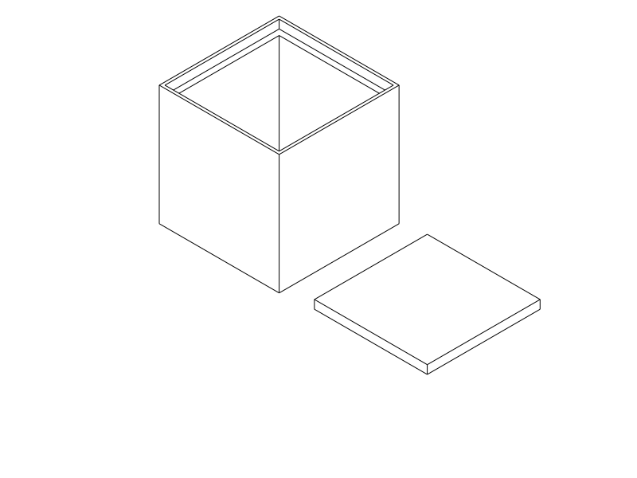
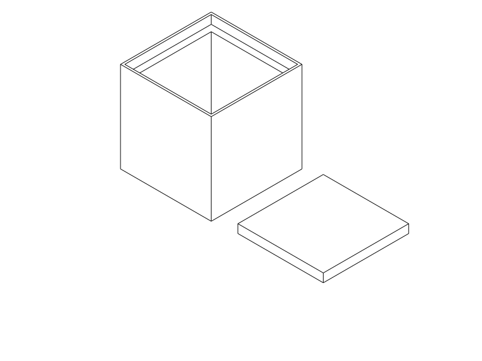

# G08 and G16: larger-air-gap cup comparison

**Comparison printed and reported:** G16 gives a meaningful, modest damping improvement over L20; G08's difference feels less meaningful. The user still considers **updated L20 sufficient for most uses** and selects it for the dental liner. Damping preference depends on the application. No repeat comparison print is requested.

The files below remain available for identification or applications needing a larger gap. Each contains one cup and its matching lid pad. The selected gap is consistent through walls, floor and pad; skins remain 0.8 mm. The [updated L20 dental liner](../../dental_travel_case_liner/notes/uniform_l20.md) remains the selected application.

| Model / engraved ID | Skin / air / skin | Total panel thickness | Closed clear chamber | Print files |
| --- | --- | --- | --- | --- |
| **G08** | 0.8 / **0.8** / 0.8 mm | **2.4 mm** | **29.2 mm cube** | [STEP](../gap_G08.step) · [STL](../gap_G08.stl) · [Python](../gap_G08.py) |
| **G16** | 0.8 / **1.6** / 0.8 mm | **3.2 mm** | **27.6 mm cube** | [STEP](../gap_G16.step) · [STL](../gap_G16.stl) · [Python](../gap_G16.py) |

Both cups keep the **34 × 34 × 34 mm exterior**, existing insertion fit and 32 mm-square pad footprint. Each pad's thickness matches its model, so it contacts both the cup seat and the existing rigid lid without additional preload. Print **both matching soft parts for each comparison**; a 2 mm L20 pad will not give the same six-face construction. Reuse the rigid enclosure and existing hardware. Two files, four soft parts total, no new rigid parts.

## User direction

The user requests larger-gap variants **only for the TPU experiment cup**, explicitly keeping the dental liner as it is. They initially consider 0.8/1.2 mm, then choose **0.8 and 1.6 mm**, skipping 1.2 mm, to explore whether the gap makes a perceptible physical difference. This is an explicit experimental exception to the selected L20 gap, not a replacement standard. The prior requirement for consistent wall/floor construction is retained within each model.

## Physical comparison and application selection

The user reports printing **both G08 and G16**. G16 feels meaningfully different from L20 and slightly better in real damping. G08's difference feels less meaningful. Despite noticing G16's benefit, the user judges L20 sufficient for the majority of use cases, emphasizes that damping depends on the application, and requests the dental liner use **updated L20**, explicitly excluding the old thin-floor version with visible surface defects.

This is subjective physical comparison, not a measured attenuation or universal ranking. Exact printed hashes/revisions, spool and slicer settings, matching-pad use and the baseline L20 print identity are unreported. No new floor-finish, internal-gap or durability conclusion is inferred. The dental sources and paired exports already implement the updated 0.8/0.4/0.8 section, so application selection needs no geometry change. [Current dental print files and limits](../../dental_travel_case_liner/notes/uniform_l20.md).

## What stays constant and what necessarily changes

Skins remain 0.8 mm; floor-post and wall-tie footprints remain 0.8 × 0.8 mm on 4.4 mm pitch, with 4 mm solid lands, solid ID seats and the same rim closure. G08/G16 IDs are recessed only into solid corner seats, not working sandwich skins. The [parametric comparison source](../gap_comparison_design.py) uses the selected L20 skin/tie/grid constants without editing its standard implementation.

Larger gaps make panels thicker, reduce cavity dimensions, lengthen cross-gap ties/posts, and change the matching pad depth. The tie rows remain on 4.4 mm pitch, repositioned within the available height. Consequently a nut's available travel also changes: this is a practical comparison in the same outer box, not a measurement isolating the air gap from every other physical variable. Lateral floor-roof spans between posts are not shortened by increasing the gap height.

## Printing and comparison

Use the unchanged [shared L20 process](../profiles/l20-uniform-process.json), [TPU 95A filament](../profiles/tpu95a.json) and [Q2C 0.4 mm printer](../../../.codex/skills/orca-slicer-printability/profiles/qidi-q2c-petg/qidi-q2c-0.4-nozzle.json). Keep supplied orientation, 100% scale and placement: cup at (60,60), pad at (102,60). Both are broad backing-down parts; the cup opening faces up.

**0.4 mm nozzle, 0.2 mm layers, Classic, thin-wall detection off, two walls, 100% rectilinear modeled-material fill, four top/bottom layers, supports off, 9 mm³/s maximum flow.** The existing 50% / 30 mm/s / 0.15 mm ironing recipe is unchanged for both. Keep the same spool and actual printer settings between comparisons. One file can be printed after the other; each layout is reviewed separately.

Four ordinary layers make each horizontal skin. G08's core has four layer heights; G16's has eight. The first contact-skin paths are at Z 1.8 mm and Z 2.6 mm respectively. Floor roofs still bridge; longer cross-gap ties may also print differently. A successful slice does not establish clean physical roofs or open printed gaps. Do not add trapped internal supports merely to make the probe signal disappear.

Inspect completed floor skins and wall ties, fit each marked cup with its own marked pad, then use the same enclosure, same loose nut and similar shaking. Compare squeeze feel, impact sound and visible print defects. If a core has fused or a skin has torn, record that separately from damping. The existing uniform L20 can remain a 0.4 mm baseline if available; no new baseline print is required by this delivery.

## Verification, limits and print status

G08: [CAD](gap_comparison/G08/cad.json) · [native export/slice](gap_comparison/G08/native.json) · [actual paths](gap_comparison/G08/paths.json) · [publication](gap_comparison/G08/publication.json) · [verification](gap_comparison/G08/verification.json).

G16: [CAD](gap_comparison/G16/cad.json) · [native export/slice](gap_comparison/G16/native.json) · [actual paths](gap_comparison/G16/paths.json) · [publication](gap_comparison/G16/publication.json) · [verification](gap_comparison/G16/verification.json).

Both CAD layouts and paired exports are valid. OrcaSlicer 2.4.2 completes both primary support-off slices without notices. The forced probe proposes 687 interface segments at Z 1.4 mm for G08 and 17,236 support/interface segments at Z 1.2–2.2 mm for G16, all within the enclosed floor-core footprints. There is no higher wall-tie support signal. These enclosed cores remain unsupported in the actual print; their roof finish is a physical experiment. Twenty-six local skin/core path sections per variant pass the selected-profile review.

Actual material/air witnesses cover four walls, floor, pad and posts. Rigid insertion/withdrawal, lid clearance, actual pad contact with both seat and lid, downward seating-stop obstruction, nominal contents space and empty ID strokes are checked. Native STEP/STL pairs use the same selected geometry and placement; matching STL slices use the supplied TPU profiles. Local path inspection addresses the fixed skins and wider open cores; any forced support proposal is reviewed separately. These checks do not measure physical stiffness, sag, bonding, printed gap openness, noise attenuation or durability. GUI STEP import is separate from the STL slice.

| Item | Print status | Artifact / remaining observation |
| --- | --- | --- |
| G08 cup; matching-pad use unreported | **Yes — printed and compared** | `gap_G08.py` / `.step` / `.stl`; less meaningful damping difference from L20. Exact printed hash/settings unknown. |
| G16 cup; matching-pad use unreported | **Yes — printed and compared** | `gap_G16.py` / `.step` / `.stl`; perceptible, modest damping benefit over L20. Application-dependent. |
| L20 baseline reference | **User judges sufficient for most uses** | Updated L20 selected going forward; exact baseline print identity and revised floor finish unconfirmed. |
| Updated L20 dental liner | **Selected — application print unknown** | Existing uniform 0.8/0.4/0.8 sources/exports already implement the requested recipe. |

## Engineering notes and attribution

These are exploratory variants, not adoption of a larger standard gap. Common skin/tie constants and the supplied profiles stay unchanged; variant selection is explicit and unknown IDs fail. The baseline publication association has a reviewed router-only hash refresh after adding G08/G16 CLI choices; its geometry, profile and exports are unchanged. No solver or additional material purchase is needed to explore the user's question. Both modes are exposed through the shared product-verification CLI, keeping the digital receipts separate from the later subjective physical comparison above.

Primary language model: GPT-6 family; exact identifier and reasoning effort not exposed. Harness: Codex shared-workspace coding agent, OpenAI. No subagents. User selects the 0.8/1.6 mm experiment and explicitly excludes dental changes. Prior source and profile attribution remains intact.
