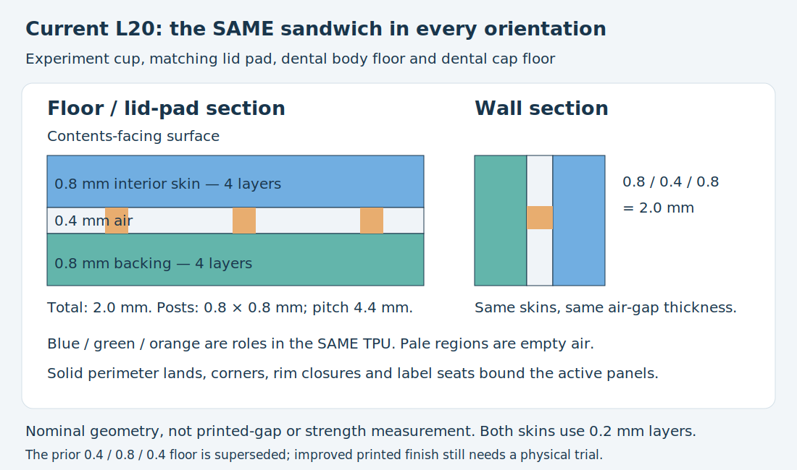

# Current L20 standard: one section in every orientation

**Use 0.8 mm skin / 0.4 mm air / 0.8 mm skin, totaling 2.0 mm**, in all active flat walls, floors and lid pads. The selected standard now has one [shared implementation](../l20_standard.py); there is no separate thinner floor recipe. This corrects a design inconsistency. Improved physical floor quality remains to be tested.

Print the revised [experiment cup + matching lid pad STEP](../uniform_l20.step) / [STL](../uniform_l20.stl) / [Python](../uniform_l20.py). Reuse the existing rigid test enclosure and its hardware. Print **both** soft parts: an older T08/L20 pad retains the superseded floor construction. The matching [dental liner](../../dental_travel_case_liner/notes/uniform_l20.md) uses the same source dimensions and enclosed-floor builder.

[Editable standard SVG](../renders/print/uniform_l20/profile.svg).

## User direction

After reporting a canceled dental liner print with broken/cracking contents-facing floor surface and okay early wall regions, the user questioned why floors used thinner skins and a larger gap than walls. There was no demonstrated engineering reason: the old 0.4/0.8/0.4 horizontal construction had been carried forward while walls improved. The user explicitly requires the standard, TPU experiment and dental liner to use the **same sandwich in walls and bottoms**, and authorizes updating both models and the reusable standard.

The earlier L20 wall/damping preference remains valid for its tested print. It does not qualify this changed floor or the revised pad. [Original physical comparison and later floor clarification](thin_gap/README.md). The [prior SVG investigation](../../dental_travel_case_liner/notes/floor_surface_review.md) is historical; the uniform section here is the selected implementation, rather than its earlier alternative proposals.

## Construction and printing

| Feature | Current shared recipe |
| --- | --- |
| All active flat panel skins | **0.8 mm on each side** |
| All active flat panel air gaps | **0.4 mm**, measured normal to the panel |
| Total sandwich | **2.0 mm**, including horizontal floors/pad |
| Discrete ties / floor posts | 0.8 × 0.8 mm footprint on a 4.4 mm grid |
| Floor perimeter and wall-end lands | 4 mm solid boundaries |
| Experiment cup | 34 × 34 × 34 mm; main lined chamber 30 × 30 × 30 mm when closed |
| Matching pad | 32 × 32 × 2 mm; nests in the upper cup seat |

Solid corners, perimeter lands, rim closures, installation transitions and local solid ID seats are boundaries of the active sandwich, not alternative thinner skin recipes. L20 markings remain recessed only in solid corner seats; no working air-panel skin is thinned for lettering. The cup/pad's old additional 0.2 mm pad-preload layer is removed so its nominal panel is also exactly 0.8/0.4/0.8. The rigid fixture and stock fasteners are unchanged. Existing pad holding/compression feel is not assumed for the revision.

Use the [shared Classic process](../profiles/l20-uniform-process.json), [TPU 95A filament](../profiles/tpu95a.json), and [Q2C 0.4 mm printer](../../../.codex/skills/orca-slicer-printability/profiles/qidi-q2c-petg/qidi-q2c-0.4-nozzle.json). Supplied placement has the cup and pad backing down at (60,60) and (102,60), respectively. Keep orientation, 100% scale, no support and no brim unless physical adhesion needs it. The broad closed backing gives bed contact.

**0.4 mm nozzle, 0.2 mm normal/first layers, Classic, thin-wall detection off, two walls, 100% rectilinear modeled-material fill, supports off, 9 mm³/s maximum flow.** Four top and four bottom layers match the 0.8 mm skins. The shared profile retains the dental starting ironing recipe, **50% / 30 mm/s / 0.15 mm spacing**. It does not establish that ironing caused or solves the previous defects. Both current models use this same preset. Profile attribution and AGPL licensing remain in [the profile record](../profiles/ATTRIBUTION.md).

At horizontal floors, backing paths occur at Z 0.2/0.4/0.6/0.8 mm, posts at 1.0/1.2 mm, and contact skin at 1.4/1.6/1.8/2.0 mm. The first roof still bridges; a smaller vertical air gap does not shorten lateral spans between posts. Four-layer skins address the selected inconsistency without promising sag-free TPU. Do not add inaccessible support inside the air core.

## Verification, limits and print status

Both current native layouts are valid, export paired STEP/STL successfully, and complete OrcaSlicer 2.4.2 slicing with the supplied TPU profile, no notices and **no automatic-support generation**. Actual local paths retain four-layer floor skins and the 0.4 mm core. This is digital evidence; the revised floor has no physical print report.

[CAD witnesses and fixture paths](uniform_l20/cad.json) inspect actual material/air in all four walls, floor and pad, confirm the 30 mm clear chamber and existing shell insertion/closure, pad contact with its cup seat and rigid lid, downward seating-stop obstruction, and include an old-floor negative control: at a point between posts, Z 0.6 mm is air in the old floor but backing material in the new one. [Native export/slice](uniform_l20/native.json), [local floor/wall paths](uniform_l20/paths.json), [publication association](uniform_l20/publication.json) and [product verification](uniform_l20/verification.json) identify the current files and selected setup. Historical geometry and native receipts are retained; their print approval is not transferred to the new floor.

The bed-facing skins have four ordinary layers; the 0.4 mm void has two layer heights; upper skins have four layers. Upright surfaces continue to stack on earlier layers. Broad bed contact, nominal skin/core/tie dimensions and the floor's enclosed bridge are reviewed. Any automatic-support signal is inspected separately from the primary support-off setup. Selected-profile path acceptance does not measure sag, bonding, gap closure, quietness, fit effort or durability. STEP is the primary interchange; the matching STL slice does not qualify separate GUI STEP import.

| Item | Print status | Artifacts / remaining observation |
| --- | --- | --- |
| Earlier L20/T08 experiments | **Yes — walls/damping preferred; floor fragile** | Historical `thin_gap_L20` / `t_skin_T08_m1`; do not repeat as the corrected standard |
| Uniform L20 experiment pair | **Unknown — no print report** | `uniform_l20.py` / `.step` / `.stl`; inspect roof continuity, skin integrity, pad seating and damping |
| Final application | **N/A in this experiment object** | Revised dental application has its own record and print status |

## Engineering ownership and attribution

The failure came from independently retaining a legacy horizontal recipe. Current dimension aliases and the shared floor-core builder are consumed by both the experiment and dental application. Future L20 adaptations must import the standard rather than copy historical floor constants. Old T08/L18/L20 sources are historical comparisons, not a current template. Another profile needs an explicit user decision, not a silent orientation-specific substitution.

Primary language model: GPT-6 family; exact identifier and reasoning effort not exposed. Harness: Codex shared-workspace coding agent. Provider: OpenAI. No subagents. User selected orientation consistency and supplied the physical print reports. Geometry retains the repository license; derived profile JSON retains AGPL-3.0 attribution.

The later [G08/G16 gap comparison](gap_comparison.md) explores 0.8 and 1.6 mm cores only in the test fixture. It is an explicitly requested experiment, not a change to this selected standard or its dental application.
